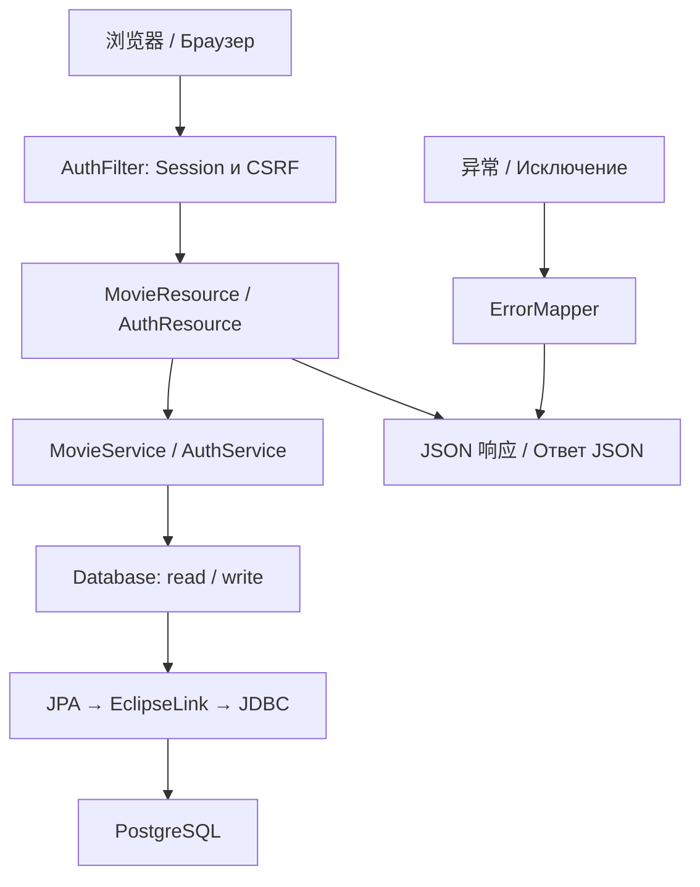
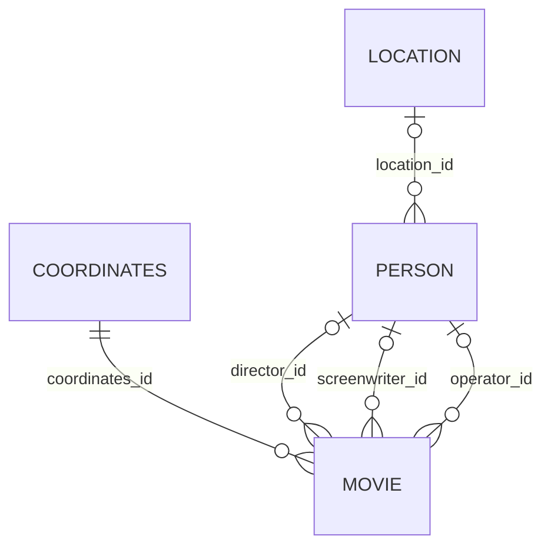

# 项目结构与后端逐方法答辩详解（中俄）
# Структура проекта и подробный разбор серверной части

版本日期 / Дата: **2026-10-14**。对象 / Проект: **实验 № 1，变体 4101，movie-lab**。

本文面向“有 Java 基础、尚未系统学习后端框架”的学习者。中文负责把逻辑讲透，俄语提供术语和可直接口述的解释。方法章节同时给出参数、返回值、代码块解释和当前源码节选。

Материал рассчитан на студента, который знает Java, но ещё изучает серверные технологии. Китайский текст объясняет логику, русский текст помогает отвечать на защите. Для методов разобраны параметры, результат, блоки кода и реальные фрагменты исходников.

覆盖范围：逐文件覆盖 movie-lab 中维护的源码、配置、脚本与测试；后端生产 Java 的每个手写方法、构造器及自定义注解成员均单独解释。测试方法另列附录；生成目录和第三方依赖按类别说明。前端说明文件职责与请求衔接，答辩提问聚焦后端。

Область: все поддерживаемые файлы приложения; каждый явно объявленный метод и конструктор серверного Java-кода, а также элементы пользовательской аннотации. Тесты рассмотрены отдельно. Сгенерированные файлы и библиотеки объясняются по категориям. Вопросы для защиты посвящены серверной части.

源码链接是当前电脑的绝对路径，行号以本次文档生成时的源码为准。未把潜在改进写成已实现功能；这次只编写文档，不更改代码或服务器数据。

Ссылки ведут к локальным исходникам. Номера строк относятся к этой версии. Возможные улучшения не выдаются за реализованные функции; подготовка документа не меняет приложение и данные сервера.

## 目录 / Содержание

- [阅读路线 / Как читать](#section-1)
- [1. 系统主线 / Общая схема](#section-2)
- [2. 项目目录与逐文件说明 / Каталог файлов](#section-3)
- [3. 注解总表：谁读取它、何时生效 / Все аннотации](#section-4)
- [4. 实体与数据库关系 / Сущности и связи](#section-5)
- [5. Database：资源与事务 / Ресурсы и транзакции](#section-6)
- [6. MovieService：逐方法业务逻辑 / Бизнес-логика по методам](#section-7)
- [7. AuthService：账号与密码 / Аккаунты и пароли](#section-8)
- [8. REST 入口与会话 / REST и HTTP-сессия](#section-9)
- [9. 异常与错误响应 / Исключения и ответы об ошибках](#section-10)
- [10. 生命周期、序列化与日期 / Жизненный цикл и преобразования](#section-11)
- [11. 自定义票房校验 / Пользовательская проверка сборов](#section-12)
- [12. 配置、数据库与脚本如何配合 / Конфигурации, БД и скрипты](#section-13)
- [13. Java 测试逐方法 / Методы тестов](#section-14)
- [14. 把方法串起来：完整请求 / Полный путь запроса](#section-15)
- [15. 俄语答辩问答 / Вопросы и ответы для защиты](#section-16)
- [16. 不能混淆的实现边界 / Границы и неоднозначности](#section-17)
- [17. 演示与复习顺序 / Порядок показа и повторения](#section-18)
- [18. 方法导航与源码核对 / Указатель методов и сверка](#section-19)

<a id="section-1"></a>

## 阅读路线 / Как читать

1. 先读项目地图与注解速查，知道每层解决什么问题。 / Сначала изучите структуру и назначение аннотаций.
2. 然后按 `AuthFilter → MovieResource → MovieService → Database → PostgreSQL` 追踪一次请求。 / Проследите один запрос через все уровни.
3. 重点精读 `Database.write()`、`MovieService.save()`、`page()`、`delete()` 和五项特殊操作。 / Подробно разберите транзакции, сохранение, выборку, удаление и специальные операции.
4. 最后用俄语自检题复述，答案必须能指向具体源码。 / Отвечайте по-русски и показывайте соответствующий код.

这里的“参数缺省”分两类：普通 Java 方法调用必须传齐参数；HTTP 参数是否可省略取决于 `@DefaultValue`、Java 类型和业务检查。不要把 Java 编译规则与 HTTP 缺参规则混在一起。

Обычный вызов Java требует все аргументы. Для HTTP отсутствие параметра обрабатывается по правилам JAX-RS, значениям `@DefaultValue` и проверкам сервиса.

<a id="section-2"></a>

## 1. 系统主线 / Общая схема

一句话：浏览器发送请求，过滤器检查登录与 CSRF，REST 方法解析参数，业务服务执行规则，事务组件管理 EntityManager，EclipseLink 把实体操作转换成 SQL，PostgreSQL 保存并约束数据。

Браузер отправляет запрос; фильтр проверяет сессию и CSRF; REST-ресурс принимает параметры; сервис выполняет правила; компонент Database управляет EntityManager и транзакцией; EclipseLink обращается к PostgreSQL.



过滤器在资源方法执行之前运行；JAX-RS 通常已经匹配了资源路由。HTTP 请求不是直接调用数据库。CDI 负责对象的创建和注入，JPA 负责持久化规范，EclipseLink 是 JPA 实现，Payara 提供运行容器。

Фильтр работает до вызова ресурсного метода, обычно после сопоставления маршрута. CDI управляет компонентами; JPA задаёт контракт работы с сущностями; EclipseLink реализует этот контракт; Payara запускает приложение.

<a id="section-3"></a>

## 2. 项目目录与逐文件说明 / Каталог файлов

```text
Lab1/
├── Lab1.md / Lab1_cn.md          原题与中文对照
├── movie-lab/                   实际应用工程
│   ├── src/main/java/ru/itmo/movie/
│   │   ├── domain/              实体、枚举、转换器、校验
│   │   ├── persistence/         EntityManager 与事务
│   │   ├── service/             业务与认证
│   │   └── web/                 REST、过滤器、异常映射
│   ├── src/main/resources/      JPA 配置
│   ├── src/main/webapp/         页面与 WEB-INF 配置
│   ├── src/test/java/           Java 测试
│   ├── database/                DDL 与迁移
│   ├── scripts/                 运行、数据生成和测试工具
│   ├── target/                  Maven 生成产物
│   └── .runtime/                本地运行、临时工具和日志
├── manual-test-data/            最新样例 ID、快照、预期结果
├── deployment/                  Helios 部署及验收记录
├── report/                      俄语 LaTeX 报告
├── learning/                    学习文档，本文件所在位置
├── verification/                本地历史验证证据
└── tools/                       本地构建、数据库和排版工具
```

| 文件 / Файл | 作用 / Назначение |
| --- | --- |
| [.dockerignore](<C:/develop/NOTE_UTP/StudyNote/5 Information Systems/Lab/Lab1/movie-lab/.dockerignore>) | 控制 Docker 构建上下文，排除生成目录等无关内容<br>Исключает лишние файлы из контекста сборки Docker |
| [.gitignore](<C:/develop/NOTE_UTP/StudyNote/5 Information Systems/Lab/Lab1/movie-lab/.gitignore>) | 排除 target、.runtime 和日志，避免把产物与运行数据当源码提交<br>Исключает сборку, служебные данные и журналы из Git |
| [compose.yaml](<C:/develop/NOTE_UTP/StudyNote/5 Information Systems/Lab/Lab1/movie-lab/compose.yaml>) | 组织 PostgreSQL 与应用两个容器、持久卷、健康检查和环境变量<br>Описывает PostgreSQL и приложение, том данных, проверку готовности и переменные |
| [database/migrations/001_accounts.sql](<C:/develop/NOTE_UTP/StudyNote/5 Information Systems/Lab/Lab1/movie-lab/database/migrations/001_accounts.sql>) | 为已有安装增加账号表，IF NOT EXISTS 允许重复执行<br>Добавляет таблицу аккаунтов в существующую установку |
| [database/migrations/002_box_office.sql](<C:/develop/NOTE_UTP/StudyNote/5 Information Systems/Lab/Lab1/movie-lab/database/migrations/002_box_office.sql>) | 为已有电影表增加美国票房不超过总票房的约束；不静默改旧数据<br>Добавляет межполевое ограничение сборов и не исправляет старые записи автоматически |
| [database/schema.sql](<C:/develop/NOTE_UTP/StudyNote/5 Information Systems/Lab/Lab1/movie-lab/database/schema.sql>) | 新数据库的六张表、identity、CHECK、UNIQUE、外键、索引及初始 revision 行<br>DDL шести таблиц, identity, ограничения, индексы и начальная строка ревизии |
| [Dockerfile](<C:/develop/NOTE_UTP/StudyNote/5 Information Systems/Lab/Lab1/movie-lab/Dockerfile>) | 先用 Maven 构建 WAR，再把 WAR 放进 Payara 镜像；构建步骤跳过测试<br>Многоэтапная сборка WAR и образа Payara; этот путь сборки пропускает тесты |
| [pom.xml](<C:/develop/NOTE_UTP/StudyNote/5 Information Systems/Lab/Lab1/movie-lab/pom.xml>) | Maven 工程、Java 17 编译目标、WAR 打包、依赖及测试插件<br>Настройки Maven, целевая Java 17, WAR, зависимости и тестовые плагины |
| [README.md](<C:/develop/NOTE_UTP/StudyNote/5 Information Systems/Lab/Lab1/movie-lab/README.md>) | 项目启动、约束、部署和测试说明；其中历史验收日期是记录而非本次重跑<br>Инструкция по запуску, правилам и проверкам; даты старых проверок являются историей |
| [scripts/auth-browser-test.cjs](<C:/develop/NOTE_UTP/StudyNote/5 Information Systems/Lab/Lab1/movie-lab/scripts/auth-browser-test.cjs>) | 注册、重复账号、会话和重启后账号持久化的历史浏览器脚本；部分定位仍对应旧提示区域<br>Исторический браузерный сценарий регистрации; некоторые локаторы относятся к старому интерфейсу |
| [scripts/browser-test.cjs](<C:/develop/NOTE_UTP/StudyNote/5 Information Systems/Lab/Lab1/movie-lab/scripts/browser-test.cjs>) | 两个独立浏览器上下文验证 CRUD 同步、冲突、详情、CSRF 和部分特殊操作<br>Проверяет работу приложения через два независимых контекста браузера |
| [scripts/deploy-frontend.py](<C:/develop/NOTE_UTP/StudyNote/5 Information Systems/Lab/Lab1/movie-lab/scripts/deploy-frontend.py>) | 只替换 WAR 中的前端文件；不能发布 Java 或数据库约束变更<br>Обновляет только статические файлы WAR, но не Java-классы и не схему БД |
| [scripts/helios.py](<C:/develop/NOTE_UTP/StudyNote/5 Information Systems/Lab/Lab1/movie-lab/scripts/helios.py>) | 学校服务器的 test/init/migrate/start/stop/status；从服务器 pgpass 读取数据库凭据<br>Команды управления развёртыванием Helios; пароль БД читается из pgpass |
| [scripts/maven-settings.xml](<C:/develop/NOTE_UTP/StudyNote/5 Information Systems/Lab/Lab1/movie-lab/scripts/maven-settings.xml>) | 为 Maven 指定仓库镜像，属于构建配置<br>Настройки зеркала репозитория Maven |
| [scripts/preview-ui.py](<C:/develop/NOTE_UTP/StudyNote/5 Information Systems/Lab/Lab1/movie-lab/scripts/preview-ui.py>) | 只监听本地的静态前端预览，并把 API 转发到已有 SSH 隧道<br>Локальный просмотр интерфейса с проксированием API |
| [scripts/seed-demo.py](<C:/develop/NOTE_UTP/StudyNote/5 Information Systems/Lab/Lab1/movie-lab/scripts/seed-demo.py>) | 通过正常认证 API 生成 72 个样例、清单、预期结果和测试指南；自身不清库<br>Создаёт 72 объекта через API и формирует описание; сам не очищает БД |
| [scripts/start-local.ps1](<C:/develop/NOTE_UTP/StudyNote/5 Information Systems/Lab/Lab1/movie-lab/scripts/start-local.ps1>) | Windows 本地 PostgreSQL 初始化、迁移、测试、构建和 Payara 启动<br>Локальная подготовка PostgreSQL, миграции, тесты и запуск Payara в Windows |
| [scripts/validation-test.cjs](<C:/develop/NOTE_UTP/StudyNote/5 Information Systems/Lab/Lab1/movie-lab/scripts/validation-test.cjs>) | 在 Node 中检查纯字段规则；不等于后端或真实浏览器验收<br>Проверяет чистые правила полей в Node; не заменяет серверные и браузерные тесты |
| [src/main/java/ru/itmo/movie/domain/AppState.java](<C:/develop/NOTE_UTP/StudyNote/5 Information Systems/Lab/Lab1/movie-lab/src/main/java/ru/itmo/movie/domain/AppState.java>) | 单行全局 revision，同时作为写事务的锁定目标<br>Одна строка ревизии и объект блокировки записей |
| [src/main/java/ru/itmo/movie/domain/AppUser.java](<C:/develop/NOTE_UTP/StudyNote/5 Information Systems/Lab/Lab1/movie-lab/src/main/java/ru/itmo/movie/domain/AppUser.java>) | 持久账号、密码哈希、盐和迭代次数，不通过 REST 返回实体<br>Аккаунт, хеш, соль и число итераций; сущность не возвращается клиенту |
| [src/main/java/ru/itmo/movie/domain/Color.java](<C:/develop/NOTE_UTP/StudyNote/5 Information Systems/Lab/Lab1/movie-lab/src/main/java/ru/itmo/movie/domain/Color.java>) | 眼睛和头发共用的颜色枚举<br>Цвета глаз и волос |
| [src/main/java/ru/itmo/movie/domain/Coordinates.java](<C:/develop/NOTE_UTP/StudyNote/5 Information Systems/Lab/Lab1/movie-lab/src/main/java/ru/itmo/movie/domain/Coordinates.java>) | 电影所用整数坐标；X 上限为 826<br>Целочисленные координаты фильма, X не больше 826 |
| [src/main/java/ru/itmo/movie/domain/Country.java](<C:/develop/NOTE_UTP/StudyNote/5 Information Systems/Lab/Lab1/movie-lab/src/main/java/ru/itmo/movie/domain/Country.java>) | 原题提供但当前字段没有引用的枚举<br>Перечисление из задания, не используемое полями модели |
| [src/main/java/ru/itmo/movie/domain/Location.java](<C:/develop/NOTE_UTP/StudyNote/5 Information Systems/Lab/Lab1/movie-lab/src/main/java/ru/itmo/movie/domain/Location.java>) | 人物地点；X 为 Long，Y 为 Double<br>Место человека: X типа Long, Y типа Double |
| [src/main/java/ru/itmo/movie/domain/LongJsonSerializer.java](<C:/develop/NOTE_UTP/StudyNote/5 Information Systems/Lab/Lab1/movie-lab/src/main/java/ru/itmo/movie/domain/LongJsonSerializer.java>) | 把标记过的 Long 字段输出为十进制 JSON 字符串<br>Выводит помеченные Long как десятичные строки JSON |
| [src/main/java/ru/itmo/movie/domain/Movie.java](<C:/develop/NOTE_UTP/StudyNote/5 Information Systems/Lab/Lab1/movie-lab/src/main/java/ru/itmo/movie/domain/Movie.java>) | 电影实体及字段约束，包含版本和新票房关系约束<br>Сущность фильма, ограничения, версия и связь сборов |
| [src/main/java/ru/itmo/movie/domain/MovieGenre.java](<C:/develop/NOTE_UTP/StudyNote/5 Information Systems/Lab/Lab1/movie-lab/src/main/java/ru/itmo/movie/domain/MovieGenre.java>) | 四个电影类型枚举值<br>Четыре допустимых жанра |
| [src/main/java/ru/itmo/movie/domain/MpaaRating.java](<C:/develop/NOTE_UTP/StudyNote/5 Information Systems/Lab/Lab1/movie-lab/src/main/java/ru/itmo/movie/domain/MpaaRating.java>) | 五个 MPAA 分级枚举值<br>Пять рейтингов MPAA |
| [src/main/java/ru/itmo/movie/domain/Person.java](<C:/develop/NOTE_UTP/StudyNote/5 Information Systems/Lab/Lab1/movie-lab/src/main/java/ru/itmo/movie/domain/Person.java>) | 电影参与者、生日、护照唯一性及可选地点<br>Участник фильма, дата рождения, уникальный паспорт и место |
| [src/main/java/ru/itmo/movie/domain/validation/BoxOfficeValidator.java](<C:/develop/NOTE_UTP/StudyNote/5 Information Systems/Lab/Lab1/movie-lab/src/main/java/ru/itmo/movie/domain/validation/BoxOfficeValidator.java>) | 执行票房比较并把错误定位到 usaBoxOffice<br>Сравнивает сборы и связывает ошибку с usaBoxOffice |
| [src/main/java/ru/itmo/movie/domain/validation/ConsistentBoxOffice.java](<C:/develop/NOTE_UTP/StudyNote/5 Information Systems/Lab/Lab1/movie-lab/src/main/java/ru/itmo/movie/domain/validation/ConsistentBoxOffice.java>) | 定义类级别票房关系校验注解<br>Объявляет межполевое ограничение сборов |
| [src/main/java/ru/itmo/movie/domain/ZonedTimeConverter.java](<C:/develop/NOTE_UTP/StudyNote/5 Information Systems/Lab/Lab1/movie-lab/src/main/java/ru/itmo/movie/domain/ZonedTimeConverter.java>) | 在 ZonedDateTime 与数据库文本之间转换<br>Преобразует ZonedDateTime в текст БД и обратно |
| [src/main/java/ru/itmo/movie/persistence/Database.java](<C:/develop/NOTE_UTP/StudyNote/5 Information Systems/Lab/Lab1/movie-lab/src/main/java/ru/itmo/movie/persistence/Database.java>) | 创建工厂、每次创建 EntityManager、管理事务与全局写锁<br>Управляет EntityManagerFactory, контекстами, транзакциями и общей блокировкой |
| [src/main/java/ru/itmo/movie/service/AuthService.java](<C:/develop/NOTE_UTP/StudyNote/5 Information Systems/Lab/Lab1/movie-lab/src/main/java/ru/itmo/movie/service/AuthService.java>) | 账号校验、PBKDF2 哈希、注册和密码认证<br>Проверка аккаунтов, PBKDF2, регистрация и аутентификация |
| [src/main/java/ru/itmo/movie/service/MovieService.java](<C:/develop/NOTE_UTP/StudyNote/5 Information Systems/Lab/Lab1/movie-lab/src/main/java/ru/itmo/movie/service/MovieService.java>) | 通用实体 CRUD、筛选分页、五项业务操作与字段校验<br>CRUD сущностей, поиск, страницы и специальные операции |
| [src/main/java/ru/itmo/movie/service/Problem.java](<C:/develop/NOTE_UTP/StudyNote/5 Information Systems/Lab/Lab1/movie-lab/src/main/java/ru/itmo/movie/service/Problem.java>) | 携带 HTTP 状态的业务异常<br>Исключение бизнес-логики с HTTP-статусом |
| [src/main/java/ru/itmo/movie/web/ApiApplication.java](<C:/develop/NOTE_UTP/StudyNote/5 Information Systems/Lab/Lab1/movie-lab/src/main/java/ru/itmo/movie/web/ApiApplication.java>) | 把 /api 配置为 REST 基路径并登记资源和扩展组件<br>Настраивает базовый путь /api и регистрирует компоненты |
| [src/main/java/ru/itmo/movie/web/AuthFilter.java](<C:/develop/NOTE_UTP/StudyNote/5 Information Systems/Lab/Lab1/movie-lab/src/main/java/ru/itmo/movie/web/AuthFilter.java>) | 登录检查及 GET/HEAD 之外业务请求的 CSRF 检查<br>Проверяет сессию и CSRF для защищённых запросов |
| [src/main/java/ru/itmo/movie/web/AuthResource.java](<C:/develop/NOTE_UTP/StudyNote/5 Information Systems/Lab/Lab1/movie-lab/src/main/java/ru/itmo/movie/web/AuthResource.java>) | 会话查询、登录、注册后登录及退出<br>Статус сессии, вход, регистрация и выход |
| [src/main/java/ru/itmo/movie/web/ErrorMapper.java](<C:/develop/NOTE_UTP/StudyNote/5 Information Systems/Lab/Lab1/movie-lab/src/main/java/ru/itmo/movie/web/ErrorMapper.java>) | 统一把业务异常和其他异常转换为 JSON 响应<br>Преобразует исключения в ответы JSON |
| [src/main/java/ru/itmo/movie/web/MovieResource.java](<C:/develop/NOTE_UTP/StudyNote/5 Information Systems/Lab/Lab1/movie-lab/src/main/java/ru/itmo/movie/web/MovieResource.java>) | 电影及辅助对象 REST 入口，负责 HTTP 到 Service 的转换<br>REST-вход для фильмов и связанных сущностей |
| [src/main/resources/META-INF/orm-helios-test.xml](<C:/develop/NOTE_UTP/StudyNote/5 Information Systems/Lab/Lab1/movie-lab/src/main/resources/META-INF/orm-helios-test.xml>) | 把测试实体映射到 lab1_4101_test_，与业务表隔离<br>Отображает тестовые сущности в отдельные таблицы lab1_4101_test_ |
| [src/main/resources/META-INF/orm-helios.xml](<C:/develop/NOTE_UTP/StudyNote/5 Information Systems/Lab/Lab1/movie-lab/src/main/resources/META-INF/orm-helios.xml>) | 把逻辑表名映射到学校表前缀 lab1_4101_<br>Переопределяет таблицы для Helios с префиксом lab1_4101_ |
| [src/main/resources/META-INF/persistence.xml](<C:/develop/NOTE_UTP/StudyNote/5 Information Systems/Lab/Lab1/movie-lab/src/main/resources/META-INF/persistence.xml>) | 三个持久化单元、EclipseLink、RESOURCE_LOCAL、实体登记与缓存设置<br>Три persistence unit, EclipseLink, локальные транзакции, сущности и кэш |
| [src/main/webapp/app.js](<C:/develop/NOTE_UTP/StudyNote/5 Information Systems/Lab/Lab1/movie-lab/src/main/webapp/app.js>) | UI 状态、API 请求、CRUD、编辑版本快照、两秒轮询与特殊操作弹窗<br>Состояние интерфейса, запросы, CRUD, снимок версии, опрос и результаты операций |
| [src/main/webapp/index.html](<C:/develop/NOTE_UTP/StudyNote/5 Information Systems/Lab/Lab1/movie-lab/src/main/webapp/index.html>) | 俄语页面骨架、表格、表单、菜单及各对话框<br>HTML-структура русского интерфейса и диалоговых окон |
| [src/main/webapp/style.css](<C:/develop/NOTE_UTP/StudyNote/5 Information Systems/Lab/Lab1/movie-lab/src/main/webapp/style.css>) | 页面布局、响应式样式、焦点状态和错误红字<br>Оформление, адаптивность, фокус и сообщения об ошибках |
| [src/main/webapp/ui-text.js](<C:/develop/NOTE_UTP/StudyNote/5 Information Systems/Lab/Lab1/movie-lab/src/main/webapp/ui-text.js>) | 俄语模板文本替换和安全 textContent 输出；没有语言切换功能<br>Форматирование русского текста и вывод через textContent; переключения языка нет |
| [src/main/webapp/validation.js](<C:/develop/NOTE_UTP/StudyNote/5 Information Systems/Lab/Lab1/movie-lab/src/main/webapp/validation.js>) | 前端字段校验、票房联动、错误显示与服务器字段错误映射<br>Проверка ввода, связь полей сборов и отображение ошибок |
| [src/main/webapp/WEB-INF/beans.xml](<C:/develop/NOTE_UTP/StudyNote/5 Information Systems/Lab/Lab1/movie-lab/src/main/webapp/WEB-INF/beans.xml>) | CDI annotated 发现模式，扫描具有 bean 定义注解的类<br>Включает обнаружение CDI-компонентов с определяющими аннотациями |
| [src/main/webapp/WEB-INF/web.xml](<C:/develop/NOTE_UTP/StudyNote/5 Information Systems/Lab/Lab1/movie-lab/src/main/webapp/WEB-INF/web.xml>) | Servlet 会话 30 分钟、Cookie 跟踪与 HttpOnly<br>Настройки сессии: 30 минут, Cookie и HttpOnly |
| [src/test/java/ru/itmo/movie/BoxOfficeValidatorTest.java](<C:/develop/NOTE_UTP/StudyNote/5 Information Systems/Lab/Lab1/movie-lab/src/test/java/ru/itmo/movie/BoxOfficeValidatorTest.java>) | 1 项独立 Bean Validation 测试，检查票房约束和字段错误路径<br>Отдельная проверка ограничения сборов и пути ошибки |
| [src/test/java/ru/itmo/movie/MovieServiceTest.java](<C:/develop/NOTE_UTP/StudyNote/5 Information Systems/Lab/Lab1/movie-lab/src/test/java/ru/itmo/movie/MovieServiceTest.java>) | 42 项真实 PostgreSQL/EclipseLink 集成测试及测试辅助方法<br>42 интеграционных теста с реальными PostgreSQL и EclipseLink |

### 生成目录与外围资料 / Сгенерированные данные

| 位置 | 中文 / Русский |
| --- | --- |
| `target/classes/**/*.class` | Java 编译结果，与 `.java` 对应。 / Скомпилированные классы Java. |
| `target/movie-lab.war` | 部署包，包含类、配置、前端和运行依赖。 / Архив развёртывания приложения. |
| `target/movie-lab/` | WAR 的展开内容，不能把这里当主要源码修改。 / Распакованное содержимое WAR. |
| `target/surefire-reports/` | JUnit 文本/XML 结果；报告存在不代表当前又运行了一遍。 / Отчёты JUnit о конкретном запуске. |
| `target/maven-status/`、`maven-archiver/` | Maven 编译与打包元数据。 / Служебные сведения Maven. |
| `.runtime/` | 临时数据库、Payara 根目录、进程记录、缓存或部署备份；不属于业务源码。 / Локальные данные запуска и резервные копии. |
| `scripts/__pycache__/` | Python 字节码缓存。 / Кэш байткода Python. |
| `WEB-INF/lib/*.jar` | 打包依赖；不是本项目自行编写的后端文件。 / Зависимости приложения. |
| `manual-test-data/manifest.json` | 样例代号到当前真实 ID 的映射。 / Соответствие обозначений и реальных ID. |
| `before.json`、`after.json` | 导入前后快照。 / Снимки коллекции до и после импорта. |
| `expected-results.json` | 五项操作在初始样例上的预测。 / Ожидаемые результаты операций. |
| `verification.json`、`README.md` | 明确列出的已检查项与手动操作指南。 / Протокол проверок и инструкция. |

“每个文件”在本节指维护的应用文件，不把每个 Maven 缓存 JAR、数据库页文件、日志轮转文件重复列为自行实现的模块。

Под файлами проекта понимаются поддерживаемые исходники и конфигурации; файлы кэша, страницы PostgreSQL и сторонние JAR рассматриваются по типам.

<a id="section-4"></a>

## 3. 注解总表：谁读取它、何时生效 / Все аннотации

注解是元数据。只有框架或工具读取它时，才产生相应行为。例如 `@NotNull` 需要校验器，`@Entity` 需要 JPA，`@Path` 需要 JAX-RS。它们不会让普通字段赋值语句自动抛异常。

Аннотации являются метаданными. Поведение возникает, когда их читает соответствующий механизм: Bean Validation, JPA, JAX-RS или CDI. Прямое присваивание полю само по себе не запускает все проверки.

| 注解 / Аннотация | 出现位置 / Где | 解释 / Объяснение |
| --- | --- | --- |
| `@Entity` | Movie、Person 等 | JPA 将类登记为持久实体；本项目把 @Id 放在字段上，采用字段访问<br>JPA рассматривает класс как сущность; здесь используется доступ к полям |
| `@Table` | 所有实体 | 指定逻辑表名；Helios 的 XML 映射会覆盖这些表名<br>Задаёт имя таблицы, которое может быть переопределено XML |
| `@Id` | 实体主键 | 标记实体标识，用于 find、关联和一级缓存身份判断<br>Отмечает идентификатор сущности |
| `@GeneratedValue` | 业务实体与账号 ID | IDENTITY 依赖数据库生成主键；删除或回滚后编号可以有空洞<br>IDENTITY использует генерацию в БД; последовательность ID не обязана быть непрерывной |
| `@Version` | Movie、Person、Coordinates、Location | ORM 维护版本，用于乐观锁；用户不能自行覆盖版本<br>Версия для оптимистической блокировки, управляемая ORM |
| `@Column` | 实体字段 | 描述列名、长度、非空、唯一及写入行为；已有表仍以显式 DDL 约束为准<br>Метаданные столбца; реальные ограничения существующей БД задаются DDL |
| `@NotNull` | 必填引用与包装类型 | 禁止 null，但不禁止空字符串；不能代替 @Size<br>Запрещает null, но не пустую строку |
| `@Size` | Movie.name、Person.name | min=1 禁止空字符串；字符串只有空白仍不被此注解拒绝<br>min=1 запрещает пустую строку, но не строку из пробелов |
| `@Positive` | 奖项、预算、票房等 | 非 null 时必须 >0；包装类型的 null 仍可通过，需要另配 NotNull 才能必填<br>Требует >0; null для ссылочного типа допускается без NotNull |
| `@Max` | Coordinates.x | 包含上限 826，没有规定 x 必须为正<br>Включает границу 826, не требует положительного X |
| `@DecimalMax` | Double、Float 相关字段 | 限制上界，结合服务的 isFinite 和数据库约束拒绝无穷大等<br>Ограничивает верхнюю границу вместе с проверкой конечности |
| `@DecimalMin` | Location.y | 允许负数，但限制在有限 Double 范围内<br>Нижняя граница конечного Double, отрицательные значения допустимы |
| `@ManyToOne` | 电影到坐标/人物、人物到地点 | 多个对象可共享同一个关联实体；默认 EAGER；没有声明 CascadeType.REMOVE<br>Несколько объектов ссылаются на одну сущность; по умолчанию EAGER, без CascadeType.REMOVE |
| `@JoinColumn` | 外键关系 | 指定外键列；coordinates_id 非空，人物角色可为空<br>Задаёт внешний ключ и его nullable-свойство |
| `@Enumerated` | 类型、评级、颜色 | STRING 保存枚举名称，避免 ordinal 随声明顺序变化<br>STRING сохраняет имя значения, а не его порядковый номер |
| `@Convert` | Person.birthday | 指定 ZonedTimeConverter 在属性与数据库列之间转换<br>Выбирает преобразователь атрибута birthday |
| `@Converter` | ZonedTimeConverter | 登记 JPA 属性转换器；本项目通过 Convert 显式应用<br>Объявляет JPA-конвертер, применённый явно через Convert |
| `@JsonbTypeSerializer` | 部分 Long 字段 | 指定 JSON-B 序列化器，把 Long 输出成字符串保护精度<br>Задаёт JSON-B-сериализатор для точного представления Long |
| `@PrePersist` | Movie.created | 插入前的实体生命周期回调；本项目日期最终仍由数据库 DEFAULT 决定<br>Callback перед вставкой; итоговую дату задаёт DEFAULT базы |
| `@ApplicationScoped` | Database、MovieService、AuthService | 应用级 CDI 实例/上下文；不自动为方法加互斥锁<br>Контекст CDI приложения; сам по себе не синхронизирует методы |
| `@RequestScoped` | 两个 REST Resource | 每个 HTTP 请求的 CDI 上下文；与 HttpSession 生命周期不同<br>Контекст одного HTTP-запроса, отличный от HttpSession |
| `@Inject` | Resource 和 Service 的依赖字段 | 由 CDI 注入依赖；手动 new 时不会自动执行注入<br>CDI внедряет зависимость; обычный new этого не делает |
| `@PostConstruct` | Database.init、AuthService.seedDefaultAccount | 容器完成实例创建与依赖注入后初始化；测试手动 new 需要手动调用<br>Инициализация после внедрения зависимостей; при new вызывается явно |
| `@PreDestroy` | Database.close | 容器销毁 CDI 组件时释放工厂资源<br>Освобождение ресурсов при уничтожении компонента |
| `@ApplicationPath` | ApiApplication | REST 基路径 /api；外面还有部署上下文 /movie-lab<br>Базовый путь REST /api внутри контекста /movie-lab |
| `@Path` | Resource 类与方法 | 组合路由；kind 的正则只允许四种已知对象类别<br>Маршрут ресурса; регулярное выражение ограничивает kind |
| `@GET` | 读取入口 | 匹配 GET 请求；业务上应只读<br>Обрабатывает GET, который должен быть читающим |
| `@POST` | 新增、注册、登录、奖项操作 | 匹配 POST；是否创建对象由方法业务决定<br>Обрабатывает POST, смысл определяется методом |
| `@PUT` | 更新对象 | 匹配更新请求；当前实现允许只提交部分字段<br>Обновление; текущая реализация принимает часть полей |
| `@DELETE` | 对象删除、按票房删除、退出 | 匹配 DELETE；受保护业务请求仍检查 CSRF<br>Удаление и выход; защищённые запросы проверяются по CSRF |
| `@Produces` | Resource 类 | 声明响应媒体类型为 application/json<br>Объявляет JSON как формат ответа |
| `@Consumes` | 接收 JSON 的入口 | 声明可接收 application/json，不等于完成字段业务校验<br>Объявляет принимаемый JSON, но не заменяет проверку полей |
| `@QueryParam` | 列表与特殊操作 | 从 URL 的 ? 后读取参数<br>Читает параметр строки запроса |
| `@PathParam` | kind、id | 从已匹配路径片段读取参数<br>Читает параметр пути |
| `@DefaultValue` | 分页、筛选字段、排序与前缀 | 缺少 HTTP 参数时提供字符串默认值，再转换成声明的 Java 类型<br>Значение по умолчанию до преобразования типа |
| `@Context` | request 字段 | JAX-RS/Servlet 提供当前请求上下文，不是普通业务 Bean 注入<br>Предоставляет контекст текущего HTTP-запроса |
| `@Provider` | AuthFilter、ErrorMapper | 登记 JAX-RS 扩展组件，分别执行过滤和异常映射<br>Регистрирует расширение JAX-RS: фильтр или mapper |
| `@Override` | 接口实现与重写 | 编译器检查重写关系，本身不创建事务或路由<br>Проверяет корректность переопределения на этапе компиляции |
| `@ConsistentBoxOffice` | Movie 类 | 项目自定义的跨字段校验，检查已知总票房不小于美国票房<br>Пользовательское межполевое ограничение сборов |
| `@Constraint` | ConsistentBoxOffice | 指定由 BoxOfficeValidator 实现校验<br>Указывает реализацию валидатора |
| `@Documented` | ConsistentBoxOffice | 使注解出现在生成的 Javadoc 中<br>Включает аннотацию в Javadoc |
| `@Target` | ConsistentBoxOffice | TYPE 表示应用于类等类型声明<br>TYPE разрешает применение к объявлению типа |
| `@Retention` | ConsistentBoxOffice | RUNTIME 使运行时反射和校验框架可以读取注解<br>RUNTIME сохраняет аннотацию для чтения во время выполнения |
| `@Test` | JUnit 方法 | 标记测试方法，正常启动服务不会逐个运行它们<br>Отмечает тестовый метод, не выполняемый при обычном старте сервера |
| `@TestInstance` | MovieServiceTest | PER_CLASS 在测试类的各测试间复用一个测试实例<br>PER_CLASS использует один экземпляр тестового класса |
| `@BeforeAll` | setup | 测试类开始前准备数据库和服务<br>Подготовка перед всеми тестами класса |
| `@AfterAll` | 测试 close | 结束后释放工厂、连接并清理本次测试表或 schema<br>Освобождение ресурсов и удаление тестовых структур |
| `@BeforeEach` | clean | 每个测试前清空独立测试数据，避免用例互相污染<br>Изоляция состояния перед каждым тестом |

### `@Column` 参数要这样解释 / Параметры Column

| 参数 | 中文 / Русский |
| --- | --- |
| `name` | Java 字段名与列名不同时显式映射，如 passwordHash → password_hash。 / Явное имя столбца. |
| `nullable=false` | JPA 非空映射信息；运行时字段校验使用 NotNull，数据库使用 NOT NULL。 / Метаданные nullable; проверки Java и БД задаются отдельно. |
| `unique=true` | 表达唯一性意图；真实数据库必须有 UNIQUE。 / Уникальность должна существовать и в реальной БД. |
| `length` | 字符列长度元数据；不自动等同于 Bean Validation 的 Size。 / Длина столбца не равна проверке Size. |
| `columnDefinition="text"` | DDL 类型提示，不表示每次保存都执行一条建表语句。 / Подсказка типа SQL для DDL. |
| `insertable=false` | ORM 生成 INSERT 时不写入此列。 / Исключает столбец из INSERT. |
| `updatable=false` | ORM 生成 UPDATE 时不改此列。 / Исключает столбец из UPDATE. |

校验有三层：浏览器提示用户；Service/Bean Validation 拒绝非法请求；PostgreSQL 约束阻止绕过应用的非法写入。三层职责不同，不能只用输入框限制来证明数据库约束已经存在。

Три уровня: браузер помогает пользователю; сервис и Bean Validation отклоняют запрос; PostgreSQL защищает данные даже при прямом SQL. Проверка в браузере не доказывает наличие ограничения в БД.

<a id="section-5"></a>

## 4. 实体与数据库关系 / Сущности и связи



箭头关系表示引用，不代表删除时自动双向传播。电影引用坐标；删除坐标会删除依赖电影，删除电影保留坐标。人物、地点同理按依赖方向处理。

Связь означает ссылку, а не двустороннее каскадное удаление. Удаление координат удаляет зависимые фильмы; удаление фильма сохраняет координаты. Для людей и мест действует такое же направление зависимости.

### 实体 `Movie` / Сущность `Movie`

[源码 / Исходник](<C:/develop/NOTE_UTP/StudyNote/5 Information Systems/Lab/Lab1/movie-lab/src/main/java/ru/itmo/movie/domain/Movie.java>)

电影实体及字段约束，包含版本和新票房关系约束<br>Сущность фильма, ограничения, версия и связь сборов

| 字段 / Поле | 实际含义与约束 / Смысл и ограничения |
| --- | --- |
| `Long id` | 数据库生成的唯一正主键；AppState 的固定 ID=1 由 DDL 插入<br>Уникальный идентификатор; для AppState фиксированная строка 1 |
| `long version` | ORM 自动维护的乐观锁版本，修改时提交打开表单时的旧版本<br>Версия ORM; клиент передаёт версию своего снимка |
| `String name` | Movie/Person 非 null 且非空；Location 仅禁止 null；AppUser 按注册规则校验<br>Имя: Movie/Person непустое, Location допускает пустую строку, аккаунт проверяется отдельно |
| `Coordinates coordinates` | 必填 ManyToOne；引用已有坐标 ID，不复制一个新坐标对象<br>Обязательная ссылка на существующие координаты |
| `java.time.LocalDate creationDate` | 自动创建日期；列不允许 ORM 插入和更新，最终由数据库生成后 refresh 读取<br>Автоматическая дата, полученная из БД после refresh |
| `int oscarsCount` | int，必须 >0；加奖时防止 int 溢出<br>Положительный int, операции защищены от переполнения |
| `long budget` | long，必须 >0；通过 JSON 十进制字符串保护 64 位精度<br>Положительный long, передаваемый строкой JSON |
| `Double totalBoxOffice` | 可 null 的正有限 Double；有值时不得小于 usaBoxOffice<br>Положительный конечный Double или null; не меньше сборов США |
| `MpaaRating mpaaRating` | 必填枚举，存储 G/PG/PG_13/R/NC_17<br>Обязательный рейтинг, сохраняемый строкой |
| `Person director` | 可空的人物引用，代表导演<br>Необязательная ссылка на режиссёра |
| `Person screenwriter` | 可空的人物引用；原题未给此字段明确必填注释<br>Необязательная ссылка на сценариста в текущей реализации |
| `Person operator` | 可空的人物引用，代表电影摄影师<br>Необязательная ссылка на кинооператора |
| `Integer length` | 必填 Integer，必须 >0；特殊操作使用严格 > 阈值<br>Обязательная положительная продолжительность |
| `Long goldenPalmCount` | 可 null 的正 Long，同样使用 JSON 字符串<br>Положительный Long или null, передаваемый строкой |
| `int usaBoxOffice` | 正 int；若总票房已知则不得超过它<br>Положительный int, не превышающий известные общие сборы |
| `String tagline` | 不能 null，但允许空字符串；精确筛选空串与前缀空串含义不同<br>Не null, но пустая строка допустима |
| `MovieGenre genre` | 可 null 的 MovieGenre；空类型不参加按指定类型的转移<br>Необязательный жанр, null не относится к выбранному жанру |

### 实体 `Coordinates` / Сущность `Coordinates`

[源码 / Исходник](<C:/develop/NOTE_UTP/StudyNote/5 Information Systems/Lab/Lab1/movie-lab/src/main/java/ru/itmo/movie/domain/Coordinates.java>)

电影所用整数坐标；X 上限为 826<br>Целочисленные координаты фильма, X не больше 826

| 字段 / Поле | 实际含义与约束 / Смысл и ограничения |
| --- | --- |
| `Long id` | 数据库生成的唯一正主键；AppState 的固定 ID=1 由 DDL 插入<br>Уникальный идентификатор; для AppState фиксированная строка 1 |
| `long version` | ORM 自动维护的乐观锁版本，修改时提交打开表单时的旧版本<br>Версия ORM; клиент передаёт версию своего снимка |
| `Integer x` | Coordinates: Integer ≤826；Location: Long，允许 0 与负数<br>Coordinates: Integer ≤826; Location: Long, включая 0 и отрицательные |
| `Integer y` | Coordinates: Integer；Location: 有限 Double，均必填且允许负数<br>Coordinates: Integer; Location: конечный Double; оба обязательны |

### 实体 `Person` / Сущность `Person`

[源码 / Исходник](<C:/develop/NOTE_UTP/StudyNote/5 Information Systems/Lab/Lab1/movie-lab/src/main/java/ru/itmo/movie/domain/Person.java>)

电影参与者、生日、护照唯一性及可选地点<br>Участник фильма, дата рождения, уникальный паспорт и место

| 字段 / Поле | 实际含义与约束 / Смысл и ограничения |
| --- | --- |
| `Long id` | 数据库生成的唯一正主键；AppState 的固定 ID=1 由 DDL 插入<br>Уникальный идентификатор; для AppState фиксированная строка 1 |
| `long version` | ORM 自动维护的乐观锁版本，修改时提交打开表单时的旧版本<br>Версия ORM; клиент передаёт версию своего снимка |
| `String name` | Movie/Person 非 null 且非空；Location 仅禁止 null；AppUser 按注册规则校验<br>Имя: Movie/Person непустое, Location допускает пустую строку, аккаунт проверяется отдельно |
| `Color eyeColor` | 可空颜色枚举<br>Необязательный цвет глаз |
| `Color hairColor` | 可空颜色枚举<br>Необязательный цвет волос |
| `Location location` | 可空 ManyToOne，人物可没有地点<br>Необязательная ссылка человека на место |
| `java.time.ZonedDateTime birthday` | 必填 ZonedDateTime，通过转换器保存为包含时区标识的文本<br>Обязательный ZonedDateTime, сохраняемый текстом с зоной |
| `Float height` | 可 null 的正有限 Float；太小而舍入为 0 的输入应拒绝<br>Положительный конечный Float или null |
| `Float weight` | 可 null 的正有限 Float<br>Положительный конечный Float или null |
| `String passportID` | 非 null 且唯一；空字符串本身未被禁止，但仍必须唯一<br>Не null и уникальный; пустая строка отдельно не запрещена |

### 实体 `Location` / Сущность `Location`

[源码 / Исходник](<C:/develop/NOTE_UTP/StudyNote/5 Information Systems/Lab/Lab1/movie-lab/src/main/java/ru/itmo/movie/domain/Location.java>)

人物地点；X 为 Long，Y 为 Double<br>Место человека: X типа Long, Y типа Double

| 字段 / Поле | 实际含义与约束 / Смысл и ограничения |
| --- | --- |
| `Long id` | 数据库生成的唯一正主键；AppState 的固定 ID=1 由 DDL 插入<br>Уникальный идентификатор; для AppState фиксированная строка 1 |
| `long version` | ORM 自动维护的乐观锁版本，修改时提交打开表单时的旧版本<br>Версия ORM; клиент передаёт версию своего снимка |
| `Long x` | Coordinates: Integer ≤826；Location: Long，允许 0 与负数<br>Coordinates: Integer ≤826; Location: Long, включая 0 и отрицательные |
| `Double y` | Coordinates: Integer；Location: 有限 Double，均必填且允许负数<br>Coordinates: Integer; Location: конечный Double; оба обязательны |
| `String name` | Movie/Person 非 null 且非空；Location 仅禁止 null；AppUser 按注册规则校验<br>Имя: Movie/Person непустое, Location допускает пустую строку, аккаунт проверяется отдельно |

### 实体 `AppState` / Сущность `AppState`

[源码 / Исходник](<C:/develop/NOTE_UTP/StudyNote/5 Information Systems/Lab/Lab1/movie-lab/src/main/java/ru/itmo/movie/domain/AppState.java>)

单行全局 revision，同时作为写事务的锁定目标<br>Одна строка ревизии и объект блокировки записей

| 字段 / Поле | 实际含义与约束 / Смысл и ограничения |
| --- | --- |
| `Long id` | 数据库生成的唯一正主键；AppState 的固定 ID=1 由 DDL 插入<br>Уникальный идентификатор; для AppState фиксированная строка 1 |
| `long revision` | 集合变化序号；成功写事务中递增，不是某部电影的版本<br>Номер изменения коллекции, а не версия отдельного фильма |

### 实体 `AppUser` / Сущность `AppUser`

[源码 / Исходник](<C:/develop/NOTE_UTP/StudyNote/5 Information Systems/Lab/Lab1/movie-lab/src/main/java/ru/itmo/movie/domain/AppUser.java>)

持久账号、密码哈希、盐和迭代次数，不通过 REST 返回实体<br>Аккаунт, хеш, соль и число итераций; сущность не возвращается клиенту

| 字段 / Поле | 实际含义与约束 / Смысл и ограничения |
| --- | --- |
| `Long id` | 数据库生成的唯一正主键；AppState 的固定 ID=1 由 DDL 插入<br>Уникальный идентификатор; для AppState фиксированная строка 1 |
| `String username` | 持久账号名，唯一，长度 3–64，去除首尾空白后检查字符集<br>Уникальное имя аккаунта, нормализованное по краям |
| `String passwordHash` | PBKDF2 输出的 Base64 文本，不是可解密的明文密码<br>Base64 хеша PBKDF2, а не зашифрованный исходный пароль |
| `String salt` | 随机 16 字节盐的 Base64 表示，每个账号独立<br>Base64 случайной 16-байтовой соли |
| `int iterations` | 该账号使用的 PBKDF2 迭代次数，当前 600000<br>Число итераций PBKDF2, сейчас 600000 |

### 四个枚举 / Четыре перечисления

`MovieGenre`、`MpaaRating`、`Color` 的值由下拉框和服务解析共同约束，数据库 CHECK 再次限制。`Country` 仅保留原题给出的声明，当前任何实体字段都未引用它。

Значения MovieGenre, MpaaRating и Color ограничены интерфейсом, Java и CHECK в БД. Country присутствует по заданию, но не используется полями.

这些枚举没有手写方法。Java 编译器生成的 `values()` 返回枚举值数组，`valueOf(String)` 按名称查找并在名称不存在时抛异常；业务层用 parseEnum 转换错误为可理解的请求错误。

В перечислениях нет явно написанных методов. `values()` и `valueOf(String)` создаёт компилятор. Сервис обрабатывает ошибку неизвестного имени.

<a id="section-6"></a>

## 5. Database：资源与事务 / Ресурсы и транзакции

<a id="java-Database-config-0"></a>

### `Database.config()` — 读取带默认值的运行配置 / Читает настройку с запасным значением

[源码 / Исходник](<C:/develop/NOTE_UTP/StudyNote/5 Information Systems/Lab/Lab1/movie-lab/src/main/java/ru/itmo/movie/persistence/Database.java:20>)；声明起始行 / Начальная строка: 20。

**用途 / Назначение**

读取带默认值的运行配置。<br>Читает настройку с запасным значением.

**参数 / Параметры**

| 参数与类型 / Параметр | 代表什么 / Смысл | 缺省、null 或非法值 / Отсутствие и ошибки |
| --- | --- | --- |
| String key | 配置名，例如 MOVIE_DB_URL<br>Имя настройки | Java 必须传入；null 不作为有效配置名 / Нужен допустимый ключ |
| String fallback | 无系统属性、无环境变量时的值<br>Запасное значение | 可为 null，但后续组件可能不接受 / Может быть null, если это допускает вызывающий код |

**返回与异常 / Результат и ошибки**

返回最终 String 配置，不读取配置文件。<br>Возвращает String, не читает файл настроек.

**按代码块理解 / Разбор блоков**

| 源码定位 / Место | 作用与原因 / Действие и причина |
| --- | --- |
| [L21 · `System.getProperty`](<C:/develop/NOTE_UTP/StudyNote/5 Information Systems/Lab/Lab1/movie-lab/src/main/java/ru/itmo/movie/persistence/Database.java:21>) | 优先 Java -D 系统属性，其次环境变量，最后 fallback；空字符串仍是已提供值<br>Приоритет: системное свойство, переменная среды, затем fallback; пустая строка не заменяется автоматически |

**源码节选 1 / Фрагмент 1** · L20–L22

```java
    public static String config(String key, String fallback) {
        return System.getProperty(key, System.getenv().getOrDefault(key, fallback));
    }
```

**一句话俄语 / Коротко по-русски：** Читает настройку с запасным значением.

<a id="java-Database-init-0"></a>

### `Database.init()` — 创建应用共享的 EntityManagerFactory / Создаёт общий EntityManagerFactory

[源码 / Исходник](<C:/develop/NOTE_UTP/StudyNote/5 Information Systems/Lab/Lab1/movie-lab/src/main/java/ru/itmo/movie/persistence/Database.java:25>)；声明起始行 / Начальная строка: 25。

**用途 / Назначение**

创建应用共享的 EntityManagerFactory。<br>Создаёт общий EntityManagerFactory.

**参数 / Параметры：** 无显式参数；依赖、请求上下文或实体字段见下表。 / Нет явных параметров; используются зависимости, контекст или поля объекта.

**返回与异常 / Результат и ошибки**

无返回值；持久化单元或连接配置错误会导致初始化失败。<br>Возвращает void; неверная конфигурация вызывает ошибку инициализации.

**按代码块理解 / Разбор блоков**

| 源码定位 / Место | 作用与原因 / Действие и причина |
| --- | --- |
| [L26 · `Persistence.createEntityManagerFactory`](<C:/develop/NOTE_UTP/StudyNote/5 Information Systems/Lab/Lab1/movie-lab/src/main/java/ru/itmo/movie/persistence/Database.java:26>) | 按 MOVIE_PERSISTENCE_UNIT 选择持久化单元，默认 movies<br>Выбирает persistence unit, по умолчанию movies |
| [L27 · `jakarta.persistence.jdbc.driver`](<C:/develop/NOTE_UTP/StudyNote/5 Information Systems/Lab/Lab1/movie-lab/src/main/java/ru/itmo/movie/persistence/Database.java:27>) | 提供 PostgreSQL JDBC 驱动、URL、账号与密码；生产值来自运行环境<br>Передаёт драйвер, URL, имя пользователя и пароль из конфигурации |

**源码节选 1 / Фрагмент 1** · L25–L31

```java
    public void init() {
        factory = Persistence.createEntityManagerFactory(config("MOVIE_PERSISTENCE_UNIT", "movies"), Map.of(
                "jakarta.persistence.jdbc.driver", "org.postgresql.Driver",
                "jakarta.persistence.jdbc.url", config("MOVIE_DB_URL", "jdbc:postgresql://127.0.0.1:55441/movie_lab"),
                "jakarta.persistence.jdbc.user", config("MOVIE_DB_USER", "movie_lab"),
                "jakarta.persistence.jdbc.password", config("MOVIE_DB_PASSWORD", "")));
    }
```

**答辩要点与误解 / Пояснение для защиты**

@PostConstruct 表示 CDI 初始化阶段调用；普通 new Database() 不会自动执行它。工厂相对昂贵，应复用。<br>PostConstruct вызывается контейнером; при обычном new метод вызывается вручную. Фабрика предназначена для повторного использования.

**一句话俄语 / Коротко по-русски：** Создаёт общий EntityManagerFactory.

<a id="java-Database-read-0"></a>

### `Database.read()` — 给一次读取提供独立的 EntityManager / Предоставляет отдельный EntityManager для чтения

[源码 / Исходник](<C:/develop/NOTE_UTP/StudyNote/5 Information Systems/Lab/Lab1/movie-lab/src/main/java/ru/itmo/movie/persistence/Database.java:33>)；声明起始行 / Начальная строка: 33。

**用途 / Назначение**

给一次读取提供独立的 EntityManager。<br>Предоставляет отдельный EntityManager для чтения.

**参数 / Параметры**

| 参数与类型 / Параметр | 代表什么 / Смысл | 缺省、null 或非法值 / Отсутствие и ошибки |
| --- | --- | --- |
| Function<EntityManager,T> work | 需要执行的读取逻辑，em 由此方法提供<br>Функция чтения, получающая em | 不可省略；null 在 apply 时失败 / null не является работой |

**返回与异常 / Результат и ошибки**

返回 Lambda 的结果 T；异常向上抛出。此方法没有显式开启写事务。<br>Возвращает результат T, исключение передаётся выше; явная транзакция записи не начинается.

**按代码块理解 / Разбор блоков**

| 源码定位 / Место | 作用与原因 / Действие и причина |
| --- | --- |
| [L34 · `try (EntityManager`](<C:/develop/NOTE_UTP/StudyNote/5 Information Systems/Lab/Lab1/movie-lab/src/main/java/ru/itmo/movie/persistence/Database.java:34>) | 创建并在结束时自动关闭 EntityManager，持久化上下文独立<br>Создаёт и автоматически закрывает отдельный контекст |
| [L35 · `work.apply(em)`](<C:/develop/NOTE_UTP/StudyNote/5 Information Systems/Lab/Lab1/movie-lab/src/main/java/ru/itmo/movie/persistence/Database.java:35>) | 运行调用方的 Lambda 并原样返回 T<br>Выполняет переданную функцию и возвращает T |

**源码节选 1 / Фрагмент 1** · L33–L37

```java
    public <T> T read(Function<EntityManager, T> work) {
        try (EntityManager em = factory.createEntityManager()) {
            return work.apply(em);
        }
    }
```

**答辩要点与误解 / Пояснение для защиты**

独立 EntityManager 不是独立数据库。T 是编译期泛型结果类型，可以是实体、列表或 Map。<br>Отдельный EntityManager не означает отдельную БД. T может быть сущностью, списком или Map.

**一句话俄语 / Коротко по-русски：** Предоставляет отдельный EntityManager для чтения.

<a id="java-Database-write-0"></a>

### `Database.write()` — 在同一事务中完成业务修改与集合 revision 更新 / Атомарно выполняет изменения и обновляет ревизию

[源码 / Исходник](<C:/develop/NOTE_UTP/StudyNote/5 Information Systems/Lab/Lab1/movie-lab/src/main/java/ru/itmo/movie/persistence/Database.java:39>)；声明起始行 / Начальная строка: 39。

**用途 / Назначение**

在同一事务中完成业务修改与集合 revision 更新。<br>Атомарно выполняет изменения и обновляет ревизию.

**参数 / Параметры**

| 参数与类型 / Параметр | 代表什么 / Смысл | 缺省、null 或非法值 / Отсутствие и ошибки |
| --- | --- | --- |
| Function<EntityManager,T> work | 需要在事务内执行的业务逻辑<br>Функция изменения данных | 不可省略；异常触发回滚 / Ошибка функции приводит к откату |

**返回与异常 / Результат и ошибки**

成功返回 T；任一业务/ORM/数据库 RuntimeException 都不能作为成功结果返回。<br>Возвращает T после успеха; RuntimeException не маскируется под успешный ответ.

**按代码块理解 / Разбор блоков**

| 源码定位 / Место | 作用与原因 / Действие и причина |
| --- | --- |
| [L41 · `EntityTransaction tx`](<C:/develop/NOTE_UTP/StudyNote/5 Information Systems/Lab/Lab1/movie-lab/src/main/java/ru/itmo/movie/persistence/Database.java:41>) | 获取 RESOURCE_LOCAL 事务并 begin<br>Получает и начинает локальную транзакцию |
| [L44 · `LockModeType.PESSIMISTIC_WRITE`](<C:/develop/NOTE_UTP/StudyNote/5 Information Systems/Lab/Lab1/movie-lab/src/main/java/ru/itmo/movie/persistence/Database.java:44>) | 锁定 AppState 的 ID=1 行，所有经 write 的写入按顺序执行；超时提示值 10000ms 的支持情况取决于提供者<br>Блокирует строку AppState=1 и сериализует записи; обработка timeout зависит от провайдера |
| [L46 · `T result = work.apply(em)`](<C:/develop/NOTE_UTP/StudyNote/5 Information Systems/Lab/Lab1/movie-lab/src/main/java/ru/itmo/movie/persistence/Database.java:46>) | 执行真正的业务工作，返回暂存结果，此时尚未提交<br>Выполняет бизнес-работу, но ещё не подтверждает результат |
| [L47 · `state.revision++`](<C:/develop/NOTE_UTP/StudyNote/5 Information Systems/Lab/Lab1/movie-lab/src/main/java/ru/itmo/movie/persistence/Database.java:47>) | 同事务递增集合变化序号，保证数据与通知标记一起提交<br>Меняет ревизию в той же транзакции |
| [L48 · `em.flush()`](<C:/develop/NOTE_UTP/StudyNote/5 Information Systems/Lab/Lab1/movie-lab/src/main/java/ru/itmo/movie/persistence/Database.java:48>) | 把变更同步成 SQL，尽早暴露数据库约束和乐观锁错误<br>Синхронизирует изменения с БД и выявляет нарушения |
| [L49 · `tx.commit()`](<C:/develop/NOTE_UTP/StudyNote/5 Information Systems/Lab/Lab1/movie-lab/src/main/java/ru/itmo/movie/persistence/Database.java:49>) | 提交后才把 result 返回上层；flush 过的变更仍可在提交前回滚<br>Возвращает результат только после commit; flush не равен commit |
| [L51 · `catch (RuntimeException e)`](<C:/develop/NOTE_UTP/StudyNote/5 Information Systems/Lab/Lab1/movie-lab/src/main/java/ru/itmo/movie/persistence/Database.java:51>) | 事务仍活动时 rollback，然后重新抛出原异常<br>Откатывает активную транзакцию и повторно бросает исключение |

**源码节选 1 / Фрагмент 1** · L39–L56

```java
    public <T> T write(Function<EntityManager, T> work) {
        try (EntityManager em = factory.createEntityManager()) {
            EntityTransaction tx = em.getTransaction();
            tx.begin();
            try {
                AppState state = em.find(AppState.class, 1L, LockModeType.PESSIMISTIC_WRITE, Map.of("jakarta.persistence.lock.timeout", 10000));
                if (state == null) throw new IllegalStateException("Сначала выполните database/schema.sql");
                T result = work.apply(em);
                state.revision++;
                em.flush();
                tx.commit();
                return result;
            } catch (RuntimeException e) {
                if (tx.isActive()) tx.rollback();
                throw e;
            }
        }
    }
```

**答辩要点与误解 / Пояснение для защиты**

全局锁简化并发正确性，也限制写吞吐量。ApplicationScoped 本身不保证线程安全；这里靠数据库锁协调。<br>Общая блокировка упрощает корректность, но ограничивает параллельность записей. ApplicationScoped сам по себе не обеспечивает взаимное исключение.

**一句话俄语 / Коротко по-русски：** Атомарно выполняет изменения и обновляет ревизию.

<a id="java-Database-close-0"></a>

### `Database.close()` — 销毁应用时关闭持久化工厂 / Закрывает фабрику при завершении приложения

[源码 / Исходник](<C:/develop/NOTE_UTP/StudyNote/5 Information Systems/Lab/Lab1/movie-lab/src/main/java/ru/itmo/movie/persistence/Database.java:59>)；声明起始行 / Начальная строка: 59。

**用途 / Назначение**

销毁应用时关闭持久化工厂。<br>Закрывает фабрику при завершении приложения.

**参数 / Параметры：** 无显式参数；依赖、请求上下文或实体字段见下表。 / Нет явных параметров; используются зависимости, контекст или поля объекта.

**返回与异常 / Результат и ошибки**

void；@PreDestroy 是容器销毁回调。<br>void; PreDestroy является callback уничтожения.

**按代码块理解 / Разбор блоков**

| 源码定位 / Место | 作用与原因 / Действие и причина |
| --- | --- |
| [L60 · `if (factory != null)`](<C:/develop/NOTE_UTP/StudyNote/5 Information Systems/Lab/Lab1/movie-lab/src/main/java/ru/itmo/movie/persistence/Database.java:60>) | 初始化成功才关闭，避免对 null 调用 close<br>Закрывает фабрику, если она была создана |

**源码节选 1 / Фрагмент 1** · L59–L61

```java
    public void close() {
        if (factory != null) factory.close();
    }
```

**一句话俄语 / Коротко по-русски：** Закрывает фабрику при завершении приложения.

### 本节答辩 / Вопросы

1. Почему фабрика общая, а EntityManager создаётся заново? / 为什么共享工厂但每次新建 EntityManager？——工厂管理持久化配置；EntityManager 持有一次工作的上下文，不适合多个请求共享。 / Фабрика общая, контекст конкретной работы изолирован.
2. Можно ли отменить изменения после flush? / flush 后能否回滚？——同一事务尚未 commit 时可以。 / Да, пока транзакция не подтверждена.
3. Почему ревизия меняется внутри транзакции? / 为什么 revision 在事务内递增？——避免失败操作产生假的已提交变化标记。 / Чтобы не сообщать об откатившихся изменениях.

<a id="section-7"></a>

## 6. MovieService：逐方法业务逻辑 / Бизнес-логика по методам

这个类是应用级 CDI Bean。`db` 由 Inject 注入。静态 `TYPES` 是类别白名单；`COLUMNS` 是可查询列白名单；`VF` 是 Bean Validation 工厂，不是数据库里的电影集合。

Это CDI-компонент уровня приложения. `TYPES` ограничивает классы сущностей, `COLUMNS` — поля запросов, а `VF` создаёт валидаторы. Эти статические объекты не хранят коллекцию фильмов.

<a id="java-MovieService-MovieService-0"></a>

### `MovieService.MovieService()` — 为 CDI 保留无参构造器 / Предоставляет конструктор без аргументов для CDI

[源码 / Исходник](<C:/develop/NOTE_UTP/StudyNote/5 Information Systems/Lab/Lab1/movie-lab/src/main/java/ru/itmo/movie/service/MovieService.java:24>)；声明起始行 / Начальная строка: 24。

**用途 / Назначение**

为 CDI 保留无参构造器。<br>Предоставляет конструктор без аргументов для CDI.

**参数 / Параметры：** 无显式参数；依赖、请求上下文或实体字段见下表。 / Нет явных параметров; используются зависимости, контекст или поля объекта.

**返回与异常 / Результат и ошибки**

构造 MovieService 实例，不返回业务数据。<br>Создаёт объект сервиса, не возвращает бизнес-данные.

**按代码块理解 / Разбор блоков**

| 源码定位 / Место | 作用与原因 / Действие и причина |
| --- | --- |
| [L24 · `public MovieService`](<C:/develop/NOTE_UTP/StudyNote/5 Information Systems/Lab/Lab1/movie-lab/src/main/java/ru/itmo/movie/service/MovieService.java:24>) | 构造器本身没有业务逻辑，容器随后完成 Inject<br>В конструкторе нет бизнес-логики; зависимость внедряется контейнером |

**源码节选 1 / Фрагмент 1** · L24–L25

```java
    public MovieService() {
    }
```

**答辩要点与误解 / Пояснение для защиты**

构造器没有返回类型；它与名为类名的普通方法不同。<br>У конструктора отсутствует тип возвращаемого значения.

**一句话俄语 / Коротко по-русски：** Предоставляет конструктор без аргументов для CDI.

<a id="java-MovieService-MovieService-1"></a>

### `MovieService.MovieService()` — 允许测试显式提供 Database / Позволяет передать Database явно в тесте

[源码 / Исходник](<C:/develop/NOTE_UTP/StudyNote/5 Information Systems/Lab/Lab1/movie-lab/src/main/java/ru/itmo/movie/service/MovieService.java:27>)；声明起始行 / Начальная строка: 27。

**用途 / Назначение**

允许测试显式提供 Database。<br>Позволяет передать Database явно в тесте.

**参数 / Параметры**

| 参数与类型 / Параметр | 代表什么 / Смысл | 缺省、null 或非法值 / Отсутствие и ошибки |
| --- | --- | --- |
| Database db | 已经初始化的数据库组件<br>Инициализированный компонент Database | 传 null 会在后续调用时失败 / null вызовет ошибку при использовании |

**返回与异常 / Результат и ошибки**

构造实例；没有独立业务返回值。<br>Создаёт экземпляр без отдельного результата операции.

**按代码块理解 / Разбор блоков**

| 源码定位 / Место | 作用与原因 / Действие и причина |
| --- | --- |
| [L28 · `this.db = db`](<C:/develop/NOTE_UTP/StudyNote/5 Information Systems/Lab/Lab1/movie-lab/src/main/java/ru/itmo/movie/service/MovieService.java:28>) | 把形参赋给当前对象字段，使测试无需启动 CDI 容器<br>Сохраняет зависимость для тестов без контейнера CDI |

**源码节选 1 / Фрагмент 1** · L27–L29

```java
    public MovieService(Database db) {
        this.db = db;
    }
```

**一句话俄语 / Коротко по-русски：** Позволяет передать Database явно в тесте.

<a id="java-MovieService-parseEnum-0"></a>

### `MovieService.parseEnum()` — 把字符串解析为指定枚举 / Преобразует строку в указанное перечисление

[源码 / Исходник](<C:/develop/NOTE_UTP/StudyNote/5 Information Systems/Lab/Lab1/movie-lab/src/main/java/ru/itmo/movie/service/MovieService.java:31>)；声明起始行 / Начальная строка: 31。

**用途 / Назначение**

把字符串解析为指定枚举。<br>Преобразует строку в указанное перечисление.

**参数 / Параметры**

| 参数与类型 / Параметр | 代表什么 / Смысл | 缺省、null 或非法值 / Отсутствие и ошибки |
| --- | --- | --- |
| Class<E> type | 枚举类型，例如 MovieGenre.class<br>Класс перечисления | 调用方必须提供合法枚举类 / Обязателен класс enum |
| String value | 枚举声明名称，例如 COMEDY<br>Имя значения, например COMEDY | 未知名称被转成 400；null 不属于此辅助方法的正常输入 / Неизвестное имя даёт 400 |

**返回与异常 / Результат и ошибки**

返回泛型枚举 E；未知值抛 Problem(400)。<br>Возвращает enum E, неизвестное значение вызывает Problem(400).

**按代码块理解 / Разбор блоков**

| 源码定位 / Место | 作用与原因 / Действие и причина |
| --- | --- |
| [L33 · `Enum.valueOf`](<C:/develop/NOTE_UTP/StudyNote/5 Information Systems/Lab/Lab1/movie-lab/src/main/java/ru/itmo/movie/service/MovieService.java:33>) | 按名称精确解析，不按下标也不模糊匹配<br>Ищет точное имя значения |
| [L34 · `catch (IllegalArgumentException`](<C:/develop/NOTE_UTP/StudyNote/5 Information Systems/Lab/Lab1/movie-lab/src/main/java/ru/itmo/movie/service/MovieService.java:34>) | 把 Java 解析异常转换为俄语业务错误<br>Преобразует исключение разбора в понятную ошибку запроса |

**源码节选 1 / Фрагмент 1** · L31–L37

```java
    private static <E extends Enum<E>> E parseEnum(Class<E> type, String value) {
        try {
            return Enum.valueOf(type, value);
        } catch (IllegalArgumentException e) {
            throw new Problem(400, "Недопустимое значение " + type.getSimpleName());
        }
    }
```

**答辩要点与误解 / Пояснение для защиты**

`<E extends Enum<E>>` 限制 E 必须是枚举。不是把错误名称替换为默认类型。<br>Ограничение типа требует enum; неверное имя не заменяется значением по умолчанию.

**一句话俄语 / Коротко по-русски：** Преобразует строку в указанное перечисление.

<a id="java-MovieService-checkedOscars-0"></a>

### `MovieService.checkedOscars()` — 在转换成 int 前检查奖项溢出 / Проверяет верхнюю границу наград перед преобразованием в int

[源码 / Исходник](<C:/develop/NOTE_UTP/StudyNote/5 Information Systems/Lab/Lab1/movie-lab/src/main/java/ru/itmo/movie/service/MovieService.java:39>)；声明起始行 / Начальная строка: 39。

**用途 / Назначение**

在转换成 int 前检查奖项溢出。<br>Проверяет верхнюю границу наград перед преобразованием в int.

**参数 / Параметры**

| 参数与类型 / Параметр | 代表什么 / Смысл | 缺省、null 或非法值 / Отсутствие и ошибки |
| --- | --- | --- |
| long value | 先以 long 计算出的候选奖项数<br>Предварительно вычисленное число наград | 超过 Integer.MAX_VALUE 抛 400 / Превышение максимума int даёт 400 |

**返回与异常 / Результат и ошибки**

返回 int；这里只显式检查上界，下界依赖原奖项为正和增加量非负等调用条件。<br>Возвращает int; нижняя граница обеспечивается условиями вызывающих операций.

**按代码块理解 / Разбор блоков**

| 源码定位 / Место | 作用与原因 / Действие и причина |
| --- | --- |
| [L40 · `value > Integer.MAX_VALUE`](<C:/develop/NOTE_UTP/StudyNote/5 Information Systems/Lab/Lab1/movie-lab/src/main/java/ru/itmo/movie/service/MovieService.java:40>) | 禁止 int 上溢，阻止正数溢出后变为负数<br>Предотвращает переполнение int |
| [L41 · `return (int) value`](<C:/develop/NOTE_UTP/StudyNote/5 Information Systems/Lab/Lab1/movie-lab/src/main/java/ru/itmo/movie/service/MovieService.java:41>) | 在已检查的上界内转换成实体字段类型<br>Преобразует число к типу поля после проверки |

**源码节选 1 / Фрагмент 1** · L39–L42

```java
    private static int checkedOscars(long value) {
        if (value > Integer.MAX_VALUE) throw new Problem(400, "Переполнение oscarsCount: операция отменена целиком");
        return (int) value;
    }
```

**一句话俄语 / Коротко по-русски：** Проверяет верхнюю границу наград перед преобразованием в int.

<a id="java-MovieService-validationMessage-0"></a>

### `MovieService.validationMessage()` — 把约束违反转换为俄语解释 / Преобразует нарушение ограничения в русское сообщение

[源码 / Исходник](<C:/develop/NOTE_UTP/StudyNote/5 Information Systems/Lab/Lab1/movie-lab/src/main/java/ru/itmo/movie/service/MovieService.java:44>)；声明起始行 / Начальная строка: 44。

**用途 / Назначение**

把约束违反转换为俄语解释。<br>Преобразует нарушение ограничения в русское сообщение.

**参数 / Параметры**

| 参数与类型 / Параметр | 代表什么 / Смысл | 缺省、null 或非法值 / Отсутствие и ошибки |
| --- | --- | --- |
| ConstraintViolation<?> v | 校验器发现的一项字段或类级别错误<br>Одно нарушение ограничения | 由 validate 返回的集合提供 / Передаётся из результата проверки |

**返回与异常 / Результат и ошибки**

返回一条消息；字段路径由 save 另外拼到消息前。<br>Возвращает сообщение; путь поля добавляется методом save.

**按代码块理解 / Разбор блоков**

| 源码定位 / Место | 作用与原因 / Действие и причина |
| --- | --- |
| [L45 · `getAnnotation().annotationType().getSimpleName()`](<C:/develop/NOTE_UTP/StudyNote/5 Information Systems/Lab/Lab1/movie-lab/src/main/java/ru/itmo/movie/service/MovieService.java:45>) | 识别违反的注解种类<br>Определяет тип нарушенного ограничения |
| [L46 · `case "NotNull"`](<C:/develop/NOTE_UTP/StudyNote/5 Information Systems/Lab/Lab1/movie-lab/src/main/java/ru/itmo/movie/service/MovieService.java:46>) | 把常见注解映射到业务可理解的固定俄语信息<br>Переводит стандартные ограничения в понятные сообщения |
| [L51 · `default -> v.getMessage()`](<C:/develop/NOTE_UTP/StudyNote/5 Information Systems/Lab/Lab1/movie-lab/src/main/java/ru/itmo/movie/service/MovieService.java:51>) | 保留自定义票房注解等约束自己的消息<br>Сохраняет сообщение пользовательского ограничения |

**源码节选 1 / Фрагмент 1** · L44–L53

```java
    private static String validationMessage(ConstraintViolation<?> v) {
        return switch (v.getConstraintDescriptor().getAnnotation().annotationType().getSimpleName()) {
            case "NotNull" -> "обязательное поле";
            case "Positive" -> "значение должно быть больше 0";
            case "Size" -> "строка не должна быть пустой";
            case "Max" -> "значение не должно превышать 826";
            case "DecimalMax", "DecimalMin" -> "значение должно быть конечным числом в допустимом диапазоне";
            default -> v.getMessage();
        };
    }
```

**一句话俄语 / Коротко по-русски：** Преобразует нарушение ограничения в русское сообщение.

<a id="java-MovieService-type-0"></a>

### `MovieService.type()` — 将外部类别名映射成受信任实体类 / Сопоставляет имя раздела с разрешённым классом

[源码 / Исходник](<C:/develop/NOTE_UTP/StudyNote/5 Information Systems/Lab/Lab1/movie-lab/src/main/java/ru/itmo/movie/service/MovieService.java:55>)；声明起始行 / Начальная строка: 55。

**用途 / Назначение**

将外部类别名映射成受信任实体类。<br>Сопоставляет имя раздела с разрешённым классом.

**参数 / Параметры**

| 参数与类型 / Параметр | 代表什么 / Смысл | 缺省、null 或非法值 / Отсутствие и ошибки |
| --- | --- | --- |
| String kind | movies / people / coordinates / locations<br>Раздел и тип сущности | 必须是已知类别 / Нужен известный раздел |

**返回与异常 / Результат и ошибки**

返回 Class<?>。调用链应提供非 null 类别。<br>Возвращает Class<?> для известного ненулевого раздела.

**按代码块理解 / Разбор блоков**

| 源码定位 / Место | 作用与原因 / Действие и причина |
| --- | --- |
| [L56 · `TYPES.get(kind)`](<C:/develop/NOTE_UTP/StudyNote/5 Information Systems/Lab/Lab1/movie-lab/src/main/java/ru/itmo/movie/service/MovieService.java:56>) | 只从固定 Map 取 Class，不从用户字符串任意加载类<br>Берёт Class из фиксированного белого списка |
| [L57 · `if (t == null)`](<C:/develop/NOTE_UTP/StudyNote/5 Information Systems/Lab/Lab1/movie-lab/src/main/java/ru/itmo/movie/service/MovieService.java:57>) | 未知类别返回 404，避免对任意实体执行反射 CRUD<br>Отклоняет неизвестный раздел со статусом 404 |

**源码节选 1 / Фрагмент 1** · L55–L59

```java
    private Class<?> type(String kind) {
        Class<?> t = TYPES.get(kind);
        if (t == null) throw new Problem(404, "Неизвестный раздел");
        return t;
    }
```

**一句话俄语 / Коротко по-русски：** Сопоставляет имя раздела с разрешённым классом.

<a id="java-MovieService-required-0"></a>

### `MovieService.required()` — 按主键查询并确保对象存在 / Находит сущность по ID или сообщает об отсутствии

[源码 / Исходник](<C:/develop/NOTE_UTP/StudyNote/5 Information Systems/Lab/Lab1/movie-lab/src/main/java/ru/itmo/movie/service/MovieService.java:61>)；声明起始行 / Начальная строка: 61。

**用途 / Назначение**

按主键查询并确保对象存在。<br>Находит сущность по ID или сообщает об отсутствии.

**参数 / Параметры**

| 参数与类型 / Параметр | 代表什么 / Смысл | 缺省、null 或非法值 / Отсутствие и ошибки |
| --- | --- | --- |
| EntityManager em | 当前工作上下文，来自 Database<br>Контекст текущей работы | 由调用链提供，不应跨线程共享 / Передаётся вызывающим кодом |
| Class<T> type | 应查询的实体类<br>Тип искомой сущности | 由白名单或实体字段类型提供 / Берётся из доверенного отображения |
| long id | 数据库主键<br>Первичный ключ | 不存在时 required 抛 404 / Несуществующий объект даёт 404 |

**返回与异常 / Результат и ошибки**

返回类型 T 的实体；不存在时 Problem(404)。<br>Возвращает сущность T или Problem(404).

**按代码块理解 / Разбор блоков**

| 源码定位 / Место | 作用与原因 / Действие и причина |
| --- | --- |
| [L62 · `em.find(type, id)`](<C:/develop/NOTE_UTP/StudyNote/5 Information Systems/Lab/Lab1/movie-lab/src/main/java/ru/itmo/movie/service/MovieService.java:62>) | type 决定实体，id 决定记录；T 保留返回类型<br>Тип определяет сущность, ID — запись |
| [L63 · `if (value == null)`](<C:/develop/NOTE_UTP/StudyNote/5 Information Systems/Lab/Lab1/movie-lab/src/main/java/ru/itmo/movie/service/MovieService.java:63>) | 不存在就抛 404，不创建替代对象<br>При отсутствии возвращает ошибку 404, не создавая замену |

**源码节选 1 / Фрагмент 1** · L61–L65

```java
    private <T> T required(EntityManager em, Class<T> type, long id) {
        T value = em.find(type, id);
        if (value == null) throw new Problem(404, "Объект " + type.getSimpleName() + " #" + id + " не найден");
        return value;
    }
```

**一句话俄语 / Коротко по-русски：** Находит сущность по ID или сообщает об отсутствии.

<a id="java-MovieService-revision-0"></a>

### `MovieService.revision()` — 读取全局集合变化序号 / Читает ревизию общей коллекции

[源码 / Исходник](<C:/develop/NOTE_UTP/StudyNote/5 Information Systems/Lab/Lab1/movie-lab/src/main/java/ru/itmo/movie/service/MovieService.java:67>)；声明起始行 / Начальная строка: 67。

**用途 / Назначение**

读取全局集合变化序号。<br>Читает ревизию общей коллекции.

**参数 / Параметры：** 无显式参数；依赖、请求上下文或实体字段见下表。 / Нет явных параметров; используются зависимости, контекст или поля объекта.

**返回与异常 / Результат и ошибки**

返回 long revision；状态行缺失时由 required 报错。<br>Возвращает long revision; отсутствие строки является ошибкой.

**按代码块理解 / Разбор блоков**

| 源码定位 / Место | 作用与原因 / Действие и причина |
| --- | --- |
| [L68 · `db.read`](<C:/develop/NOTE_UTP/StudyNote/5 Information Systems/Lab/Lab1/movie-lab/src/main/java/ru/itmo/movie/service/MovieService.java:68>) | 在独立读取上下文中查 AppState 的固定 ID=1<br>Читает фиксированную строку AppState=1 |

**源码节选 1 / Фрагмент 1** · L67–L69

```java
    public long revision() {
        return db.read(em -> required(em, AppState.class, 1L).revision);
    }
```

**答辩要点与误解 / Пояснение для защиты**

两秒轮询由前端定时器发起，这个方法自身没有定时器。revision 不等于实体 version。<br>Опрос запускает браузер. Метод не содержит таймера; revision отличается от version сущности.

**一句话俄语 / Коротко по-русски：** Читает ревизию общей коллекции.

<a id="java-MovieService-get-0"></a>

### `MovieService.get()` — 读取一个对象及其已映射关联 / Читает объект по типу и ID

[源码 / Исходник](<C:/develop/NOTE_UTP/StudyNote/5 Information Systems/Lab/Lab1/movie-lab/src/main/java/ru/itmo/movie/service/MovieService.java:71>)；声明起始行 / Начальная строка: 71。

**用途 / Назначение**

读取一个对象及其已映射关联。<br>Читает объект по типу и ID.

**参数 / Параметры**

| 参数与类型 / Параметр | 代表什么 / Смысл | 缺省、null 或非法值 / Отсутствие и ошибки |
| --- | --- | --- |
| String kind | movies / people / coordinates / locations<br>Раздел и тип сущности | 必须是已知类别 / Нужен известный раздел |
| long id | 数据库主键<br>Первичный ключ | 不存在时 required 抛 404 / Несуществующий объект даёт 404 |

**返回与异常 / Результат и ошибки**

返回 Object，实际类型由 kind 决定。<br>Возвращает Object фактического типа, выбранного по kind.

**按代码块理解 / Разбор блоков**

| 源码定位 / Место | 作用与原因 / Действие и причина |
| --- | --- |
| [L72 · `required(em, type(kind), id)`](<C:/develop/NOTE_UTP/StudyNote/5 Information Systems/Lab/Lab1/movie-lab/src/main/java/ru/itmo/movie/service/MovieService.java:72>) | 组合类别白名单、实体查询和不存在错误<br>Объединяет разрешение типа и поиск с проверкой существования |

**源码节选 1 / Фрагмент 1** · L71–L73

```java
    public Object get(String kind, long id) {
        return db.read(em -> required(em, type(kind), id));
    }
```

**一句话俄语 / Коротко по-русски：** Читает объект по типу и ID.

<a id="java-MovieService-all-0"></a>

### `MovieService.all()` — 按 ID 读取指定类别全部对象 / Читает все объекты раздела по ID

[源码 / Исходник](<C:/develop/NOTE_UTP/StudyNote/5 Information Systems/Lab/Lab1/movie-lab/src/main/java/ru/itmo/movie/service/MovieService.java:75>)；声明起始行 / Начальная строка: 75。

**用途 / Назначение**

按 ID 读取指定类别全部对象。<br>Читает все объекты раздела по ID.

**参数 / Параметры**

| 参数与类型 / Параметр | 代表什么 / Смысл | 缺省、null 或非法值 / Отсутствие и ошибки |
| --- | --- | --- |
| String kind | movies / people / coordinates / locations<br>Раздел и тип сущности | 必须是已知类别 / Нужен известный раздел |

**返回与异常 / Результат и ошибки**

返回 List<?>；REST 将它用于人物、坐标和地点。<br>Возвращает List<?> для справочников.

**按代码块理解 / Разбор блоков**

| 源码定位 / Место | 作用与原因 / Действие и причина |
| --- | --- |
| [L76 · `type(kind).getSimpleName()`](<C:/develop/NOTE_UTP/StudyNote/5 Information Systems/Lab/Lab1/movie-lab/src/main/java/ru/itmo/movie/service/MovieService.java:76>) | JPQL 使用 Java 实体类名；类别已经过白名单<br>Имя сущности JPQL берётся из разрешённого Class |
| [L76 · `ORDER BY e.id`](<C:/develop/NOTE_UTP/StudyNote/5 Information Systems/Lab/Lab1/movie-lab/src/main/java/ru/itmo/movie/service/MovieService.java:76>) | 返回稳定的升序列表；该方法本身不做数据库分页<br>Возвращает список по ID без серверной пагинации |

**源码节选 1 / Фрагмент 1** · L75–L77

```java
    public List<?> all(String kind) {
        return db.read(em -> em.createQuery("SELECT e FROM " + type(kind).getSimpleName() + " e ORDER BY e.id").getResultList());
    }
```

**答辩要点与误解 / Пояснение для защиты**

电影分页使用 page；辅助对象一次全量加载，再在浏览器分页。不要声称所有列表都在数据库分页。<br>Фильмы выбираются постранично методом page, справочники загружаются целиком и делятся на страницы в браузере.

**一句话俄语 / Коротко по-русски：** Читает все объекты раздела по ID.

<a id="java-MovieService-page-0"></a>

### `MovieService.page()` — 在服务器执行精确筛选排序和电影分页 / Фильтрует, сортирует и выбирает страницу фильмов

[源码 / Исходник](<C:/develop/NOTE_UTP/StudyNote/5 Information Systems/Lab/Lab1/movie-lab/src/main/java/ru/itmo/movie/service/MovieService.java:79>)；声明起始行 / Начальная строка: 79。

**用途 / Назначение**

在服务器执行精确筛选排序和电影分页。<br>Фильтрует, сортирует и выбирает страницу фильмов.

**参数 / Параметры**

| 参数与类型 / Параметр | 代表什么 / Смысл | 缺省、null 或非法值 / Отсутствие и ошибки |
| --- | --- | --- |
| int page | 从 0 开始的页码<br>Номер страницы с нуля | <0 拒绝；超末页会夹到末页 / Отрицательный запрещён, слишком большой ограничивается |
| int size | 每页条数<br>Размер страницы | 仅允许 1–100 / Допустимо 1–100 |
| String filter | 筛选列的逻辑名称<br>Поле фильтра | 必须在 COLUMNS，即使 value=null / Нужно разрешённое поле |
| String value | 完整匹配的值<br>Точное значение фильтра | null=不筛选；空串=筛选空串 / null отключает фильтр, пустая строка остаётся значением |
| String sort | 排序列或 id<br>Поле сортировки | 必须是白名单字段或 id / Только белый список или id |
| boolean descending | 主排序是否降序<br>Убывающая основная сортировка | Java 调用必须传；HTTP 默认 false / По HTTP по умолчанию false |

**返回与异常 / Результат и ошибки**

返回 Map<String,Object>；非法分页或列名抛 400。<br>Возвращает Map<String,Object>; неверные границы и имена полей дают 400.

**按代码块理解 / Разбор блоков**

| 源码定位 / Место | 作用与原因 / Действие и причина |
| --- | --- |
| [L80 · `if (page < 0`](<C:/develop/NOTE_UTP/StudyNote/5 Information Systems/Lab/Lab1/movie-lab/src/main/java/ru/itmo/movie/service/MovieService.java:80>) | 验证页码、每页条数及列白名单<br>Проверяет параметры страницы и имена полей |
| [L84 · `String where`](<C:/develop/NOTE_UTP/StudyNote/5 Information Systems/Lab/Lab1/movie-lab/src/main/java/ru/itmo/movie/service/MovieService.java:84>) | 只有 value 非 null 才创建 = :value 条件，实现完整匹配<br>Добавляет условие равенства только при заданном значении |
| [L86 · `String joins`](<C:/develop/NOTE_UTP/StudyNote/5 Information Systems/Lab/Lab1/movie-lab/src/main/java/ru/itmo/movie/service/MovieService.java:86>) | 三个 LEFT JOIN 保留没有导演等人物关联的电影<br>LEFT JOIN сохраняет фильмы без связанных участников |
| [L87 · `TypedQuery<Movie> q`](<C:/develop/NOTE_UTP/StudyNote/5 Information Systems/Lab/Lab1/movie-lab/src/main/java/ru/itmo/movie/service/MovieService.java:87>) | 构造数据查询，主排序后用 id ASC 打破同值并列<br>Создаёт запрос данных со стабильным дополнительным порядком по ID |
| [L88 · `TypedQuery<Long> count`](<C:/develop/NOTE_UTP/StudyNote/5 Information Systems/Lab/Lab1/movie-lab/src/main/java/ru/itmo/movie/service/MovieService.java:88>) | 单独统计总数，供页码和总数显示<br>Считает общее число подходящих строк |
| [L90 · `Object v = filter.equals`](<C:/develop/NOTE_UTP/StudyNote/5 Information Systems/Lab/Lab1/movie-lab/src/main/java/ru/itmo/movie/service/MovieService.java:90>) | 枚举先转换成对应枚举实例；所有值用 setParameter 绑定<br>Преобразует enum и связывает значения параметрами |
| [L95 · `int safePage`](<C:/develop/NOTE_UTP/StudyNote/5 Information Systems/Lab/Lab1/movie-lab/src/main/java/ru/itmo/movie/service/MovieService.java:95>) | 根据总数限制末页，再计算 offset 和 limit<br>Ограничивает страницу и задаёт смещение с лимитом |
| [L96 · `return Map.of`](<C:/develop/NOTE_UTP/StudyNote/5 Information Systems/Lab/Lab1/movie-lab/src/main/java/ru/itmo/movie/service/MovieService.java:96>) | 返回 items、total、page、size，客户端不需要猜总页数<br>Возвращает данные и метаданные страницы |

**源码节选 1 / Фрагмент 1** · L79–L98

```java
    public Map<String, Object> page(int page, int size, String filter, String value, String sort, boolean descending) {
        if (page < 0 || size < 1 || size > 100) throw new Problem(400, "page ≥ 0; размер страницы от 1 до 100");
        if (!COLUMNS.containsKey(filter) || !(COLUMNS.containsKey(sort) || sort.equals("id")))
            throw new Problem(400, "Неизвестная колонка");
        return db.read(em -> {
            String where = value == null ? "" : " WHERE " + COLUMNS.get(filter) + " = :value";
            String order = sort.equals("id") ? "m.id" : COLUMNS.get(sort);
            String joins = " LEFT JOIN m.director d LEFT JOIN m.screenwriter s LEFT JOIN m.operator o";
            TypedQuery<Movie> q = em.createQuery("SELECT m FROM Movie m" + joins + where + " ORDER BY " + order + (descending ? " DESC" : " ASC") + (sort.equals("id") ? "" : ", m.id ASC"), Movie.class);
            TypedQuery<Long> count = em.createQuery("SELECT COUNT(m) FROM Movie m" + joins + where, Long.class);
            if (value != null) {
                Object v = filter.equals("genre") ? parseEnum(MovieGenre.class, value) : filter.equals("mpaaRating") ? parseEnum(MpaaRating.class, value) : value;
                q.setParameter("value", v);
                count.setParameter("value", v);
            }
            long total = count.getSingleResult();
            int safePage = (int) Math.min(page, Math.max(0, (total - 1) / size));
            return Map.of("items", q.setFirstResult(Math.multiplyExact(safePage, size)).setMaxResults(size).getResultList(), "total", total, "page", safePage, "size", size);
        });
    }
```

**答辩要点与误解 / Пояснение для защиты**

参数绑定保护值，列名白名单保护查询结构；仅有 setParameter 不能参数化 ORDER BY 列名。末页调整处理的是分页状态，不是把非法领域字段静默改合法。<br>Параметры защищают значения, белый список — структуру запроса. Коррекция номера страницы не является исправлением полей сущности.

**一句话俄语 / Коротко по-русски：** Фильтрует, сортирует и выбирает страницу фильмов.

<a id="java-MovieService-save-0"></a>

### `MovieService.save()` — 统一创建或更新实体并执行完整校验 / Создаёт или обновляет сущность с проверками

[源码 / Исходник](<C:/develop/NOTE_UTP/StudyNote/5 Information Systems/Lab/Lab1/movie-lab/src/main/java/ru/itmo/movie/service/MovieService.java:103>)；声明起始行 / Начальная строка: 103。

**用途 / Назначение**

统一创建或更新实体并执行完整校验。<br>Создаёт или обновляет сущность с проверками.

**参数 / Параметры**

| 参数与类型 / Параметр | 代表什么 / Смысл | 缺省、null 或非法值 / Отсутствие и ошибки |
| --- | --- | --- |
| String kind | movies / people / coordinates / locations<br>Раздел и тип сущности | 必须是已知类别 / Нужен известный раздел |
| Long id | null 表示新建；非 null 表示更新现有对象<br>null — создание, иначе обновление | 新建时主动传 null / Для создания явно передаётся null |
| Map<String,Object> input | HTTP JSON 转成的字段和值<br>Поля и значения JSON | 应为非 null Map；当前未对整个 null 请求体专门防御 / Ожидается ненулевая Map |

**返回与异常 / Результат и ошибки**

返回保存后的实体 Object；格式/字段约束通常 400，版本/护照冲突 409，关联不存在 404。整个 write 提交成功后 REST 才获得成功结果。<br>Возвращает сохранённую сущность; ошибки формата — обычно 400, конфликты — 409, отсутствующая ссылка — 404. Успех возможен после commit.

**按代码块理解 / Разбор блоков**

| 源码定位 / Место | 作用与原因 / Действие и причина |
| --- | --- |
| [L104 · `Class<?> t = type(kind)`](<C:/develop/NOTE_UTP/StudyNote/5 Information Systems/Lab/Lab1/movie-lab/src/main/java/ru/itmo/movie/service/MovieService.java:104>) | 先解析允许的实体类别，业务放进 db.write 事务<br>Разрешает тип и начинает работу в общей транзакции |
| [L108 · `entity = id == null`](<C:/develop/NOTE_UTP/StudyNote/5 Information Systems/Lab/Lab1/movie-lab/src/main/java/ru/itmo/movie/service/MovieService.java:108>) | 新建时反射调用无参构造器，更新时查询当前受管理实体<br>Создаёт объект или загружает управляемую сущность |
| [L113 · `Object expected = input.get("version")`](<C:/develop/NOTE_UTP/StudyNote/5 Information Systems/Lab/Lab1/movie-lab/src/main/java/ru/itmo/movie/service/MovieService.java:113>) | 更新必须比较编辑快照版本与数据库当前版本；不匹配返回 409<br>Сравнивает версию формы с текущей версией, при конфликте возвращает 409 |
| [L117 · `for (String key : input.keySet())`](<C:/develop/NOTE_UTP/StudyNote/5 Information Systems/Lab/Lab1/movie-lab/src/main/java/ru/itmo/movie/service/MovieService.java:117>) | 遍历实际提交的字段；更新未提交的字段保留原值<br>Обрабатывает только переданные поля, сохраняя прочие значения |
| [L119 · `if (key.equals("id")`](<C:/develop/NOTE_UTP/StudyNote/5 Information Systems/Lab/Lab1/movie-lab/src/main/java/ru/itmo/movie/service/MovieService.java:119>) | 禁止用户写 id、creationDate、创建时的 version 等自动字段<br>Запрещает изменение автоматически управляемых полей |
| [L123 · `field = t.getField(key)`](<C:/develop/NOTE_UTP/StudyNote/5 Information Systems/Lab/Lab1/movie-lab/src/main/java/ru/itmo/movie/service/MovieService.java:123>) | 反射按名称找公开字段，未知名称返回 400<br>Находит открытое поле, неизвестное имя отклоняется |
| [L133 · `if (ft == String.class)`](<C:/develop/NOTE_UTP/StudyNote/5 Information Systems/Lab/Lab1/movie-lab/src/main/java/ru/itmo/movie/service/MovieService.java:133>) | 按字段真实类型处理字符串、整数、Long、有限浮点数、日期、枚举或关联 ID<br>Преобразует значение в фактический тип поля |
| [L149 · `else v = required`](<C:/develop/NOTE_UTP/StudyNote/5 Information Systems/Lab/Lab1/movie-lab/src/main/java/ru/itmo/movie/service/MovieService.java:149>) | 关联字段传已有对象 ID，再查出实体引用；不存在返回 404<br>Разрешает ссылку по ID существующего объекта |
| [L154 · `if (v == null && ft.isPrimitive())`](<C:/develop/NOTE_UTP/StudyNote/5 Information Systems/Lab/Lab1/movie-lab/src/main/java/ru/itmo/movie/service/MovieService.java:154>) | 基本类型不能接受 null；其他值先赋给本事务的实体<br>Запрещает null для примитивов и заполняет объект транзакции |
| [L158 · `if (entity instanceof Movie m && id == null)`](<C:/develop/NOTE_UTP/StudyNote/5 Information Systems/Lab/Lab1/movie-lab/src/main/java/ru/itmo/movie/service/MovieService.java:158>) | 为创建前手动校验暂时补日期，最终数据库仍负责真实日期<br>Даёт временную дату для проверки перед вставкой |
| [L159 · `VF.getValidator().validate(entity)`](<C:/develop/NOTE_UTP/StudyNote/5 Information Systems/Lab/Lab1/movie-lab/src/main/java/ru/itmo/movie/service/MovieService.java:159>) | 执行字段和类级别规则，包括票房关系；错误按字段路径排序汇总<br>Проверяет ограничения полей и класса, включая сборы |
| [L162 · `if (entity instanceof Person p)`](<C:/develop/NOTE_UTP/StudyNote/5 Information Systems/Lab/Lab1/movie-lab/src/main/java/ru/itmo/movie/service/MovieService.java:162>) | 查询重复护照；更新时排除自己，重复则 409<br>Проверяет уникальность паспорта, исключая обновляемую запись |
| [L168 · `if (id == null) em.persist(entity)`](<C:/develop/NOTE_UTP/StudyNote/5 Information Systems/Lab/Lab1/movie-lab/src/main/java/ru/itmo/movie/service/MovieService.java:168>) | 新实体 persist；更新实体已受管理，直接修改由 ORM 检测<br>Сохраняет новую сущность; изменения управляемой сущности отслеживает ORM |
| [L169 · `em.flush()`](<C:/develop/NOTE_UTP/StudyNote/5 Information Systems/Lab/Lab1/movie-lab/src/main/java/ru/itmo/movie/service/MovieService.java:169>) | 执行 SQL 并检查约束，再 refresh 读取真实版本、生成日期等数据库值<br>Синхронизирует и перечитывает значения из БД |
| [L172 · `catch (ReflectiveOperationException e)`](<C:/develop/NOTE_UTP/StudyNote/5 Information Systems/Lab/Lab1/movie-lab/src/main/java/ru/itmo/movie/service/MovieService.java:172>) | 反射结构异常视为服务实现错误；普通业务异常继续向外传播<br>Ошибки структуры отражения не маскируются как корректный ввод |

**源码节选 1 / Фрагмент 1** · L103–L126

```java
    public Object save(String kind, Long id, Map<String, Object> input) {
        Class<?> t = type(kind);
        return db.write(em -> {
            Object entity;
            try {
                entity = id == null ? t.getDeclaredConstructor().newInstance() : required(em, t, id);
                if (id != null) {
                    // expected 是浏览器打开表单时保存的版本；entity 的版本来自本次事务读取的当前记录。
                    // 比较在后端进行，不要求浏览器把编辑快照更新到最新版本；否则旧输入可能绕过过期检查。
                    // @Version 检查后端读取实体之后的并发冲突，这里额外识别用户长时间编辑造成的旧表单。
                    Object expected = input.get("version");
                    if (expected == null || Long.parseLong(expected.toString()) != t.getField("version").getLong(entity))
                        throw new Problem(409, "Объект изменён другим пользователем. Откройте форму заново.");
                }
                for (String key : input.keySet()) {
                    if (key.equals("version") && id != null) continue;
                    if (key.equals("id") || key.equals("version") || key.equals("creationDate"))
                        throw new Problem(400, "Поле " + key + " формируется автоматически");
                    Field field;
                    try {
                        field = t.getField(key);
                    } catch (NoSuchFieldException e) {
                        throw new Problem(400, "Неизвестное поле: " + key);
                    }
```

**源码节选 2 / Фрагмент 2** · L127–L150

```java
                    Object raw = input.get(key);
                    Class<?> ft = field.getType();
                    Object v = null;
                    if (raw != null) {
                        String s = raw.toString();
                        try {
                            if (ft == String.class) {
                                if (!(raw instanceof String)) throw new IllegalArgumentException();
                                v = raw;
                            } else if (ft == Integer.class || ft == int.class) v = Integer.valueOf(s);
                            else if (ft == Long.class || ft == long.class) v = Long.valueOf(s);
                            else if (ft == Double.class) {
                                double n = Double.parseDouble(s);
                                if (!Double.isFinite(n)) throw new IllegalArgumentException();
                                v = n;
                            } else if (ft == Float.class) {
                                float n = Float.parseFloat(s);
                                if (!Float.isFinite(n)) throw new IllegalArgumentException();
                                v = n;
                            } else if (ft == ZonedDateTime.class) v = ZonedDateTime.parse(s);
                            else if (ft.isEnum()) {
                                v = Enum.valueOf(ft.asSubclass(Enum.class), s);
                            } else v = required(em, ft, Long.parseLong(s));
                        } catch (IllegalArgumentException | java.time.DateTimeException e) {
```

**源码节选 3 / Фрагмент 3** · L151–L174

```java
                            throw new Problem(400, "Некорректное поле " + key + ": проверьте формат и диапазон");
                        }
                    }
                    if (v == null && ft.isPrimitive()) throw new Problem(400, "Поле " + key + " обязательно");
                    field.set(entity, v);
                }
                // Creation date is assigned by PostgreSQL; set a temporary value for Bean Validation.
                if (entity instanceof Movie m && id == null) m.creationDate = java.time.LocalDate.now();
                var violations = VF.getValidator().validate(entity);
                if (!violations.isEmpty())
                    throw new Problem(400, violations.stream().map(v -> v.getPropertyPath() + ": " + validationMessage(v)).sorted().collect(Collectors.joining("; ")));
                if (entity instanceof Person p) {
                    var query = em.createQuery("SELECT COUNT(p) FROM Person p WHERE p.passportID=:p" + (id == null ? "" : " AND p.id<>:id"), Long.class).setParameter("p", p.passportID);
                    if (id != null) query.setParameter("id", id);
                    Long duplicates = query.getSingleResult();
                    if (duplicates > 0) throw new Problem(409, "passportID: паспорт уже существует");
                }
                if (id == null) em.persist(entity);
                em.flush();
                em.refresh(entity);
                return entity;
            } catch (ReflectiveOperationException e) {
                throw new IllegalStateException(e);
            }
```

**源码节选 4 / Фрагмент 4** · L175–L176

```java
        });
    }
```

**答辩要点与误解 / Пояснение для защиты**

这里先赋字段再 validate，不代表非法值已经永久保存：失败会抛异常并回滚。缺少的新建基本数值字段初始为 0，随后 Positive 拒绝；省略可选字段保持 null。类型转换不是把 827 改 826 或把 0 改 1。<br>Присваивание до проверки не означает окончательное сохранение: ошибка откатывает транзакцию. Пропущенный примитив начинает с 0 и не проходит Positive. Преобразование типа не исправляет недопустимые значения.

**一句话俄语 / Коротко по-русски：** Создаёт или обновляет сущность с проверками.

<a id="java-MovieService-delete-0"></a>

### `MovieService.delete()` — 按版本删除对象并处理依赖级联 / Удаляет объект и зависимые сущности с проверкой версии

[源码 / Исходник](<C:/develop/NOTE_UTP/StudyNote/5 Information Systems/Lab/Lab1/movie-lab/src/main/java/ru/itmo/movie/service/MovieService.java:178>)；声明起始行 / Начальная строка: 178。

**用途 / Назначение**

按版本删除对象并处理依赖级联。<br>Удаляет объект и зависимые сущности с проверкой версии.

**参数 / Параметры**

| 参数与类型 / Параметр | 代表什么 / Смысл | 缺省、null 或非法值 / Отсутствие и ошибки |
| --- | --- | --- |
| String kind | movies / people / coordinates / locations<br>Раздел и тип сущности | 必须是已知类别 / Нужен известный раздел |
| long id | 数据库主键<br>Первичный ключ | 不存在时 required 抛 404 / Несуществующий объект даёт 404 |
| long version | 调用者看到的版本快照<br>Версия снимка клиента | 不匹配时 409 / Несовпадение даёт 409 |

**返回与异常 / Результат и ошибки**

返回 int 删除对象数，不一定全是电影；版本不匹配 409，不存在 404。<br>Возвращает число удалённых объектов разных типов; конфликт — 409, отсутствие — 404.

**按代码块理解 / Разбор блоков**

| 源码定位 / Место | 作用与原因 / Действие и причина |
| --- | --- |
| [L180 · `required(em, type(kind), id)`](<C:/develop/NOTE_UTP/StudyNote/5 Information Systems/Lab/Lab1/movie-lab/src/main/java/ru/itmo/movie/service/MovieService.java:180>) | 在写事务中加载删除目标<br>Загружает объект в транзакции записи |
| [L182 · `getField("version")`](<C:/develop/NOTE_UTP/StudyNote/5 Information Systems/Lab/Lab1/movie-lab/src/main/java/ru/itmo/movie/service/MovieService.java:182>) | 先检查调用者快照，避免删除别人已经修改的对象<br>Проверяет устаревание версии перед удалением |
| [L188 · `if (entity instanceof Location)`](<C:/develop/NOTE_UTP/StudyNote/5 Information Systems/Lab/Lab1/movie-lab/src/main/java/ru/itmo/movie/service/MovieService.java:188>) | 删除地点时依次删除相关人物及人物引用的电影<br>Для места удаляет связанных людей и их фильмы |
| [L193 · `else if (entity instanceof Person p)`](<C:/develop/NOTE_UTP/StudyNote/5 Information Systems/Lab/Lab1/movie-lab/src/main/java/ru/itmo/movie/service/MovieService.java:193>) | 删除人物时先删除把他用于任意电影角色的电影<br>Для человека удаляет фильмы с любой его ролью |
| [L194 · `else if (entity instanceof Coordinates)`](<C:/develop/NOTE_UTP/StudyNote/5 Information Systems/Lab/Lab1/movie-lab/src/main/java/ru/itmo/movie/service/MovieService.java:194>) | 删除坐标时删除依赖此坐标的所有电影<br>Для координат удаляет зависимые фильмы |
| [L200 · `em.remove(entity)`](<C:/develop/NOTE_UTP/StudyNote/5 Information Systems/Lab/Lab1/movie-lab/src/main/java/ru/itmo/movie/service/MovieService.java:200>) | 最后删除根对象；删除电影不向上删除共享坐标和人物<br>Удаляет исходный объект, сохраняя справочники при удалении фильма |
| [L201 · `return deleted + 1`](<C:/develop/NOTE_UTP/StudyNote/5 Information Systems/Lab/Lab1/movie-lab/src/main/java/ru/itmo/movie/service/MovieService.java:201>) | 返回根对象与显式级联对象的总数<br>Возвращает число корневого и зависимых объектов |

**源码节选 1 / Фрагмент 1** · L178–L201

```java
    public int delete(String kind, long id, long version) {
        return db.write(em -> {
            Object entity = required(em, type(kind), id);
            try {
                if (type(kind).getField("version").getLong(entity) != version)
                    throw new Problem(409, "Объект изменён. Обновите данные перед удалением.");
            } catch (ReflectiveOperationException e) {
                throw new IllegalStateException(e);
            }
            int deleted = 0;
            if (entity instanceof Location) {
                List<Person> people = em.createQuery("SELECT p FROM Person p WHERE p.location.id=:id", Person.class).setParameter("id", id).getResultList();
                for (Person p : people) {
                    deleted += deletePerson(em, p);
                }
            } else if (entity instanceof Person p) deleted += deletePersonMovies(em, p.id);
            else if (entity instanceof Coordinates) {
                for (Movie m : em.createQuery("SELECT m FROM Movie m WHERE m.coordinates.id=:id", Movie.class).setParameter("id", id).getResultList()) {
                    em.remove(m);
                    deleted++;
                }
            }
            em.remove(entity);
            return deleted + 1;
```

**源码节选 2 / Фрагмент 2** · L202–L203

```java
        });
    }
```

**答辩要点与误解 / Пояснение для защиты**

当前级联方向是对原题模糊表述的实现解释；不能说原题已经精确定义了所有删除方向。服务级删除与数据库 FK ON DELETE CASCADE 双层配合。<br>Направление каскада является выбранной интерпретацией задания. Сервисная логика дополнена внешними ключами ON DELETE CASCADE.

**一句话俄语 / Коротко по-русски：** Удаляет объект и зависимые сущности с проверкой версии.

<a id="java-MovieService-deletePerson-0"></a>

### `MovieService.deletePerson()` — 删除一个人物及其依赖电影 / Удаляет одного человека и связанные фильмы

[源码 / Исходник](<C:/develop/NOTE_UTP/StudyNote/5 Information Systems/Lab/Lab1/movie-lab/src/main/java/ru/itmo/movie/service/MovieService.java:205>)；声明起始行 / Начальная строка: 205。

**用途 / Назначение**

删除一个人物及其依赖电影。<br>Удаляет одного человека и связанные фильмы.

**参数 / Параметры**

| 参数与类型 / Параметр | 代表什么 / Смысл | 缺省、null 或非法值 / Отсутствие и ошибки |
| --- | --- | --- |
| EntityManager em | 当前工作上下文，来自 Database<br>Контекст текущей работы | 由调用链提供，不应跨线程共享 / Передаётся вызывающим кодом |
| Person p | 当前事务中待删除的人物<br>Удаляемая управляемая сущность Person | 由地点删除查询提供 / Получается из запроса связанных людей |

**返回与异常 / Результат и ошибки**

返回电影数 +1；属于 delete 内部同一事务，不单独 commit。<br>Возвращает число фильмов плюс один без отдельного commit.

**按代码块理解 / Разбор блоков**

| 源码定位 / Место | 作用与原因 / Действие и причина |
| --- | --- |
| [L206 · `deletePersonMovies`](<C:/develop/NOTE_UTP/StudyNote/5 Information Systems/Lab/Lab1/movie-lab/src/main/java/ru/itmo/movie/service/MovieService.java:206>) | 先删除其电影，再删除人物，满足依赖方向<br>Сначала удаляет фильмы, затем человека |
| [L208 · `em.flush()`](<C:/develop/NOTE_UTP/StudyNote/5 Information Systems/Lab/Lab1/movie-lab/src/main/java/ru/itmo/movie/service/MovieService.java:208>) | 立即同步删除，使下一位人物的电影查询不重复统计已删电影<br>Синхронизирует удаления перед обработкой следующего человека |
| [L209 · `return n + 1`](<C:/develop/NOTE_UTP/StudyNote/5 Information Systems/Lab/Lab1/movie-lab/src/main/java/ru/itmo/movie/service/MovieService.java:209>) | 电影数加人物自身计数<br>Прибавляет самого человека к числу фильмов |

**源码节选 1 / Фрагмент 1** · L205–L210

```java
    private int deletePerson(EntityManager em, Person p) {
        int n = deletePersonMovies(em, p.id);
        em.remove(p);
        em.flush();
        return n + 1;
    }
```

**一句话俄语 / Коротко по-русски：** Удаляет одного человека и связанные фильмы.

<a id="java-MovieService-deletePersonMovies-0"></a>

### `MovieService.deletePersonMovies()` — 删除任意角色引用指定人物的电影 / Удаляет фильмы с указанным человеком в любой роли

[源码 / Исходник](<C:/develop/NOTE_UTP/StudyNote/5 Information Systems/Lab/Lab1/movie-lab/src/main/java/ru/itmo/movie/service/MovieService.java:212>)；声明起始行 / Начальная строка: 212。

**用途 / Назначение**

删除任意角色引用指定人物的电影。<br>Удаляет фильмы с указанным человеком в любой роли.

**参数 / Параметры**

| 参数与类型 / Параметр | 代表什么 / Смысл | 缺省、null 或非法值 / Отсутствие и ошибки |
| --- | --- | --- |
| EntityManager em | 当前工作上下文，来自 Database<br>Контекст текущей работы | 由调用链提供，不应跨线程共享 / Передаётся вызывающим кодом |
| long id | 数据库主键<br>Первичный ключ | 不存在时 required 抛 404 / Несуществующий объект даёт 404 |

**返回与异常 / Результат и ошибки**

返回 int；em::remove 是方法引用，等价于 m -> em.remove(m)。<br>Возвращает int; em::remove — ссылка на метод, аналогичная лямбде.

**按代码块理解 / Разбор блоков**

| 源码定位 / Место | 作用与原因 / Действие и причина |
| --- | --- |
| [L213 · `m.director.id=:id OR`](<C:/develop/NOTE_UTP/StudyNote/5 Information Systems/Lab/Lab1/movie-lab/src/main/java/ru/itmo/movie/service/MovieService.java:213>) | 用 OR 覆盖导演、编剧、摄影师；同一电影匹配多个角色也只是一条结果<br>Учитывает три роли, не дублируя один фильм |
| [L214 · `movies.forEach(em::remove)`](<C:/develop/NOTE_UTP/StudyNote/5 Information Systems/Lab/Lab1/movie-lab/src/main/java/ru/itmo/movie/service/MovieService.java:214>) | 逐个标记删除并 flush<br>Удаляет найденные управляемые сущности и синхронизирует |
| [L216 · `return movies.size()`](<C:/develop/NOTE_UTP/StudyNote/5 Information Systems/Lab/Lab1/movie-lab/src/main/java/ru/itmo/movie/service/MovieService.java:216>) | 返回找到的电影数供级联统计<br>Возвращает число фильмов для общего счётчика |

**源码节选 1 / Фрагмент 1** · L212–L217

```java
    private int deletePersonMovies(EntityManager em, long id) {
        List<Movie> movies = em.createQuery("SELECT m FROM Movie m WHERE m.director.id=:id OR m.screenwriter.id=:id OR m.operator.id=:id", Movie.class).setParameter("id", id).getResultList();
        movies.forEach(em::remove);
        em.flush();
        return movies.size();
    }
```

**一句话俄语 / Коротко по-русски：** Удаляет фильмы с указанным человеком в любой роли.

<a id="java-MovieService-deleteByBoxOffice-0"></a>

### `MovieService.deleteByBoxOffice()` — 删除美国票房完整等于给定值的所有电影 / Удаляет все фильмы с заданными сборами в США

[源码 / Исходник](<C:/develop/NOTE_UTP/StudyNote/5 Information Systems/Lab/Lab1/movie-lab/src/main/java/ru/itmo/movie/service/MovieService.java:219>)；声明起始行 / Начальная строка: 219。

**用途 / Назначение**

删除美国票房完整等于给定值的所有电影。<br>Удаляет все фильмы с заданными сборами в США.

**参数 / Параметры**

| 参数与类型 / Параметр | 代表什么 / Смысл | 缺省、null 或非法值 / Отсутствие и ошибки |
| --- | --- | --- |
| int amount | 要匹配的 usaBoxOffice<br>Искомое значение usaBoxOffice | 必须 >0；找不到匹配不是错误 / Нужно >0, отсутствие совпадений допустимо |

**返回与异常 / Результат и ошибки**

返回删除电影数；零匹配返回 0。成功的无操作 write 也会递增 revision。<br>Возвращает число фильмов, в том числе 0; успешный write меняет revision даже без совпадений.

**按代码块理解 / Разбор блоков**

| 源码定位 / Место | 作用与原因 / Действие и причина |
| --- | --- |
| [L220 · `if (amount <= 0)`](<C:/develop/NOTE_UTP/StudyNote/5 Information Systems/Lab/Lab1/movie-lab/src/main/java/ru/itmo/movie/service/MovieService.java:220>) | 拒绝非法参数，不替换成最小正数<br>Отклоняет неверное значение без замены |
| [L222 · `WHERE m.usaBoxOffice=:v`](<C:/develop/NOTE_UTP/StudyNote/5 Information Systems/Lab/Lab1/movie-lab/src/main/java/ru/itmo/movie/service/MovieService.java:222>) | 参数化等值查询，查出全部匹配电影<br>Находит все точные совпадения |
| [L223 · `rows.forEach(em::remove)`](<C:/develop/NOTE_UTP/StudyNote/5 Information Systems/Lab/Lab1/movie-lab/src/main/java/ru/itmo/movie/service/MovieService.java:223>) | 在单个事务内删除所有结果<br>Удаляет все результаты в одной транзакции |

**源码节选 1 / Фрагмент 1** · L219–L226

```java
    public int deleteByBoxOffice(int amount) {
        if (amount <= 0) throw new Problem(400, "usaBoxOffice должен быть > 0");
        return db.write(em -> {
            var rows = em.createQuery("SELECT m FROM Movie m WHERE m.usaBoxOffice=:v", Movie.class).setParameter("v", amount).getResultList();
            rows.forEach(em::remove);
            return rows.size();
        });
    }
```

**一句话俄语 / Коротко по-русски：** Удаляет все фильмы с заданными сборами в США.

<a id="java-MovieService-average-0"></a>

### `MovieService.average()` — 计算全体电影的平均美国票房 / Вычисляет средние сборы США для всей коллекции

[源码 / Исходник](<C:/develop/NOTE_UTP/StudyNote/5 Information Systems/Lab/Lab1/movie-lab/src/main/java/ru/itmo/movie/service/MovieService.java:228>)；声明起始行 / Начальная строка: 228。

**用途 / Назначение**

计算全体电影的平均美国票房。<br>Вычисляет средние сборы США для всей коллекции.

**参数 / Параметры：** 无显式参数；依赖、请求上下文或实体字段见下表。 / Нет явных параметров; используются зависимости, контекст или поля объекта.

**返回与异常 / Результат и ошибки**

返回 Double，空集合为 null，不是 0。<br>Возвращает Double или null для пустой коллекции.

**按代码块理解 / Разбор блоков**

| 源码定位 / Место | 作用与原因 / Действие и причина |
| --- | --- |
| [L229 · `SELECT AVG(m.usaBoxOffice)`](<C:/develop/NOTE_UTP/StudyNote/5 Information Systems/Lab/Lab1/movie-lab/src/main/java/ru/itmo/movie/service/MovieService.java:229>) | 在业务组件中发起 JPQL 聚合，不受页面筛选和分页影响<br>Запускает JPQL-агрегат по всей коллекции |

**源码节选 1 / Фрагмент 1** · L228–L230

```java
    public Double average() {
        return db.read(em -> em.createQuery("SELECT AVG(m.usaBoxOffice) FROM Movie m", Double.class).getSingleResult());
    }
```

**答辩要点与误解 / Пояснение для защиты**

这里使用数据库内置 AVG 聚合，但没有自定义存储业务过程。原题对“函数和过程”的课堂解释若把内置聚合也纳入禁止范围，需要向老师澄清，不能宣称完全没有使用数据库函数。<br>Используется встроенный агрегат AVG, но не пользовательская хранимая бизнес-процедура. Если преподаватель запрещает и встроенные агрегаты, трактовку надо уточнить.

**一句话俄语 / Коротко по-русски：** Вычисляет средние сборы США для всей коллекции.

<a id="java-MovieService-prefix-0"></a>

### `MovieService.prefix()` — 按标语的字面前缀查找电影 / Ищет фильмы по буквальному префиксу слогана

[源码 / Исходник](<C:/develop/NOTE_UTP/StudyNote/5 Information Systems/Lab/Lab1/movie-lab/src/main/java/ru/itmo/movie/service/MovieService.java:232>)；声明起始行 / Начальная строка: 232。

**用途 / Назначение**

按标语的字面前缀查找电影。<br>Ищет фильмы по буквальному префиксу слогана.

**参数 / Параметры**

| 参数与类型 / Параметр | 代表什么 / Смысл | 缺省、null 或非法值 / Отсутствие и ошибки |
| --- | --- | --- |
| String prefix | 标语开头字符串<br>Начало слогана | null 拒绝；空字符串匹配全部 / null запрещён, пустая строка подходит ко всем |

**返回与异常 / Результат и ошибки**

返回 List<Movie>；无匹配为 []，不是错误。<br>Возвращает List<Movie>; отсутствие совпадений даёт пустой список.

**按代码块理解 / Разбор блоков**

| 源码定位 / Место | 作用与原因 / Действие и причина |
| --- | --- |
| [L235 · `prefix.replace("!", "!!")`](<C:/develop/NOTE_UTP/StudyNote/5 Information Systems/Lab/Lab1/movie-lab/src/main/java/ru/itmo/movie/service/MovieService.java:235>) | 先转义转义符 !，再转义 % 和 _，防止用户输入变通配模式<br>Экранирует !, затем % и _, сохраняя буквальный смысл |
| [L236 · `LIKE :p ESCAPE`](<C:/develop/NOTE_UTP/StudyNote/5 Information Systems/Lab/Lab1/movie-lab/src/main/java/ru/itmo/movie/service/MovieService.java:236>) | 用指定转义符执行 LIKE；只在末尾添加代表任意后缀的 %<br>LIKE использует экранированный префикс и произвольное продолжение |
| [L236 · `ORDER BY m.id`](<C:/develop/NOTE_UTP/StudyNote/5 Information Systems/Lab/Lab1/movie-lab/src/main/java/ru/itmo/movie/service/MovieService.java:236>) | 返回按 ID 排序的对象数组/列表<br>Возвращает объекты в порядке ID |

**源码节选 1 / Фрагмент 1** · L232–L237

```java
    public List<Movie> prefix(String prefix) {
        if (prefix == null) throw new Problem(400, "Укажите префикс");
        // Escape LIKE metacharacters: the input is a literal prefix, never a pattern.
        String escaped = prefix.replace("!", "!!").replace("%", "!%").replace("_", "!_");
        return db.read(em -> em.createQuery("SELECT m FROM Movie m WHERE m.tagline LIKE :p ESCAPE '!' ORDER BY m.id", Movie.class).setParameter("p", escaped + "%").getResultList());
    }
```

**答辩要点与误解 / Пояснение для защиты**

转义查询模式不改变存储的 tagline。普通筛选是完整等值，此方法是“开头匹配”。<br>Экранирование шаблона не меняет сохранённый слоган. Это поиск по началу, а не обычный точный фильтр.

**一句话俄语 / Коротко по-русски：** Ищет фильмы по буквальному префиксу слогана.

<a id="java-MovieService-redistribute-0"></a>

### `MovieService.redistribute()` — 在两个类型之间按约定规则转移奖项 / Перераспределяет награды между двумя жанрами

[源码 / Исходник](<C:/develop/NOTE_UTP/StudyNote/5 Information Systems/Lab/Lab1/movie-lab/src/main/java/ru/itmo/movie/service/MovieService.java:239>)；声明起始行 / Начальная строка: 239。

**用途 / Назначение**

在两个类型之间按约定规则转移奖项。<br>Перераспределяет награды между двумя жанрами.

**参数 / Параметры**

| 参数与类型 / Параметр | 代表什么 / Смысл | 缺省、null 或非法值 / Отсутствие и ошибки |
| --- | --- | --- |
| MovieGenre from | 来源类型<br>Исходный жанр | 不可 null，必须与 to 不同且有电影 / Нужен непустой исходный жанр |
| MovieGenre to | 接收类型<br>Жанр получателей | 不可 null，必须不同且有电影 / Нужен другой непустой жанр |

**返回与异常 / Результат и ошибки**

返回 transferred、recipients、each、remainder；输入冲突、空组或溢出时整体拒绝。<br>Возвращает transferred, recipients, each, remainder; ошибки отменяют всю операцию.

**按代码块理解 / Разбор блоков**

| 源码定位 / Место | 作用与原因 / Действие и причина |
| --- | --- |
| [L240 · `from == null`](<C:/develop/NOTE_UTP/StudyNote/5 Information Systems/Lab/Lab1/movie-lab/src/main/java/ru/itmo/movie/service/MovieService.java:240>) | 拒绝空类型和同类型<br>Отклоняет отсутствующие или одинаковые жанры |
| [L242 · `List<Movie> source`](<C:/develop/NOTE_UTP/StudyNote/5 Information Systems/Lab/Lab1/movie-lab/src/main/java/ru/itmo/movie/service/MovieService.java:242>) | 两个查询都按 ID 升序，固定余数分配顺序<br>Оба списка сортируются по ID для определённого распределения остатка |
| [L244 · `if (source.isEmpty()`](<C:/develop/NOTE_UTP/StudyNote/5 Information Systems/Lab/Lab1/movie-lab/src/main/java/ru/itmo/movie/service/MovieService.java:244>) | 任一组为空则拒绝，整个事务不改数据<br>Пустая группа приводит к отмене операции |
| [L245 · `long pool`](<C:/develop/NOTE_UTP/StudyNote/5 Information Systems/Lab/Lab1/movie-lab/src/main/java/ru/itmo/movie/service/MovieService.java:245>) | 每个来源保留 1，其余汇总为 long 奖池；each 为商，rest 为余数<br>Сохраняет по одной награде у источников, вычисляет частное и остаток |
| [L247 · `for (int i = 0`](<C:/develop/NOTE_UTP/StudyNote/5 Information Systems/Lab/Lab1/movie-lab/src/main/java/ru/itmo/movie/service/MovieService.java:247>) | 每部目标增加 each，前 rest 部额外加 1，每次检查 int 上溢<br>Добавляет долю и единицу первым получателям, проверяя переполнение |
| [L251 · `source.forEach`](<C:/develop/NOTE_UTP/StudyNote/5 Information Systems/Lab/Lab1/movie-lab/src/main/java/ru/itmo/movie/service/MovieService.java:251>) | 来源奖项统一变成 1；返回分配摘要，提交由 Database 完成<br>Оставляет источникам по одной награде и возвращает итог распределения |

**源码节选 1 / Фрагмент 1** · L239–L254

```java
    public Map<String, Object> redistribute(MovieGenre from, MovieGenre to) {
        if (from == null || to == null || from == to) throw new Problem(400, "Выберите два разных жанра");
        return db.write(em -> {
            List<Movie> source = em.createQuery("SELECT m FROM Movie m WHERE m.genre=:g ORDER BY m.id", Movie.class).setParameter("g", from).getResultList();
            List<Movie> target = em.createQuery("SELECT m FROM Movie m WHERE m.genre=:g ORDER BY m.id", Movie.class).setParameter("g", to).getResultList();
            if (source.isEmpty() || target.isEmpty()) throw new Problem(400, "Оба жанра должны содержать фильмы");
            long pool = source.stream().mapToLong(m -> m.oscarsCount - 1L).sum();
            long each = pool / target.size(), rest = pool % target.size();
            for (int i = 0; i < target.size(); i++) {
                Movie m = target.get(i);
                m.oscarsCount = checkedOscars(m.oscarsCount + each + (i < rest ? 1 : 0));
            }
            source.forEach(m -> m.oscarsCount = 1);
            return Map.of("transferred", pool, "recipients", target.size(), "each", each, "remainder", rest);
        });
    }
```

**答辩要点与误解 / Пояснение для защиты**

“各来源保留 1”是用户确认的任务解释，用于协调“全部转移”与 oscarsCount>0 的矛盾，并非原文明确规则。平均的是新增份额，目标原奖项不同则最终总数仍可不同。奖池 0 是合法无转移结果。<br>Сохранение одной награды — выбранное уточнение противоречивого задания. Поровну делятся добавки, а не итоговые суммы. Нулевой фонд допустим.

**一句话俄语 / Коротко по-русски：** Перераспределяет награды между двумя жанрами.

<a id="java-MovieService-award-0"></a>

### `MovieService.award()` — 给时长严格超过阈值的电影追加奖项 / Добавляет награды фильмам строго длиннее порога

[源码 / Исходник](<C:/develop/NOTE_UTP/StudyNote/5 Information Systems/Lab/Lab1/movie-lab/src/main/java/ru/itmo/movie/service/MovieService.java:256>)；声明起始行 / Начальная строка: 256。

**用途 / Назначение**

给时长严格超过阈值的电影追加奖项。<br>Добавляет награды фильмам строго длиннее порога.

**参数 / Параметры**

| 参数与类型 / Параметр | 代表什么 / Смысл | 缺省、null 或非法值 / Отсутствие и ошибки |
| --- | --- | --- |
| int minLength | 时长阈值，不包含等于<br>Порог, не включающий равенство | 必须 ≥0 / Нужно ≥0 |
| int count | 每部符合条件电影增加的奖项数<br>Добавка каждому подходящему фильму | 必须 >0 / Нужно >0 |

**返回与异常 / Результат и ошибки**

返回 int；一部电影溢出会使本次全部修改回滚。重复执行会再次加奖。<br>Возвращает int; переполнение одного фильма откатывает всё. Повторный вызов снова добавляет награды.

**按代码块理解 / Разбор блоков**

| 源码定位 / Место | 作用与原因 / Действие и причина |
| --- | --- |
| [L257 · `if (minLength < 0`](<C:/develop/NOTE_UTP/StudyNote/5 Information Systems/Lab/Lab1/movie-lab/src/main/java/ru/itmo/movie/service/MovieService.java:257>) | 先检查业务参数，拒绝负阈值和非正奖励<br>Проверяет допустимость порога и добавки |
| [L259 · `WHERE m.length>:n`](<C:/develop/NOTE_UTP/StudyNote/5 Information Systems/Lab/Lab1/movie-lab/src/main/java/ru/itmo/movie/service/MovieService.java:259>) | 严格 >，时长恰好等于阈值的电影不参与<br>Использует строгое >, исключая равенство |
| [L260 · `checkedOscars((long)`](<C:/develop/NOTE_UTP/StudyNote/5 Information Systems/Lab/Lab1/movie-lab/src/main/java/ru/itmo/movie/service/MovieService.java:260>) | 先转 long 再做加法，防止 int 加法已溢出后才检查<br>Складывает в long до проверки границы int |
| [L261 · `return movies.size()`](<C:/develop/NOTE_UTP/StudyNote/5 Information Systems/Lab/Lab1/movie-lab/src/main/java/ru/itmo/movie/service/MovieService.java:261>) | 返回更新电影数，不是新增奖项的总和<br>Возвращает число фильмов, а не общее число добавленных наград |

**源码节选 1 / Фрагмент 1** · L256–L263

```java
    public int award(int minLength, int count) {
        if (minLength < 0 || count <= 0) throw new Problem(400, "Порог ≥ 0, число наград > 0");
        return db.write(em -> {
            var movies = em.createQuery("SELECT m FROM Movie m WHERE m.length>:n", Movie.class).setParameter("n", minLength).getResultList();
            for (Movie m : movies) m.oscarsCount = checkedOscars((long) m.oscarsCount + count);
            return movies.size();
        });
    }
```

**一句话俄语 / Коротко по-русски：** Добавляет награды фильмам строго длиннее порога.

### 本节答辩 / Вопросы

1. Почему обновлённая сущность сохраняется без merge? / 为什么更新不调用 merge？——required 在当前 EntityManager 查询得到受管理实体，ORM 跟踪修改。 / Сущность уже управляется текущим EntityManager.
2. Чем отличаются version и revision? / 两种版本有什么区别？——version 属于一条实体，revision 属于整个集合的成功写事务序列。 / version относится к объекту, revision — к коллекции.
3. Почему нужен белый список колонок? / 为什么需要列名白名单？——值可绑定参数，但列名是查询结构，不能直接接收任意字符串。 / Имя столбца определяет структуру запроса.
4. Сохраняется ли сумма наград при перераспределении? / 转移是否守恒？——来源减去的数量与目标增加相等，来源各保留 1。 / Уменьшение источников равно увеличению получателей.

<a id="section-8"></a>

## 7. AuthService：账号与密码 / Аккаунты и пароли

认证回答“你是谁”，CSRF 检查回答“修改请求是否携带本会话令牌”。两者都不是对象所有权判断；本系统登录用户共享集合，没有按创建者限制修改的规则。

Аутентификация устанавливает пользователя, CSRF проверяет токен сессии, а авторизация определяла бы права. В этой работе все вошедшие пользователи работают с общей коллекцией.

<a id="java-AuthService-AuthService-0"></a>

### `AuthService.AuthService()` — 提供 CDI 无参构造器 / Предоставляет конструктор CDI без аргументов

[源码 / Исходник](<C:/develop/NOTE_UTP/StudyNote/5 Information Systems/Lab/Lab1/movie-lab/src/main/java/ru/itmo/movie/service/AuthService.java:25>)；声明起始行 / Начальная строка: 25。

**用途 / Назначение**

提供 CDI 无参构造器。<br>Предоставляет конструктор CDI без аргументов.

**参数 / Параметры：** 无显式参数；依赖、请求上下文或实体字段见下表。 / Нет явных параметров; используются зависимости, контекст или поля объекта.

**返回与异常 / Результат и ошибки**

构造 AuthService；不会单靠 new 自动完成默认账号初始化。<br>Создаёт объект; обычный new не запускает автоматически PostConstruct.

**按代码块理解 / Разбор блоков**

| 源码定位 / Место | 作用与原因 / Действие и причина |
| --- | --- |
| [L25 · `public AuthService`](<C:/develop/NOTE_UTP/StudyNote/5 Information Systems/Lab/Lab1/movie-lab/src/main/java/ru/itmo/movie/service/AuthService.java:25>) | 构造器为空，依赖由容器注入<br>Пустой конструктор оставляет внедрение зависимости контейнеру |

**源码节选 1 / Фрагмент 1** · L25–L25

```java
    public AuthService() {}
```

**一句话俄语 / Коротко по-русски：** Предоставляет конструктор CDI без аргументов.

<a id="java-AuthService-AuthService-1"></a>

### `AuthService.AuthService()` — 允许测试手工注入数据库 / Позволяет явно передать базу для теста

[源码 / Исходник](<C:/develop/NOTE_UTP/StudyNote/5 Information Systems/Lab/Lab1/movie-lab/src/main/java/ru/itmo/movie/service/AuthService.java:27>)；声明起始行 / Начальная строка: 27。

**用途 / Назначение**

允许测试手工注入数据库。<br>Позволяет явно передать базу для теста.

**参数 / Параметры**

| 参数与类型 / Параметр | 代表什么 / Смысл | 缺省、null 或非法值 / Отсутствие и ошибки |
| --- | --- | --- |
| Database db | 已初始化的数据库组件<br>Готовый компонент Database | 不可用于未配置的 null 依赖 / Нужна рабочая зависимость |

**返回与异常 / Результат и ошибки**

构造实例，供集成测试调用。<br>Создаёт экземпляр для интеграционных тестов.

**按代码块理解 / Разбор блоков**

| 源码定位 / Место | 作用与原因 / Действие и причина |
| --- | --- |
| [L28 · `this.db = db`](<C:/develop/NOTE_UTP/StudyNote/5 Information Systems/Lab/Lab1/movie-lab/src/main/java/ru/itmo/movie/service/AuthService.java:28>) | 测试可以绕过完整 Payara/CDI 启动，仅使用真实 JPA 与数据库<br>Позволяет тестировать сервис без полного контейнера |

**源码节选 1 / Фрагмент 1** · L27–L29

```java
    public AuthService(Database db) {
        this.db = db;
    }
```

**一句话俄语 / Коротко по-русски：** Позволяет явно передать базу для теста.

<a id="java-AuthService-find-0"></a>

### `AuthService.find()` — 按账号名查询用户实体 / Ищет аккаунт по имени

[源码 / Исходник](<C:/develop/NOTE_UTP/StudyNote/5 Information Systems/Lab/Lab1/movie-lab/src/main/java/ru/itmo/movie/service/AuthService.java:31>)；声明起始行 / Начальная строка: 31。

**用途 / Назначение**

按账号名查询用户实体。<br>Ищет аккаунт по имени.

**参数 / Параметры**

| 参数与类型 / Параметр | 代表什么 / Смысл | 缺省、null 或非法值 / Отсутствие и ошибки |
| --- | --- | --- |
| EntityManager em | 当前工作上下文，来自 Database<br>Контекст текущей работы | 由调用链提供，不应跨线程共享 / Передаётся вызывающим кодом |
| String username | 已经规范化的账号名<br>Нормализованное имя аккаунта | 不存在时返回 null / Отсутствие даёт null |

**返回与异常 / Результат и ошибки**

返回 AppUser 或 null；该内部实体包含哈希与盐，不应直接作为 REST 响应。<br>Возвращает AppUser или null; сущность с хешем не выдаётся клиенту.

**按代码块理解 / Разбор блоков**

| 源码定位 / Место | 作用与原因 / Действие и причина |
| --- | --- |
| [L32 · `WHERE u.username=:name`](<C:/develop/NOTE_UTP/StudyNote/5 Information Systems/Lab/Lab1/movie-lab/src/main/java/ru/itmo/movie/service/AuthService.java:32>) | 使用绑定参数查询，用户名不会拼进 JPQL 结构<br>Связывает имя параметром, не вставляя его в структуру запроса |
| [L33 · `getResultStream().findFirst().orElse(null)`](<C:/develop/NOTE_UTP/StudyNote/5 Information Systems/Lab/Lab1/movie-lab/src/main/java/ru/itmo/movie/service/AuthService.java:33>) | 取首个匹配或 null；唯一约束保证同名账号最多一个<br>Возвращает пользователя или null; уникальность обеспечивает БД |

**源码节选 1 / Фрагмент 1** · L31–L34

```java
    private static AppUser find(EntityManager em, String username) {
        return em.createQuery("SELECT u FROM AppUser u WHERE u.username=:name", AppUser.class)
                .setParameter("name", username).getResultStream().findFirst().orElse(null);
    }
```

**一句话俄语 / Коротко по-русски：** Ищет аккаунт по имени.

<a id="java-AuthService-username-0"></a>

### `AuthService.username()` — 规范化并验证注册账号名 / Нормализует и проверяет имя аккаунта

[源码 / Исходник](<C:/develop/NOTE_UTP/StudyNote/5 Information Systems/Lab/Lab1/movie-lab/src/main/java/ru/itmo/movie/service/AuthService.java:36>)；声明起始行 / Начальная строка: 36。

**用途 / Назначение**

规范化并验证注册账号名。<br>Нормализует и проверяет имя аккаунта.

**参数 / Параметры**

| 参数与类型 / Параметр | 代表什么 / Смысл | 缺省、null 或非法值 / Отсутствие и ошибки |
| --- | --- | --- |
| String value | 用户提交的原始账号名<br>Исходное имя пользователя | null 变为空串后因长度不合法拒绝 / null превращается в пустую строку и отклоняется |

**返回与异常 / Результат и ошибки**

返回规范化名称；不合法抛 400。<br>Возвращает нормализованное имя или ошибку 400.

**按代码块理解 / Разбор блоков**

| 源码定位 / Место | 作用与原因 / Действие и причина |
| --- | --- |
| [L37 · `value.strip()`](<C:/develop/NOTE_UTP/StudyNote/5 Information Systems/Lab/Lab1/movie-lab/src/main/java/ru/itmo/movie/service/AuthService.java:37>) | 去掉首尾 Unicode 空白；这是明确存在的输入规范化<br>Удаляет крайние пробельные символы, то есть нормализует ввод |
| [L38 · `name.matches`](<C:/develop/NOTE_UTP/StudyNote/5 Information Systems/Lab/Lab1/movie-lab/src/main/java/ru/itmo/movie/service/AuthService.java:38>) | 仅允许 3–64 个字母、数字、下划线、点和减号<br>Проверяет длину и разрешённые символы |

**源码节选 1 / Фрагмент 1** · L36–L41

```java
    private static String username(String value) {
        String name = value == null ? "" : value.strip();
        if (!name.matches("[\\p{L}\\p{N}_.-]{3,64}"))
            throw new Problem(400, "Имя пользователя: от 3 до 64 букв, цифр или символов _ . -");
        return name;
    }
```

**答辩要点与误解 / Пояснение для защиты**

不要声称系统对任何字段都完全不做替换：用户名确实 strip。它与把非法奖项 0 改成 1 是不同的规则。<br>Не утверждайте, что ввод никогда не нормализуется: strip применяется к имени, но неверное число наград не исправляется.

**一句话俄语 / Коротко по-русски：** Нормализует и проверяет имя аккаунта.

<a id="java-AuthService-hash-0"></a>

### `AuthService.hash()` — 使用 PBKDF2 派生密码哈希 / Вычисляет производный хеш пароля PBKDF2

[源码 / Исходник](<C:/develop/NOTE_UTP/StudyNote/5 Information Systems/Lab/Lab1/movie-lab/src/main/java/ru/itmo/movie/service/AuthService.java:43>)；声明起始行 / Начальная строка: 43。

**用途 / Назначение**

使用 PBKDF2 派生密码哈希。<br>Вычисляет производный хеш пароля PBKDF2.

**参数 / Параметры**

| 参数与类型 / Параметр | 代表什么 / Смысл | 缺省、null 或非法值 / Отсутствие и ошибки |
| --- | --- | --- |
| String password | 待处理的原始密码<br>Исходный пароль | 调用方保证非 null / Вызывающий код обеспечивает не null |
| byte[] salt | 该账号的随机盐<br>Случайная соль аккаунта | 验证时必须用注册时同一盐 / При входе нужна сохранённая соль |
| int iterations | 派生迭代次数<br>Число итераций | 当前新账号 600000，验证时取账号记录 / Для проверки берётся сохранённое число |

**返回与异常 / Результат и ошибки**

返回 byte[]，长度 32 字节；不是可逆加密。<br>Возвращает 32 байта; это не обратимое шифрование.

**按代码块理解 / Разбор блоков**

| 源码定位 / Место | 作用与原因 / Действие и причина |
| --- | --- |
| [L44 · `new PBEKeySpec`](<C:/develop/NOTE_UTP/StudyNote/5 Information Systems/Lab/Lab1/movie-lab/src/main/java/ru/itmo/movie/service/AuthService.java:44>) | 把密码字符、盐、迭代次数和 256 位输出长度装入派生参数<br>Создаёт параметры с длиной результата 256 бит |
| [L46 · `SecretKeyFactory.getInstance`](<C:/develop/NOTE_UTP/StudyNote/5 Information Systems/Lab/Lab1/movie-lab/src/main/java/ru/itmo/movie/service/AuthService.java:46>) | 选择 PBKDF2WithHmacSHA256 并产生字节数组<br>Применяет PBKDF2-HMAC-SHA256 |
| [L47 · `catch (GeneralSecurityException`](<C:/develop/NOTE_UTP/StudyNote/5 Information Systems/Lab/Lab1/movie-lab/src/main/java/ru/itmo/movie/service/AuthService.java:47>) | 算法或平台不可用属于服务器处理错误<br>Недоступность алгоритма считается ошибкой сервера |
| [L50 · `spec.clearPassword()`](<C:/develop/NOTE_UTP/StudyNote/5 Information Systems/Lab/Lab1/movie-lab/src/main/java/ru/itmo/movie/service/AuthService.java:50>) | finally 清除 PBEKeySpec 中的密码副本；不等于擦除不可变 String 的所有内存副本<br>Очищает копию пароля в PBEKeySpec, но не все копии String |

**源码节选 1 / Фрагмент 1** · L43–L52

```java
    private static byte[] hash(String password, byte[] salt, int iterations) {
        PBEKeySpec spec = new PBEKeySpec(password.toCharArray(), salt, iterations, 256);
        try {
            return SecretKeyFactory.getInstance("PBKDF2WithHmacSHA256").generateSecret(spec).getEncoded();
        } catch (GeneralSecurityException e) {
            throw new IllegalStateException("Не удалось обработать пароль", e);
        } finally {
            spec.clearPassword();
        }
    }
```

**一句话俄语 / Коротко по-русски：** Вычисляет производный хеш пароля PBKDF2.

<a id="java-AuthService-credentials-0"></a>

### `AuthService.credentials()` — 为新账号生成盐和哈希记录 / Готовит соль и хеш нового аккаунта

[源码 / Исходник](<C:/develop/NOTE_UTP/StudyNote/5 Information Systems/Lab/Lab1/movie-lab/src/main/java/ru/itmo/movie/service/AuthService.java:54>)；声明起始行 / Начальная строка: 54。

**用途 / Назначение**

为新账号生成盐和哈希记录。<br>Готовит соль и хеш нового аккаунта.

**参数 / Параметры**

| 参数与类型 / Параметр | 代表什么 / Смысл | 缺省、null 或非法值 / Отсутствие и ошибки |
| --- | --- | --- |
| String name | 已经校验的用户名<br>Проверенное имя | 由注册或默认账号流程提供 / Передаётся после проверки |
| String password | 待哈希密码<br>Пароль для хеширования | 注册流程先检查长度；初始化账号走独立流程 / Регистрация проверяет длину отдельно |

**返回与异常 / Результат и ошибки**

返回未 persist 的 AppUser。Base64 是编码，不是密码保护算法本身。<br>Возвращает несохранённый AppUser; Base64 является кодировкой, а не защитой пароля.

**按代码块理解 / Разбор блоков**

| 源码定位 / Место | 作用与原因 / Действие и причина |
| --- | --- |
| [L55 · `new byte[16]`](<C:/develop/NOTE_UTP/StudyNote/5 Information Systems/Lab/Lab1/movie-lab/src/main/java/ru/itmo/movie/service/AuthService.java:55>) | 生成 16 字节随机盐，每个账号独立<br>Создаёт отдельную случайную соль из 16 байт |
| [L57 · `AppUser user = new AppUser()`](<C:/develop/NOTE_UTP/StudyNote/5 Information Systems/Lab/Lab1/movie-lab/src/main/java/ru/itmo/movie/service/AuthService.java:57>) | 填写账号名和迭代次数，尚未持久化<br>Создаёт ещё не сохранённую запись аккаунта |
| [L60 · `Base64.getEncoder()`](<C:/develop/NOTE_UTP/StudyNote/5 Information Systems/Lab/Lab1/movie-lab/src/main/java/ru/itmo/movie/service/AuthService.java:60>) | 把盐与哈希编码为适合文本列存储的字符串<br>Кодирует соль и хеш в Base64 для текстовых столбцов |

**源码节选 1 / Фрагмент 1** · L54–L63

```java
    private static AppUser credentials(String name, String password) {
        byte[] salt = new byte[16];
        RANDOM.nextBytes(salt);
        AppUser user = new AppUser();
        user.username = name;
        user.iterations = ITERATIONS;
        user.salt = Base64.getEncoder().encodeToString(salt);
        user.passwordHash = Base64.getEncoder().encodeToString(hash(password, salt, user.iterations));
        return user;
    }
```

**一句话俄语 / Коротко по-русски：** Готовит соль и хеш нового аккаунта.

<a id="java-AuthService-seedDefaultAccount-0"></a>

### `AuthService.seedDefaultAccount()` — 仅在默认账号不存在时创建它 / Создаёт начальный аккаунт только при его отсутствии

[源码 / Исходник](<C:/develop/NOTE_UTP/StudyNote/5 Information Systems/Lab/Lab1/movie-lab/src/main/java/ru/itmo/movie/service/AuthService.java:67>)；声明起始行 / Начальная строка: 67。

**用途 / Назначение**

仅在默认账号不存在时创建它。<br>Создаёт начальный аккаунт только при его отсутствии.

**参数 / Параметры：** 无显式参数；依赖、请求上下文或实体字段见下表。 / Нет явных параметров; используются зависимости, контекст или поля объекта.

**返回与异常 / Результат и ошибки**

void；@PostConstruct 自动调用。默认教学账号密码不经过 register 的最小八字符规则，这是初始化路径的区别。<br>void; вызывается PostConstruct. Учебный начальный аккаунт создаётся по отдельному пути, не через register.

**按代码块理解 / Разбор блоков**

| 源码定位 / Место | 作用与原因 / Действие и причина |
| --- | --- |
| [L68 · `Database.config("MOVIE_USER"`](<C:/develop/NOTE_UTP/StudyNote/5 Information Systems/Lab/Lab1/movie-lab/src/main/java/ru/itmo/movie/service/AuthService.java:68>) | 读取默认账号配置并校验用户名<br>Читает имя начального аккаунта и проверяет его |
| [L69 · `if (db.read`](<C:/develop/NOTE_UTP/StudyNote/5 Information Systems/Lab/Lab1/movie-lab/src/main/java/ru/itmo/movie/service/AuthService.java:69>) | 已有账号就返回，修改环境变量不会重设旧密码<br>Если аккаунт есть, пароль не меняется |
| [L70 · `AppUser candidate`](<C:/develop/NOTE_UTP/StudyNote/5 Information Systems/Lab/Lab1/movie-lab/src/main/java/ru/itmo/movie/service/AuthService.java:70>) | 在写事务前准备较耗时的哈希，减少锁持有时间<br>Готовит хеш до получения общей блокировки |
| [L72 · `if (find(em, name) == null)`](<C:/develop/NOTE_UTP/StudyNote/5 Information Systems/Lab/Lab1/movie-lab/src/main/java/ru/itmo/movie/service/AuthService.java:72>) | 事务内再次检查，避免两个初始化流程重复创建<br>Повторно проверяет существование внутри транзакции |

**源码节选 1 / Фрагмент 1** · L67–L75

```java
    public void seedDefaultAccount() {
        String name = username(Database.config("MOVIE_USER", "student"));
        if (db.read(em -> find(em, name)) != null) return;
        AppUser candidate = credentials(name, Database.config("MOVIE_PASSWORD", "student"));
        db.write(em -> {
            if (find(em, name) == null) em.persist(candidate);
            return null;
        });
    }
```

**一句话俄语 / Коротко по-русски：** Создаёт начальный аккаунт только при его отсутствии.

<a id="java-AuthService-register-0"></a>

### `AuthService.register()` — 校验后创建持久账号 / Проверяет данные и создаёт постоянный аккаунт

[源码 / Исходник](<C:/develop/NOTE_UTP/StudyNote/5 Information Systems/Lab/Lab1/movie-lab/src/main/java/ru/itmo/movie/service/AuthService.java:77>)；声明起始行 / Начальная строка: 77。

**用途 / Назначение**

校验后创建持久账号。<br>Проверяет данные и создаёт постоянный аккаунт.

**参数 / Параметры**

| 参数与类型 / Параметр | 代表什么 / Смысл | 缺省、null 或非法值 / Отсутствие и ошибки |
| --- | --- | --- |
| String value | 原始用户名<br>Исходное имя | null 或不合法名称被拒绝 / Неверное имя отклоняется |
| String password | 注册密码<br>Пароль регистрации | 要求 8–128 个 Java 字符单元 / Длина проверяется Java String.length |

**返回与异常 / Результат и ошибки**

返回 String 用户名；格式错误 400，重复 409。密码确认只在前端检查，REST 仅接收 username/password。<br>Возвращает имя; формат — 400, дубликат — 409. Подтверждение пароля проверяется интерфейсом.

**按代码块理解 / Разбор блоков**

| 源码定位 / Место | 作用与原因 / Действие и причина |
| --- | --- |
| [L78 · `String name = username(value)`](<C:/develop/NOTE_UTP/StudyNote/5 Information Systems/Lab/Lab1/movie-lab/src/main/java/ru/itmo/movie/service/AuthService.java:78>) | 先规范化并检查账号名，再检查密码长度<br>Проверяет имя и длину пароля |
| [L81 · `AppUser candidate = credentials`](<C:/develop/NOTE_UTP/StudyNote/5 Information Systems/Lab/Lab1/movie-lab/src/main/java/ru/itmo/movie/service/AuthService.java:81>) | 生成加盐哈希，不保存明文密码<br>Готовит соль и хеш без хранения исходного пароля |
| [L83 · `if (find(em, name) != null)`](<C:/develop/NOTE_UTP/StudyNote/5 Information Systems/Lab/Lab1/movie-lab/src/main/java/ru/itmo/movie/service/AuthService.java:83>) | 写事务内检查重复；数据库 UNIQUE 再次兜底<br>Проверяет дубликат в транзакции, дополнительно действует UNIQUE |
| [L84 · `em.persist(candidate)`](<C:/develop/NOTE_UTP/StudyNote/5 Information Systems/Lab/Lab1/movie-lab/src/main/java/ru/itmo/movie/service/AuthService.java:84>) | 保存账号并返回名称，提交由 Database.write 完成<br>Сохраняет запись и возвращает имя после commit |

**源码节选 1 / Фрагмент 1** · L77–L87

```java
    public String register(String value, String password) {
        String name = username(value);
        if (password == null || password.length() < 8 || password.length() > 128)
            throw new Problem(400, "Пароль должен содержать от 8 до 128 символов");
        AppUser candidate = credentials(name, password);
        return db.write(em -> {
            if (find(em, name) != null) throw new Problem(409, "Это имя пользователя уже занято");
            em.persist(candidate);
            return name;
        });
    }
```

**一句话俄语 / Коротко по-русски：** Проверяет данные и создаёт постоянный аккаунт.

<a id="java-AuthService-authenticate-0"></a>

### `AuthService.authenticate()` — 用保存的盐和迭代次数验证密码 / Проверяет пароль по сохранённым параметрам

[源码 / Исходник](<C:/develop/NOTE_UTP/StudyNote/5 Information Systems/Lab/Lab1/movie-lab/src/main/java/ru/itmo/movie/service/AuthService.java:89>)；声明起始行 / Начальная строка: 89。

**用途 / Назначение**

用保存的盐和迭代次数验证密码。<br>Проверяет пароль по сохранённым параметрам.

**参数 / Параметры**

| 参数与类型 / Параметр | 代表什么 / Смысл | 缺省、null 或非法值 / Отсутствие и ошибки |
| --- | --- | --- |
| String value | 登录用户名<br>Имя для входа | null 按空名查找，无法认证 / null не приводит к успешному входу |
| String password | 登录密码<br>Предъявленный пароль | null 或超过 128 直接拒绝 / null или слишком длинный пароль отклоняется |

**返回与异常 / Результат и ошибки**

返回 String；不存在账号与错误密码统一 401。<br>Возвращает имя; неизвестный аккаунт и неверный пароль дают 401.

**按代码块理解 / Разбор блоков**

| 源码定位 / Место | 作用与原因 / Действие и причина |
| --- | --- |
| [L90 · `value.strip()`](<C:/develop/NOTE_UTP/StudyNote/5 Information Systems/Lab/Lab1/movie-lab/src/main/java/ru/itmo/movie/service/AuthService.java:90>) | 登录名称同样去除首尾空白并限制输入长度<br>Нормализует имя и ограничивает размер запроса |
| [L93 · `AppUser user = db.read`](<C:/develop/NOTE_UTP/StudyNote/5 Information Systems/Lab/Lab1/movie-lab/src/main/java/ru/itmo/movie/service/AuthService.java:93>) | 读取持久账号，不从静态内存账号列表验证<br>Находит аккаунт в постоянной БД |
| [L94 · `MessageDigest.isEqual`](<C:/develop/NOTE_UTP/StudyNote/5 Information Systems/Lab/Lab1/movie-lab/src/main/java/ru/itmo/movie/service/AuthService.java:94>) | 使用保存的盐和 iterations 重新派生哈希，再比较字节<br>Повторяет вычисление с сохранёнными параметрами и сравнивает байты |
| [L97 · `return user.username`](<C:/develop/NOTE_UTP/StudyNote/5 Information Systems/Lab/Lab1/movie-lab/src/main/java/ru/itmo/movie/service/AuthService.java:97>) | 只有验证成功才返回规范账号名，由 Resource 创建会话<br>Возвращает имя только после успешной проверки |

**源码节选 1 / Фрагмент 1** · L89–L98

```java
    public String authenticate(String value, String password) {
        String name = value == null ? "" : value.strip();
        if (name.length() > 64 || password == null || password.length() > 128)
            throw new Problem(401, "Неверное имя пользователя или пароль");
        AppUser user = db.read(em -> find(em, name));
        if (user == null || !MessageDigest.isEqual(Base64.getDecoder().decode(user.passwordHash),
                hash(password, Base64.getDecoder().decode(user.salt), user.iterations)))
            throw new Problem(401, "Неверное имя пользователя или пароль");
        return user.username;
    }
```

**答辩要点与误解 / Пояснение для защиты**

isEqual 减少哈希比较本身的时序泄露，不表示整个登录流程在所有情况下严格恒时。<br>isEqual относится к сравнению байтов; весь процесс входа не объявляется полностью постоянным по времени.

**一句话俄语 / Коротко по-русски：** Проверяет пароль по сохранённым параметрам.

<a id="section-9"></a>

## 8. REST 入口与会话 / REST и HTTP-сессия

<a id="java-ApiApplication-getClasses-0"></a>

### `ApiApplication.getClasses()` — 登记 REST 资源和扩展组件 / Регистрирует ресурсы и расширения REST

[源码 / Исходник](<C:/develop/NOTE_UTP/StudyNote/5 Information Systems/Lab/Lab1/movie-lab/src/main/java/ru/itmo/movie/web/ApiApplication.java:9>)；声明起始行 / Начальная строка: 9。

**用途 / Назначение**

登记 REST 资源和扩展组件。<br>Регистрирует ресурсы и расширения REST.

**参数 / Параметры：** 无显式参数；依赖、请求上下文或实体字段见下表。 / Нет явных параметров; используются зависимости, контекст или поля объекта.

**返回与异常 / Результат и ошибки**

返回 Set<Class<?>>。类上的 ApplicationPath("/api") 决定公共基路径。<br>Возвращает Set<Class<?>>; ApplicationPath задаёт /api.

**按代码块理解 / Разбор блоков**

| 源码定位 / Место | 作用与原因 / Действие и причина |
| --- | --- |
| [L10 · `java.util.Set.of`](<C:/develop/NOTE_UTP/StudyNote/5 Information Systems/Lab/Lab1/movie-lab/src/main/java/ru/itmo/movie/web/ApiApplication.java:10>) | 显式登记两个 Resource、认证过滤器和异常映射器<br>Явно перечисляет два ресурса, фильтр и обработчик исключений |

**源码节选 1 / Фрагмент 1** · L9–L11

```java
    public java.util.Set<Class<?>> getClasses() {
        return java.util.Set.of(MovieResource.class, AuthResource.class, AuthFilter.class, ErrorMapper.class);
    }
```

**一句话俄语 / Коротко по-русски：** Регистрирует ресурсы и расширения REST.

### AuthFilter 与会话 / Фильтр и сессия

Session 是服务器端会话对象，Cookie 通常只携带会话标识。CSRF 令牌由登录流程保存到会话并返回给前端，修改请求携带 X-CSRF-Token。它与用户密码、实体 version、集合 revision 含义完全不同。

HttpSession хранится на сервере, Cookie передаёт идентификатор. CSRF-токен хранится в сессии и отправляется клиентом в заголовке. Он отличается от пароля, version и revision.

<a id="java-AuthFilter-filter-0"></a>

### `AuthFilter.filter()` — 在资源方法前检查登录与 CSRF / Проверяет сессию и CSRF до ресурсного метода

[源码 / Исходник](<C:/develop/NOTE_UTP/StudyNote/5 Information Systems/Lab/Lab1/movie-lab/src/main/java/ru/itmo/movie/web/AuthFilter.java:16>)；声明起始行 / Начальная строка: 16。

**用途 / Назначение**

在资源方法前检查登录与 CSRF。<br>Проверяет сессию и CSRF до ресурсного метода.

**参数 / Параметры**

| 参数与类型 / Параметр | 代表什么 / Смысл | 缺省、null 或非法值 / Отсутствие и ошибки |
| --- | --- | --- |
| ContainerRequestContext context | JAX-RS 当前请求上下文<br>Контекст текущего запроса JAX-RS | 框架提供；代码不主动 new / Предоставляется платформой |

**返回与异常 / Результат и ошибки**

void，通过继续链路，拒绝则提前生成响应；签名允许 IOException。<br>void; продолжает цепочку либо формирует отказ.

**按代码块理解 / Разбор блоков**

| 源码定位 / Место | 作用与原因 / Действие и причина |
| --- | --- |
| [L17 · `getUriInfo().getPath()`](<C:/develop/NOTE_UTP/StudyNote/5 Information Systems/Lab/Lab1/movie-lab/src/main/java/ru/itmo/movie/web/AuthFilter.java:17>) | 取 API 相对路径和 HTTP 方法<br>Определяет путь и HTTP-метод |
| [L19 · `if (path.equals("auth")`](<C:/develop/NOTE_UTP/StudyNote/5 Information Systems/Lab/Lab1/movie-lab/src/main/java/ru/itmo/movie/web/AuthFilter.java:19>) | 放行 GET/POST auth 及 POST auth/register，允许未登录查询、登录、注册<br>Разрешает публичные маршруты статуса, входа и регистрации |
| [L21 · `request.getSession(false)`](<C:/develop/NOTE_UTP/StudyNote/5 Information Systems/Lab/Lab1/movie-lab/src/main/java/ru/itmo/movie/web/AuthFilter.java:21>) | 只读取已有会话，不因未登录访问主动创建一个<br>Получает существующую сессию без создания новой |
| [L22 · `session == null`](<C:/develop/NOTE_UTP/StudyNote/5 Information Systems/Lab/Lab1/movie-lab/src/main/java/ru/itmo/movie/web/AuthFilter.java:22>) | 未登录时 abortWith 401，并立即 return<br>Прерывает неавторизованный запрос со статусом 401 |
| [L26 · `!method.equals("GET")`](<C:/develop/NOTE_UTP/StudyNote/5 Information Systems/Lab/Lab1/movie-lab/src/main/java/ru/itmo/movie/web/AuthFilter.java:26>) | 受保护请求中，GET/HEAD 之外的所有方法都比较 CSRF；因此 PUT、DELETE 也检查<br>Проверяет CSRF для всех защищённых методов кроме GET и HEAD |
| [L27 · `Response.status(403)`](<C:/develop/NOTE_UTP/StudyNote/5 Information Systems/Lab/Lab1/movie-lab/src/main/java/ru/itmo/movie/web/AuthFilter.java:27>) | 令牌不匹配则拒绝；通过时正常继续执行资源方法<br>При неверном токене возвращает 403, иначе пропускает запрос |

**源码节选 1 / Фрагмент 1** · L16–L28

```java
    public void filter(ContainerRequestContext context) throws IOException {
        String path = context.getUriInfo().getPath();
        String method = context.getMethod();
        if (path.equals("auth") && (method.equals("POST") || method.equals("GET"))) return;
        if (path.equals("auth/register") && method.equals("POST")) return;
        HttpSession session = request.getSession(false);
        if (session == null || session.getAttribute("user") == null) {
            context.abortWith(Response.status(401).entity(Map.of("error", "Войдите в систему")).build());
            return;
        }
        if (!method.equals("GET") && !method.equals("HEAD") && !String.valueOf(session.getAttribute("csrf")).equals(context.getHeaderString("X-CSRF-Token")))
            context.abortWith(Response.status(403).entity(Map.of("error", "Недействительный CSRF-токен")).build());
    }
```

**答辩要点与误解 / Пояснение для защиты**

不要说“只验证 POST”。登录注册有单独放行规则，也不要说“所有 POST 一律验证”。<br>Нельзя говорить, что проверяется только POST; публичные вход и регистрация имеют исключения.

**一句话俄语 / Коротко по-русски：** Проверяет сессию и CSRF до ресурсного метода.

<a id="java-AuthResource-status-0"></a>

### `AuthResource.status()` — 返回当前会话状态而不强制创建会话 / Возвращает состояние существующей сессии

[源码 / Исходник](<C:/develop/NOTE_UTP/StudyNote/5 Information Systems/Lab/Lab1/movie-lab/src/main/java/ru/itmo/movie/web/AuthResource.java:23>)；声明起始行 / Начальная строка: 23。

**用途 / Назначение**

返回当前会话状态而不强制创建会话。<br>Возвращает состояние существующей сессии.

**参数 / Параметры：** 无显式参数；依赖、请求上下文或实体字段见下表。 / Нет явных параметров; используются зависимости, контекст или поля объекта.

**返回与异常 / Результат и ошибки**

返回 Map<String,Object>。此 GET 是公开状态入口，返回当前调用者自己的会话状态。<br>Возвращает Map<String,Object> для текущего клиента.

**按代码块理解 / Разбор блоков**

| 源码定位 / Место | 作用与原因 / Действие и причина |
| --- | --- |
| [L24 · `request.getSession(false)`](<C:/develop/NOTE_UTP/StudyNote/5 Information Systems/Lab/Lab1/movie-lab/src/main/java/ru/itmo/movie/web/AuthResource.java:24>) | 没有会话时保持无会话状态<br>Не создаёт сессию ради проверки статуса |
| [L25 · `return s == null`](<C:/develop/NOTE_UTP/StudyNote/5 Information Systems/Lab/Lab1/movie-lab/src/main/java/ru/itmo/movie/web/AuthResource.java:25>) | 无会话只返回 authenticated=false；有会话返回登录标记、账号和 CSRF，缺属性用空串<br>Формирует JSON статуса без выдачи AppUser, хеша и соли |

**源码节选 1 / Фрагмент 1** · L23–L26

```java
    public Map<String, Object> status() {
        HttpSession s = request.getSession(false);
        return s == null ? Map.of("authenticated", false) : Map.of("authenticated", s.getAttribute("user") != null, "user", Objects.toString(s.getAttribute("user"), ""), "csrf", Objects.toString(s.getAttribute("csrf"), ""));
    }
```

**一句话俄语 / Коротко по-русски：** Возвращает состояние существующей сессии.

<a id="java-AuthResource-login-0"></a>

### `AuthResource.login()` — 认证成功后建立新会话 / Создаёт новую сессию после аутентификации

[源码 / Исходник](<C:/develop/NOTE_UTP/StudyNote/5 Information Systems/Lab/Lab1/movie-lab/src/main/java/ru/itmo/movie/web/AuthResource.java:30>)；声明起始行 / Начальная строка: 30。

**用途 / Назначение**

认证成功后建立新会话。<br>Создаёт новую сессию после аутентификации.

**参数 / Параметры**

| 参数与类型 / Параметр | 代表什么 / Смысл | 缺省、null 或非法值 / Отсутствие и ошибки |
| --- | --- | --- |
| Map<String,String> data | JSON 中的 username/password<br>Поля username/password из JSON | 整个 data 为 null 时使用 null 参数，Service 拒绝 / null передаётся на проверку сервиса |

**返回与异常 / Результат и ошибки**

POST /api/auth；成功返回会话 Map，错误密码通常 401。<br>POST /api/auth; возвращает состояние сессии, неверный пароль даёт 401.

**按代码块理解 / Разбор блоков**

| 源码定位 / Место | 作用与原因 / Действие и причина |
| --- | --- |
| [L31 · `auth.authenticate`](<C:/develop/NOTE_UTP/StudyNote/5 Information Systems/Lab/Lab1/movie-lab/src/main/java/ru/itmo/movie/web/AuthResource.java:31>) | 把凭据交给 AuthService；失败时不会创建成功会话<br>Передаёт проверку пароля сервису |
| [L31 · `return session`](<C:/develop/NOTE_UTP/StudyNote/5 Information Systems/Lab/Lab1/movie-lab/src/main/java/ru/itmo/movie/web/AuthResource.java:31>) | 认证成功的用户名用于创建会话并返回状态<br>Создаёт сессию для проверенного имени |

**源码节选 1 / Фрагмент 1** · L30–L32

```java
    public Map<String, Object> login(Map<String, String> data) {
        return session(auth.authenticate(data == null ? null : data.get("username"), data == null ? null : data.get("password")));
    }
```

**一句话俄语 / Коротко по-русски：** Создаёт новую сессию после аутентификации.

<a id="java-AuthResource-register-0"></a>

### `AuthResource.register()` — 注册账号并立即登录 / Регистрирует аккаунт и сразу создаёт сессию

[源码 / Исходник](<C:/develop/NOTE_UTP/StudyNote/5 Information Systems/Lab/Lab1/movie-lab/src/main/java/ru/itmo/movie/web/AuthResource.java:37>)；声明起始行 / Начальная строка: 37。

**用途 / Назначение**

注册账号并立即登录。<br>Регистрирует аккаунт и сразу создаёт сессию.

**参数 / Параметры**

| 参数与类型 / Параметр | 代表什么 / Смысл | 缺省、null 或非法值 / Отсутствие и ошибки |
| --- | --- | --- |
| Map<String,String> data | JSON 中的 username/password<br>Поля username/password из JSON | 整个 data 为 null 时使用 null 参数，Service 拒绝 / null передаётся на проверку сервиса |

**返回与异常 / Результат и ошибки**

POST /api/auth/register；返回 Response。账号事务提交与随后建立 Servlet 会话是先后步骤，不是一个跨系统数据库事务。<br>Возвращает Response 201; запись аккаунта и создание HTTP-сессии являются последовательными шагами.

**按代码块理解 / Разбор блоков**

| 源码定位 / Место | 作用与原因 / Действие и причина |
| --- | --- |
| [L38 · `auth.register`](<C:/develop/NOTE_UTP/StudyNote/5 Information Systems/Lab/Lab1/movie-lab/src/main/java/ru/itmo/movie/web/AuthResource.java:38>) | 先持久保存账号；失败时不返回成功状态<br>Сначала сохраняет аккаунт через сервис |
| [L39 · `Response.status(Response.Status.CREATED)`](<C:/develop/NOTE_UTP/StudyNote/5 Information Systems/Lab/Lab1/movie-lab/src/main/java/ru/itmo/movie/web/AuthResource.java:39>) | 使用 201 而不是普通 200，响应体为会话状态<br>Возвращает 201 с состоянием новой сессии |

**源码节选 1 / Фрагмент 1** · L37–L40

```java
    public Response register(Map<String, String> data) {
        String user = auth.register(data == null ? null : data.get("username"), data == null ? null : data.get("password"));
        return Response.status(Response.Status.CREATED).entity(session(user)).build();
    }
```

**一句话俄语 / Коротко по-русски：** Регистрирует аккаунт и сразу создаёт сессию.

<a id="java-AuthResource-session-0"></a>

### `AuthResource.session()` — 替换旧会话并绑定新身份和令牌 / Заменяет старую сессию и выдаёт новый токен

[源码 / Исходник](<C:/develop/NOTE_UTP/StudyNote/5 Information Systems/Lab/Lab1/movie-lab/src/main/java/ru/itmo/movie/web/AuthResource.java:42>)；声明起始行 / Начальная строка: 42。

**用途 / Назначение**

替换旧会话并绑定新身份和令牌。<br>Заменяет старую сессию и выдаёт новый токен.

**参数 / Параметры**

| 参数与类型 / Параметр | 代表什么 / Смысл | 缺省、null 或非法值 / Отсутствие и ошибки |
| --- | --- | --- |
| String user | 已经认证或注册成功的账号名<br>Уже проверенное имя | 内部正常调用保证有效 / Предполагается проверенное имя |

**返回与异常 / Результат и ошибки**

返回 Map<String,Object>。同一浏览器多个普通标签页共享 Cookie，切换账号会影响旧页。<br>Возвращает Map; обычные вкладки одного браузера разделяют Cookie.

**按代码块理解 / Разбор блоков**

| 源码定位 / Место | 作用与原因 / Действие и причина |
| --- | --- |
| [L43 · `HttpSession old`](<C:/develop/NOTE_UTP/StudyNote/5 Information Systems/Lab/Lab1/movie-lab/src/main/java/ru/itmo/movie/web/AuthResource.java:43>) | 找到旧会话并 invalidate，使旧身份与旧令牌失效<br>Аннулирует предыдущую сессию |
| [L45 · `request.getSession(true)`](<C:/develop/NOTE_UTP/StudyNote/5 Information Systems/Lab/Lab1/movie-lab/src/main/java/ru/itmo/movie/web/AuthResource.java:45>) | 创建新会话，容器通过 Cookie 传递新会话标识<br>Создаёт новую сессию и её идентификатор Cookie |
| [L46 · `s.setAttribute("user"`](<C:/develop/NOTE_UTP/StudyNote/5 Information Systems/Lab/Lab1/movie-lab/src/main/java/ru/itmo/movie/web/AuthResource.java:46>) | 保存用户名与 UUID 随机 CSRF 令牌<br>Сохраняет имя и случайный UUID-токен |
| [L48 · `return status()`](<C:/develop/NOTE_UTP/StudyNote/5 Information Systems/Lab/Lab1/movie-lab/src/main/java/ru/itmo/movie/web/AuthResource.java:48>) | 复用统一的状态响应格式，不返回密码材料<br>Возвращает стандартный формат статуса |

**源码节选 1 / Фрагмент 1** · L42–L49

```java
    private Map<String, Object> session(String user) {
        HttpSession old = request.getSession(false);
        if (old != null) old.invalidate();
        HttpSession s = request.getSession(true);
        s.setAttribute("user", user);
        s.setAttribute("csrf", UUID.randomUUID().toString());
        return status();
    }
```

**一句话俄语 / Коротко по-русски：** Заменяет старую сессию и выдаёт новый токен.

<a id="java-AuthResource-logout-0"></a>

### `AuthResource.logout()` — 销毁当前登录会话 / Аннулирует текущую сессию

[源码 / Исходник](<C:/develop/NOTE_UTP/StudyNote/5 Information Systems/Lab/Lab1/movie-lab/src/main/java/ru/itmo/movie/web/AuthResource.java:52>)；声明起始行 / Начальная строка: 52。

**用途 / Назначение**

销毁当前登录会话。<br>Аннулирует текущую сессию.

**参数 / Параметры：** 无显式参数；依赖、请求上下文或实体字段见下表。 / Нет явных параметров; используются зависимости, контекст или поля объекта.

**返回与异常 / Результат и ошибки**

DELETE /api/auth，返回 Map<String,String>。<br>DELETE /api/auth, возвращает Map<String,String>.

**按代码块理解 / Разбор блоков**

| 源码定位 / Место | 作用与原因 / Действие и причина |
| --- | --- |
| [L53 · `request.getSession().invalidate()`](<C:/develop/NOTE_UTP/StudyNote/5 Information Systems/Lab/Lab1/movie-lab/src/main/java/ru/itmo/movie/web/AuthResource.java:53>) | 使现有会话失效；业务执行前已通过 AuthFilter 的登录与 CSRF 检查<br>Аннулирует сессию после проверок фильтра |
| [L54 · `Map.of("message"`](<C:/develop/NOTE_UTP/StudyNote/5 Information Systems/Lab/Lab1/movie-lab/src/main/java/ru/itmo/movie/web/AuthResource.java:54>) | 返回俄语退出消息<br>Возвращает сообщение о выходе |

**源码节选 1 / Фрагмент 1** · L52–L55

```java
    public Map<String, String> logout() {
        request.getSession().invalidate();
        return Map.of("message", "Вы вышли из системы");
    }
```

**一句话俄语 / Коротко по-русски：** Аннулирует текущую сессию.

### MovieResource 路由表 / Маршруты MovieResource

| HTTP 与路径 | 方法 | 含义 / Смысл |
| --- | --- | --- |
| GET `/api/revision` | revision | 集合变化序号 / Ревизия коллекции |
| GET `/api/movies` | movies | 电影分页 / Страница фильмов |
| GET `/api/{people\|coordinates\|locations}` | all | 辅助对象全列表 / Справочник |
| GET `/api/{kind}/{id}` | get | 按 ID 查看 / Объект по ID |
| POST `/api/{kind}` | create | 新建 / Создание |
| PUT `/api/{kind}/{id}` | update | 更新 / Обновление |
| DELETE `/api/{kind}/{id}?version=...` | delete | 带版本删除 / Удаление с версией |
| DELETE `/api/operations/box-office?value=...` | deleteBox | 按票房批量删除 / Удаление по сборам |
| GET `/api/operations/average` | average | 平均值 / Среднее |
| GET `/api/operations/prefix?value=...` | prefix | 标语前缀 / Префикс слогана |
| POST `/api/operations/redistribute?from=...&to=...` | redistribute | 转移奖项 / Перераспределение |
| POST `/api/operations/award?length=...&count=...` | award | 批量加奖 / Дополнительные награды |

Resource 的职责是接收 HTTP、解释参数、选择状态码并委托 Service；计算、查询和事务不应搬到浏览器完成。类级 Path 与方法级 Path 组合，外层部署上下文是 /movie-lab。

Resource принимает HTTP, связывает параметры, выбирает статус и вызывает сервис. Бизнес-вычисления и изменения выполняются на сервере. Полный адрес включает контекст /movie-lab.

<a id="java-MovieResource-revision-0"></a>

### `MovieResource.revision()` — 把全局 revision 包装成 JSON / Возвращает ревизию в JSON

[源码 / Исходник](<C:/develop/NOTE_UTP/StudyNote/5 Information Systems/Lab/Lab1/movie-lab/src/main/java/ru/itmo/movie/web/MovieResource.java:22>)；声明起始行 / Начальная строка: 22。

**用途 / Назначение**

把全局 revision 包装成 JSON。<br>Возвращает ревизию в JSON.

**参数 / Параметры：** 无显式参数；依赖、请求上下文或实体字段见下表。 / Нет явных параметров; используются зависимости, контекст или поля объекта.

**返回与异常 / Результат и ошибки**

GET 返回 {revision: число}。<br>GET возвращает объект с полем revision.

**按代码块理解 / Разбор блоков**

| 源码定位 / Место | 作用与原因 / Действие и причина |
| --- | --- |
| [L23 · `Map.of("revision"`](<C:/develop/NOTE_UTP/StudyNote/5 Information Systems/Lab/Lab1/movie-lab/src/main/java/ru/itmo/movie/web/MovieResource.java:23>) | 委托 Service 并返回具名字段，便于前端解构<br>Вызывает сервис и формирует именованное поле JSON |

**源码节选 1 / Фрагмент 1** · L22–L24

```java
    public Map<String, Long> revision() {
        return Map.of("revision", service.revision());
    }
```

**一句话俄语 / Коротко по-русски：** Возвращает ревизию в JSON.

<a id="java-MovieResource-movies-0"></a>

### `MovieResource.movies()` — 把 HTTP 查询参数交给电影分页服务 / Передаёт параметры HTTP сервису страниц

[源码 / Исходник](<C:/develop/NOTE_UTP/StudyNote/5 Information Systems/Lab/Lab1/movie-lab/src/main/java/ru/itmo/movie/web/MovieResource.java:28>)；声明起始行 / Начальная строка: 28。

**用途 / Назначение**

把 HTTP 查询参数交给电影分页服务。<br>Передаёт параметры HTTP сервису страниц.

**参数 / Параметры**

| 参数与类型 / Параметр | 代表什么 / Смысл | 缺省、null 或非法值 / Отсутствие и ошибки |
| --- | --- | --- |
| int page | QueryParam page<br>Номер страницы | DefaultValue("0") |
| int size | QueryParam size<br>Размер страницы | DefaultValue("10") |
| String filter | QueryParam filter<br>Поле фильтра | DefaultValue("name") |
| String value | QueryParam value<br>Точное значение | 无默认；缺少时 null / Без параметра null |
| String sort | QueryParam sort<br>Поле сортировки | DefaultValue("id") |
| boolean desc | QueryParam desc<br>Порядок убывания | DefaultValue("false") |

**返回与异常 / Результат и ошибки**

返回分页 Map，成功默认 200。<br>Возвращает страницу, обычно HTTP 200.

**按代码块理解 / Разбор блоков**

| 源码定位 / Место | 作用与原因 / Действие и причина |
| --- | --- |
| [L29 · `return service.page`](<C:/develop/NOTE_UTP/StudyNote/5 Information Systems/Lab/Lab1/movie-lab/src/main/java/ru/itmo/movie/web/MovieResource.java:29>) | 入口只做参数绑定和委托，所有范围、白名单检查由 Service 完成<br>Ресурс связывает параметры, проверки выполняет сервис |

**源码节选 1 / Фрагмент 1** · L28–L30

```java
    public Object movies(@QueryParam("page") @DefaultValue("0") int page, @QueryParam("size") @DefaultValue("10") int size, @QueryParam("filter") @DefaultValue("name") String filter, @QueryParam("value") String value, @QueryParam("sort") @DefaultValue("id") String sort, @QueryParam("desc") @DefaultValue("false") boolean desc) {
        return service.page(page, size, filter, value, sort, desc);
    }
```

**一句话俄语 / Коротко по-русски：** Передаёт параметры HTTP сервису страниц.

<a id="java-MovieResource-all-0"></a>

### `MovieResource.all()` — 提供辅助对象列表接口 / Предоставляет списки вспомогательных объектов

[源码 / Исходник](<C:/develop/NOTE_UTP/StudyNote/5 Information Systems/Lab/Lab1/movie-lab/src/main/java/ru/itmo/movie/web/MovieResource.java:34>)；声明起始行 / Начальная строка: 34。

**用途 / Назначение**

提供辅助对象列表接口。<br>Предоставляет списки вспомогательных объектов.

**参数 / Параметры**

| 参数与类型 / Параметр | 代表什么 / Смысл | 缺省、null 或非法值 / Отсутствие и ошибки |
| --- | --- | --- |
| String kind | 从路径正则捕获的三种辅助类别<br>Раздел из регулярного выражения пути | 正则不匹配则不是此路由 / Должен соответствовать маршруту |

**返回与异常 / Результат и ошибки**

返回辅助对象 List。<br>Возвращает список объектов справочника.

**按代码块理解 / Разбор блоков**

| 源码定位 / Место | 作用与原因 / Действие и причина |
| --- | --- |
| [L35 · `return service.all`](<C:/develop/NOTE_UTP/StudyNote/5 Information Systems/Lab/Lab1/movie-lab/src/main/java/ru/itmo/movie/web/MovieResource.java:35>) | 委托读取全列表，前端用于列表和关联选择<br>Передаёт получение справочника сервису |

**源码节选 1 / Фрагмент 1** · L34–L36

```java
    public Object all(@PathParam("kind") String kind) {
        return service.all(kind);
    }
```

**一句话俄语 / Коротко по-русски：** Предоставляет списки вспомогательных объектов.

<a id="java-MovieResource-get-0"></a>

### `MovieResource.get()` — 按路径中的类别和 ID 返回对象 / Возвращает объект по параметрам пути

[源码 / Исходник](<C:/develop/NOTE_UTP/StudyNote/5 Information Systems/Lab/Lab1/movie-lab/src/main/java/ru/itmo/movie/web/MovieResource.java:40>)；声明起始行 / Начальная строка: 40。

**用途 / Назначение**

按路径中的类别和 ID 返回对象。<br>Возвращает объект по параметрам пути.

**参数 / Параметры**

| 参数与类型 / Параметр | 代表什么 / Смысл | 缺省、null 或非法值 / Отсутствие и ошибки |
| --- | --- | --- |
| String kind | 四种路径允许的类别<br>Разрешённый раздел | 路径必须匹配 / Требуется совпадение маршрута |
| long id | PathParam id，JAX-RS 转为 long<br>ID из пути | 无法转换会被框架拒绝 / Неверный формат отклоняется платформой |

**返回与异常 / Результат и ошибки**

成功返回对象 JSON。<br>Успех возвращает JSON объекта.

**按代码块理解 / Разбор блоков**

| 源码定位 / Место | 作用与原因 / Действие и причина |
| --- | --- |
| [L41 · `return service.get`](<C:/develop/NOTE_UTP/StudyNote/5 Information Systems/Lab/Lab1/movie-lab/src/main/java/ru/itmo/movie/web/MovieResource.java:41>) | 业务 Service 决定不存在对象的 404 及实体结果<br>Сервис возвращает сущность или ошибку отсутствия |

**源码节选 1 / Фрагмент 1** · L40–L42

```java
    public Object get(@PathParam("kind") String kind, @PathParam("id") long id) {
        return service.get(kind, id);
    }
```

**一句话俄语 / Коротко по-русски：** Возвращает объект по параметрам пути.

<a id="java-MovieResource-create-0"></a>

### `MovieResource.create()` — 新建对象并返回 201 / Создаёт объект и возвращает 201

[源码 / Исходник](<C:/develop/NOTE_UTP/StudyNote/5 Information Systems/Lab/Lab1/movie-lab/src/main/java/ru/itmo/movie/web/MovieResource.java:47>)；声明起始行 / Начальная строка: 47。

**用途 / Назначение**

新建对象并返回 201。<br>Создаёт объект и возвращает 201.

**参数 / Параметры**

| 参数与类型 / Параметр | 代表什么 / Смысл | 缺省、null 或非法值 / Отсутствие и ошибки |
| --- | --- | --- |
| String kind | movies / people / coordinates / locations<br>Раздел и тип сущности | 必须是已知类别 / Нужен известный раздел |
| Map<String,Object> data | JSON 对象转成字段 Map<br>JSON-объект как Map | 字段由 Service 验证；整体 null 未单独保护 / Поля проверяет сервис |

**返回与异常 / Результат и ошибки**

返回带实体 JSON 的 Response，事务失败不会返回 201。<br>Возвращает Response с сущностью; ошибка транзакции не даёт 201.

**按代码块理解 / Разбор блоков**

| 源码定位 / Место | 作用与原因 / Действие и причина |
| --- | --- |
| [L48 · `Response.status(201)`](<C:/develop/NOTE_UTP/StudyNote/5 Information Systems/Lab/Lab1/movie-lab/src/main/java/ru/itmo/movie/web/MovieResource.java:48>) | 明确用创建状态，调用 save 时 id=null<br>Выбирает статус создания и передаёт id=null в save |

**源码节选 1 / Фрагмент 1** · L47–L49

```java
    public Response create(@PathParam("kind") String kind, Map<String, Object> data) {
        return Response.status(201).entity(service.save(kind, null, data)).build();
    }
```

**一句话俄语 / Коротко по-русски：** Создаёт объект и возвращает 201.

<a id="java-MovieResource-update-0"></a>

### `MovieResource.update()` — 将路径 ID 和 JSON 更新交给 Service / Передаёт ID и JSON для обновления

[源码 / Исходник](<C:/develop/NOTE_UTP/StudyNote/5 Information Systems/Lab/Lab1/movie-lab/src/main/java/ru/itmo/movie/web/MovieResource.java:54>)；声明起始行 / Начальная строка: 54。

**用途 / Назначение**

将路径 ID 和 JSON 更新交给 Service。<br>Передаёт ID и JSON для обновления.

**参数 / Параметры**

| 参数与类型 / Параметр | 代表什么 / Смысл | 缺省、null 或非法值 / Отсутствие и ошибки |
| --- | --- | --- |
| String kind | movies / people / coordinates / locations<br>Раздел и тип сущности | 必须是已知类别 / Нужен известный раздел |
| long id | 数据库主键<br>Первичный ключ | 不存在时 required 抛 404 / Несуществующий объект даёт 404 |
| Map<String,Object> data | JSON 对象转成字段 Map<br>JSON-объект как Map | 字段由 Service 验证；整体 null 未单独保护 / Поля проверяет сервис |

**返回与异常 / Результат и ошибки**

成功返回更新后实体，默认 200。<br>Возвращает обновлённую сущность со статусом 200.

**按代码块理解 / Разбор блоков**

| 源码定位 / Место | 作用与原因 / Действие и причина |
| --- | --- |
| [L55 · `return service.save`](<C:/develop/NOTE_UTP/StudyNote/5 Information Systems/Lab/Lab1/movie-lab/src/main/java/ru/itmo/movie/web/MovieResource.java:55>) | 传非 null ID，触发存在性和编辑版本检查<br>Ненулевой ID включает проверки существования и версии |

**源码节选 1 / Фрагмент 1** · L54–L56

```java
    public Object update(@PathParam("kind") String kind, @PathParam("id") long id, Map<String, Object> data) {
        return service.save(kind, id, data);
    }
```

**一句话俄语 / Коротко по-русски：** Передаёт ID и JSON для обновления.

<a id="java-MovieResource-delete-0"></a>

### `MovieResource.delete()` — 删除指定版本对象并返回计数 / Удаляет указанную версию объекта и возвращает счётчик

[源码 / Исходник](<C:/develop/NOTE_UTP/StudyNote/5 Information Systems/Lab/Lab1/movie-lab/src/main/java/ru/itmo/movie/web/MovieResource.java:60>)；声明起始行 / Начальная строка: 60。

**用途 / Назначение**

删除指定版本对象并返回计数。<br>Удаляет указанную версию объекта и возвращает счётчик.

**参数 / Параметры**

| 参数与类型 / Параметр | 代表什么 / Смысл | 缺省、null 或非法值 / Отсутствие и ошибки |
| --- | --- | --- |
| String kind | movies / people / coordinates / locations<br>Раздел и тип сущности | 必须是已知类别 / Нужен известный раздел |
| long id | 数据库主键<br>Первичный ключ | 不存在时 required 抛 404 / Несуществующий объект даёт 404 |
| long version | QueryParam version<br>Версия клиента из query | 无 DefaultValue；缺省 primitive 通常为 0，再由 Service 比较 / Без значения используется 0 и выполняется сравнение |

**返回与异常 / Результат и ошибки**

JSON {deleted: int}；版本不匹配 409。<br>JSON со счётчиком; конфликт версии даёт 409.

**按代码块理解 / Разбор блоков**

| 源码定位 / Место | 作用与原因 / Действие и причина |
| --- | --- |
| [L61 · `Map.of("deleted"`](<C:/develop/NOTE_UTP/StudyNote/5 Information Systems/Lab/Lab1/movie-lab/src/main/java/ru/itmo/movie/web/MovieResource.java:61>) | 返回 Service 的总删除对象数，包括级联对象<br>Возвращает общий счётчик с зависимыми объектами |

**源码节选 1 / Фрагмент 1** · L60–L62

```java
    public Object delete(@PathParam("kind") String kind, @PathParam("id") long id, @QueryParam("version") long version) {
        return Map.of("deleted", service.delete(kind, id, version));
    }
```

**一句话俄语 / Коротко по-русски：** Удаляет указанную версию объекта и возвращает счётчик.

<a id="java-MovieResource-deleteBox-0"></a>

### `MovieResource.deleteBox()` — 接收批量删除票房参数 / Принимает значение для массового удаления

[源码 / Исходник](<C:/develop/NOTE_UTP/StudyNote/5 Information Systems/Lab/Lab1/movie-lab/src/main/java/ru/itmo/movie/web/MovieResource.java:66>)；声明起始行 / Начальная строка: 66。

**用途 / Назначение**

接收批量删除票房参数。<br>Принимает значение для массового удаления.

**参数 / Параметры**

| 参数与类型 / Параметр | 代表什么 / Смысл | 缺省、null 或非法值 / Отсутствие и ошибки |
| --- | --- | --- |
| int value | QueryParam value，对应美国票房<br>Значение сборов США | 缺省 0，Service 因非正拒绝 / Отсутствие даёт 0, сервис отклоняет |

**返回与异常 / Результат и ошибки**

DELETE，返回删除电影数 JSON。<br>DELETE, возвращает число фильмов.

**按代码块理解 / Разбор блоков**

| 源码定位 / Место | 作用与原因 / Действие и причина |
| --- | --- |
| [L67 · `service.deleteByBoxOffice`](<C:/develop/NOTE_UTP/StudyNote/5 Information Systems/Lab/Lab1/movie-lab/src/main/java/ru/itmo/movie/web/MovieResource.java:67>) | 委托删除并返回 deleted 字段<br>Делегирует удаление и формирует поле deleted |

**源码节选 1 / Фрагмент 1** · L66–L68

```java
    public Object deleteBox(@QueryParam("value") int value) {
        return Map.of("deleted", service.deleteByBoxOffice(value));
    }
```

**一句话俄语 / Коротко по-русски：** Принимает значение для массового удаления.

<a id="java-MovieResource-average-0"></a>

### `MovieResource.average()` — 返回可以包含 null 的平均值结果 / Возвращает среднее с возможным null

[源码 / Исходник](<C:/develop/NOTE_UTP/StudyNote/5 Information Systems/Lab/Lab1/movie-lab/src/main/java/ru/itmo/movie/web/MovieResource.java:72>)；声明起始行 / Начальная строка: 72。

**用途 / Назначение**

返回可以包含 null 的平均值结果。<br>Возвращает среднее с возможным null.

**参数 / Параметры：** 无显式参数；依赖、请求上下文或实体字段见下表。 / Нет явных параметров; используются зависимости, контекст или поля объекта.

**返回与异常 / Результат и ошибки**

返回 Map，空集合为 {average:null}。<br>Возвращает Map; для пустой коллекции average равен null.

**按代码块理解 / Разбор блоков**

| 源码定位 / Место | 作用与原因 / Действие и причина |
| --- | --- |
| [L73 · `new HashMap<>()`](<C:/develop/NOTE_UTP/StudyNote/5 Information Systems/Lab/Lab1/movie-lab/src/main/java/ru/itmo/movie/web/MovieResource.java:73>) | HashMap 允许 null 值；Map.of 不允许，因此空集合不能用 Map.of 包装<br>HashMap допускает null, в отличие от Map.of |
| [L74 · `result.put("average"`](<C:/develop/NOTE_UTP/StudyNote/5 Information Systems/Lab/Lab1/movie-lab/src/main/java/ru/itmo/movie/web/MovieResource.java:74>) | 放入服务平均值，不把无数据替换为 0<br>Сохраняет null для отсутствующих данных |

**源码节选 1 / Фрагмент 1** · L72–L76

```java
    public Object average() {
        Map<String, Object> result = new HashMap<>();
        result.put("average", service.average());
        return result;
    }
```

**一句话俄语 / Коротко по-русски：** Возвращает среднее с возможным null.

<a id="java-MovieResource-prefix-0"></a>

### `MovieResource.prefix()` — 接收标语前缀并返回对象数组 / Принимает префикс и возвращает массив объектов

[源码 / Исходник](<C:/develop/NOTE_UTP/StudyNote/5 Information Systems/Lab/Lab1/movie-lab/src/main/java/ru/itmo/movie/web/MovieResource.java:80>)；声明起始行 / Начальная строка: 80。

**用途 / Назначение**

接收标语前缀并返回对象数组。<br>Принимает префикс и возвращает массив объектов.

**参数 / Параметры**

| 参数与类型 / Параметр | 代表什么 / Смысл | 缺省、null 或非法值 / Отсутствие и ошибки |
| --- | --- | --- |
| String value | QueryParam value<br>Буквальный префикс | DefaultValue("")；省略时匹配全部 / При отсутствии пустой префикс |

**返回与异常 / Результат и ошибки**

GET，返回 List<Movie>，无匹配为空数组。<br>GET возвращает массив, возможно пустой.

**按代码块理解 / Разбор блоков**

| 源码定位 / Место | 作用与原因 / Действие и причина |
| --- | --- |
| [L81 · `return service.prefix`](<C:/develop/NOTE_UTP/StudyNote/5 Information Systems/Lab/Lab1/movie-lab/src/main/java/ru/itmo/movie/web/MovieResource.java:81>) | 返回真正的电影列表，JSON 序列化为数组<br>Возвращает список фильмов как массив JSON |

**源码节选 1 / Фрагмент 1** · L80–L82

```java
    public Object prefix(@QueryParam("value") @DefaultValue("") String value) {
        return service.prefix(value);
    }
```

**一句话俄语 / Коротко по-русски：** Принимает префикс и возвращает массив объектов.

<a id="java-MovieResource-redistribute-0"></a>

### `MovieResource.redistribute()` — 接收来源和目标枚举 / Принимает исходный и целевой жанры

[源码 / Исходник](<C:/develop/NOTE_UTP/StudyNote/5 Information Systems/Lab/Lab1/movie-lab/src/main/java/ru/itmo/movie/web/MovieResource.java:86>)；声明起始行 / Начальная строка: 86。

**用途 / Назначение**

接收来源和目标枚举。<br>Принимает исходный и целевой жанры.

**参数 / Параметры**

| 参数与类型 / Параметр | 代表什么 / Смысл | 缺省、null 或非法值 / Отсутствие и ошибки |
| --- | --- | --- |
| MovieGenre from | QueryParam from<br>Исходный жанр | 缺少为 null，Service 拒绝 / null отклоняется сервисом |
| MovieGenre to | QueryParam to<br>Жанр получателей | 缺少为 null；非法名称被参数转换拒绝 / Нужен допустимый enum |

**返回与异常 / Результат и ошибки**

POST，返回分配摘要 Map。<br>POST возвращает итоговую Map.

**按代码块理解 / Разбор блоков**

| 源码定位 / Место | 作用与原因 / Действие и причина |
| --- | --- |
| [L87 · `return service.redistribute`](<C:/develop/NOTE_UTP/StudyNote/5 Information Systems/Lab/Lab1/movie-lab/src/main/java/ru/itmo/movie/web/MovieResource.java:87>) | 分配算法完全在 Service，不在 Resource 或前端实现<br>Алгоритм находится в сервисе, а не в ресурсе или браузере |

**源码节选 1 / Фрагмент 1** · L86–L88

```java
    public Object redistribute(@QueryParam("from") MovieGenre from, @QueryParam("to") MovieGenre to) {
        return service.redistribute(from, to);
    }
```

**一句话俄语 / Коротко по-русски：** Принимает исходный и целевой жанры.

<a id="java-MovieResource-award-0"></a>

### `MovieResource.award()` — 接收时长阈值和奖励数量 / Принимает порог и добавку наград

[源码 / Исходник](<C:/develop/NOTE_UTP/StudyNote/5 Information Systems/Lab/Lab1/movie-lab/src/main/java/ru/itmo/movie/web/MovieResource.java:92>)；声明起始行 / Начальная строка: 92。

**用途 / Назначение**

接收时长阈值和奖励数量。<br>Принимает порог и добавку наград.

**参数 / Параметры**

| 参数与类型 / Параметр | 代表什么 / Смысл | 缺省、null 或非法值 / Отсутствие и ошибки |
| --- | --- | --- |
| int length | QueryParam length，对应严格大于阈值<br>Порог продолжительности | 省略通常为 0，业务允许阈值 0 / По умолчанию 0, который допустим |
| int count | QueryParam count，每部加奖数<br>Добавка каждому фильму | 省略通常为 0，Service 拒绝 / 0 отклоняется сервисом |

**返回与异常 / Результат и ошибки**

POST，返回更新计数 Map。<br>POST возвращает число обновлённых фильмов.

**按代码块理解 / Разбор блоков**

| 源码定位 / Место | 作用与原因 / Действие и причина |
| --- | --- |
| [L93 · `Map.of("updated"`](<C:/develop/NOTE_UTP/StudyNote/5 Information Systems/Lab/Lab1/movie-lab/src/main/java/ru/itmo/movie/web/MovieResource.java:93>) | 调用 Service 并把更新电影数封装为 updated<br>Возвращает число обновлённых фильмов в поле updated |

**源码节选 1 / Фрагмент 1** · L92–L94

```java
    public Object award(@QueryParam("length") int length, @QueryParam("count") int count) {
        return Map.of("updated", service.award(length, count));
    }
```

**一句话俄语 / Коротко по-русски：** Принимает порог и добавку наград.

<a id="section-10"></a>

## 9. 异常与错误响应 / Исключения и ответы об ошибках

<a id="java-Problem-Problem-0"></a>

### `Problem.Problem()` — 把业务消息和 HTTP 状态放进异常 / Передаёт сообщение и HTTP-статус в исключении

[源码 / Исходник](<C:/develop/NOTE_UTP/StudyNote/5 Information Systems/Lab/Lab1/movie-lab/src/main/java/ru/itmo/movie/service/Problem.java:6>)；声明起始行 / Начальная строка: 6。

**用途 / Назначение**

把业务消息和 HTTP 状态放进异常。<br>Передаёт сообщение и HTTP-статус в исключении.

**参数 / Параметры**

| 参数与类型 / Параметр | 代表什么 / Смысл | 缺省、null 或非法值 / Отсутствие и ошибки |
| --- | --- | --- |
| int status | 预期 HTTP 错误码<br>Нужный HTTP-статус | 调用方显式提供，如 400/404/409 / Задаётся вызывающим кодом |
| String message | 展示给用户的业务消息<br>Понятное пользователю сообщение | 正常调用提供非 null 消息 / Ожидается ненулевое сообщение |

**返回与异常 / Результат и ошибки**

构造业务异常；继承 RuntimeException 使 Database.write 能统一捕获并回滚。<br>Создаёт RuntimeException, который приводит к откату в Database.write.

**按代码块理解 / Разбор блоков**

| 源码定位 / Место | 作用与原因 / Действие и причина |
| --- | --- |
| [L7 · `super(message)`](<C:/develop/NOTE_UTP/StudyNote/5 Information Systems/Lab/Lab1/movie-lab/src/main/java/ru/itmo/movie/service/Problem.java:7>) | 让 RuntimeException 保存消息，可用 getMessage 读取<br>Сохраняет сообщение в RuntimeException |
| [L8 · `this.status = status`](<C:/develop/NOTE_UTP/StudyNote/5 Information Systems/Lab/Lab1/movie-lab/src/main/java/ru/itmo/movie/service/Problem.java:8>) | 保存 final 状态供 ErrorMapper 使用<br>Сохраняет статус для ErrorMapper |

**源码节选 1 / Фрагмент 1** · L6–L9

```java
    public Problem(int status, String message) {
        super(message);
        this.status = status;
    }
```

**一句话俄语 / Коротко по-русски：** Передаёт сообщение и HTTP-статус в исключении.

<a id="java-ErrorMapper-toResponse-0"></a>

### `ErrorMapper.toResponse()` — 统一把异常转换为 JSON 错误响应 / Преобразует исключение в единый ответ JSON

[源码 / Исходник](<C:/develop/NOTE_UTP/StudyNote/5 Information Systems/Lab/Lab1/movie-lab/src/main/java/ru/itmo/movie/web/ErrorMapper.java:15>)；声明起始行 / Начальная строка: 15。

**用途 / Назначение**

统一把异常转换为 JSON 错误响应。<br>Преобразует исключение в единый ответ JSON.

**参数 / Параметры**

| 参数与类型 / Параметр | 代表什么 / Смысл | 缺省、null 或非法值 / Отсутствие и ошибки |
| --- | --- | --- |
| Exception e | JAX-RS 交给 mapper 的异常<br>Исключение, переданное JAX-RS | 框架提供，不是用户 JSON 参数 / Передаётся платформой |

**返回与异常 / Результат и ошибки**

返回 Response；它负责表达错误，不负责在这里补做数据库回滚。<br>Возвращает Response; откат выполняется транзакционным компонентом, а не mapper.

**按代码块理解 / Разбор блоков**

| 源码定位 / Место | 作用与原因 / Действие и причина |
| --- | --- |
| [L16 · `int status = 500`](<C:/develop/NOTE_UTP/StudyNote/5 Information Systems/Lab/Lab1/movie-lab/src/main/java/ru/itmo/movie/web/ErrorMapper.java:16>) | 默认把未知异常视为内部错误，并使用不泄露堆栈的通用消息<br>По умолчанию выбирает 500 и общее сообщение |
| [L18 · `if (e instanceof Problem p)`](<C:/develop/NOTE_UTP/StudyNote/5 Information Systems/Lab/Lab1/movie-lab/src/main/java/ru/itmo/movie/web/ErrorMapper.java:18>) | 业务异常保留预设状态和明确消息<br>Сохраняет статус и сообщение бизнес-ошибки |
| [L21 · `else if (e instanceof WebApplicationException w)`](<C:/develop/NOTE_UTP/StudyNote/5 Information Systems/Lab/Lab1/movie-lab/src/main/java/ru/itmo/movie/web/ErrorMapper.java:21>) | 保留框架 HTTP 状态，404 给出未找到提示<br>Сохраняет статус HTTP-исключения платформы |
| [L24 · `else if (e instanceof PersistenceException)`](<C:/develop/NOTE_UTP/StudyNote/5 Information Systems/Lab/Lab1/movie-lab/src/main/java/ru/itmo/movie/web/ErrorMapper.java:24>) | ORM/数据库约束或冲突统一映射 409；不细分每一种 SQLSTATE<br>Отображает PersistenceException в общий конфликт 409 |
| [L27 · `else if (e instanceof IllegalArgumentException)`](<C:/develop/NOTE_UTP/StudyNote/5 Information Systems/Lab/Lab1/movie-lab/src/main/java/ru/itmo/movie/web/ErrorMapper.java:27>) | 参数解析类错误映射 400<br>Преобразует IllegalArgumentException в 400 |
| [L31 · `if (status >= 500`](<C:/develop/NOTE_UTP/StudyNote/5 Information Systems/Lab/Lab1/movie-lab/src/main/java/ru/itmo/movie/web/ErrorMapper.java:31>) | 对 500 和持久化异常写日志，细节留在服务器日志<br>Записывает подробности серверных и persistence-ошибок в журнал |
| [L33 · `Response.status(status)`](<C:/develop/NOTE_UTP/StudyNote/5 Information Systems/Lab/Lab1/movie-lab/src/main/java/ru/itmo/movie/web/ErrorMapper.java:33>) | 明确 JSON 媒体类型，统一响应结构为 {error: message}<br>Формирует JSON с полем error |

**源码节选 1 / Фрагмент 1** · L15–L34

```java
    public Response toResponse(Exception e) {
        int status = 500;
        String message = "Внутренняя ошибка сервера. Подробности в журнале.";
        if (e instanceof Problem p) {
            status = p.status;
            message = p.getMessage();
        } else if (e instanceof WebApplicationException w) {
            status = w.getResponse().getStatus();
            message = status == 404 ? "Объект или адрес не найден" : "Некорректный запрос (" + status + ")";
        } else if (e instanceof PersistenceException) {
            status = 409;
            message = "Операция отменена: конфликт или нарушение ограничения базы данных.";
        } else if (e instanceof IllegalArgumentException) {
            status = 400;
            message = "Проверьте формат входных данных";
        }
        if (status >= 500 || e instanceof PersistenceException)
            Logger.getLogger(getClass().getName()).log(Level.SEVERE, "Request failed", e);
        return Response.status(status).type(MediaType.APPLICATION_JSON).entity(Map.of("error", message)).build();
    }
```

**答辩要点与误解 / Пояснение для защиты**

401=未登录/认证失败，403=令牌不合法，400=请求或字段错误，404=不存在，409=版本/唯一性/数据库冲突。并非任意 Java 异常都应该向用户展示原始 getMessage。<br>401 — аутентификация, 403 — отказ проверки, 400 — ввод, 404 — отсутствие, 409 — конфликт. Не все внутренние сообщения безопасно выдавать клиенту.

**一句话俄语 / Коротко по-русски：** Преобразует исключение в единый ответ JSON.

<a id="section-11"></a>

## 10. 生命周期、序列化与日期 / Жизненный цикл и преобразования

<a id="java-Movie-created-0"></a>

### `Movie.created()` — 在插入生命周期内提供创建日期临时值 / Задаёт дату в callback перед вставкой

[源码 / Исходник](<C:/develop/NOTE_UTP/StudyNote/5 Information Systems/Lab/Lab1/movie-lab/src/main/java/ru/itmo/movie/domain/Movie.java:69>)；声明起始行 / Начальная строка: 69。

**用途 / Назначение**

在插入生命周期内提供创建日期临时值。<br>Задаёт дату в callback перед вставкой.

**参数 / Параметры：** 无显式参数；依赖、请求上下文或实体字段见下表。 / Нет явных параметров; используются зависимости, контекст или поля объекта.

**返回与异常 / Результат и ошибки**

void，@PrePersist 由 JPA 在插入生命周期调用，数据库 CURRENT_DATE 是最终持久值。<br>void; JPA вызывает PrePersist, окончательное значение задаёт CURRENT_DATE базы.

**按代码块理解 / Разбор блоков**

| 源码定位 / Место | 作用与原因 / Действие и причина |
| --- | --- |
| [L70 · `creationDate = java.time.LocalDate.now()`](<C:/develop/NOTE_UTP/StudyNote/5 Information Systems/Lab/Lab1/movie-lab/src/main/java/ru/itmo/movie/domain/Movie.java:70>) | 给 Java 实体赋系统日期；Column 的 insertable=false 仍让 INSERT 省略此列<br>Присваивает дату объекту, но insertable=false исключает столбец из INSERT |

**源码节选 1 / Фрагмент 1** · L69–L71

```java
    void created() {
        creationDate = java.time.LocalDate.now();
    }
```

**答辩要点与误解 / Пояснение для защиты**

save 还会在手动校验前临时赋日期；随后 flush/refresh 读回数据库生成值。自动字段的系统生成与“偷偷修正用户非法输入”是不同场景。<br>save также задаёт временную дату перед явной проверкой; refresh затем читает значение БД. Это генерация автоматического поля.

**一句话俄语 / Коротко по-русски：** Задаёт дату в callback перед вставкой.

<a id="java-LongJsonSerializer-serialize-0"></a>

### `LongJsonSerializer.serialize()` — 把 Long 写成 JSON 字符串以保留精度 / Сериализует Long строкой для сохранения точности

[源码 / Исходник](<C:/develop/NOTE_UTP/StudyNote/5 Information Systems/Lab/Lab1/movie-lab/src/main/java/ru/itmo/movie/domain/LongJsonSerializer.java:10>)；声明起始行 / Начальная строка: 10。

**用途 / Назначение**

把 Long 写成 JSON 字符串以保留精度。<br>Сериализует Long строкой для сохранения точности.

**参数 / Параметры**

| 参数与类型 / Параметр | 代表什么 / Смысл | 缺省、null 或非法值 / Отсутствие и ошибки |
| --- | --- | --- |
| Long value | 待序列化的 Long 数值<br>Сериализуемое число | 正常路径由 JSON-B 提供非 null 值 / Передаётся JSON-B |
| JsonGenerator generator | 用于生成 JSON 的输出器<br>Генератор JSON | 框架提供 / Предоставляется платформой |
| SerializationContext context | 序列化上下文，本方法未使用<br>Контекст сериализации, здесь не используется | 由框架传入，无业务默认 / Передаётся JSON-B |

**返回与异常 / Результат и ошибки**

void，结果写入 JSON 输出。只对带 JsonbTypeSerializer 的字段生效。<br>void; пишет в JSON и применяется только к помеченным полям.

**按代码块理解 / Разбор блоков**

| 源码定位 / Место | 作用与原因 / Действие и причина |
| --- | --- |
| [L11 · `generator.write(value.toString())`](<C:/develop/NOTE_UTP/StudyNote/5 Information Systems/Lab/Lab1/movie-lab/src/main/java/ru/itmo/movie/domain/LongJsonSerializer.java:11>) | write(String) 输出 JSON 字符串，避免浏览器 Number 超过 2^53−1 后丢精度<br>Записывает строку вместо неточного числа JavaScript |

**源码节选 1 / Фрагмент 1** · L10–L12

```java
    public void serialize(Long value, JsonGenerator generator, SerializationContext context) {
        generator.write(value.toString());
    }
```

**答辩要点与误解 / Пояснение для защиты**

数据库仍存 bigint，Java 仍用 long/Long；改变的是传输表示。不能说所有 Long 自动都变字符串，例如 revision 当前是普通 JSON 数字。<br>В БД остаётся bigint, в Java — long/Long. Меняется транспортное представление только выбранных полей.

**一句话俄语 / Коротко по-русски：** Сериализует Long строкой для сохранения точности.

<a id="java-ZonedTimeConverter-convertToDatabaseColumn-0"></a>

### `ZonedTimeConverter.convertToDatabaseColumn()` — 将带时区日期保存为数据库文本 / Преобразует дату с зоной в текст БД

[源码 / Исходник](<C:/develop/NOTE_UTP/StudyNote/5 Information Systems/Lab/Lab1/movie-lab/src/main/java/ru/itmo/movie/domain/ZonedTimeConverter.java:9>)；声明起始行 / Начальная строка: 9。

**用途 / Назначение**

将带时区日期保存为数据库文本。<br>Преобразует дату с зоной в текст БД.

**参数 / Параметры**

| 参数与类型 / Параметр | 代表什么 / Смысл | 缺省、null 或非法值 / Отсутствие и ошибки |
| --- | --- | --- |
| ZonedDateTime value | 实体 birthday 属性<br>Атрибут birthday | null 保持 null；Person.NotNull 另负责拒绝 / null сохраняется, NotNull проверяется отдельно |

**返回与异常 / Результат и ошибки**

返回 String 或 null。<br>Возвращает String или null.

**按代码块理解 / Разбор блоков**

| 源码定位 / Место | 作用与原因 / Действие и причина |
| --- | --- |
| [L10 · `value == null ? null : value.toString()`](<C:/develop/NOTE_UTP/StudyNote/5 Information Systems/Lab/Lab1/movie-lab/src/main/java/ru/itmo/movie/domain/ZonedTimeConverter.java:10>) | 非 null 时用 ISO 风格文本保留时间和地区时区标识<br>Сохраняет текст даты со смещением и идентификатором зоны |

**源码节选 1 / Фрагмент 1** · L9–L11

```java
    public String convertToDatabaseColumn(ZonedDateTime value) {
        return value == null ? null : value.toString();
    }
```

**一句话俄语 / Коротко по-русски：** Преобразует дату с зоной в текст БД.

<a id="java-ZonedTimeConverter-convertToEntityAttribute-0"></a>

### `ZonedTimeConverter.convertToEntityAttribute()` — 将数据库文本还原为带时区日期 / Восстанавливает дату с зоной из текста БД

[源码 / Исходник](<C:/develop/NOTE_UTP/StudyNote/5 Information Systems/Lab/Lab1/movie-lab/src/main/java/ru/itmo/movie/domain/ZonedTimeConverter.java:13>)；声明起始行 / Начальная строка: 13。

**用途 / Назначение**

将数据库文本还原为带时区日期。<br>Восстанавливает дату с зоной из текста БД.

**参数 / Параметры**

| 参数与类型 / Параметр | 代表什么 / Смысл | 缺省、null 或非法值 / Отсутствие и ошибки |
| --- | --- | --- |
| String value | 数据库 birthday 列<br>Текст столбца birthday | null 保持 null，无法解析的非空文本抛日期异常 / Неверный текст вызывает исключение |

**返回与异常 / Результат и ошибки**

返回 ZonedDateTime 或 null。<br>Возвращает ZonedDateTime или null.

**按代码块理解 / Разбор блоков**

| 源码定位 / Место | 作用与原因 / Действие и причина |
| --- | --- |
| [L14 · `ZonedDateTime.parse(value)`](<C:/develop/NOTE_UTP/StudyNote/5 Information Systems/Lab/Lab1/movie-lab/src/main/java/ru/itmo/movie/domain/ZonedTimeConverter.java:14>) | 按 Java 的日期时间解析规则重建值<br>Восстанавливает объект по правилам Java |

**源码节选 1 / Фрагмент 1** · L13–L15

```java
    public ZonedDateTime convertToEntityAttribute(String value) {
        return value == null ? null : ZonedDateTime.parse(value);
    }
```

**答辩要点与误解 / Пояснение для защиты**

数据库 timestamptz 通常保留瞬间而不保留原始地区时区名称，所以这里选择 text。当前没有额外检查输入 offset 与地区 zone 的一致性，不能宣称拒绝所有冲突组合。<br>Тип timestamptz не сохраняет исходное название региональной зоны, поэтому выбран text. Отдельной проверки согласованности offset и zone в текущем коде нет.

**一句话俄语 / Коротко по-русски：** Восстанавливает дату с зоной из текста БД.

<a id="section-12"></a>

## 11. 自定义票房校验 / Пользовательская проверка сборов

### `ConsistentBoxOffice` 的三个成员 / Элементы аннотации

注解作用于整个 Movie，因为比较需要同时访问两个字段。它通过 Constraint 指向 BoxOfficeValidator。下面三个声明都是无参注解成员，提供元数据默认值，没有业务执行代码块。

Аннотация применяется к Movie целиком, поскольку нужны два поля. Constraint связывает её с BoxOfficeValidator. Три элемента ниже задают метаданные и не содержат тела бизнес-метода.

[源码 / Исходник](<C:/develop/NOTE_UTP/StudyNote/5 Information Systems/Lab/Lab1/movie-lab/src/main/java/ru/itmo/movie/domain/validation/ConsistentBoxOffice.java>)

#### `String message()`

**参数 / Параметры：** 无 / Нет.

默认错误消息。校验器可以读取并用于字段级消息；不传时采用这里的俄语文本。<br>Сообщение по умолчанию, используемое валидатором.

```java
String message() default "Сборы в США не могут превышать общие сборы.";
```

#### `Class<?>[] groups()`

**参数 / Параметры：** 无 / Нет.

校验分组元数据；当前调用 validate(entity) 使用默认组，没有配置额外分组。<br>Метаданные групп; текущая проверка использует стандартную группу.

```java
Class<?>[] groups() default {};
```

#### `Class<? extends Payload>[] payload()`

**参数 / Параметры：** 无 / Нет.

供调用者附加约束元信息；当前业务未使用，默认空数组。<br>Дополнительные метаданные ограничения; в приложении не используются.

```java
Class<? extends Payload>[] payload() default {};
```

<a id="java-BoxOfficeValidator-isValid-0"></a>

### `BoxOfficeValidator.isValid()` — 判断两个票房字段是否一致并定位错误 / Проверяет связь сборов и указывает ошибочное поле

[源码 / Исходник](<C:/develop/NOTE_UTP/StudyNote/5 Information Systems/Lab/Lab1/movie-lab/src/main/java/ru/itmo/movie/domain/validation/BoxOfficeValidator.java:9>)；声明起始行 / Начальная строка: 9。

**用途 / Назначение**

判断两个票房字段是否一致并定位错误。<br>Проверяет связь сборов и указывает ошибочное поле.

**参数 / Параметры**

| 参数与类型 / Параметр | 代表什么 / Смысл | 缺省、null 或非法值 / Отсутствие и ошибки |
| --- | --- | --- |
| Movie movie | 包含 totalBoxOffice 与 usaBoxOffice 的完整对象<br>Объект с обоими значениями сборов | 对象或总票房 null 时本约束跳过比较 / При null это ограничение не сравнивает |
| ConstraintValidatorContext context | 构建错误消息与属性路径的上下文<br>Контекст сообщения и пути нарушения | 框架提供 / Предоставляется Bean Validation |

**返回与异常 / Результат и ошибки**

返回 boolean；true 只表示本约束没有发现关系错误，不代表实体其他字段全部合法。<br>Возвращает boolean; true не означает, что остальные ограничения сущности выполнены.

**按代码块理解 / Разбор блоков**

| 源码定位 / Место | 作用与原因 / Действие и причина |
| --- | --- |
| [L11 · `if (movie == null`](<C:/develop/NOTE_UTP/StudyNote/5 Information Systems/Lab/Lab1/movie-lab/src/main/java/ru/itmo/movie/domain/validation/BoxOfficeValidator.java:11>) | 总票房未知时允许；非法有限性和正数由单字段约束负责；关系正确返回 true<br>Допускает неизвестные общие сборы и оставляет отдельные ошибки другим ограничениям |
| [L14 · `context.disableDefaultConstraintViolation()`](<C:/develop/NOTE_UTP/StudyNote/5 Information Systems/Lab/Lab1/movie-lab/src/main/java/ru/itmo/movie/domain/validation/BoxOfficeValidator.java:14>) | 关闭默认的类级别空路径错误，避免只报“整个对象不合法”<br>Отключает общее нарушение на уровне всего объекта |
| [L15 · `context.buildConstraintViolationWithTemplate`](<C:/develop/NOTE_UTP/StudyNote/5 Information Systems/Lab/Lab1/movie-lab/src/main/java/ru/itmo/movie/domain/validation/BoxOfficeValidator.java:15>) | 使用默认俄语消息，并把属性路径指定为 usaBoxOffice<br>Связывает сообщение с полем usaBoxOffice |
| [L17 · `return false`](<C:/develop/NOTE_UTP/StudyNote/5 Information Systems/Lab/Lab1/movie-lab/src/main/java/ru/itmo/movie/domain/validation/BoxOfficeValidator.java:17>) | 表示关系检查失败，Service 随后汇总成 400，事务回滚<br>Возвращает отказ проверки, приводящий к ошибке и откату |

**源码节选 1 / Фрагмент 1** · L9–L18

```java
    public boolean isValid(Movie movie, ConstraintValidatorContext context) {
        // 总票房可未知；格式、正数和有限值由各字段自身的约束处理。
        if (movie == null || movie.totalBoxOffice == null
                || !Double.isFinite(movie.totalBoxOffice) || movie.totalBoxOffice <= 0
                || movie.usaBoxOffice <= 0 || movie.usaBoxOffice <= movie.totalBoxOffice) return true;
        context.disableDefaultConstraintViolation();
        context.buildConstraintViolationWithTemplate(context.getDefaultConstraintMessageTemplate())
                .addPropertyNode("usaBoxOffice").addConstraintViolation();
        return false;
    }
```

**答辩要点与误解 / Пояснение для защиты**

例如总票房为负时此方法返回 true，但 totalBoxOffice 的 Positive 会拒绝它。这里没有把总票房自动提高，也没有把美国票房自动降低。<br>Отрицательные общие сборы отклоняет Positive. Валидатор не увеличивает и не уменьшает введённые сборы.

**一句话俄语 / Коротко по-русски：** Проверяет связь сборов и указывает ошибочное поле.

<a id="section-13"></a>

## 12. 配置、数据库与脚本如何配合 / Конфигурации, БД и скрипты

### Maven 与运行时 / Maven и платформа

| 配置 | 中文 / Русский |
| --- | --- |
| `packaging=war` | 结果交给 Web 容器部署，不是本项目手写 main 启动 Spring Boot。 / Приложение развёртывается в Web-контейнере как WAR. |
| `maven.compiler.release=17` | 编译的 Java API/字节码目标为 17；可使用配置过的 JDK 21 执行构建。 / Целевая версия Java — 17, сборка может выполняться JDK 21. |
| Jakarta EE API `provided` | 编译时使用规范接口，运行时由 Payara 提供实现。 / API нужен компилятору, реализации предоставляет Payara. |
| EclipseLink | JPA 实现；Maven 声明 4.0.5。Payara 的类加载可能优先容器版本，不应只凭 pom 判断实际运行版本。 / Реализация JPA; фактическая версия зависит и от загрузчика контейнера. |
| PostgreSQL JDBC | 把 Java/JPA 发出的数据库请求交给 PostgreSQL。 / Драйвер связи с PostgreSQL. |
| Hibernate Validator `test` | 测试用 Bean Validation 实现；它不等于使用 Hibernate ORM 代替 EclipseLink。 / Валидатор в тестах, а не замена JPA-провайдера Hibernate ORM. |
| JUnit Jupiter | 执行测试；Surefire 输出测试报告。 / JUnit выполняет тесты, Surefire формирует отчёты. |

### persistence.xml 的每个关键块 / Блоки persistence.xml

| 块 | 中文 / Русский |
| --- | --- |
| `movies` | 本地逻辑表名。 / Локальные таблицы без серверного префикса. |
| `movies-helios` | 读取 orm-helios.xml，以 lab1_4101_ 访问学校业务表。 / Рабочие таблицы Helios. |
| `movies-helios-test` | 读取测试映射，使用 lab1_4101_test_。 / Изолированные таблицы тестов Helios. |
| `transaction-type=RESOURCE_LOCAL` | EntityTransaction 手动 begin/commit/rollback；当前没有靠 @Transactional 或 JTA 自动包裹。 / Локальные транзакции управляются явно. |
| `provider` | 指定 org.eclipse.persistence.jpa.PersistenceProvider。 / Выбирает EclipseLink. |
| `class` 与 `exclude-unlisted-classes` | 显式登记实体/转换器，控制扫描范围。校验器不是另一个数据库实体。 / Явный список сущностей и конвертера. |
| `weaving=false` | 不依赖字节码织入配置；不等于关闭 ORM。 / Работа без weaving, а не без ORM. |
| `cache.shared.default=false` | 关闭跨 EntityManager 的共享实体缓存；每个 EntityManager 仍有自己的一级上下文。 / Отключён общий кэш, но контекст первого уровня остаётся. |
| `logging.level=WARNING` | 控制 EclipseLink 日志量，不影响约束是否执行。 / Уровень журнала, а не выключение проверок. |

### schema.sql 与迁移 / DDL и миграции

1. `coordinates`、`location` 先建立，随后建立引用地点的 `person`，再建立引用坐标/人物的 `movie`。 / Таблицы создаются в порядке зависимостей.
2. `GENERATED ALWAYS AS IDENTITY` 负责 ID；PRIMARY KEY 保证唯一和非空；CHECK(id>0) 保证正数。序列不会为了删行补号，事务失败也可能消耗序列值。 / БД генерирует ID, номера могут иметь пропуски.
3. 字段 CHECK 检查正数、整数由 SQL 类型限制、浮点有限性由边界检查保证；枚举由 CHECK(IN...) 兜底。 / Типы и CHECK контролируют значения.
4. `passportid UNIQUE NOT NULL` 与服务查询共同保证唯一性；数据库唯一约束在并发和直接 SQL 下仍然有效。 / UNIQUE защищает и при конкурентных запросах.
5. 外键的 ON DELETE CASCADE 沿依赖方向删除。Java 没有在 ManyToOne 上加 REMOVE 去反向删除共享父对象。 / Каскад идёт от удалённого родителя к зависимым строкам.
6. `creationdate DEFAULT CURRENT_DATE` 自动赋日期；`app_state` 固定插入一行 1；`app_user` 独立保存账号。 / Автоматическая дата, одна строка состояния и отдельные аккаунты.
7. 索引用于提高名称、类型和外键查询效率；普通非唯一索引不是业务正确性约束，也不保证排序一定不用额外步骤。 / Индекс ускоряет доступ, но не заменяет ограничения.
8. `001_accounts.sql` 只补账号表。`002_box_office.sql` 通过 pg_constraint 判断约束是否已存在，再 ADD CONSTRAINT；添加时校验旧行，失败不会悄悄调整票房。这里 DO 块是迁移 DDL，不是五项业务操作的数据库存储实现。 / Миграция добавляет ограничение и проверяет старые записи; DO-блок относится к DDL.

### Python/PowerShell 运行辅助方法 / Вспомогательные средства запуска

它们不是处理每个 HTTP 请求的 Java 后端，但答辩时常用于解释怎么启动和部署。下面列出关键函数与执行分支。

Эти инструменты управляют запуском, но не выполняются для каждого HTTP-запроса.

| 函数/分支 | 参数与代码块 / Параметры и блоки | 实际含义 / Смысл |
| --- | --- | --- |
| `helios.py: pg_password()` | 无参；检查 ~/.pgpass 权限 → 解析转义的冒号/反斜杠 → 匹配 pg:5432:studs:账号 → 返回密码；无匹配报错。 / Проверяет права, разбирает pgpass и выбирает подходящую запись. | 密码不写进 Java 源码或命令行参数。 / Пароль не хранится в исходниках. |
| `helios.py: run(args, **kwargs)` | args 是待执行命令；统一 cwd、env，check=True 让失败抛异常。 / Выполняет команду в окружении проекта с проверкой результата. | 运行命令的薄封装。 / Обёртка над запуском процесса. |
| `helios.py: own_pid()` | 无参；读 pid 文件 → 校验 pid>1 → ps 检查命令确实属于本部署 → 返回 pid 或 None。 / Проверяет, что PID относится к этому Payara. | 减少误停复用 PID 的进程风险。 / Проверка принадлежности процесса. |
| `status / stop` | 先 own_pid；stop 对自身 Java 发送 SIGTERM，停止是异步请求，再用 status 确认。 / SIGTERM запрашивает завершение, затем проверяется статус. | 不用重跑 start 来停止进程。 / Остановка выполняется отдельной командой. |
| `test` | 选择测试持久化单元、共享 schema 的测试前缀 → mvn clean verify。 / Собирает и проверяет в тестовых таблицах. | 不把集成测试 TRUNCATE 指向业务表。 / Тестовые и рабочие данные разделены. |
| `init / migrate` | init 读 schema；migrate 按文件名读取全部迁移 → 替换学校表前缀 → psql 在事务中执行。 / Применяет DDL и миграции с серверными именами таблиц. | init 不是反复清库命令。 / init не является командой сброса данных. |
| `start` | 拒绝重复运行 → 写 loopback preboot → 以固定端口和 WAR 启动 Payara → 保存 PID、日志。 / Запускает Payara и записывает PID. | 运行由辅助脚本启动的 Java 进程，脚本本身会退出。 / Продолжает работать дочерний процесс Java. |
| `seed-demo.py: Api.__init__(base)` | 规范 API 基地址，建立独立 CookieJar，初始 csrf 为空。 / Готовит адрес API и отдельные Cookie. | 不切换用户正在用的浏览器会话。 / Сессия генератора независима. |
| `Api.call(path, method, body)` | 序列化 JSON → 加 Content-Type 与 CSRF → 发请求 → 返回状态和数据，HTTPError 也转为可检查结果。 / Выполняет запрос и возвращает статус с JSON. | 允许负向测试检查 400/409。 / Поддерживает проверку ожидаемых ошибок. |
| `Api.ok(...)` | 包装 call；非 2xx 抛异常。 / Требует успешный HTTP-статус. | 正常导入失败时停止，不假报成功。 / Останавливает неуспешный импорт. |
| `Api.movies()` | 循环读取每页 100 条直到 total。 / Последовательно читает все страницы. | 预测使用整个集合。 / Прогноз строится по всей коллекции. |
| `fixtures(...)` | 生成位置→坐标→人物→电影模板，使用 @L/@C/@P 占位引用。 / Готовит шаблоны объектов и ссылок. | 新版样例总票房与美国票房关系合法。 / Данные согласованы с новым ограничением. |
| `write_json(path, data)` | 先写临时文件再替换目标。 / Записывает JSON через временный файл. | manifest 可逐条保存进度。 / Сохраняет прогресс импорта. |
| `write_guide(...)` | 使用真实 ID、快照和预测生成 Markdown。 / Формирует руководство из реальных ID и прогнозов. | 不把旧 ID 当永久编号。 / ID берутся из текущего набора. |
| `main()` | 解析 --apply/--verify-only → 登录 → 读取快照 → 创建或继续 manifest → 按依赖顺序 POST → 检查 → 预测 → 写指南。 / Управляет импортом и проверками. | --apply 创建数据；脚本本身不负责清空旧数据。 / Импорт не равен очистке. |

前端文件的内部算法不是本次问答重点。需要讲请求衔接时，只需指出 app.js 的 api() 发送 JSON 和 CSRF、edit() 保留 version 快照、validation.js 显示字段错误。ui-text.js 仅负责俄语文本，不包含语言切换。

Для связи с интерфейсом достаточно объяснить отправку JSON и CSRF, снимок version и сообщения полей. ui-text.js работает с русским текстом и не переключает язык.

<a id="section-14"></a>

## 13. Java 测试逐方法 / Методы тестов

生产后端的 60 个手写方法/构造器已在前面解释。下面补齐测试辅助方法和 43 个测试方法。测试源码不是服务启动入口，测试准备/清理仅指测试配置选中的独立结构。

Выше разобраны 60 явно написанных методов и конструкторов серверной части. Ниже рассмотрены вспомогательные методы и 43 теста. Подготовка и очистка относятся к изолированным тестовым структурам.

一个测试的典型逻辑是 Arrange（准备）→ Act（执行）→ Assert（断言）。assertThrows 表示“必须失败才通过”，不能把日志中的预期异常都当成应用故障。并发测试还要确保线程真正同时起跑，而不是顺序执行。

Типичный тест: подготовка → действие → проверка. assertThrows требует ожидаемое исключение. Для проверки конкуренции важно согласовать запуск потоков.

<a id="java-MovieServiceTest-sql-0"></a>

### `MovieServiceTest.sql()` — 按测试环境改写可信 DDL 的表名 / Подставляет тестовые имена таблиц в доверенный SQL

[源码 / Исходник](<C:/develop/NOTE_UTP/StudyNote/5 Information Systems/Lab/Lab1/movie-lab/src/test/java/ru/itmo/movie/MovieServiceTest.java:29>)；声明起始行 / Начальная строка: 29。

**用途 / Назначение**

按测试环境改写可信 DDL 的表名。<br>Подставляет тестовые имена таблиц в доверенный SQL.

**参数 / Параметры**

| 参数与类型 / Параметр | 代表什么 / Смысл | 缺省、null 或非法值 / Отсутствие и ошибки |
| --- | --- | --- |
| String statement | 测试代码或 DDL 文件提供的 SQL<br>SQL теста или файла схемы | 不是直接接收用户 SQL / Не является пользовательским вводом |

**返回与异常 / Результат и ошибки**

返回 String SQL。它不是业务 Service 的查询拼接接口。<br>Возвращает SQL для тестов, а не публичный конструктор бизнес-запросов.

**按代码块理解 / Разбор блоков**

| 源码定位 / Место | 作用与原因 / Действие и причина |
| --- | --- |
| [L30 · `return sharedSchema`](<C:/develop/NOTE_UTP/StudyNote/5 Information Systems/Lab/Lab1/movie-lab/src/test/java/ru/itmo/movie/MovieServiceTest.java:30>) | 学校共享 schema 时改为 lab1_4101_test_ 前缀；随机本地 schema 保留普通名<br>В общей схеме использует тестовый префикс, в отдельной — обычные имена |

**源码节选 1 / Фрагмент 1** · L29–L32

```java
    String sql(String statement) {
        return sharedSchema ? statement.replaceAll("\\b(movie|person|coordinates|location|app_state|app_user)\\b", "lab1_4101_test_$1")
                .replaceAll("\\b(movie_[a-z]+_idx|person_location_idx)\\b", "lab1_4101_test_$1") : statement;
    }
```

**一句话俄语 / Коротко по-русски：** Подставляет тестовые имена таблиц в доверенный SQL.

<a id="java-MovieServiceTest-setup-0"></a>

### `MovieServiceTest.setup()` — 在测试前创建独立数据库结构与服务 / Готовит изолированные таблицы и сервис перед тестами

[源码 / Исходник](<C:/develop/NOTE_UTP/StudyNote/5 Information Systems/Lab/Lab1/movie-lab/src/test/java/ru/itmo/movie/MovieServiceTest.java:35>)；声明起始行 / Начальная строка: 35。

**用途 / Назначение**

在测试前创建独立数据库结构与服务。<br>Готовит изолированные таблицы и сервис перед тестами.

**参数 / Параметры：** 无显式参数；依赖、请求上下文或实体字段见下表。 / Нет явных параметров; используются зависимости, контекст или поля объекта.

**返回与异常 / Результат и ошибки**

void，@BeforeAll；失败抛异常使测试准备失败。<br>void, BeforeAll; ошибка подготовки прерывает тесты.

**按代码块理解 / Разбор блоков**

| 源码定位 / Место | 作用与原因 / Действие и причина |
| --- | --- |
| [L36 · `Database.config("MOVIE_TEST_DB_URL"`](<C:/develop/NOTE_UTP/StudyNote/5 Information Systems/Lab/Lab1/movie-lab/src/test/java/ru/itmo/movie/MovieServiceTest.java:36>) | 读取测试数据库地址和凭据并建立 JDBC 连接<br>Читает параметры тестовой БД и открывает JDBC |
| [L40 · `sharedSchema = !schema.isEmpty()`](<C:/develop/NOTE_UTP/StudyNote/5 Information Systems/Lab/Lab1/movie-lab/src/test/java/ru/itmo/movie/MovieServiceTest.java:40>) | 有指定 schema 时用测试前缀；否则生成 UUID schema，正则验证标识符<br>Выбирает общую схему с префиксом либо случайную отдельную схему |
| [L43 · `connection.setAutoCommit(false)`](<C:/develop/NOTE_UTP/StudyNote/5 Information Systems/Lab/Lab1/movie-lab/src/test/java/ru/itmo/movie/MovieServiceTest.java:43>) | 用 JDBC 事务原子创建 schema 与表，失败 rollback<br>Создаёт структуру в JDBC-транзакции с откатом при ошибке |
| [L48 · `s.execute(sql(Files.readString`](<C:/develop/NOTE_UTP/StudyNote/5 Information Systems/Lab/Lab1/movie-lab/src/test/java/ru/itmo/movie/MovieServiceTest.java:48>) | 应用真实 PostgreSQL schema.sql，不用 H2 模拟约束<br>Применяет реальный PostgreSQL DDL, а не имитацию H2 |
| [L57 · `System.setProperty("MOVIE_DB_URL"`](<C:/develop/NOTE_UTP/StudyNote/5 Information Systems/Lab/Lab1/movie-lab/src/test/java/ru/itmo/movie/MovieServiceTest.java:57>) | 给 Database 配置 currentSchema 和正确持久化单元<br>Настраивает JPA на тестовую схему |
| [L59 · `db = new Database()`](<C:/develop/NOTE_UTP/StudyNote/5 Information Systems/Lab/Lab1/movie-lab/src/test/java/ru/itmo/movie/MovieServiceTest.java:59>) | 手动 new 后显式 init，再构造 MovieService(db)<br>Явно инициализирует компоненты без CDI |

**源码节选 1 / Фрагмент 1** · L35–L58

```java
    void setup() throws Exception {
        String url = Database.config("MOVIE_TEST_DB_URL", "jdbc:postgresql://127.0.0.1:55441/movie_lab_test");
        String user = Database.config("MOVIE_DB_USER", "movie_lab"), password = Database.config("MOVIE_DB_PASSWORD", "");
        connection = DriverManager.getConnection(url, user, password);
        schema = Database.config("MOVIE_TEST_SCHEMA", "");
        sharedSchema = !schema.isEmpty();
        if (!sharedSchema) schema = "test_" + UUID.randomUUID().toString().replace("-", "");
        if (!schema.matches("[a-z][a-z0-9_]*")) throw new IllegalArgumentException("Invalid test schema");
        connection.setAutoCommit(false);
        try (Statement s = connection.createStatement()) {
            if (!sharedSchema) s.execute("CREATE SCHEMA " + schema);
            s.execute("SET search_path TO " + schema);
            // Plain CREATE TABLE intentionally refuses to overwrite existing test data.
            s.execute(sql(Files.readString(Path.of("database/schema.sql"))));
            connection.commit();
            created = true;
        } catch (Exception e) {
            connection.rollback();
            throw e;
        } finally {
            connection.setAutoCommit(true);
        }
        System.setProperty("MOVIE_DB_URL", url + (url.contains("?") ? "&" : "?") + "currentSchema=" + schema);
        System.setProperty("MOVIE_PERSISTENCE_UNIT", sharedSchema ? "movies-helios-test" : "movies");
```

**源码节选 2 / Фрагмент 2** · L59–L62

```java
        db = new Database();
        db.init();
        service = new MovieService(db);
    }
```

**答辩要点与误解 / Пояснение для защиты**

created 只有 DDL 提交后才为 true，清理据此决定是否删除本次建立的结构。<br>Флаг created устанавливается после успешного DDL и ограничивает последующую очистку.

**一句话俄语 / Коротко по-русски：** Готовит изолированные таблицы и сервис перед тестами.

<a id="java-MovieServiceTest-close-0"></a>

### `MovieServiceTest.close()` — 清理本次测试结构并释放资源 / Удаляет тестовые структуры и закрывает ресурсы

[源码 / Исходник](<C:/develop/NOTE_UTP/StudyNote/5 Information Systems/Lab/Lab1/movie-lab/src/test/java/ru/itmo/movie/MovieServiceTest.java:65>)；声明起始行 / Начальная строка: 65。

**用途 / Назначение**

清理本次测试结构并释放资源。<br>Удаляет тестовые структуры и закрывает ресурсы.

**参数 / Параметры：** 无显式参数；依赖、请求上下文或实体字段见下表。 / Нет явных параметров; используются зависимости, контекст или поля объекта.

**返回与异常 / Результат и ошибки**

void，@AfterAll，可能抛 SQLException 等清理错误。<br>void, AfterAll; ошибки очистки не маскируются.

**按代码块理解 / Разбор блоков**

| 源码定位 / Место | 作用与原因 / Действие и причина |
| --- | --- |
| [L66 · `if (db != null)`](<C:/develop/NOTE_UTP/StudyNote/5 Information Systems/Lab/Lab1/movie-lab/src/test/java/ru/itmo/movie/MovieServiceTest.java:66>) | 先关闭工厂，避免测试结束后仍持有 ORM 资源<br>Закрывает фабрику ORM |
| [L69 · `if (created)`](<C:/develop/NOTE_UTP/StudyNote/5 Information Systems/Lab/Lab1/movie-lab/src/test/java/ru/itmo/movie/MovieServiceTest.java:69>) | 只清理成功创建的测试表或随机 schema<br>Удаляет только созданные тестовые структуры |
| [L70 · `if (sharedSchema)`](<C:/develop/NOTE_UTP/StudyNote/5 Information Systems/Lab/Lab1/movie-lab/src/test/java/ru/itmo/movie/MovieServiceTest.java:70>) | 共享 schema 只 DROP 固定测试前缀表；独立 schema 删除整个本次 schema<br>В общей схеме удаляет тестовые таблицы, в отдельной — тестовую схему |
| [L74 · `connection.close()`](<C:/develop/NOTE_UTP/StudyNote/5 Information Systems/Lab/Lab1/movie-lab/src/test/java/ru/itmo/movie/MovieServiceTest.java:74>) | finally 释放 JDBC 连接<br>В finally закрывает JDBC-соединение |

**源码节选 1 / Фрагмент 1** · L65–L77

```java
    void close() throws Exception {
        if (db != null) db.close();
        if (connection != null) {
            try (Statement s = connection.createStatement()) {
                if (created) {
                    if (sharedSchema) s.execute(sql("DROP TABLE movie,person,coordinates,location,app_state,app_user"));
                    else s.execute("DROP SCHEMA " + schema + " CASCADE");
                }
            } finally {
                connection.close();
            }
        }
    }
```

**一句话俄语 / Коротко по-русски：** Удаляет тестовые структуры и закрывает ресурсы.

<a id="java-MovieServiceTest-clean-0"></a>

### `MovieServiceTest.clean()` — 让每个测试从相同空状态开始 / Сбрасывает тестовые данные перед каждым тестом

[源码 / Исходник](<C:/develop/NOTE_UTP/StudyNote/5 Information Systems/Lab/Lab1/movie-lab/src/test/java/ru/itmo/movie/MovieServiceTest.java:80>)；声明起始行 / Начальная строка: 80。

**用途 / Назначение**

让每个测试从相同空状态开始。<br>Сбрасывает тестовые данные перед каждым тестом.

**参数 / Параметры：** 无显式参数；依赖、请求上下文或实体字段见下表。 / Нет явных параметров; используются зависимости, контекст или поля объекта.

**返回与异常 / Результат и ошибки**

void，@BeforeEach；此重置只用于测试，不是应用正常删除 ID 的规则。<br>void, BeforeEach; сброс identity относится к тестам, а не обычному удалению.

**按代码块理解 / Разбор блоков**

| 源码定位 / Место | 作用与原因 / Действие и причина |
| --- | --- |
| [L82 · `TRUNCATE movie`](<C:/develop/NOTE_UTP/StudyNote/5 Information Systems/Lab/Lab1/movie-lab/src/test/java/ru/itmo/movie/MovieServiceTest.java:82>) | 清空测试业务表与账号表并重置测试 identity<br>Очищает тестовые таблицы и их identity |
| [L83 · `UPDATE app_state`](<C:/develop/NOTE_UTP/StudyNote/5 Information Systems/Lab/Lab1/movie-lab/src/test/java/ru/itmo/movie/MovieServiceTest.java:83>) | 保留状态行，把测试 revision 设为 0<br>Сохраняет строку состояния и сбрасывает тестовую ревизию |

**源码节选 1 / Фрагмент 1** · L80–L85

```java
    void clean() throws Exception {
        try (Statement s = connection.createStatement()) {
            s.execute(sql("TRUNCATE movie,person,coordinates,location,app_user RESTART IDENTITY"));
            s.execute(sql("UPDATE app_state SET revision=0"));
        }
    }
```

**一句话俄语 / Коротко по-русски：** Сбрасывает тестовые данные перед каждым тестом.

<a id="java-MovieServiceTest-coord-0"></a>

### `MovieServiceTest.coord()` — 创建一个合法的坐标测试对象 / Создаёт допустимые тестовые координаты

[源码 / Исходник](<C:/develop/NOTE_UTP/StudyNote/5 Information Systems/Lab/Lab1/movie-lab/src/test/java/ru/itmo/movie/MovieServiceTest.java:87>)；声明起始行 / Начальная строка: 87。

**用途 / Назначение**

创建一个合法的坐标测试对象。<br>Создаёт допустимые тестовые координаты.

**参数 / Параметры：** 无显式参数；依赖、请求上下文或实体字段见下表。 / Нет явных параметров; используются зависимости, контекст или поля объекта.

**返回与异常 / Результат и ошибки**

返回 Coordinates，供电影测试复用其 ID。<br>Возвращает Coordinates с созданным ID.

**按代码块理解 / Разбор блоков**

| 源码定位 / Место | 作用与原因 / Действие и причина |
| --- | --- |
| [L88 · `service.save`](<C:/develop/NOTE_UTP/StudyNote/5 Information Systems/Lab/Lab1/movie-lab/src/test/java/ru/itmo/movie/MovieServiceTest.java:88>) | 以 x=826、y=-10 验证上界可取且负数允许<br>Использует X=826 и Y=-10 для допустимых границ |

**源码节选 1 / Фрагмент 1** · L87–L89

```java
    Coordinates coord() {
        return (Coordinates) service.save("coordinates", null, Map.of("x", 826, "y", -10));
    }
```

**一句话俄语 / Коротко по-русски：** Создаёт допустимые тестовые координаты.

<a id="java-MovieServiceTest-data-0"></a>

### `MovieServiceTest.data()` — 构造完整合法电影请求模板 / Создаёт шаблон допустимого запроса фильма

[源码 / Исходник](<C:/develop/NOTE_UTP/StudyNote/5 Information Systems/Lab/Lab1/movie-lab/src/test/java/ru/itmo/movie/MovieServiceTest.java:185>)；声明起始行 / Начальная строка: 185。

**用途 / Назначение**

构造完整合法电影请求模板。<br>Создаёт шаблон допустимого запроса фильма.

**参数 / Параметры**

| 参数与类型 / Параметр | 代表什么 / Смысл | 缺省、null 或非法值 / Отсутствие и ошибки |
| --- | --- | --- |
| long c | 已有坐标 ID<br>ID координат | 必须对应存在对象 / Нужны существующие координаты |
| String name | 样例名称，可故意给非法值测试<br>Имя, иногда намеренно неверное | 测试可显式传空串 / Тест может передать пустую строку |
| int oscars | 样例奖项数<br>Число наград | 测试可传 0 或极值 / Может быть граничным для проверки |
| MovieGenre genre | 可选类型<br>Необязательный жанр | null 时不放 genre 键 / При null ключ не добавляется |

**返回与异常 / Результат и ошибки**

返回 Map<String,Object>，未执行数据库操作。<br>Возвращает Map, ещё не выполняя запись.

**按代码块理解 / Разбор блоков**

| 源码定位 / Место | 作用与原因 / Действие и причина |
| --- | --- |
| [L186 · `var m = new HashMap`](<C:/develop/NOTE_UTP/StudyNote/5 Information Systems/Lab/Lab1/movie-lab/src/test/java/ru/itmo/movie/MovieServiceTest.java:186>) | 构造请求 Map 而不是直接绕过 Service 写实体<br>Создаёт Map запроса для обычного сервиса |
| [L190 · `m.put("budget"`](<C:/develop/NOTE_UTP/StudyNote/5 Information Systems/Lab/Lab1/movie-lab/src/test/java/ru/itmo/movie/MovieServiceTest.java:190>) | 使用 Long.MAX_VALUE 十进制字符串，兼顾精度测试<br>Проверяет передачу максимального long строкой |
| [L191 · `m.put("mpaaRating"`](<C:/develop/NOTE_UTP/StudyNote/5 Information Systems/Lab/Lab1/movie-lab/src/test/java/ru/itmo/movie/MovieServiceTest.java:191>) | 提供默认评级、时长、票房、标语等必需值<br>Заполняет остальные обязательные поля |
| [L195 · `if (genre != null)`](<C:/develop/NOTE_UTP/StudyNote/5 Information Systems/Lab/Lab1/movie-lab/src/test/java/ru/itmo/movie/MovieServiceTest.java:195>) | 可选类型仅在提供时加入<br>Добавляет жанр при наличии |

**源码节选 1 / Фрагмент 1** · L185–L197

```java
    Map<String, Object> data(long c, String name, int oscars, MovieGenre genre) {
        var m = new HashMap<String, Object>();
        m.put("name", name);
        m.put("coordinates", c);
        m.put("oscarsCount", oscars);
        m.put("budget", "9223372036854775807");
        m.put("mpaaRating", "PG_13");
        m.put("length", 120);
        m.put("usaBoxOffice", 100);
        m.put("tagline", "Hello_world%");
        if (genre != null) m.put("genre", genre.name());
        return m;
    }
```

**一句话俄语 / Коротко по-русски：** Создаёт шаблон допустимого запроса фильма.

<a id="java-MovieServiceTest-movie-0"></a>

### `MovieServiceTest.movie()` — 用模板创建一部测试电影 / Создаёт тестовый фильм из шаблона

[源码 / Исходник](<C:/develop/NOTE_UTP/StudyNote/5 Information Systems/Lab/Lab1/movie-lab/src/test/java/ru/itmo/movie/MovieServiceTest.java:199>)；声明起始行 / Начальная строка: 199。

**用途 / Назначение**

用模板创建一部测试电影。<br>Создаёт тестовый фильм из шаблона.

**参数 / Параметры**

| 参数与类型 / Параметр | 代表什么 / Смысл | 缺省、null 或非法值 / Отсутствие и ошибки |
| --- | --- | --- |
| String name | 名称<br>Имя | 显式传入 / Обязательный аргумент |
| int oscars | 奖项数<br>Число наград | 显式传入 / Обязательный аргумент |
| MovieGenre g | 可选类型<br>Жанр | 允许 null / Допустим null |

**返回与异常 / Результат и ошибки**

返回 Movie；测试通过真实 Service 和数据库写入。<br>Возвращает Movie после реального сохранения.

**按代码块理解 / Разбор блоков**

| 源码定位 / Место | 作用与原因 / Действие и причина |
| --- | --- |
| [L200 · `data(coord().id`](<C:/develop/NOTE_UTP/StudyNote/5 Information Systems/Lab/Lab1/movie-lab/src/test/java/ru/itmo/movie/MovieServiceTest.java:200>) | 先建坐标，再建引用该坐标的电影<br>Сначала создаёт координаты, затем фильм со ссылкой |

**源码节选 1 / Фрагмент 1** · L199–L201

```java
    Movie movie(String name, int oscars, MovieGenre g) {
        return (Movie) service.save("movies", null, data(coord().id, name, oscars, g));
    }
```

**一句话俄语 / Коротко по-русски：** Создаёт тестовый фильм из шаблона.

<a id="java-MovieServiceTest-person-0"></a>

### `MovieServiceTest.person()` — 创建具有唯一护照的人物样例 / Создаёт человека с уникальным паспортом

[源码 / Исходник](<C:/develop/NOTE_UTP/StudyNote/5 Information Systems/Lab/Lab1/movie-lab/src/test/java/ru/itmo/movie/MovieServiceTest.java:203>)；声明起始行 / Начальная строка: 203。

**用途 / Назначение**

创建具有唯一护照的人物样例。<br>Создаёт человека с уникальным паспортом.

**参数 / Параметры**

| 参数与类型 / Параметр | 代表什么 / Смысл | 缺省、null 或非法值 / Отсутствие и ошибки |
| --- | --- | --- |
| Long location | 可选已有地点 ID<br>Необязательный ID места | null 时不设置地点 / При null место не задаётся |

**返回与异常 / Результат и ошибки**

返回 Person。<br>Возвращает Person.

**按代码块理解 / Разбор блоков**

| 源码定位 / Место | 作用与原因 / Действие и причина |
| --- | --- |
| [L205 · `p.put("name"`](<C:/develop/NOTE_UTP/StudyNote/5 Information Systems/Lab/Lab1/movie-lab/src/test/java/ru/itmo/movie/MovieServiceTest.java:205>) | 填写姓名与带 Moscow 时区的生日<br>Задаёт имя и дату рождения с зоной Moscow |
| [L207 · `UUID.randomUUID()`](<C:/develop/NOTE_UTP/StudyNote/5 Information Systems/Lab/Lab1/movie-lab/src/test/java/ru/itmo/movie/MovieServiceTest.java:207>) | 每个样例生成独立护照，避免无关唯一冲突<br>Создаёт уникальный паспорт для изоляции теста |
| [L208 · `if (location != null)`](<C:/develop/NOTE_UTP/StudyNote/5 Information Systems/Lab/Lab1/movie-lab/src/test/java/ru/itmo/movie/MovieServiceTest.java:208>) | 仅提供时设置外键，并通过 Service 保存<br>Добавляет ссылку на место и сохраняет через сервис |

**源码节选 1 / Фрагмент 1** · L203–L210

```java
    Person person(Long location) {
        var p = new HashMap<String, Object>();
        p.put("name", "Александр");
        p.put("birthday", "1990-01-01T12:00+03:00[Europe/Moscow]");
        p.put("passportID", UUID.randomUUID().toString());
        if (location != null) p.put("location", location);
        return (Person) service.save("people", null, p);
    }
```

**一句话俄语 / Коротко по-русски：** Создаёт человека с уникальным паспортом.

<a id="java-MovieServiceTest-registeredAccountPersistsAndUsesDistinctSalt-0"></a>

### `MovieServiceTest.registeredAccountPersistsAndUsesDistinctSalt()` — 注册两个相同密码账号，确认哈希不是明文、盐不同、哈希不同、字节长度正确且新 Service 能认证 / Два аккаунта с одним паролем имеют разные соли и хеши, а новый сервис может выполнить вход

[源码 / Исходник](<C:/develop/NOTE_UTP/StudyNote/5 Information Systems/Lab/Lab1/movie-lab/src/test/java/ru/itmo/movie/MovieServiceTest.java:92>)；声明起始行 / Начальная строка: 92。

**用途 / Назначение**

注册两个相同密码账号，确认哈希不是明文、盐不同、哈希不同、字节长度正确且新 Service 能认证。<br>Два аккаунта с одним паролем имеют разные соли и хеши, а новый сервис может выполнить вход.

**参数 / Параметры：** 无显式参数；依赖、请求上下文或实体字段见下表。 / Нет явных параметров; используются зависимости, контекст или поля объекта.

**返回与异常 / Результат и ошибки**

返回 void；JUnit 通过断言判断成功。依赖本类 BeforeEach 准备的独立测试状态。<br>Возвращает void; результат определяется утверждениями в изолированном состоянии.

**按代码块理解 / Разбор блоков**

| 源码定位 / Место | 作用与原因 / Действие и причина |
| --- | --- |
| [L95 · `assertEquals(`](<C:/develop/NOTE_UTP/StudyNote/5 Information Systems/Lab/Lab1/movie-lab/src/test/java/ru/itmo/movie/MovieServiceTest.java:95>) | 注册两个相同密码账号，确认哈希不是明文、盐不同、哈希不同、字节长度正确且新 Service 能认证；断言不满足就使测试失败。<br>Два аккаунта с одним паролем имеют разные соли и хеши, а новый сервис может выполнить вход. Невыполненное утверждение завершает тест ошибкой. |

**源码节选 1 / Фрагмент 1** · L92–L105

```java
    void registeredAccountPersistsAndUsesDistinctSalt() {
        AuthService auth = new AuthService(db);
        String password = "Integration password 2026";
        assertEquals("tester_one", auth.register(" tester_one ", password));
        auth.register("tester_two", password);
        AppUser one = db.read(em -> em.createQuery("SELECT u FROM AppUser u WHERE u.username='tester_one'", AppUser.class).getSingleResult());
        AppUser two = db.read(em -> em.createQuery("SELECT u FROM AppUser u WHERE u.username='tester_two'", AppUser.class).getSingleResult());
        assertNotEquals(password, one.passwordHash);
        assertNotEquals(one.passwordHash, two.passwordHash);
        assertNotEquals(one.salt, two.salt);
        assertEquals(32, Base64.getDecoder().decode(one.passwordHash).length);
        assertEquals(16, Base64.getDecoder().decode(one.salt).length);
        assertEquals("tester_one", new AuthService(db).authenticate("tester_one", password));
    }
```

**一句话俄语 / Коротко по-русски：** Два аккаунта с одним паролем имеют разные соли и хеши, а новый сервис может выполнить вход.

<a id="java-MovieServiceTest-duplicateAccountIsRejectedWithoutChangingPassword-0"></a>

### `MovieServiceTest.duplicateAccountIsRejectedWithoutChangingPassword()` — 重复注册应为 409，原密码仍能登录，新密码不能覆盖旧账号 / Повторная регистрация даёт 409 и не меняет пароль существующего аккаунта

[源码 / Исходник](<C:/develop/NOTE_UTP/StudyNote/5 Information Systems/Lab/Lab1/movie-lab/src/test/java/ru/itmo/movie/MovieServiceTest.java:108>)；声明起始行 / Начальная строка: 108。

**用途 / Назначение**

重复注册应为 409，原密码仍能登录，新密码不能覆盖旧账号。<br>Повторная регистрация даёт 409 и не меняет пароль существующего аккаунта.

**参数 / Параметры：** 无显式参数；依赖、请求上下文或实体字段见下表。 / Нет явных параметров; используются зависимости, контекст или поля объекта.

**返回与异常 / Результат и ошибки**

返回 void；JUnit 通过断言判断成功。依赖本类 BeforeEach 准备的独立测试状态。<br>Возвращает void; результат определяется утверждениями в изолированном состоянии.

**按代码块理解 / Разбор блоков**

| 源码定位 / Место | 作用与原因 / Действие и причина |
| --- | --- |
| [L111 · `assertThrows(`](<C:/develop/NOTE_UTP/StudyNote/5 Information Systems/Lab/Lab1/movie-lab/src/test/java/ru/itmo/movie/MovieServiceTest.java:111>) | 重复注册应为 409，原密码仍能登录，新密码不能覆盖旧账号；断言不满足就使测试失败。<br>Повторная регистрация даёт 409 и не меняет пароль существующего аккаунта. Невыполненное утверждение завершает тест ошибкой. |

**源码节选 1 / Фрагмент 1** · L108–L115

```java
    void duplicateAccountIsRejectedWithoutChangingPassword() {
        AuthService auth = new AuthService(db);
        auth.register("tester", "First password 2026");
        Problem p = assertThrows(Problem.class, () -> auth.register(" tester ", "Second password 2026"));
        assertEquals(409, p.status);
        assertEquals("tester", auth.authenticate("tester", "First password 2026"));
        assertEquals(401, assertThrows(Problem.class, () -> auth.authenticate("tester", "Second password 2026")).status);
    }
```

**一句话俄语 / Коротко по-русски：** Повторная регистрация даёт 409 и не меняет пароль существующего аккаунта.

<a id="java-MovieServiceTest-invalidRegistrationIsRejected-0"></a>

### `MovieServiceTest.invalidRegistrationIsRejected()` — 无效用户名和短/超长密码返回 400，null 请求参数也拒绝，最终账号数为 0 / Ошибочные имена и пароли отклоняются без создания аккаунтов

[源码 / Исходник](<C:/develop/NOTE_UTP/StudyNote/5 Information Systems/Lab/Lab1/movie-lab/src/test/java/ru/itmo/movie/MovieServiceTest.java:118>)；声明起始行 / Начальная строка: 118。

**用途 / Назначение**

无效用户名和短/超长密码返回 400，null 请求参数也拒绝，最终账号数为 0。<br>Ошибочные имена и пароли отклоняются без создания аккаунтов.

**参数 / Параметры：** 无显式参数；依赖、请求上下文或实体字段见下表。 / Нет явных параметров; используются зависимости, контекст или поля объекта.

**返回与异常 / Результат и ошибки**

返回 void；JUnit 通过断言判断成功。依赖本类 BeforeEach 准备的独立测试状态。<br>Возвращает void; результат определяется утверждениями в изолированном состоянии.

**按代码块理解 / Разбор блоков**

| 源码定位 / Место | 作用与原因 / Действие и причина |
| --- | --- |
| [L121 · `assertEquals(`](<C:/develop/NOTE_UTP/StudyNote/5 Information Systems/Lab/Lab1/movie-lab/src/test/java/ru/itmo/movie/MovieServiceTest.java:121>) | 无效用户名和短/超长密码返回 400，null 请求参数也拒绝，最终账号数为 0；断言不满足就使测试失败。<br>Ошибочные имена и пароли отклоняются без создания аккаунтов. Невыполненное утверждение завершает тест ошибкой. |

**源码节选 1 / Фрагмент 1** · L118–L126

```java
    void invalidRegistrationIsRejected() {
        AuthService auth = new AuthService(db);
        for (String name : new String[]{"ab", "with space", "<script>", "x".repeat(65)})
            assertEquals(400, assertThrows(Problem.class, () -> auth.register(name, "Long password 2026")).status);
        for (String password : new String[]{"short", "x".repeat(129)})
            assertEquals(400, assertThrows(Problem.class, () -> auth.register("tester", password)).status);
        assertEquals(400, assertThrows(Problem.class, () -> auth.register(null, null)).status);
        assertEquals(0L, db.read(em -> em.createQuery("SELECT COUNT(u) FROM AppUser u", Long.class).getSingleResult()).longValue());
    }
```

**一句话俄语 / Коротко по-русски：** Ошибочные имена и пароли отклоняются без создания аккаунтов.

<a id="java-MovieServiceTest-incorrectLoginIsRejected-0"></a>

### `MovieServiceTest.incorrectLoginIsRejected()` — 已有用户错密码、未知用户以及 null 凭据都返回 401 / Неверный пароль, отсутствующий пользователь и null дают 401

[源码 / Исходник](<C:/develop/NOTE_UTP/StudyNote/5 Information Systems/Lab/Lab1/movie-lab/src/test/java/ru/itmo/movie/MovieServiceTest.java:129>)；声明起始行 / Начальная строка: 129。

**用途 / Назначение**

已有用户错密码、未知用户以及 null 凭据都返回 401。<br>Неверный пароль, отсутствующий пользователь и null дают 401.

**参数 / Параметры：** 无显式参数；依赖、请求上下文或实体字段见下表。 / Нет явных параметров; используются зависимости, контекст или поля объекта.

**返回与异常 / Результат и ошибки**

返回 void；JUnit 通过断言判断成功。依赖本类 BeforeEach 准备的独立测试状态。<br>Возвращает void; результат определяется утверждениями в изолированном состоянии.

**按代码块理解 / Разбор блоков**

| 源码定位 / Место | 作用与原因 / Действие и причина |
| --- | --- |
| [L133 · `assertEquals(`](<C:/develop/NOTE_UTP/StudyNote/5 Information Systems/Lab/Lab1/movie-lab/src/test/java/ru/itmo/movie/MovieServiceTest.java:133>) | 已有用户错密码、未知用户以及 null 凭据都返回 401；断言不满足就使测试失败。<br>Неверный пароль, отсутствующий пользователь и null дают 401. Невыполненное утверждение завершает тест ошибкой. |

**源码节选 1 / Фрагмент 1** · L129–L135

```java
    void incorrectLoginIsRejected() {
        AuthService auth = new AuthService(db);
        auth.register("tester", "Correct password 2026");
        for (String name : new String[]{"tester", "missing"})
            assertEquals(401, assertThrows(Problem.class, () -> auth.authenticate(name, "wrong")).status);
        assertEquals(401, assertThrows(Problem.class, () -> auth.authenticate(null, null)).status);
    }
```

**一句话俄语 / Коротко по-русски：** Неверный пароль, отсутствующий пользователь и null дают 401.

<a id="java-MovieServiceTest-defaultAccountIsSeededOnlyOnce-0"></a>

### `MovieServiceTest.defaultAccountIsSeededOnlyOnce()` — 初始化默认账号后改变配置密码再初始化，旧密码保持，新配置不能重置已存在账号 / Повторная инициализация не сбрасывает пароль начального аккаунта

[源码 / Исходник](<C:/develop/NOTE_UTP/StudyNote/5 Information Systems/Lab/Lab1/movie-lab/src/test/java/ru/itmo/movie/MovieServiceTest.java:138>)；声明起始行 / Начальная строка: 138。

**用途 / Назначение**

初始化默认账号后改变配置密码再初始化，旧密码保持，新配置不能重置已存在账号。<br>Повторная инициализация не сбрасывает пароль начального аккаунта.

**参数 / Параметры：** 无显式参数；依赖、请求上下文或实体字段见下表。 / Нет явных параметров; используются зависимости, контекст или поля объекта.

**返回与异常 / Результат и ошибки**

返回 void；JUnit 通过断言判断成功。依赖本类 BeforeEach 准备的独立测试状态。<br>Возвращает void; результат определяется утверждениями в изолированном состоянии.

**按代码块理解 / Разбор блоков**

| 源码定位 / Место | 作用与原因 / Действие и причина |
| --- | --- |
| [L143 · `assertEquals(`](<C:/develop/NOTE_UTP/StudyNote/5 Information Systems/Lab/Lab1/movie-lab/src/test/java/ru/itmo/movie/MovieServiceTest.java:143>) | 初始化默认账号后改变配置密码再初始化，旧密码保持，新配置不能重置已存在账号；断言不满足就使测试失败。<br>Повторная инициализация не сбрасывает пароль начального аккаунта. Невыполненное утверждение завершает тест ошибкой. |

**源码节选 1 / Фрагмент 1** · L138–L155

```java
    void defaultAccountIsSeededOnlyOnce() {
        AuthService auth = new AuthService(db);
        auth.seedDefaultAccount();
        String name = Database.config("MOVIE_USER", "student");
        String password = Database.config("MOVIE_PASSWORD", "student");
        assertEquals(name, auth.authenticate(name, password));
        String previous = System.getProperty("MOVIE_PASSWORD");
        try {
            System.setProperty("MOVIE_PASSWORD", "Changed bootstrap password");
            new AuthService(db).seedDefaultAccount();
            assertEquals(name, auth.authenticate(name, password));
            assertEquals(401, assertThrows(Problem.class, () -> auth.authenticate(name, "Changed bootstrap password")).status);
            assertEquals(1L, db.read(em -> em.createQuery("SELECT COUNT(u) FROM AppUser u", Long.class).getSingleResult()).longValue());
        } finally {
            if (previous == null) System.clearProperty("MOVIE_PASSWORD");
            else System.setProperty("MOVIE_PASSWORD", previous);
        }
    }
```

**一句话俄语 / Коротко по-русски：** Повторная инициализация не сбрасывает пароль начального аккаунта.

<a id="java-MovieServiceTest-concurrentRegistrationCreatesExactlyOneAccount-0"></a>

### `MovieServiceTest.concurrentRegistrationCreatesExactlyOneAccount()` — 两个线程用门闩同时注册相同名称，结果恰为 201 和 409，数据库只有一个账号 / Два конкурентных запроса создают один аккаунт и возвращают 201 и 409

[源码 / Исходник](<C:/develop/NOTE_UTP/StudyNote/5 Information Systems/Lab/Lab1/movie-lab/src/test/java/ru/itmo/movie/MovieServiceTest.java:158>)；声明起始行 / Начальная строка: 158。

**用途 / Назначение**

两个线程用门闩同时注册相同名称，结果恰为 201 和 409，数据库只有一个账号。<br>Два конкурентных запроса создают один аккаунт и возвращают 201 и 409.

**参数 / Параметры：** 无显式参数；依赖、请求上下文或实体字段见下表。 / Нет явных параметров; используются зависимости, контекст или поля объекта.

**返回与异常 / Результат и ошибки**

返回 void；JUnit 通过断言判断成功。依赖本类 BeforeEach 准备的独立测试状态。<br>Возвращает void; результат определяется утверждениями в изолированном состоянии.

**按代码块理解 / Разбор блоков**

| 源码定位 / Место | 作用与原因 / Действие и причина |
| --- | --- |
| [L173 · `assertTrue(`](<C:/develop/NOTE_UTP/StudyNote/5 Information Systems/Lab/Lab1/movie-lab/src/test/java/ru/itmo/movie/MovieServiceTest.java:173>) | 两个线程用门闩同时注册相同名称，结果恰为 201 和 409，数据库只有一个账号；断言不满足就使测试失败。<br>Два конкурентных запроса создают один аккаунт и возвращают 201 и 409. Невыполненное утверждение завершает тест ошибкой. |

**源码节选 1 / Фрагмент 1** · L158–L181

```java
    void concurrentRegistrationCreatesExactlyOneAccount() throws Exception {
        ExecutorService workers = Executors.newFixedThreadPool(2);
        CountDownLatch ready = new CountDownLatch(2), start = new CountDownLatch(1);
        Callable<Integer> create = () -> {
            ready.countDown();
            start.await();
            try {
                new AuthService(db).register("same_user", "Concurrent password 2026");
                return 201;
            } catch (Problem p) {
                return p.status;
            }
        };
        try {
            Future<Integer> first = workers.submit(create), second = workers.submit(create);
            assertTrue(ready.await(10, TimeUnit.SECONDS));
            start.countDown();
            var statuses = new ArrayList<>(List.of(first.get(30, TimeUnit.SECONDS), second.get(30, TimeUnit.SECONDS)));
            Collections.sort(statuses);
            assertEquals(List.of(201, 409), statuses);
            assertEquals(1L, db.read(em -> em.createQuery("SELECT COUNT(u) FROM AppUser u", Long.class).getSingleResult()).longValue());
        } finally {
            start.countDown();
            workers.shutdownNow();
```

**源码节选 2 / Фрагмент 2** · L182–L183

```java
        }
    }
```

**一句话俄语 / Коротко по-русски：** Два конкурентных запроса создают один аккаунт и возвращают 201 и 409.

<a id="java-MovieServiceTest-createGeneratedFieldsAndNullableReferences-0"></a>

### `MovieServiceTest.createGeneratedFieldsAndNullableReferences()` — 检查自动 ID/日期、最大预算精度和可空人物/类型 / Проверяет генерацию ID и даты, максимальный бюджет и nullable-ссылки

[源码 / Исходник](<C:/develop/NOTE_UTP/StudyNote/5 Information Systems/Lab/Lab1/movie-lab/src/test/java/ru/itmo/movie/MovieServiceTest.java:213>)；声明起始行 / Начальная строка: 213。

**用途 / Назначение**

检查自动 ID/日期、最大预算精度和可空人物/类型。<br>Проверяет генерацию ID и даты, максимальный бюджет и nullable-ссылки.

**参数 / Параметры：** 无显式参数；依赖、请求上下文或实体字段见下表。 / Нет явных параметров; используются зависимости, контекст или поля объекта.

**返回与异常 / Результат и ошибки**

返回 void；JUnit 通过断言判断成功。依赖本类 BeforeEach 准备的独立测试状态。<br>Возвращает void; результат определяется утверждениями в изолированном состоянии.

**按代码块理解 / Разбор блоков**

| 源码定位 / Место | 作用与原因 / Действие и причина |
| --- | --- |
| [L215 · `assertTrue(`](<C:/develop/NOTE_UTP/StudyNote/5 Information Systems/Lab/Lab1/movie-lab/src/test/java/ru/itmo/movie/MovieServiceTest.java:215>) | 检查自动 ID/日期、最大预算精度和可空人物/类型；断言不满足就使测试失败。<br>Проверяет генерацию ID и даты, максимальный бюджет и nullable-ссылки. Невыполненное утверждение завершает тест ошибкой. |

**源码节选 1 / Фрагмент 1** · L213–L221

```java
    void createGeneratedFieldsAndNullableReferences() {
        Movie m = movie("Film", 1, null);
        assertTrue(m.id > 0);
        assertNotNull(m.creationDate);
        assertEquals(Long.MAX_VALUE, m.budget);
        assertNull(m.director);
        assertNull(m.screenwriter);
        assertNull(m.genre);
    }
```

**一句话俄语 / Коротко по-русски：** Проверяет генерацию ID и даты, максимальный бюджет и nullable-ссылки.

<a id="java-MovieServiceTest-updateRetainsIdentityAndCreationDate-0"></a>

### `MovieServiceTest.updateRetainsIdentityAndCreationDate()` — 更新名称后 ID 与创建日期不变，version 增加 / Обновление сохраняет ID и дату, увеличивая version

[源码 / Исходник](<C:/develop/NOTE_UTP/StudyNote/5 Information Systems/Lab/Lab1/movie-lab/src/test/java/ru/itmo/movie/MovieServiceTest.java:224>)；声明起始行 / Начальная строка: 224。

**用途 / Назначение**

更新名称后 ID 与创建日期不变，version 增加。<br>Обновление сохраняет ID и дату, увеличивая version.

**参数 / Параметры：** 无显式参数；依赖、请求上下文或实体字段见下表。 / Нет явных параметров; используются зависимости, контекст или поля объекта.

**返回与异常 / Результат и ошибки**

返回 void；JUnit 通过断言判断成功。依赖本类 BeforeEach 准备的独立测试状态。<br>Возвращает void; результат определяется утверждениями в изолированном состоянии.

**按代码块理解 / Разбор блоков**

| 源码定位 / Место | 作用与原因 / Действие и причина |
| --- | --- |
| [L227 · `assertEquals(`](<C:/develop/NOTE_UTP/StudyNote/5 Information Systems/Lab/Lab1/movie-lab/src/test/java/ru/itmo/movie/MovieServiceTest.java:227>) | 更新名称后 ID 与创建日期不变，version 增加；断言不满足就使测试失败。<br>Обновление сохраняет ID и дату, увеличивая version. Невыполненное утверждение завершает тест ошибкой. |

**源码节选 1 / Фрагмент 1** · L224–L230

```java
    void updateRetainsIdentityAndCreationDate() {
        Movie m = movie("Old", 2, MovieGenre.COMEDY);
        Movie next = (Movie) service.save("movies", m.id, Map.of("name", "New", "version", m.version));
        assertEquals(m.creationDate, next.creationDate);
        assertEquals(m.id, next.id);
        assertTrue(next.version > m.version);
    }
```

**一句话俄语 / Коротко по-русски：** Обновление сохраняет ID и дату, увеличивая version.

<a id="java-MovieServiceTest-optimisticConflict-0"></a>

### `MovieServiceTest.optimisticConflict()` — 旧版本更新返回 409，不能覆盖先前成功更新的名称 / Устаревшая версия не перезаписывает успешно сохранённое имя

[源码 / Исходник](<C:/develop/NOTE_UTP/StudyNote/5 Information Systems/Lab/Lab1/movie-lab/src/test/java/ru/itmo/movie/MovieServiceTest.java:233>)；声明起始行 / Начальная строка: 233。

**用途 / Назначение**

旧版本更新返回 409，不能覆盖先前成功更新的名称。<br>Устаревшая версия не перезаписывает успешно сохранённое имя.

**参数 / Параметры：** 无显式参数；依赖、请求上下文或实体字段见下表。 / Нет явных параметров; используются зависимости, контекст или поля объекта.

**返回与异常 / Результат и ошибки**

返回 void；JUnit 通过断言判断成功。依赖本类 BeforeEach 准备的独立测试状态。<br>Возвращает void; результат определяется утверждениями в изолированном состоянии.

**按代码块理解 / Разбор блоков**

| 源码定位 / Место | 作用与原因 / Действие и причина |
| --- | --- |
| [L236 · `assertThrows(`](<C:/develop/NOTE_UTP/StudyNote/5 Information Systems/Lab/Lab1/movie-lab/src/test/java/ru/itmo/movie/MovieServiceTest.java:236>) | 旧版本更新返回 409，不能覆盖先前成功更新的名称；断言不满足就使测试失败。<br>Устаревшая версия не перезаписывает успешно сохранённое имя. Невыполненное утверждение завершает тест ошибкой. |

**源码节选 1 / Фрагмент 1** · L233–L239

```java
    void optimisticConflict() {
        Movie m = movie("Old", 2, null);
        service.save("movies", m.id, Map.of("name", "New", "version", m.version));
        Problem p = assertThrows(Problem.class, () -> service.save("movies", m.id, Map.of("name", "Lost", "version", m.version)));
        assertEquals(409, p.status);
        assertEquals("New", ((Movie) service.get("movies", m.id)).name);
    }
```

**一句话俄语 / Коротко по-русски：** Устаревшая версия не перезаписывает успешно сохранённое имя.

<a id="java-MovieServiceTest-invalidMovieFieldsRejected-0"></a>

### `MovieServiceTest.invalidMovieFieldsRejected()` — 空名称与零奖项被同时报告，数据库没有保存电影 / Пустое имя и нулевые награды отклоняются без вставки

[源码 / Исходник](<C:/develop/NOTE_UTP/StudyNote/5 Information Systems/Lab/Lab1/movie-lab/src/test/java/ru/itmo/movie/MovieServiceTest.java:242>)；声明起始行 / Начальная строка: 242。

**用途 / Назначение**

空名称与零奖项被同时报告，数据库没有保存电影。<br>Пустое имя и нулевые награды отклоняются без вставки.

**参数 / Параметры：** 无显式参数；依赖、请求上下文或实体字段见下表。 / Нет явных параметров; используются зависимости, контекст или поля объекта.

**返回与异常 / Результат и ошибки**

返回 void；JUnit 通过断言判断成功。依赖本类 BeforeEach 准备的独立测试状态。<br>Возвращает void; результат определяется утверждениями в изолированном состоянии.

**按代码块理解 / Разбор блоков**

| 源码定位 / Место | 作用与原因 / Действие и причина |
| --- | --- |
| [L244 · `assertThrows(`](<C:/develop/NOTE_UTP/StudyNote/5 Information Systems/Lab/Lab1/movie-lab/src/test/java/ru/itmo/movie/MovieServiceTest.java:244>) | 空名称与零奖项被同时报告，数据库没有保存电影；断言不满足就使测试失败。<br>Пустое имя и нулевые награды отклоняются без вставки. Невыполненное утверждение завершает тест ошибкой. |

**源码节选 1 / Фрагмент 1** · L242–L248

```java
    void invalidMovieFieldsRejected() {
        var data = data(coord().id, "", 0, null);
        Problem p = assertThrows(Problem.class, () -> service.save("movies", null, data));
        assertTrue(p.getMessage().contains("name"));
        assertTrue(p.getMessage().contains("oscarsCount"));
        assertEquals(0L, service.page(0, 10, "name", null, "id", false).get("total"));
    }
```

**一句话俄语 / Коротко по-русски：** Пустое имя и нулевые награды отклоняются без вставки.

<a id="java-MovieServiceTest-coordinateBoundary-0"></a>

### `MovieServiceTest.coordinateBoundary()` — x=826 可保存，x=827 被拒绝 / X=826 допустим, X=827 отклоняется

[源码 / Исходник](<C:/develop/NOTE_UTP/StudyNote/5 Information Systems/Lab/Lab1/movie-lab/src/test/java/ru/itmo/movie/MovieServiceTest.java:251>)；声明起始行 / Начальная строка: 251。

**用途 / Назначение**

x=826 可保存，x=827 被拒绝。<br>X=826 допустим, X=827 отклоняется.

**参数 / Параметры：** 无显式参数；依赖、请求上下文或实体字段见下表。 / Нет явных параметров; используются зависимости, контекст или поля объекта.

**返回与异常 / Результат и ошибки**

返回 void；JUnit 通过断言判断成功。依赖本类 BeforeEach 准备的独立测试状态。<br>Возвращает void; результат определяется утверждениями в изолированном состоянии.

**按代码块理解 / Разбор блоков**

| 源码定位 / Место | 作用与原因 / Действие и причина |
| --- | --- |
| [L253 · `assertThrows(`](<C:/develop/NOTE_UTP/StudyNote/5 Information Systems/Lab/Lab1/movie-lab/src/test/java/ru/itmo/movie/MovieServiceTest.java:253>) | x=826 可保存，x=827 被拒绝；断言不满足就使测试失败。<br>X=826 допустим, X=827 отклоняется. Невыполненное утверждение завершает тест ошибкой. |

**源码节选 1 / Фрагмент 1** · L251–L254

```java
    void coordinateBoundary() {
        coord();
        assertThrows(Problem.class, () -> service.save("coordinates", null, Map.of("x", 827, "y", 0)));
    }
```

**一句话俄语 / Коротко по-русски：** X=826 допустим, X=827 отклоняется.

<a id="java-MovieServiceTest-requiredRelation-0"></a>

### `MovieServiceTest.requiredRelation()` — 引用不存在坐标时返回 404，不生成虚构坐标 / Несуществующая ссылка на координаты даёт 404

[源码 / Исходник](<C:/develop/NOTE_UTP/StudyNote/5 Information Systems/Lab/Lab1/movie-lab/src/test/java/ru/itmo/movie/MovieServiceTest.java:257>)；声明起始行 / Начальная строка: 257。

**用途 / Назначение**

引用不存在坐标时返回 404，不生成虚构坐标。<br>Несуществующая ссылка на координаты даёт 404.

**参数 / Параметры：** 无显式参数；依赖、请求上下文或实体字段见下表。 / Нет явных параметров; используются зависимости, контекст или поля объекта.

**返回与异常 / Результат и ошибки**

返回 void；JUnit 通过断言判断成功。依赖本类 BeforeEach 准备的独立测试状态。<br>Возвращает void; результат определяется утверждениями в изолированном состоянии.

**按代码块理解 / Разбор блоков**

| 源码定位 / Место | 作用与原因 / Действие и причина |
| --- | --- |
| [L259 · `assertEquals(`](<C:/develop/NOTE_UTP/StudyNote/5 Information Systems/Lab/Lab1/movie-lab/src/test/java/ru/itmo/movie/MovieServiceTest.java:259>) | 引用不存在坐标时返回 404，不生成虚构坐标；断言不满足就使测试失败。<br>Несуществующая ссылка на координаты даёт 404. Невыполненное утверждение завершает тест ошибкой. |

**源码节选 1 / Фрагмент 1** · L257–L260

```java
    void requiredRelation() {
        var data = data(999L, "Bad", 1, null);
        assertEquals(404, assertThrows(Problem.class, () -> service.save("movies", null, data)).status);
    }
```

**一句话俄语 / Коротко по-русски：** Несуществующая ссылка на координаты даёт 404.

<a id="java-MovieServiceTest-immutableFieldsRejected-0"></a>

### `MovieServiceTest.immutableFieldsRejected()` — 用户提交 creationDate 被拒绝，不能覆盖自动日期 / Пользователь не может задать автоматическую дату

[源码 / Исходник](<C:/develop/NOTE_UTP/StudyNote/5 Information Systems/Lab/Lab1/movie-lab/src/test/java/ru/itmo/movie/MovieServiceTest.java:263>)；声明起始行 / Начальная строка: 263。

**用途 / Назначение**

用户提交 creationDate 被拒绝，不能覆盖自动日期。<br>Пользователь не может задать автоматическую дату.

**参数 / Параметры：** 无显式参数；依赖、请求上下文或实体字段见下表。 / Нет явных параметров; используются зависимости, контекст или поля объекта.

**返回与异常 / Результат и ошибки**

返回 void；JUnit 通过断言判断成功。依赖本类 BeforeEach 准备的独立测试状态。<br>Возвращает void; результат определяется утверждениями в изолированном состоянии.

**按代码块理解 / Разбор блоков**

| 源码定位 / Место | 作用与原因 / Действие и причина |
| --- | --- |
| [L266 · `assertThrows(`](<C:/develop/NOTE_UTP/StudyNote/5 Information Systems/Lab/Lab1/movie-lab/src/test/java/ru/itmo/movie/MovieServiceTest.java:266>) | 用户提交 creationDate 被拒绝，不能覆盖自动日期；断言不满足就使测试失败。<br>Пользователь не может задать автоматическую дату. Невыполненное утверждение завершает тест ошибкой. |

**源码节选 1 / Фрагмент 1** · L263–L267

```java
    void immutableFieldsRejected() {
        var data = data(coord().id, "Bad", 1, null);
        data.put("creationDate", "2020-01-01");
        assertThrows(Problem.class, () -> service.save("movies", null, data));
    }
```

**一句话俄语 / Коротко по-русски：** Пользователь не может задать автоматическую дату.

<a id="java-MovieServiceTest-duplicatePassport-0"></a>

### `MovieServiceTest.duplicatePassport()` — 两个不同人物使用相同护照时第二次保存返回 409 / Повторный паспорт другого человека даёт 409

[源码 / Исходник](<C:/develop/NOTE_UTP/StudyNote/5 Information Systems/Lab/Lab1/movie-lab/src/test/java/ru/itmo/movie/MovieServiceTest.java:270>)；声明起始行 / Начальная строка: 270。

**用途 / Назначение**

两个不同人物使用相同护照时第二次保存返回 409。<br>Повторный паспорт другого человека даёт 409.

**参数 / Параметры：** 无显式参数；依赖、请求上下文或实体字段见下表。 / Нет явных параметров; используются зависимости, контекст или поля объекта.

**返回与异常 / Результат и ошибки**

返回 void；JUnit 通过断言判断成功。依赖本类 BeforeEach 准备的独立测试状态。<br>Возвращает void; результат определяется утверждениями в изолированном состоянии.

**按代码块理解 / Разбор блоков**

| 源码定位 / Место | 作用与原因 / Действие и причина |
| --- | --- |
| [L272 · `assertEquals(`](<C:/develop/NOTE_UTP/StudyNote/5 Information Systems/Lab/Lab1/movie-lab/src/test/java/ru/itmo/movie/MovieServiceTest.java:272>) | 两个不同人物使用相同护照时第二次保存返回 409；断言不满足就使测试失败。<br>Повторный паспорт другого человека даёт 409. Невыполненное утверждение завершает тест ошибкой. |

**源码节选 1 / Фрагмент 1** · L270–L273

```java
    void duplicatePassport() {
        Person p = person(null);
        assertEquals(409, assertThrows(Problem.class, () -> service.save("people", null, Map.of("name", "B", "birthday", p.birthday.toString(), "passportID", p.passportID))).status);
    }
```

**一句话俄语 / Коротко по-русски：** Повторный паспорт другого человека даёт 409.

<a id="java-MovieServiceTest-zonedBirthdayRoundTrip-0"></a>

### `MovieServiceTest.zonedBirthdayRoundTrip()` — 保存读取后保留 Europe/Moscow 标识和相同 ZonedDateTime / Сохраняется зона Europe/Moscow и значение даты

[源码 / Исходник](<C:/develop/NOTE_UTP/StudyNote/5 Information Systems/Lab/Lab1/movie-lab/src/test/java/ru/itmo/movie/MovieServiceTest.java:276>)；声明起始行 / Начальная строка: 276。

**用途 / Назначение**

保存读取后保留 Europe/Moscow 标识和相同 ZonedDateTime。<br>Сохраняется зона Europe/Moscow и значение даты.

**参数 / Параметры：** 无显式参数；依赖、请求上下文或实体字段见下表。 / Нет явных параметров; используются зависимости, контекст или поля объекта.

**返回与异常 / Результат и ошибки**

返回 void；JUnit 通过断言判断成功。依赖本类 BeforeEach 准备的独立测试状态。<br>Возвращает void; результат определяется утверждениями в изолированном состоянии.

**按代码块理解 / Разбор блоков**

| 源码定位 / Место | 作用与原因 / Действие и причина |
| --- | --- |
| [L279 · `assertEquals(`](<C:/develop/NOTE_UTP/StudyNote/5 Information Systems/Lab/Lab1/movie-lab/src/test/java/ru/itmo/movie/MovieServiceTest.java:279>) | 保存读取后保留 Europe/Moscow 标识和相同 ZonedDateTime；断言不满足就使测试失败。<br>Сохраняется зона Europe/Moscow и значение даты. Невыполненное утверждение завершает тест ошибкой. |

**源码节选 1 / Фрагмент 1** · L276–L281

```java
    void zonedBirthdayRoundTrip() {
        Person p = person(null);
        Person read = (Person) service.get("people", p.id);
        assertEquals("Europe/Moscow", read.birthday.getZone().getId());
        assertEquals(p.birthday, read.birthday);
    }
```

**一句话俄语 / Коротко по-русски：** Сохраняется зона Europe/Moscow и значение даты.

<a id="java-MovieServiceTest-nonFiniteRejected-0"></a>

### `MovieServiceTest.nonFiniteRejected()` — 地点 Y 的 NaN 被拒绝 / NaN в координате места отклоняется

[源码 / Исходник](<C:/develop/NOTE_UTP/StudyNote/5 Information Systems/Lab/Lab1/movie-lab/src/test/java/ru/itmo/movie/MovieServiceTest.java:284>)；声明起始行 / Начальная строка: 284。

**用途 / Назначение**

地点 Y 的 NaN 被拒绝。<br>NaN в координате места отклоняется.

**参数 / Параметры：** 无显式参数；依赖、请求上下文或实体字段见下表。 / Нет явных параметров; используются зависимости, контекст или поля объекта.

**返回与异常 / Результат и ошибки**

返回 void；JUnit 通过断言判断成功。依赖本类 BeforeEach 准备的独立测试状态。<br>Возвращает void; результат определяется утверждениями в изолированном состоянии.

**按代码块理解 / Разбор блоков**

| 源码定位 / Место | 作用与原因 / Действие и причина |
| --- | --- |
| [L285 · `assertThrows(`](<C:/develop/NOTE_UTP/StudyNote/5 Information Systems/Lab/Lab1/movie-lab/src/test/java/ru/itmo/movie/MovieServiceTest.java:285>) | 地点 Y 的 NaN 被拒绝；断言不满足就使测试失败。<br>NaN в координате места отклоняется. Невыполненное утверждение завершает тест ошибкой. |

**源码节选 1 / Фрагмент 1** · L284–L286

```java
    void nonFiniteRejected() {
        assertThrows(Problem.class, () -> service.save("locations", null, Map.of("name", "X", "x", 1, "y", "NaN")));
    }
```

**一句话俄语 / Коротко по-русски：** NaN в координате места отклоняется.

<a id="java-MovieServiceTest-precisionAndRange-0"></a>

### `MovieServiceTest.precisionAndRange()` — 预算 Long.MAX_VALUE+1 字符串被拒绝而非截断 / Переполнение long отклоняется без обрезания

[源码 / Исходник](<C:/develop/NOTE_UTP/StudyNote/5 Information Systems/Lab/Lab1/movie-lab/src/test/java/ru/itmo/movie/MovieServiceTest.java:289>)；声明起始行 / Начальная строка: 289。

**用途 / Назначение**

预算 Long.MAX_VALUE+1 字符串被拒绝而非截断。<br>Переполнение long отклоняется без обрезания.

**参数 / Параметры：** 无显式参数；依赖、请求上下文或实体字段见下表。 / Нет явных параметров; используются зависимости, контекст или поля объекта.

**返回与异常 / Результат и ошибки**

返回 void；JUnit 通过断言判断成功。依赖本类 BeforeEach 准备的独立测试状态。<br>Возвращает void; результат определяется утверждениями в изолированном состоянии.

**按代码块理解 / Разбор блоков**

| 源码定位 / Место | 作用与原因 / Действие и причина |
| --- | --- |
| [L292 · `assertThrows(`](<C:/develop/NOTE_UTP/StudyNote/5 Information Systems/Lab/Lab1/movie-lab/src/test/java/ru/itmo/movie/MovieServiceTest.java:292>) | 预算 Long.MAX_VALUE+1 字符串被拒绝而非截断；断言不满足就使测试失败。<br>Переполнение long отклоняется без обрезания. Невыполненное утверждение завершает тест ошибкой. |

**源码节选 1 / Фрагмент 1** · L289–L293

```java
    void precisionAndRange() {
        var data = data(coord().id, "Bad", 1, null);
        data.put("budget", "9223372036854775808");
        assertThrows(Problem.class, () -> service.save("movies", null, data));
    }
```

**一句话俄语 / Коротко по-русски：** Переполнение long отклоняется без обрезания.

<a id="java-MovieServiceTest-boxOfficeRelationshipRejectsCreateAndRollsBackUpdate-0"></a>

### `MovieServiceTest.boxOfficeRelationshipRejectsCreateAndRollsBackUpdate()` — 总票房小于美国票房时创建失败且 revision 不变；分别修改美国票房或总票房导致冲突都失败，旧值与 version 保持 / Несогласованные сборы отклоняются при создании и обновлении без изменения сохранённой записи

[源码 / Исходник](<C:/develop/NOTE_UTP/StudyNote/5 Information Systems/Lab/Lab1/movie-lab/src/test/java/ru/itmo/movie/MovieServiceTest.java:296>)；声明起始行 / Начальная строка: 296。

**用途 / Назначение**

总票房小于美国票房时创建失败且 revision 不变；分别修改美国票房或总票房导致冲突都失败，旧值与 version 保持。<br>Несогласованные сборы отклоняются при создании и обновлении без изменения сохранённой записи.

**参数 / Параметры：** 无显式参数；依赖、请求上下文或实体字段见下表。 / Нет явных параметров; используются зависимости, контекст или поля объекта.

**返回与异常 / Результат и ошибки**

返回 void；JUnit 通过断言判断成功。依赖本类 BeforeEach 准备的独立测试状态。<br>Возвращает void; результат определяется утверждениями в изолированном состоянии.

**按代码块理解 / Разбор блоков**

| 源码定位 / Место | 作用与原因 / Действие и причина |
| --- | --- |
| [L301 · `assertThrows(`](<C:/develop/NOTE_UTP/StudyNote/5 Information Systems/Lab/Lab1/movie-lab/src/test/java/ru/itmo/movie/MovieServiceTest.java:301>) | 总票房小于美国票房时创建失败且 revision 不变；分别修改美国票房或总票房导致冲突都失败，旧值与 version 保持；断言不满足就使测试失败。<br>Несогласованные сборы отклоняются при создании и обновлении без изменения сохранённой записи. Невыполненное утверждение завершает тест ошибкой. |

**源码节选 1 / Фрагмент 1** · L296–L317

```java
    void boxOfficeRelationshipRejectsCreateAndRollsBackUpdate() {
        Coordinates c = coord();
        var input = data(c.id, "Box office", 1, null);
        input.put("totalBoxOffice", 99.5);
        long revision = service.revision();
        Problem error = assertThrows(Problem.class, () -> service.save("movies", null, input));
        assertEquals(400, error.status);
        assertTrue(error.getMessage().contains("usaBoxOffice"));
        assertEquals(revision, service.revision());
        assertEquals(0L, service.page(0, 10, "name", null, "id", false).get("total"));

        input.put("totalBoxOffice", 100);
        Movie m = (Movie) service.save("movies", null, input);
        assertThrows(Problem.class, () -> service.save("movies", m.id,
                Map.of("version", m.version, "usaBoxOffice", 101)));
        assertThrows(Problem.class, () -> service.save("movies", m.id,
                Map.of("version", m.version, "totalBoxOffice", 99.5)));
        Movie unchanged = (Movie) service.get("movies", m.id);
        assertEquals(100, unchanged.usaBoxOffice);
        assertEquals(100.0, unchanged.totalBoxOffice);
        assertEquals(m.version, unchanged.version);
    }
```

**一句话俄语 / Коротко по-русски：** Несогласованные сборы отклоняются при создании и обновлении без изменения сохранённой записи.

<a id="java-MovieServiceTest-boxOfficeRelationshipAllowsEqualGreaterAndUnknownTotal-0"></a>

### `MovieServiceTest.boxOfficeRelationshipAllowsEqualGreaterAndUnknownTotal()` — 允许相等、总票房更高及更新为 null，同时保留美国票房 / Допускает равенство, большие общие сборы и неизвестное общее значение

[源码 / Исходник](<C:/develop/NOTE_UTP/StudyNote/5 Information Systems/Lab/Lab1/movie-lab/src/test/java/ru/itmo/movie/MovieServiceTest.java:320>)；声明起始行 / Начальная строка: 320。

**用途 / Назначение**

允许相等、总票房更高及更新为 null，同时保留美国票房。<br>Допускает равенство, большие общие сборы и неизвестное общее значение.

**参数 / Параметры：** 无显式参数；依赖、请求上下文或实体字段见下表。 / Нет явных параметров; используются зависимости, контекст или поля объекта.

**返回与异常 / Результат и ошибки**

返回 void；JUnit 通过断言判断成功。依赖本类 BeforeEach 准备的独立测试状态。<br>Возвращает void; результат определяется утверждениями в изолированном состоянии.

**按代码块理解 / Разбор блоков**

| 源码定位 / Место | 作用与原因 / Действие и причина |
| --- | --- |
| [L325 · `assertEquals(`](<C:/develop/NOTE_UTP/StudyNote/5 Information Systems/Lab/Lab1/movie-lab/src/test/java/ru/itmo/movie/MovieServiceTest.java:325>) | 允许相等、总票房更高及更新为 null，同时保留美国票房；断言不满足就使测试失败。<br>Допускает равенство, большие общие сборы и неизвестное общее значение. Невыполненное утверждение завершает тест ошибкой. |

**源码节选 1 / Фрагмент 1** · L320–L332

```java
    void boxOfficeRelationshipAllowsEqualGreaterAndUnknownTotal() {
        var input = data(coord().id, "Box office", 1, null);
        input.put("totalBoxOffice", 100);
        Movie m = (Movie) service.save("movies", null, input);
        m = (Movie) service.save("movies", m.id, Map.of("version", m.version, "totalBoxOffice", 100.5));
        assertEquals(100.5, m.totalBoxOffice);
        var update = new HashMap<String, Object>();
        update.put("version", m.version);
        update.put("totalBoxOffice", null);
        Movie next = (Movie) service.save("movies", m.id, update);
        assertNull(next.totalBoxOffice);
        assertEquals(100, next.usaBoxOffice);
    }
```

**一句话俄语 / Коротко по-русски：** Допускает равенство, большие общие сборы и неизвестное общее значение.

<a id="java-MovieServiceTest-databaseEnforcesBoxOfficeRelationshipWithoutService-0"></a>

### `MovieServiceTest.databaseEnforcesBoxOfficeRelationshipWithoutService()` — 绕过 Java 直接 SQL 更新，数据库拒绝美国票房过大/总票房过小，允许相等、更高与 null / Прямой SQL подчиняется ограничению связи сборов

[源码 / Исходник](<C:/develop/NOTE_UTP/StudyNote/5 Information Systems/Lab/Lab1/movie-lab/src/test/java/ru/itmo/movie/MovieServiceTest.java:335>)；声明起始行 / Начальная строка: 335。

**用途 / Назначение**

绕过 Java 直接 SQL 更新，数据库拒绝美国票房过大/总票房过小，允许相等、更高与 null。<br>Прямой SQL подчиняется ограничению связи сборов.

**参数 / Параметры：** 无显式参数；依赖、请求上下文或实体字段见下表。 / Нет явных параметров; используются зависимости, контекст или поля объекта.

**返回与异常 / Результат и ошибки**

返回 void；JUnit 通过断言判断成功。依赖本类 BeforeEach 准备的独立测试状态。<br>Возвращает void; результат определяется утверждениями в изолированном состоянии.

**按代码块理解 / Разбор блоков**

| 源码定位 / Место | 作用与原因 / Действие и причина |
| --- | --- |
| [L339 · `assertThrows(`](<C:/develop/NOTE_UTP/StudyNote/5 Information Systems/Lab/Lab1/movie-lab/src/test/java/ru/itmo/movie/MovieServiceTest.java:339>) | 绕过 Java 直接 SQL 更新，数据库拒绝美国票房过大/总票房过小，允许相等、更高与 null；断言不满足就使测试失败。<br>Прямой SQL подчиняется ограничению связи сборов. Невыполненное утверждение завершает тест ошибкой. |

**源码节选 1 / Фрагмент 1** · L335–L345

```java
    void databaseEnforcesBoxOfficeRelationshipWithoutService() throws Exception {
        Movie m = movie("Box office", 1, null);
        try (Statement s = connection.createStatement()) {
            s.execute(sql("UPDATE movie SET totalboxoffice=100 WHERE id=" + m.id));
            assertThrows(SQLException.class, () -> s.execute(sql("UPDATE movie SET usaboxoffice=101 WHERE id=" + m.id)));
            assertThrows(SQLException.class, () -> s.execute(sql("UPDATE movie SET totalboxoffice=99.5 WHERE id=" + m.id)));
            s.execute(sql("UPDATE movie SET totalboxoffice=100.5 WHERE id=" + m.id));
            s.execute(sql("UPDATE movie SET totalboxoffice=NULL WHERE id=" + m.id));
            s.execute(sql("UPDATE movie SET usaboxoffice=200 WHERE id=" + m.id));
        }
    }
```

**一句话俄语 / Коротко по-русски：** Прямой SQL подчиняется ограничению связи сборов.

<a id="java-MovieServiceTest-boxOfficeMigrationValidatesExistingDataAndCanBeRepeated-0"></a>

### `MovieServiceTest.boxOfficeMigrationValidatesExistingDataAndCanBeRepeated()` — 移除测试约束模拟旧库；有坏数据迁移失败且不改值；修正后可迁移并可重复执行 / Миграция не исправляет плохие данные и может повторяться после успешного применения

[源码 / Исходник](<C:/develop/NOTE_UTP/StudyNote/5 Information Systems/Lab/Lab1/movie-lab/src/test/java/ru/itmo/movie/MovieServiceTest.java:348>)；声明起始行 / Начальная строка: 348。

**用途 / Назначение**

移除测试约束模拟旧库；有坏数据迁移失败且不改值；修正后可迁移并可重复执行。<br>Миграция не исправляет плохие данные и может повторяться после успешного применения.

**参数 / Параметры：** 无显式参数；依赖、请求上下文或实体字段见下表。 / Нет явных параметров; используются зависимости, контекст или поля объекта.

**返回与异常 / Результат и ошибки**

返回 void；JUnit 通过断言判断成功。依赖本类 BeforeEach 准备的独立测试状态。<br>Возвращает void; результат определяется утверждениями в изолированном состоянии.

**按代码块理解 / Разбор блоков**

| 源码定位 / Место | 作用与原因 / Действие и причина |
| --- | --- |
| [L354 · `assertThrows(`](<C:/develop/NOTE_UTP/StudyNote/5 Information Systems/Lab/Lab1/movie-lab/src/test/java/ru/itmo/movie/MovieServiceTest.java:354>) | 移除测试约束模拟旧库；有坏数据迁移失败且不改值；修正后可迁移并可重复执行；断言不满足就使测试失败。<br>Миграция не исправляет плохие данные и может повторяться после успешного применения. Невыполненное утверждение завершает тест ошибкой. |

**源码节选 1 / Фрагмент 1** · L348–L364

```java
    void boxOfficeMigrationValidatesExistingDataAndCanBeRepeated() throws Exception {
        Movie m = movie("Migration", 1, null);
        String migration = sql(Files.readString(Path.of("database/migrations/002_box_office.sql")));
        try (Statement s = connection.createStatement()) {
            s.execute(sql("ALTER TABLE movie DROP CONSTRAINT movie_box_office_consistency"));
            s.execute(sql("UPDATE movie SET totalboxoffice=50 WHERE id=" + m.id));
            assertThrows(SQLException.class, () -> s.execute(migration));
            try (ResultSet rows = s.executeQuery(sql("SELECT totalboxoffice FROM movie WHERE id=" + m.id))) {
                assertTrue(rows.next());
                assertEquals(50, rows.getDouble(1)); // Migration did not rewrite inconsistent records.
            }
            s.execute(sql("UPDATE movie SET totalboxoffice=100 WHERE id=" + m.id));
            s.execute(migration);
            s.execute(migration);
            assertThrows(SQLException.class, () -> s.execute(sql("UPDATE movie SET usaboxoffice=101 WHERE id=" + m.id)));
        }
    }
```

**一句话俄语 / Коротко по-русски：** Миграция не исправляет плохие данные и может повторяться после успешного применения.

<a id="java-MovieServiceTest-exactFilteringSortingPagination-0"></a>

### `MovieServiceTest.exactFilteringSortingPagination()` — Alpha 与 Alphabet 区分完整匹配；验证降序、偏移和总数 / Проверяет точный фильтр, сортировку, страницу и общий счётчик

[源码 / Исходник](<C:/develop/NOTE_UTP/StudyNote/5 Information Systems/Lab/Lab1/movie-lab/src/test/java/ru/itmo/movie/MovieServiceTest.java:367>)；声明起始行 / Начальная строка: 367。

**用途 / Назначение**

Alpha 与 Alphabet 区分完整匹配；验证降序、偏移和总数。<br>Проверяет точный фильтр, сортировку, страницу и общий счётчик.

**参数 / Параметры：** 无显式参数；依赖、请求上下文或实体字段见下表。 / Нет явных параметров; используются зависимости, контекст или поля объекта.

**返回与异常 / Результат и ошибки**

返回 void；JUnit 通过断言判断成功。依赖本类 BeforeEach 准备的独立测试状态。<br>Возвращает void; результат определяется утверждениями в изолированном состоянии.

**按代码块理解 / Разбор блоков**

| 源码定位 / Место | 作用与原因 / Действие и причина |
| --- | --- |
| [L371 · `assertEquals(`](<C:/develop/NOTE_UTP/StudyNote/5 Information Systems/Lab/Lab1/movie-lab/src/test/java/ru/itmo/movie/MovieServiceTest.java:371>) | Alpha 与 Alphabet 区分完整匹配；验证降序、偏移和总数；断言不满足就使测试失败。<br>Проверяет точный фильтр, сортировку, страницу и общий счётчик. Невыполненное утверждение завершает тест ошибкой. |

**源码节选 1 / Фрагмент 1** · L367–L375

```java
    void exactFilteringSortingPagination() {
        movie("Alpha", 1, null);
        movie("Alphabet", 1, null);
        movie("Beta", 1, null);
        assertEquals(1L, service.page(0, 10, "name", "Alpha", "name", false).get("total"));
        var p = service.page(1, 1, "name", null, "name", true);
        assertEquals("Alphabet", ((Movie) ((List<?>) p.get("items")).get(0)).name);
        assertEquals(3L, p.get("total"));
    }
```

**一句话俄语 / Коротко по-русски：** Проверяет точный фильтр, сортировку, страницу и общий счётчик.

<a id="java-MovieServiceTest-stringTaglineExactFilter-0"></a>

### `MovieServiceTest.stringTaglineExactFilter()` — Hello 不完整匹配 Hello_world%，完整值才匹配 / Обычный фильтр слогана требует полного совпадения

[源码 / Исходник](<C:/develop/NOTE_UTP/StudyNote/5 Information Systems/Lab/Lab1/movie-lab/src/test/java/ru/itmo/movie/MovieServiceTest.java:378>)；声明起始行 / Начальная строка: 378。

**用途 / Назначение**

Hello 不完整匹配 Hello_world%，完整值才匹配。<br>Обычный фильтр слогана требует полного совпадения.

**参数 / Параметры：** 无显式参数；依赖、请求上下文或实体字段见下表。 / Нет явных параметров; используются зависимости, контекст или поля объекта.

**返回与异常 / Результат и ошибки**

返回 void；JUnit 通过断言判断成功。依赖本类 BeforeEach 准备的独立测试状态。<br>Возвращает void; результат определяется утверждениями в изолированном состоянии.

**按代码块理解 / Разбор блоков**

| 源码定位 / Место | 作用与原因 / Действие и причина |
| --- | --- |
| [L380 · `assertEquals(`](<C:/develop/NOTE_UTP/StudyNote/5 Information Systems/Lab/Lab1/movie-lab/src/test/java/ru/itmo/movie/MovieServiceTest.java:380>) | Hello 不完整匹配 Hello_world%，完整值才匹配；断言不满足就使测试失败。<br>Обычный фильтр слогана требует полного совпадения. Невыполненное утверждение завершает тест ошибкой. |

**源码节选 1 / Фрагмент 1** · L378–L382

```java
    void stringTaglineExactFilter() {
        movie("Alpha", 1, null);
        assertEquals(0L, service.page(0, 10, "tagline", "Hello", "id", false).get("total"));
        assertEquals(1L, service.page(0, 10, "tagline", "Hello_world%", "id", false).get("total"));
    }
```

**一句话俄语 / Коротко по-русски：** Обычный фильтр слогана требует полного совпадения.

<a id="java-MovieServiceTest-pageBoundsAndSortInjection-0"></a>

### `MovieServiceTest.pageBoundsAndSortInjection()` — 拒绝负页码、size=101 及伪造排序片段 / Отклоняет неверные границы страницы и подстановку сортировки

[源码 / Исходник](<C:/develop/NOTE_UTP/StudyNote/5 Information Systems/Lab/Lab1/movie-lab/src/test/java/ru/itmo/movie/MovieServiceTest.java:385>)；声明起始行 / Начальная строка: 385。

**用途 / Назначение**

拒绝负页码、size=101 及伪造排序片段。<br>Отклоняет неверные границы страницы и подстановку сортировки.

**参数 / Параметры：** 无显式参数；依赖、请求上下文或实体字段见下表。 / Нет явных параметров; используются зависимости, контекст или поля объекта.

**返回与异常 / Результат и ошибки**

返回 void；JUnit 通过断言判断成功。依赖本类 BeforeEach 准备的独立测试状态。<br>Возвращает void; результат определяется утверждениями в изолированном состоянии.

**按代码块理解 / Разбор блоков**

| 源码定位 / Место | 作用与原因 / Действие и причина |
| --- | --- |
| [L386 · `assertThrows(`](<C:/develop/NOTE_UTP/StudyNote/5 Information Systems/Lab/Lab1/movie-lab/src/test/java/ru/itmo/movie/MovieServiceTest.java:386>) | 拒绝负页码、size=101 及伪造排序片段；断言不满足就使测试失败。<br>Отклоняет неверные границы страницы и подстановку сортировки. Невыполненное утверждение завершает тест ошибкой. |

**源码节选 1 / Фрагмент 1** · L385–L389

```java
    void pageBoundsAndSortInjection() {
        assertThrows(Problem.class, () -> service.page(-1, 10, "name", null, "id", false));
        assertThrows(Problem.class, () -> service.page(0, 101, "name", null, "id", false));
        assertThrows(Problem.class, () -> service.page(0, 10, "name", null, "name DESC; DELETE", false));
    }
```

**一句话俄语 / Коротко по-русски：** Отклоняет неверные границы страницы и подстановку сортировки.

<a id="java-MovieServiceTest-escapedPrefix-0"></a>

### `MovieServiceTest.escapedPrefix()` — 把 % 和 _ 当普通字符，并验证空前缀和无匹配情况 / Проверяет буквальные % и _, пустой префикс и отсутствие совпадений

[源码 / Исходник](<C:/develop/NOTE_UTP/StudyNote/5 Information Systems/Lab/Lab1/movie-lab/src/test/java/ru/itmo/movie/MovieServiceTest.java:392>)；声明起始行 / Начальная строка: 392。

**用途 / Назначение**

把 % 和 _ 当普通字符，并验证空前缀和无匹配情况。<br>Проверяет буквальные % и _, пустой префикс и отсутствие совпадений.

**参数 / Параметры：** 无显式参数；依赖、请求上下文或实体字段见下表。 / Нет явных параметров; используются зависимости, контекст или поля объекта.

**返回与异常 / Результат и ошибки**

返回 void；JUnit 通过断言判断成功。依赖本类 BeforeEach 准备的独立测试状态。<br>Возвращает void; результат определяется утверждениями в изолированном состоянии.

**按代码块理解 / Разбор блоков**

| 源码定位 / Место | 作用与原因 / Действие и причина |
| --- | --- |
| [L396 · `assertEquals(`](<C:/develop/NOTE_UTP/StudyNote/5 Information Systems/Lab/Lab1/movie-lab/src/test/java/ru/itmo/movie/MovieServiceTest.java:396>) | 把 % 和 _ 当普通字符，并验证空前缀和无匹配情况；断言不满足就使测试失败。<br>Проверяет буквальные % и _, пустой префикс и отсутствие совпадений. Невыполненное утверждение завершает тест ошибкой. |

**源码节选 1 / Фрагмент 1** · L392–L400

```java
    void escapedPrefix() {
        Movie m = movie("A", 1, null);
        movie("B", 1, null);
        service.save("movies", m.id, Map.of("version", m.version, "tagline", "HelloXworld!"));
        assertEquals(1, service.prefix("Hello_").size());
        assertEquals(1, service.prefix("Hello_world%").size());
        assertEquals(2, service.prefix("").size());
        assertEquals(0, service.prefix("%").size());
    }
```

**一句话俄语 / Коротко по-русски：** Проверяет буквальные % и _, пустой префикс и отсутствие совпадений.

<a id="java-MovieServiceTest-averageEmptyAndNonempty-0"></a>

### `MovieServiceTest.averageEmptyAndNonempty()` — 空集合 null；票房 200 与 100 的平均为 150 / Для пустой коллекции null, для 200 и 100 среднее 150

[源码 / Исходник](<C:/develop/NOTE_UTP/StudyNote/5 Information Systems/Lab/Lab1/movie-lab/src/test/java/ru/itmo/movie/MovieServiceTest.java:403>)；声明起始行 / Начальная строка: 403。

**用途 / Назначение**

空集合 null；票房 200 与 100 的平均为 150。<br>Для пустой коллекции null, для 200 и 100 среднее 150.

**参数 / Параметры：** 无显式参数；依赖、请求上下文或实体字段见下表。 / Нет явных параметров; используются зависимости, контекст или поля объекта.

**返回与异常 / Результат и ошибки**

返回 void；JUnit 通过断言判断成功。依赖本类 BeforeEach 准备的独立测试状态。<br>Возвращает void; результат определяется утверждениями в изолированном состоянии.

**按代码块理解 / Разбор блоков**

| 源码定位 / Место | 作用与原因 / Действие и причина |
| --- | --- |
| [L404 · `assertNull(`](<C:/develop/NOTE_UTP/StudyNote/5 Information Systems/Lab/Lab1/movie-lab/src/test/java/ru/itmo/movie/MovieServiceTest.java:404>) | 空集合 null；票房 200 与 100 的平均为 150；断言不满足就使测试失败。<br>Для пустой коллекции null, для 200 и 100 среднее 150. Невыполненное утверждение завершает тест ошибкой. |

**源码节选 1 / Фрагмент 1** · L403–L409

```java
    void averageEmptyAndNonempty() {
        assertNull(service.average());
        Movie a = movie("A", 1, null);
        movie("B", 1, null);
        service.save("movies", a.id, Map.of("version", a.version, "usaBoxOffice", 200));
        assertEquals(150d, service.average());
    }
```

**一句话俄语 / Коротко по-русски：** Для пустой коллекции null, для 200 и 100 среднее 150.

<a id="java-MovieServiceTest-deleteByBoxOffice-0"></a>

### `MovieServiceTest.deleteByBoxOffice()` — 相同票房两部一起删除，重复删除返回 0，空集合平均 null / Удаляет все совпадения, повторный вызов даёт 0

[源码 / Исходник](<C:/develop/NOTE_UTP/StudyNote/5 Information Systems/Lab/Lab1/movie-lab/src/test/java/ru/itmo/movie/MovieServiceTest.java:412>)；声明起始行 / Начальная строка: 412。

**用途 / Назначение**

相同票房两部一起删除，重复删除返回 0，空集合平均 null。<br>Удаляет все совпадения, повторный вызов даёт 0.

**参数 / Параметры：** 无显式参数；依赖、请求上下文或实体字段见下表。 / Нет явных параметров; используются зависимости, контекст или поля объекта.

**返回与异常 / Результат и ошибки**

返回 void；JUnit 通过断言判断成功。依赖本类 BeforeEach 准备的独立测试状态。<br>Возвращает void; результат определяется утверждениями в изолированном состоянии.

**按代码块理解 / Разбор блоков**

| 源码定位 / Место | 作用与原因 / Действие и причина |
| --- | --- |
| [L415 · `assertEquals(`](<C:/develop/NOTE_UTP/StudyNote/5 Information Systems/Lab/Lab1/movie-lab/src/test/java/ru/itmo/movie/MovieServiceTest.java:415>) | 相同票房两部一起删除，重复删除返回 0，空集合平均 null；断言不满足就使测试失败。<br>Удаляет все совпадения, повторный вызов даёт 0. Невыполненное утверждение завершает тест ошибкой. |

**源码节选 1 / Фрагмент 1** · L412–L418

```java
    void deleteByBoxOffice() {
        movie("A", 1, null);
        movie("B", 1, null);
        assertEquals(2, service.deleteByBoxOffice(100));
        assertNull(service.average());
        assertEquals(0, service.deleteByBoxOffice(100));
    }
```

**一句话俄语 / Коротко по-русски：** Удаляет все совпадения, повторный вызов даёт 0.

<a id="java-MovieServiceTest-redistributionConservesAwardsAndRemainder-0"></a>

### `MovieServiceTest.redistributionConservesAwardsAndRemainder()` — 来源 5、4 各留 1，转移 7；目标原 2、2 变 6、5，验证余数和守恒 / Проверяет фонд 7, остаток и сохранение суммы наград

[源码 / Исходник](<C:/develop/NOTE_UTP/StudyNote/5 Information Systems/Lab/Lab1/movie-lab/src/test/java/ru/itmo/movie/MovieServiceTest.java:421>)；声明起始行 / Начальная строка: 421。

**用途 / Назначение**

来源 5、4 各留 1，转移 7；目标原 2、2 变 6、5，验证余数和守恒。<br>Проверяет фонд 7, остаток и сохранение суммы наград.

**参数 / Параметры：** 无显式参数；依赖、请求上下文或实体字段见下表。 / Нет явных параметров; используются зависимости, контекст или поля объекта.

**返回与异常 / Результат и ошибки**

返回 void；JUnit 通过断言判断成功。依赖本类 BeforeEach 准备的独立测试状态。<br>Возвращает void; результат определяется утверждениями в изолированном состоянии.

**按代码块理解 / Разбор блоков**

| 源码定位 / Место | 作用与原因 / Действие и причина |
| --- | --- |
| [L427 · `assertEquals(`](<C:/develop/NOTE_UTP/StudyNote/5 Information Systems/Lab/Lab1/movie-lab/src/test/java/ru/itmo/movie/MovieServiceTest.java:427>) | 来源 5、4 各留 1，转移 7；目标原 2、2 变 6、5，验证余数和守恒；断言不满足就使测试失败。<br>Проверяет фонд 7, остаток и сохранение суммы наград. Невыполненное утверждение завершает тест ошибкой. |

**源码节选 1 / Фрагмент 1** · L421–L432

```java
    void redistributionConservesAwardsAndRemainder() {
        Movie a = movie("A", 5, MovieGenre.HORROR);
        Movie b = movie("B", 4, MovieGenre.HORROR);
        Movie c = movie("C", 2, MovieGenre.COMEDY);
        Movie d = movie("D", 2, MovieGenre.COMEDY);
        var result = service.redistribute(MovieGenre.HORROR, MovieGenre.COMEDY);
        assertEquals(7L, result.get("transferred"));
        assertEquals(1, ((Movie) service.get("movies", a.id)).oscarsCount);
        assertEquals(1, ((Movie) service.get("movies", b.id)).oscarsCount);
        assertEquals(6, ((Movie) service.get("movies", c.id)).oscarsCount);
        assertEquals(5, ((Movie) service.get("movies", d.id)).oscarsCount);
    }
```

**一句话俄语 / Коротко по-русски：** Проверяет фонд 7, остаток и сохранение суммы наград.

<a id="java-MovieServiceTest-redistributionRejectsSameAndEmpty-0"></a>

### `MovieServiceTest.redistributionRejectsSameAndEmpty()` — 拒绝相同来源目标，也拒绝没有目标电影的类型 / Отклоняет одинаковые жанры и пустую целевую группу

[源码 / Исходник](<C:/develop/NOTE_UTP/StudyNote/5 Information Systems/Lab/Lab1/movie-lab/src/test/java/ru/itmo/movie/MovieServiceTest.java:435>)；声明起始行 / Начальная строка: 435。

**用途 / Назначение**

拒绝相同来源目标，也拒绝没有目标电影的类型。<br>Отклоняет одинаковые жанры и пустую целевую группу.

**参数 / Параметры：** 无显式参数；依赖、请求上下文或实体字段见下表。 / Нет явных параметров; используются зависимости, контекст или поля объекта.

**返回与异常 / Результат и ошибки**

返回 void；JUnit 通过断言判断成功。依赖本类 BeforeEach 准备的独立测试状态。<br>Возвращает void; результат определяется утверждениями в изолированном состоянии.

**按代码块理解 / Разбор блоков**

| 源码定位 / Место | 作用与原因 / Действие и причина |
| --- | --- |
| [L437 · `assertThrows(`](<C:/develop/NOTE_UTP/StudyNote/5 Information Systems/Lab/Lab1/movie-lab/src/test/java/ru/itmo/movie/MovieServiceTest.java:437>) | 拒绝相同来源目标，也拒绝没有目标电影的类型；断言不满足就使测试失败。<br>Отклоняет одинаковые жанры и пустую целевую группу. Невыполненное утверждение завершает тест ошибкой. |

**源码节选 1 / Фрагмент 1** · L435–L439

```java
    void redistributionRejectsSameAndEmpty() {
        movie("A", 2, MovieGenre.HORROR);
        assertThrows(Problem.class, () -> service.redistribute(MovieGenre.HORROR, MovieGenre.HORROR));
        assertThrows(Problem.class, () -> service.redistribute(MovieGenre.HORROR, MovieGenre.COMEDY));
    }
```

**一句话俄语 / Коротко по-русски：** Отклоняет одинаковые жанры и пустую целевую группу.

<a id="java-MovieServiceTest-redistributionZeroPool-0"></a>

### `MovieServiceTest.redistributionZeroPool()` — 来源仅 1 奖时允许执行但 transferred=0 / Нулевой фонд допустим и не создаёт награды

[源码 / Исходник](<C:/develop/NOTE_UTP/StudyNote/5 Information Systems/Lab/Lab1/movie-lab/src/test/java/ru/itmo/movie/MovieServiceTest.java:442>)；声明起始行 / Начальная строка: 442。

**用途 / Назначение**

来源仅 1 奖时允许执行但 transferred=0。<br>Нулевой фонд допустим и не создаёт награды.

**参数 / Параметры：** 无显式参数；依赖、请求上下文或实体字段见下表。 / Нет явных параметров; используются зависимости, контекст или поля объекта.

**返回与异常 / Результат и ошибки**

返回 void；JUnit 通过断言判断成功。依赖本类 BeforeEach 准备的独立测试状态。<br>Возвращает void; результат определяется утверждениями в изолированном состоянии.

**按代码块理解 / Разбор блоков**

| 源码定位 / Место | 作用与原因 / Действие и причина |
| --- | --- |
| [L445 · `assertEquals(`](<C:/develop/NOTE_UTP/StudyNote/5 Information Systems/Lab/Lab1/movie-lab/src/test/java/ru/itmo/movie/MovieServiceTest.java:445>) | 来源仅 1 奖时允许执行但 transferred=0；断言不满足就使测试失败。<br>Нулевой фонд допустим и не создаёт награды. Невыполненное утверждение завершает тест ошибкой. |

**源码节选 1 / Фрагмент 1** · L442–L446

```java
    void redistributionZeroPool() {
        movie("A", 1, MovieGenre.HORROR);
        movie("B", 2, MovieGenre.COMEDY);
        assertEquals(0L, service.redistribute(MovieGenre.HORROR, MovieGenre.COMEDY).get("transferred"));
    }
```

**一句话俄语 / Коротко по-русски：** Нулевой фонд допустим и не создаёт награды.

<a id="java-MovieServiceTest-awardStrictBoundary-0"></a>

### `MovieServiceTest.awardStrictBoundary()` — 时长 120 不加奖，121 才加，验证严格大于 / При пороге 120 награждается 121, но не 120

[源码 / Исходник](<C:/develop/NOTE_UTP/StudyNote/5 Information Systems/Lab/Lab1/movie-lab/src/test/java/ru/itmo/movie/MovieServiceTest.java:449>)；声明起始行 / Начальная строка: 449。

**用途 / Назначение**

时长 120 不加奖，121 才加，验证严格大于。<br>При пороге 120 награждается 121, но не 120.

**参数 / Параметры：** 无显式参数；依赖、请求上下文或实体字段见下表。 / Нет явных параметров; используются зависимости, контекст или поля объекта.

**返回与异常 / Результат и ошибки**

返回 void；JUnit 通过断言判断成功。依赖本类 BeforeEach 准备的独立测试状态。<br>Возвращает void; результат определяется утверждениями в изолированном состоянии.

**按代码块理解 / Разбор блоков**

| 源码定位 / Место | 作用与原因 / Действие и причина |
| --- | --- |
| [L453 · `assertEquals(`](<C:/develop/NOTE_UTP/StudyNote/5 Information Systems/Lab/Lab1/movie-lab/src/test/java/ru/itmo/movie/MovieServiceTest.java:453>) | 时长 120 不加奖，121 才加，验证严格大于；断言不满足就使测试失败。<br>При пороге 120 награждается 121, но не 120. Невыполненное утверждение завершает тест ошибкой. |

**源码节选 1 / Фрагмент 1** · L449–L456

```java
    void awardStrictBoundary() {
        Movie a = movie("A", 1, null);
        Movie b = movie("B", 1, null);
        service.save("movies", b.id, Map.of("version", b.version, "length", 121));
        assertEquals(1, service.award(120, 3));
        assertEquals(1, ((Movie) service.get("movies", a.id)).oscarsCount);
        assertEquals(4, ((Movie) service.get("movies", b.id)).oscarsCount);
    }
```

**一句话俄语 / Коротко по-русски：** При пороге 120 награждается 121, но не 120.

<a id="java-MovieServiceTest-awardOverflowRollsBackWholeTransaction-0"></a>

### `MovieServiceTest.awardOverflowRollsBackWholeTransaction()` — 第二部奖项溢出时第一部的修改也撤销，revision 不变 / Переполнение одного фильма откатывает всю операцию и ревизию

[源码 / Исходник](<C:/develop/NOTE_UTP/StudyNote/5 Information Systems/Lab/Lab1/movie-lab/src/test/java/ru/itmo/movie/MovieServiceTest.java:459>)；声明起始行 / Начальная строка: 459。

**用途 / Назначение**

第二部奖项溢出时第一部的修改也撤销，revision 不变。<br>Переполнение одного фильма откатывает всю операцию и ревизию.

**参数 / Параметры：** 无显式参数；依赖、请求上下文或实体字段见下表。 / Нет явных параметров; используются зависимости, контекст или поля объекта.

**返回与异常 / Результат и ошибки**

返回 void；JUnit 通过断言判断成功。依赖本类 BeforeEach 准备的独立测试状态。<br>Возвращает void; результат определяется утверждениями в изолированном состоянии.

**按代码块理解 / Разбор блоков**

| 源码定位 / Место | 作用与原因 / Действие и причина |
| --- | --- |
| [L463 · `assertThrows(`](<C:/develop/NOTE_UTP/StudyNote/5 Information Systems/Lab/Lab1/movie-lab/src/test/java/ru/itmo/movie/MovieServiceTest.java:463>) | 第二部奖项溢出时第一部的修改也撤销，revision 不变；断言不满足就使测试失败。<br>Переполнение одного фильма откатывает всю операцию и ревизию. Невыполненное утверждение завершает тест ошибкой. |

**源码节选 1 / Фрагмент 1** · L459–L467

```java
    void awardOverflowRollsBackWholeTransaction() {
        Movie a = movie("A", 1, null);
        Movie b = movie("B", Integer.MAX_VALUE, null);
        long revision = service.revision();
        assertThrows(Problem.class, () -> service.award(1, 1));
        assertEquals(1, ((Movie) service.get("movies", a.id)).oscarsCount);
        assertEquals(Integer.MAX_VALUE, ((Movie) service.get("movies", b.id)).oscarsCount);
        assertEquals(revision, service.revision());
    }
```

**一句话俄语 / Коротко по-русски：** Переполнение одного фильма откатывает всю операцию и ревизию.

<a id="java-MovieServiceTest-cascadeCoordinates-0"></a>

### `MovieServiceTest.cascadeCoordinates()` — 删除坐标时关联电影同时消失，总删除数为 2 / Удаление координат удаляет зависимый фильм, счётчик равен 2

[源码 / Исходник](<C:/develop/NOTE_UTP/StudyNote/5 Information Systems/Lab/Lab1/movie-lab/src/test/java/ru/itmo/movie/MovieServiceTest.java:470>)；声明起始行 / Начальная строка: 470。

**用途 / Назначение**

删除坐标时关联电影同时消失，总删除数为 2。<br>Удаление координат удаляет зависимый фильм, счётчик равен 2.

**参数 / Параметры：** 无显式参数；依赖、请求上下文或实体字段见下表。 / Нет явных параметров; используются зависимости, контекст или поля объекта.

**返回与异常 / Результат и ошибки**

返回 void；JUnit 通过断言判断成功。依赖本类 BeforeEach 准备的独立测试状态。<br>Возвращает void; результат определяется утверждениями в изолированном состоянии.

**按代码块理解 / Разбор блоков**

| 源码定位 / Место | 作用与原因 / Действие и причина |
| --- | --- |
| [L473 · `assertEquals(`](<C:/develop/NOTE_UTP/StudyNote/5 Information Systems/Lab/Lab1/movie-lab/src/test/java/ru/itmo/movie/MovieServiceTest.java:473>) | 删除坐标时关联电影同时消失，总删除数为 2；断言不满足就使测试失败。<br>Удаление координат удаляет зависимый фильм, счётчик равен 2. Невыполненное утверждение завершает тест ошибкой. |

**源码节选 1 / Фрагмент 1** · L470–L475

```java
    void cascadeCoordinates() {
        Coordinates c = coord();
        Movie m = (Movie) service.save("movies", null, data(c.id, "A", 1, null));
        assertEquals(2, service.delete("coordinates", c.id, c.version));
        assertThrows(Problem.class, () -> service.get("movies", m.id));
    }
```

**一句话俄语 / Коротко по-русски：** Удаление координат удаляет зависимый фильм, счётчик равен 2.

<a id="java-MovieServiceTest-cascadeLocationPersonMovie-0"></a>

### `MovieServiceTest.cascadeLocationPersonMovie()` — 删除地点使其人物和引用该人物的电影消失，总数 3 / Удаление места каскадно удаляет человека и фильм

[源码 / Исходник](<C:/develop/NOTE_UTP/StudyNote/5 Information Systems/Lab/Lab1/movie-lab/src/test/java/ru/itmo/movie/MovieServiceTest.java:478>)；声明起始行 / Начальная строка: 478。

**用途 / Назначение**

删除地点使其人物和引用该人物的电影消失，总数 3。<br>Удаление места каскадно удаляет человека и фильм.

**参数 / Параметры：** 无显式参数；依赖、请求上下文或实体字段见下表。 / Нет явных параметров; используются зависимости, контекст или поля объекта.

**返回与异常 / Результат и ошибки**

返回 void；JUnit 通过断言判断成功。依赖本类 BeforeEach 准备的独立测试状态。<br>Возвращает void; результат определяется утверждениями в изолированном состоянии.

**按代码块理解 / Разбор блоков**

| 源码定位 / Место | 作用与原因 / Действие и причина |
| --- | --- |
| [L484 · `assertEquals(`](<C:/develop/NOTE_UTP/StudyNote/5 Information Systems/Lab/Lab1/movie-lab/src/test/java/ru/itmo/movie/MovieServiceTest.java:484>) | 删除地点使其人物和引用该人物的电影消失，总数 3；断言不满足就使测试失败。<br>Удаление места каскадно удаляет человека и фильм. Невыполненное утверждение завершает тест ошибкой. |

**源码节选 1 / Фрагмент 1** · L478–L487

```java
    void cascadeLocationPersonMovie() {
        Location l = (Location) service.save("locations", null, Map.of("x", 1, "y", 2, "name", "SPb"));
        Person p = person(l.id);
        var data = data(coord().id, "A", 1, null);
        data.put("operator", p.id);
        Movie m = (Movie) service.save("movies", null, data);
        assertEquals(3, service.delete("locations", l.id, l.version));
        assertThrows(Problem.class, () -> service.get("people", p.id));
        assertThrows(Problem.class, () -> service.get("movies", m.id));
    }
```

**一句话俄语 / Коротко по-русски：** Удаление места каскадно удаляет человека и фильм.

<a id="java-MovieServiceTest-reusableReferencesSurviveMovieDeletion-0"></a>

### `MovieServiceTest.reusableReferencesSurviveMovieDeletion()` — 删除一部电影后，共享人物与另一部电影仍存在 / Удаление фильма сохраняет общие справочные объекты и другой фильм

[源码 / Исходник](<C:/develop/NOTE_UTP/StudyNote/5 Information Systems/Lab/Lab1/movie-lab/src/test/java/ru/itmo/movie/MovieServiceTest.java:490>)；声明起始行 / Начальная строка: 490。

**用途 / Назначение**

删除一部电影后，共享人物与另一部电影仍存在。<br>Удаление фильма сохраняет общие справочные объекты и другой фильм.

**参数 / Параметры：** 无显式参数；依赖、请求上下文或实体字段见下表。 / Нет явных параметров; используются зависимости, контекст или поля объекта.

**返回与异常 / Результат и ошибки**

返回 void；JUnit 通过断言判断成功。依赖本类 BeforeEach 准备的独立测试状态。<br>Возвращает void; результат определяется утверждениями в изолированном состоянии.

**按代码块理解 / Разбор блоков**

| 源码定位 / Место | 作用与原因 / Действие и причина |
| --- | --- |
| [L499 · `assertNotNull(`](<C:/develop/NOTE_UTP/StudyNote/5 Information Systems/Lab/Lab1/movie-lab/src/test/java/ru/itmo/movie/MovieServiceTest.java:499>) | 删除一部电影后，共享人物与另一部电影仍存在；断言不满足就使测试失败。<br>Удаление фильма сохраняет общие справочные объекты и другой фильм. Невыполненное утверждение завершает тест ошибкой. |

**源码节选 1 / Фрагмент 1** · L490–L501

```java
    void reusableReferencesSurviveMovieDeletion() {
        Person p = person(null);
        Coordinates c = coord();
        var data = data(c.id, "A", 1, null);
        data.put("director", p.id);
        Movie a = (Movie) service.save("movies", null, data);
        data.put("name", "B");
        Movie b = (Movie) service.save("movies", null, data);
        service.delete("movies", a.id, a.version);
        assertNotNull(service.get("people", p.id));
        assertEquals(p.id, ((Movie) service.get("movies", b.id)).director.id);
    }
```

**一句话俄语 / Коротко по-русски：** Удаление фильма сохраняет общие справочные объекты и другой фильм.

<a id="java-MovieServiceTest-databaseConstraintsIndependently-0"></a>

### `MovieServiceTest.databaseConstraintsIndependently()` — 直接 SQL 验证坐标上界、人物空名、NaN 与必填字段约束 / Проверяет ограничения БД отдельно от сервисного валидатора

[源码 / Исходник](<C:/develop/NOTE_UTP/StudyNote/5 Information Systems/Lab/Lab1/movie-lab/src/test/java/ru/itmo/movie/MovieServiceTest.java:504>)；声明起始行 / Начальная строка: 504。

**用途 / Назначение**

直接 SQL 验证坐标上界、人物空名、NaN 与必填字段约束。<br>Проверяет ограничения БД отдельно от сервисного валидатора.

**参数 / Параметры：** 无显式参数；依赖、请求上下文或实体字段见下表。 / Нет явных параметров; используются зависимости, контекст или поля объекта.

**返回与异常 / Результат и ошибки**

返回 void；JUnit 通过断言判断成功。依赖本类 BeforeEach 准备的独立测试状态。<br>Возвращает void; результат определяется утверждениями в изолированном состоянии.

**按代码块理解 / Разбор блоков**

| 源码定位 / Место | 作用与原因 / Действие и причина |
| --- | --- |
| [L506 · `assertThrows(`](<C:/develop/NOTE_UTP/StudyNote/5 Information Systems/Lab/Lab1/movie-lab/src/test/java/ru/itmo/movie/MovieServiceTest.java:506>) | 直接 SQL 验证坐标上界、人物空名、NaN 与必填字段约束；断言不满足就使测试失败。<br>Проверяет ограничения БД отдельно от сервисного валидатора. Невыполненное утверждение завершает тест ошибкой. |

**源码节选 1 / Фрагмент 1** · L504–L511

```java
    void databaseConstraintsIndependently() throws Exception {
        try (Statement s = connection.createStatement()) {
            assertThrows(SQLException.class, () -> s.execute(sql("INSERT INTO coordinates(x,y) VALUES(827,1)")));
            assertThrows(SQLException.class, () -> s.execute(sql("INSERT INTO person(name,birthday,passportid) VALUES('', '1990-01-01T00:00Z','x')")));
            assertThrows(SQLException.class, () -> s.execute(sql("INSERT INTO location(x,y,name) VALUES(1,'NaN','x')")));
            assertThrows(SQLException.class, () -> s.execute(sql("INSERT INTO coordinates(x,y) VALUES(NULL,1)")));
        }
    }
```

**一句话俄语 / Коротко по-русски：** Проверяет ограничения БД отдельно от сервисного валидатора.

<a id="java-MovieServiceTest-concurrentAwardsHaveNoLostUpdates-0"></a>

### `MovieServiceTest.concurrentAwardsHaveNoLostUpdates()` — 4 个线程执行 12 次各加 1，初值 1 最终应为 13 / Двенадцать конкурентных добавок по одной не теряются

[源码 / Исходник](<C:/develop/NOTE_UTP/StudyNote/5 Information Systems/Lab/Lab1/movie-lab/src/test/java/ru/itmo/movie/MovieServiceTest.java:514>)；声明起始行 / Начальная строка: 514。

**用途 / Назначение**

4 个线程执行 12 次各加 1，初值 1 最终应为 13。<br>Двенадцать конкурентных добавок по одной не теряются.

**参数 / Параметры：** 无显式参数；依赖、请求上下文或实体字段见下表。 / Нет явных параметров; используются зависимости, контекст или поля объекта.

**返回与异常 / Результат и ошибки**

返回 void；JUnit 通过断言判断成功。依赖本类 BeforeEach 准备的独立测试状态。<br>Возвращает void; результат определяется утверждениями в изолированном состоянии.

**按代码块理解 / Разбор блоков**

| 源码定位 / Место | 作用与原因 / Действие и причина |
| --- | --- |
| [L520 · `assertEquals(`](<C:/develop/NOTE_UTP/StudyNote/5 Information Systems/Lab/Lab1/movie-lab/src/test/java/ru/itmo/movie/MovieServiceTest.java:520>) | 4 个线程执行 12 次各加 1，初值 1 最终应为 13；断言不满足就使测试失败。<br>Двенадцать конкурентных добавок по одной не теряются. Невыполненное утверждение завершает тест ошибкой. |

**源码节选 1 / Фрагмент 1** · L514–L525

```java
    void concurrentAwardsHaveNoLostUpdates() throws Exception {
        Movie m = movie("A", 1, null);
        ExecutorService executor = Executors.newFixedThreadPool(4);
        try {
            List<Callable<Integer>> calls = new ArrayList<>();
            for (int i = 0; i < 12; i++) calls.add(() -> service.award(1, 1));
            for (Future<Integer> f : executor.invokeAll(calls)) assertEquals(1, f.get());
        } finally {
            executor.shutdown();
        }
        assertEquals(13, ((Movie) service.get("movies", m.id)).oscarsCount);
    }
```

**一句话俄语 / Коротко по-русски：** Двенадцать конкурентных добавок по одной не теряются.

<a id="java-MovieServiceTest-revisionOnlyAfterCommit-0"></a>

### `MovieServiceTest.revisionOnlyAfterCommit()` — 成功新建使 revision+1，非法坐标回滚后 revision 不再增加 / Ревизия меняется при успехе и сохраняется после отказа

[源码 / Исходник](<C:/develop/NOTE_UTP/StudyNote/5 Information Systems/Lab/Lab1/movie-lab/src/test/java/ru/itmo/movie/MovieServiceTest.java:528>)；声明起始行 / Начальная строка: 528。

**用途 / Назначение**

成功新建使 revision+1，非法坐标回滚后 revision 不再增加。<br>Ревизия меняется при успехе и сохраняется после отказа.

**参数 / Параметры：** 无显式参数；依赖、请求上下文或实体字段见下表。 / Нет явных параметров; используются зависимости, контекст или поля объекта.

**返回与异常 / Результат и ошибки**

返回 void；JUnit 通过断言判断成功。依赖本类 BeforeEach 准备的独立测试状态。<br>Возвращает void; результат определяется утверждениями в изолированном состоянии.

**按代码块理解 / Разбор блоков**

| 源码定位 / Место | 作用与原因 / Действие и причина |
| --- | --- |
| [L531 · `assertEquals(`](<C:/develop/NOTE_UTP/StudyNote/5 Information Systems/Lab/Lab1/movie-lab/src/test/java/ru/itmo/movie/MovieServiceTest.java:531>) | 成功新建使 revision+1，非法坐标回滚后 revision 不再增加；断言不满足就使测试失败。<br>Ревизия меняется при успехе и сохраняется после отказа. Невыполненное утверждение завершает тест ошибкой. |

**源码节选 1 / Фрагмент 1** · L528–L534

```java
    void revisionOnlyAfterCommit() {
        long before = service.revision();
        coord();
        assertEquals(before + 1, service.revision());
        assertThrows(Problem.class, () -> service.save("coordinates", null, Map.of("x", 999, "y", 0)));
        assertEquals(before + 1, service.revision());
    }
```

**一句话俄语 / Коротко по-русски：** Ревизия меняется при успехе и сохраняется после отказа.

<a id="java-MovieServiceTest-nullableRoleSortingIncludesUnrelatedMovies-0"></a>

### `MovieServiceTest.nullableRoleSortingIncludesUnrelatedMovies()` — 按导演排序保留没有导演的电影，按导演名筛选只保留匹配者 / LEFT JOIN сохраняет фильмы без режиссёра при сортировке

[源码 / Исходник](<C:/develop/NOTE_UTP/StudyNote/5 Information Systems/Lab/Lab1/movie-lab/src/test/java/ru/itmo/movie/MovieServiceTest.java:537>)；声明起始行 / Начальная строка: 537。

**用途 / Назначение**

按导演排序保留没有导演的电影，按导演名筛选只保留匹配者。<br>LEFT JOIN сохраняет фильмы без режиссёра при сортировке.

**参数 / Параметры：** 无显式参数；依赖、请求上下文或实体字段见下表。 / Нет явных параметров; используются зависимости, контекст или поля объекта.

**返回与异常 / Результат и ошибки**

返回 void；JUnit 通过断言判断成功。依赖本类 BeforeEach 准备的独立测试状态。<br>Возвращает void; результат определяется утверждениями в изолированном состоянии.

**按代码块理解 / Разбор блоков**

| 源码定位 / Место | 作用与原因 / Действие и причина |
| --- | --- |
| [L542 · `assertEquals(`](<C:/develop/NOTE_UTP/StudyNote/5 Information Systems/Lab/Lab1/movie-lab/src/test/java/ru/itmo/movie/MovieServiceTest.java:542>) | 按导演排序保留没有导演的电影，按导演名筛选只保留匹配者；断言不满足就使测试失败。<br>LEFT JOIN сохраняет фильмы без режиссёра при сортировке. Невыполненное утверждение завершает тест ошибкой. |

**源码节选 1 / Фрагмент 1** · L537–L544

```java
    void nullableRoleSortingIncludesUnrelatedMovies() {
        Movie a = movie("A", 1, null);
        Person p = person(null);
        Movie b = movie("B", 1, null);
        service.save("movies", b.id, Map.of("version", b.version, "director", p.id));
        assertEquals(2, ((List<?>) service.page(0, 10, "name", null, "director", false).get("items")).size());
        assertEquals(1L, service.page(0, 10, "director", p.name, "id", false).get("total"));
    }
```

**一句话俄语 / Коротко по-русски：** LEFT JOIN сохраняет фильмы без режиссёра при сортировке.

<a id="java-MovieServiceTest-allPositiveMovieFieldsAtServiceAndDatabase-0"></a>

### `MovieServiceTest.allPositiveMovieFieldsAtServiceAndDatabase()` — 对每个正数字段测试零值，并直接 SQL 验证非空与非法枚举 / Проверяет положительные поля, NOT NULL и значения enum на уровне сервиса и БД

[源码 / Исходник](<C:/develop/NOTE_UTP/StudyNote/5 Information Systems/Lab/Lab1/movie-lab/src/test/java/ru/itmo/movie/MovieServiceTest.java:547>)；声明起始行 / Начальная строка: 547。

**用途 / Назначение**

对每个正数字段测试零值，并直接 SQL 验证非空与非法枚举。<br>Проверяет положительные поля, NOT NULL и значения enum на уровне сервиса и БД.

**参数 / Параметры：** 无显式参数；依赖、请求上下文或实体字段见下表。 / Нет явных параметров; используются зависимости, контекст или поля объекта.

**返回与异常 / Результат и ошибки**

返回 void；JUnit 通过断言判断成功。依赖本类 BeforeEach 准备的独立测试状态。<br>Возвращает void; результат определяется утверждениями в изолированном состоянии.

**按代码块理解 / Разбор блоков**

| 源码定位 / Место | 作用与原因 / Действие и причина |
| --- | --- |
| [L552 · `assertThrows(`](<C:/develop/NOTE_UTP/StudyNote/5 Information Systems/Lab/Lab1/movie-lab/src/test/java/ru/itmo/movie/MovieServiceTest.java:552>) | 对每个正数字段测试零值，并直接 SQL 验证非空与非法枚举；断言不满足就使测试失败。<br>Проверяет положительные поля, NOT NULL и значения enum на уровне сервиса и БД. Невыполненное утверждение завершает тест ошибкой. |

**源码节选 1 / Фрагмент 1** · L547–L563

```java
    void allPositiveMovieFieldsAtServiceAndDatabase() throws Exception {
        Coordinates c = coord();
        for (String field : List.of("oscarsCount", "budget", "totalBoxOffice", "length", "goldenPalmCount", "usaBoxOffice")) {
            var input = data(c.id, "Valid", 2, null);
            input.put(field, 0);
            assertThrows(Problem.class, () -> service.save("movies", null, input), field);
        }
        Movie m = (Movie) service.save("movies", null, data(c.id, "Valid", 2, null));
        try (Statement s = connection.createStatement()) {
            for (String field : List.of("oscarscount", "budget", "totalboxoffice", "length", "goldenpalmcount", "usaboxoffice"))
                assertThrows(SQLException.class, () -> s.execute(sql("UPDATE movie SET " + field + "=0 WHERE id=" + m.id)), field);
            for (String field : List.of("name", "coordinates_id", "creationdate", "mpaarating", "length", "tagline"))
                assertThrows(SQLException.class, () -> s.execute(sql("UPDATE movie SET " + field + "=NULL WHERE id=" + m.id)), field);
            assertThrows(SQLException.class, () -> s.execute(sql("UPDATE movie SET mpaarating='BAD' WHERE id=" + m.id)));
            assertThrows(SQLException.class, () -> s.execute(sql("UPDATE movie SET genre='BAD' WHERE id=" + m.id)));
        }
    }
```

**一句话俄语 / Коротко по-русски：** Проверяет положительные поля, NOT NULL и значения enum на уровне сервиса и БД.

<a id="java-MovieServiceTest-personConstraintsAtDatabase-0"></a>

### `MovieServiceTest.personConstraintsAtDatabase()` — 数据库拒绝零身高体重、必填 null、非法生日和重复护照 / Проверяет ограничения Person непосредственно в PostgreSQL

[源码 / Исходник](<C:/develop/NOTE_UTP/StudyNote/5 Information Systems/Lab/Lab1/movie-lab/src/test/java/ru/itmo/movie/MovieServiceTest.java:566>)；声明起始行 / Начальная строка: 566。

**用途 / Назначение**

数据库拒绝零身高体重、必填 null、非法生日和重复护照。<br>Проверяет ограничения Person непосредственно в PostgreSQL.

**参数 / Параметры：** 无显式参数；依赖、请求上下文或实体字段见下表。 / Нет явных параметров; используются зависимости, контекст или поля объекта.

**返回与异常 / Результат и ошибки**

返回 void；JUnit 通过断言判断成功。依赖本类 BeforeEach 准备的独立测试状态。<br>Возвращает void; результат определяется утверждениями в изолированном состоянии.

**按代码块理解 / Разбор блоков**

| 源码定位 / Место | 作用与原因 / Действие и причина |
| --- | --- |
| [L570 · `assertThrows(`](<C:/develop/NOTE_UTP/StudyNote/5 Information Systems/Lab/Lab1/movie-lab/src/test/java/ru/itmo/movie/MovieServiceTest.java:570>) | 数据库拒绝零身高体重、必填 null、非法生日和重复护照；断言不满足就使测试失败。<br>Проверяет ограничения Person непосредственно в PostgreSQL. Невыполненное утверждение завершает тест ошибкой. |

**源码节选 1 / Фрагмент 1** · L566–L576

```java
    void personConstraintsAtDatabase() throws Exception {
        Person p = person(null);
        try (Statement s = connection.createStatement()) {
            for (String field : List.of("height", "weight"))
                assertThrows(SQLException.class, () -> s.execute(sql("UPDATE person SET " + field + "=0 WHERE id=" + p.id)));
            for (String field : List.of("name", "birthday", "passportid"))
                assertThrows(SQLException.class, () -> s.execute(sql("UPDATE person SET " + field + "=NULL WHERE id=" + p.id)));
            assertThrows(SQLException.class, () -> s.execute(sql("UPDATE person SET birthday='2020-99-99T00:00Z' WHERE id=" + p.id)));
            assertThrows(SQLException.class, () -> s.execute(sql("INSERT INTO person(name,birthday,passportid) SELECT name,birthday,passportid FROM person WHERE id=" + p.id)));
        }
    }
```

**一句话俄语 / Коротко по-русски：** Проверяет ограничения Person непосредственно в PostgreSQL.

<a id="java-MovieServiceTest-redistributionOverflowRollsBack-0"></a>

### `MovieServiceTest.redistributionOverflowRollsBack()` — 目标加奖将溢出 int 时转移失败，来源仍保持原奖项 / Переполнение получателя отменяет перераспределение, сохраняя источники

[源码 / Исходник](<C:/develop/NOTE_UTP/StudyNote/5 Information Systems/Lab/Lab1/movie-lab/src/test/java/ru/itmo/movie/MovieServiceTest.java:579>)；声明起始行 / Начальная строка: 579。

**用途 / Назначение**

目标加奖将溢出 int 时转移失败，来源仍保持原奖项。<br>Переполнение получателя отменяет перераспределение, сохраняя источники.

**参数 / Параметры：** 无显式参数；依赖、请求上下文或实体字段见下表。 / Нет явных параметров; используются зависимости, контекст или поля объекта.

**返回与异常 / Результат и ошибки**

返回 void；JUnit 通过断言判断成功。依赖本类 BeforeEach 准备的独立测试状态。<br>Возвращает void; результат определяется утверждениями в изолированном состоянии.

**按代码块理解 / Разбор блоков**

| 源码定位 / Место | 作用与原因 / Действие и причина |
| --- | --- |
| [L582 · `assertThrows(`](<C:/develop/NOTE_UTP/StudyNote/5 Information Systems/Lab/Lab1/movie-lab/src/test/java/ru/itmo/movie/MovieServiceTest.java:582>) | 目标加奖将溢出 int 时转移失败，来源仍保持原奖项；断言不满足就使测试失败。<br>Переполнение получателя отменяет перераспределение, сохраняя источники. Невыполненное утверждение завершает тест ошибкой. |

**源码节选 1 / Фрагмент 1** · L579–L584

```java
    void redistributionOverflowRollsBack() {
        Movie a = movie("A", 3, MovieGenre.HORROR);
        movie("B", Integer.MAX_VALUE, MovieGenre.COMEDY);
        assertThrows(Problem.class, () -> service.redistribute(MovieGenre.HORROR, MovieGenre.COMEDY));
        assertEquals(3, ((Movie) service.get("movies", a.id)).oscarsCount);
    }
```

**一句话俄语 / Коротко по-русски：** Переполнение получателя отменяет перераспределение, сохраняя источники.

<a id="java-BoxOfficeValidatorTest-classConstraintMapsErrorToEditableFieldAndAllowsUnknownTotal-0"></a>

### `BoxOfficeValidatorTest.classConstraintMapsErrorToEditableFieldAndAllowsUnknownTotal()` — 单独验证类级票房约束与属性路径 / Проверяет межполевое ограничение и путь ошибки

[源码 / Исходник](<C:/develop/NOTE_UTP/StudyNote/5 Information Systems/Lab/Lab1/movie-lab/src/test/java/ru/itmo/movie/BoxOfficeValidatorTest.java:12>)；声明起始行 / Начальная строка: 12。

**用途 / Назначение**

单独验证类级票房约束与属性路径。<br>Проверяет межполевое ограничение и путь ошибки.

**参数 / Параметры：** 无显式参数；依赖、请求上下文或实体字段见下表。 / Нет явных параметров; используются зависимости, контекст или поля объекта.

**返回与异常 / Результат и ошибки**

void，1 项独立测试；没有声称这个只填票房的 Movie 已满足所有必填字段。<br>void; проверяется только данное ограничение, а не полная допустимость Movie.

**按代码块理解 / Разбор блоков**

| 源码定位 / Место | 作用与原因 / Действие и причина |
| --- | --- |
| [L13 · `Validation.buildDefaultValidatorFactory()`](<C:/develop/NOTE_UTP/StudyNote/5 Information Systems/Lab/Lab1/movie-lab/src/test/java/ru/itmo/movie/BoxOfficeValidatorTest.java:13>) | 直接创建 Bean Validation 工厂并通过 try-with-resources 释放，不连接数据库<br>Создаёт и закрывает валидатор без подключения к БД |
| [L17 · `movie.totalBoxOffice = 199.5`](<C:/develop/NOTE_UTP/StudyNote/5 Information Systems/Lab/Lab1/movie-lab/src/test/java/ru/itmo/movie/BoxOfficeValidatorTest.java:17>) | 构造 USA=200、总票房=199.5 的冲突对象<br>Создаёт конфликтующие значения сборов |
| [L19 · `.filter(v ->`](<C:/develop/NOTE_UTP/StudyNote/5 Information Systems/Lab/Lab1/movie-lab/src/test/java/ru/itmo/movie/BoxOfficeValidatorTest.java:19>) | 只筛选 ConsistentBoxOffice 违反，避免其他未填字段干扰本约束测试<br>Отбирает только нарушения нужной аннотации |
| [L21 · `assertEquals("usaBoxOffice"`](<C:/develop/NOTE_UTP/StudyNote/5 Information Systems/Lab/Lab1/movie-lab/src/test/java/ru/itmo/movie/BoxOfficeValidatorTest.java:21>) | 证明错误被定位到前端可以映射的字段路径<br>Проверяет путь для отображения ошибки рядом с полем |
| [L23 · `for (Double total`](<C:/develop/NOTE_UTP/StudyNote/5 Information Systems/Lab/Lab1/movie-lab/src/test/java/ru/itmo/movie/BoxOfficeValidatorTest.java:23>) | 对 null、相等和更大总票房确认没有此关系错误<br>Проверяет допустимость null, равенства и большего значения |

**源码节选 1 / Фрагмент 1** · L12–L29

```java
    void classConstraintMapsErrorToEditableFieldAndAllowsUnknownTotal() {
        try (var factory = Validation.buildDefaultValidatorFactory()) {
            var validator = factory.getValidator();
            Movie movie = new Movie();
            movie.usaBoxOffice = 200;
            movie.totalBoxOffice = 199.5;
            var errors = validator.validate(movie).stream()
                    .filter(v -> v.getConstraintDescriptor().getAnnotation() instanceof ConsistentBoxOffice).toList();
            assertEquals(1, errors.size());
            assertEquals("usaBoxOffice", errors.get(0).getPropertyPath().toString());
            assertTrue(errors.get(0).getMessage().contains("Сборы в США"));
            for (Double total : new Double[]{null, 200.0, 200.5}) {
                movie.totalBoxOffice = total;
                assertTrue(validator.validate(movie).stream()
                        .noneMatch(v -> v.getConstraintDescriptor().getAnnotation() instanceof ConsistentBoxOffice));
            }
        }
    }
```

**一句话俄语 / Коротко по-русски：** Проверяет межполевое ограничение и путь ошибки.

<a id="section-15"></a>

## 14. 把方法串起来：完整请求 / Полный путь запроса

### 14.1 新建电影 / Создание фильма

假设坐标 ID=24 已存在，以下是请求体示例；这个 ID 只是说明，操作时必须使用当前库中真实存在的 ID。

Пусть координаты с ID=24 существуют. Это пример, а не команда для изменения текущих данных.

```json
{
  "name": "Пример для защиты",
  "coordinates": "24",
  "oscarsCount": 1,
  "budget": "1000000",
  "totalBoxOffice": 2000000,
  "mpaaRating": "PG",
  "length": 120,
  "usaBoxOffice": 500000,
  "tagline": "Пример",
  "genre": "COMEDY"
}
```

| 步骤 / Шаг | 后端实际行为 / Действие сервера |
| --- | --- |
| 1 | 浏览器向 POST /movie-lab/api/movies 发送 JSON，附带会话 Cookie 与 X-CSRF-Token。 / Браузер передаёт JSON, Cookie сессии и токен. |
| 2 | AuthFilter 确认登录和当前会话令牌；失败时业务方法不执行。 / Фильтр проверяет сессию и токен до бизнес-метода. |
| 3 | MovieResource.create 把 Map 传给 save("movies", null, data)。 / Ресурс передаёт данные сервису; null означает создание. |
| 4 | save 选择 Movie.class；Database.write 创建 EntityManager、开始事务并锁 AppState。 / Выбирается класс, начинается транзакция и берётся блокировка. |
| 5 | 反射创建 Movie，逐字段转换；coordinates 的字符串解析为 long，再 find 出 Coordinates 实体。 / Создаётся объект, преобразуются типы и загружается ссылка. |
| 6 | Validator 检查必填、正数、枚举对象及跨字段票房关系。 / Валидатор проверяет ограничения объекта. |
| 7 | persist 使新对象受管理，flush 执行 SQL，refresh 读取数据库生成的日期等结果。 / ORM сохраняет объект и обновляет его из БД. |
| 8 | write 递增 revision、flush、commit，最后才返回结果。 / Изменения и ревизия подтверждаются вместе. |
| 9 | Resource 构造 201，框架序列化为 JSON。 / Ресурс возвращает 201 и представление объекта. |

其中 budget 是 long；用十进制字符串传输能避免浏览器 Number 丢失较大整数的精度。关联字段存的是对象引用；JSON 中传来的 ID 用来查找对象，数据库外键最终保存引用的 ID。

Для больших long используется десятичная строка, чтобы не терять точность JavaScript. Ссылка в Java — объект сущности, во входном JSON — его ID, в БД — внешний ключ.

可口述：«При создании фильтр проверяет сессию и CSRF. Ресурс передаёт JSON сервису. Сервис преобразует поля, проверяет ссылки и ограничения. Database выполняет запись и обновление ревизии в одной транзакции. Ответ 201 возвращается после успешного commit».

### 14.2 旧表单发生冲突 / Конфликт устаревшей формы

1. A、B 同时打开 version=3 的电影。 / A и B открывают фильм версии 3.
2. A 提交版本 3，保存成功后实体版本变成 4。 / A сохраняет версию 3; новая версия становится 4.
3. B 的列表可能轮询到新数据，但正在编辑的字段和版本快照保留，避免覆盖未保存输入。 / Список B может обновиться, но снимок формы сохраняется.
4. B 提交旧 version=3，save 比较数据库当前 4，抛 409。 / При сохранении B сервис сравнивает 3 с 4 и отклоняет запрос.
5. B 重新打开表单、查看当前内容并重新修改。 / B заново открывает актуальную форму.

手动比较解决“打开表单到提交”的过期；@Version 解决“后端读取到执行更新”这一阶段的并发变化。当前应用的全局写锁也会顺序化应用内写事务，但它不能代替浏览器旧表单版本比较。

Сравнение клиентской версии защищает длительное редактирование; @Version обнаруживает конфликт при обновлении ORM. Общая блокировка записей не делает старую форму актуальной.

### 14.3 错误为何不会留下半条修改 / Почему ошибка не оставляет частичную запись

如果新总票房是 199，而美国票房是 200，自定义验证器返回违反，save 抛 Problem(400)。write 在 catch 中回滚，ErrorMapper 返回 error JSON。修改过的 Java 对象不会因此变成已提交记录，revision 也不增加。

Если общие сборы 199, а сборы США 200, валидатор создаёт нарушение. Сервис бросает Problem(400), Database откатывает транзакцию, ErrorMapper формирует JSON. Сохранённые значения и ревизия остаются прежними.

多部电影加奖时，后面的电影发生 int 溢出，也会撤销同一事务里前面电影的修改；即使 SQL 已经 flush，只要尚未 commit，仍由事务统一回滚。

Если пакетное начисление наград переполняет int у одного фильма, откатываются и ранее изменённые фильмы этой транзакции. flush не отменяет возможность rollback.

### 14.4 用户切换与 CSRF / Смена пользователя и CSRF

同一浏览器的两个普通标签页共享会话 Cookie。若第二页登录另一个账号，服务器替换会话和令牌，第一页的 JavaScript 仍可能保存旧令牌。因此第一页写请求会收到“Недействительный CSRF-токен”，即“无效的 CSRF 令牌”。这不说明该记录只允许创建者删除。

Обычные вкладки разделяют Cookie. После входа в другой аккаунт сессия и токен меняются, а старая вкладка может хранить прежний токен. Ошибка CSRF не является проверкой владельца записи.

GET/HEAD 在本实现中免除 CSRF；受保护的 POST、PUT、DELETE 都需要令牌。登录和注册是过滤器显式放行的入口。测试两个独立用户时使用不同浏览器配置或隔离上下文。

В данной реализации защищённые POST, PUT и DELETE требуют токен. GET/HEAD освобождены, а вход и регистрация разрешены явно. Для независимых пользователей нужны независимые контексты браузера.

<a id="section-16"></a>

## 15. 俄语答辩问答 / Вопросы и ответы для защиты

用法：先只读问题，自己回答，再核对答案并打开对应方法。下面的俄语回答可以口述，但需要理解中文说明，避免背出项目没有实现的功能。

Сначала ответьте самостоятельно, затем сверьтесь с кодом. Ответы описывают именно эту реализацию.

### 问题 1 / Вопрос 1: Как устроен проект?

**俄语回答 / Ответ：** Есть REST-ресурсы, сервисы, компонент Database и сущности. Ресурсы принимают HTTP, сервисы выполняют правила, Database управляет транзакциями, а PostgreSQL хранит данные.

**中文理解：** 项目分入口、业务、事务和实体。界面不是直接连接数据库。

### 问题 2 / Вопрос 2: Какие технологии вы используете?

**俄语回答 / Ответ：** Java 17, Maven, Jakarta REST, CDI, JPA с EclipseLink, Bean Validation, PostgreSQL и Payara.

**中文理解：** Maven 构建 WAR；Payara 是运行容器。JPA 是规范，EclipseLink 是实现，不能说二者是同一层的两个数据库。

### 问题 3 / Вопрос 3: Для чего нужен @Inject?

**俄语回答 / Ответ：** Контейнер CDI предоставляет зависимость вместо ручного создания объекта в ресурсе.

**中文理解：** 注入的前提是对象由容器管理。测试手动 new 时通过构造器传依赖。

### 问题 4 / Вопрос 4: Что означает @ApplicationScoped?

**俄语回答 / Ответ：** Экземпляр CDI-компонента используется в пределах приложения. Аннотация сама по себе не синхронизирует конкурентные вызовы.

**中文理解：** 应用级共享实例不等于线程锁。MovieService 和 Database 的共享作用域不能替代事务与并发控制。

### 问题 5 / Вопрос 5: Что такое persistence context?

**俄语回答 / Ответ：** Это контекст управляемых сущностей конкретного EntityManager. Он отслеживает изменения объектов и их идентичность.

**中文理解：** EntityManager 的管理范围不是另一份数据库；每次工作创建独立上下文，避免多个线程共享它。

### 问题 6 / Вопрос 6: Чем EntityManagerFactory отличается от EntityManager?

**俄语回答 / Ответ：** Фабрика создаётся для приложения и используется повторно; EntityManager создаётся для конкретной работы и закрывается после неё.

**中文理解：** 共享昂贵工厂，短期使用上下文。不能每个请求一直复用同一个 EntityManager。

### 问题 7 / Вопрос 7: Как работает Database.write?

**俄语回答 / Ответ：** Он начинает транзакцию, блокирует строку AppState, выполняет функцию, увеличивает ревизию, делает flush и commit. При RuntimeException выполняется rollback.

**中文理解：** 答题按 begin→锁→业务→revision→flush→commit 顺序，并说明错误分支。

### 问题 8 / Вопрос 8: Чем flush отличается от commit?

**俄语回答 / Ответ：** flush синхронизирует изменения с БД внутри транзакции. commit подтверждает транзакцию. До commit изменения можно откатить.

**中文理解：** flush 会执行 SQL，数据库已参与约束检查，但还不代表最终提交。

### 问题 9 / Вопрос 9: Зачем нужна пессимистическая блокировка?

**俄语回答 / Ответ：** Блокировка AppState сериализует все записи через Database.write. Это упрощает корректность пакетных операций, но ограничивает параллельность.

**中文理解：** 悲观锁在数据库行上。普通 synchronized 只能协调单 JVM，不能等同于这个数据库锁。

### 问题 10 / Вопрос 10: Зачем одновременно сравнивать version и использовать @Version?

**俄语回答 / Ответ：** Версия клиента выявляет устаревшую форму, а @Version позволяет ORM обнаружить изменение после загрузки сущности.

**中文理解：** 两段时间窗口不同。列表轮询不应把用户表单旧快照偷偷改成新版本。

### 问题 11 / Вопрос 11: Что делает em.find(Coordinates.class, id)?

**俄语回答 / Ответ：** Первый аргумент задаёт тип сущности, второй — её первичный ключ. При отсутствии записи find возвращает null.

**中文理解：** required 包装 find 并将 null 转成 404，不会自动造一个坐标。

### 问题 12 / Вопрос 12: Как вы используете рефлексию?

**俄语回答 / Ответ：** Сервис получает разрешённый класс, находит публичное поле, узнаёт его тип, преобразует входное значение и присваивает его объекту.

**中文理解：** 核心是 Class→Field→getType→set；类别白名单及禁止自动字段很重要，不能说接受任意类任意属性。

### 问题 13 / Вопрос 13: Почему id и creationDate нельзя передавать при создании?

**俄语回答 / Ответ：** Эти значения формируются автоматически: ID задаётся identity, дата — DEFAULT CURRENT_DATE в PostgreSQL. Сервис отклоняет попытку задать их вручную.

**中文理解：** 不要把数据库生成的身份当成页面行号。正常删除不会让后续 ID 回填空洞。

### 问题 14 / Вопрос 14: Почему long передаётся строкой?

**俄语回答 / Ответ：** JavaScript Number не представляет точно все значения Java long. Десятичная строка сохраняет точность.

**中文理解：** 例如最大预算不能先被浏览器转成不精确的 Number 再 stringify；字段有针对性的序列化器。

### 问题 15 / Вопрос 15: Чем JPQL отличается от SQL?

**俄语回答 / Ответ：** JPQL обращается к Java-сущностям и их свойствам; провайдер переводит запрос в SQL конкретной БД.

**中文理解：** SELECT m FROM Movie m 用实体属性名，不是直接写 PostgreSQL 表列名；ORM XML 可更改真实表前缀。

### 问题 16 / Вопрос 16: Как защищены фильтр и сортировка?

**俄语回答 / Ответ：** Имена полей берутся из белого списка, значения передаются параметрами. Фильтр использует точное равенство.

**中文理解：** 值参数化不能替代列名白名单；两者解决不同位置的注入。

### 问题 17 / Вопрос 17: Зачем LEFT JOIN при сортировке по режиссёру?

**俄语回答 / Ответ：** Чтобы фильмы без режиссёра не исчезали из результата только из-за отсутствия связи.

**中文理解：** 可空关系使用内连接会漏电影；针对导演名的实际筛选仍只保留匹配者。

### 问题 18 / Вопрос 18: Как реализована пагинация?

**俄语回答 / Ответ：** Для фильмов сервер считает COUNT, затем применяет setFirstResult и setMaxResults. Сортировка дополняется ID для стабильного порядка.

**中文理解：** 电影服务端分页；辅助对象当前是全量取回后前端分页，不要说所有对象都用同一个分页 SQL。

### 问题 19 / Вопрос 19: Как проверяется согласованность сборов?

**俄语回答 / Ответ：** При известном totalBoxOffice значение usaBoxOffice не должно его превышать. Правило проверяется интерфейсом, пользовательским Bean Validator и CHECK в БД.

**中文理解：** totalBoxOffice=null 表示未知，允许保存；相等合法。跨字段约束将错误定位到 usaBoxOffice。

### 问题 20 / Вопрос 20: Достаточно ли проверки в браузере?

**俄语回答 / Ответ：** Нет. Запрос можно отправить напрямую, поэтому сервис повторяет проверку, а БД защищает данные от обхода сервиса.

**中文理解：** 前端改善体验，后端决定请求是否合法，数据库保护最终存储。校验不是把非法数值替换成默认值。

### 问题 21 / Вопрос 21: Чем @NotNull отличается от @Size(min=1)?

**俄语回答 / Ответ：** @NotNull запрещает null, а @Size(min=1) проверяет длину ненулевой строки. Для обязательной непустой строки нужны оба ограничения.

**中文理解：** 空字符串、null、纯空格不同；当前 Size 仍允许纯空格，不能口述成 NotBlank。

### 问题 22 / Вопрос 22: Как проверяется уникальность паспорта?

**俄语回答 / Ответ：** Сервис проверяет наличие другого человека с таким паспортом, а UNIQUE в БД остаётся окончательной защитой.

**中文理解：** 更新时排除自己的 ID。数据库唯一性约束不能仅靠一次先查后存替代。

### 问题 23 / Вопрос 23: Как происходит каскадное удаление?

**俄语回答 / Ответ：** При удалении координат удаляются связанные фильмы, при удалении места — люди и их фильмы. Это поддерживается сервисом и внешними ключами ON DELETE CASCADE.

**中文理解：** 方向从被引用对象到依赖对象；删除电影不会顺带删除可复用的人物和坐标。本项目没有给 ManyToOne 设置 CascadeType.REMOVE。

### 问题 24 / Вопрос 24: Как работает поиск по префиксу?

**俄语回答 / Ответ：** Сервис экранирует !, % и _, добавляет % только в конце и выполняет LIKE с ESCAPE.

**中文理解：** 用户输入是字面前缀，不是让用户写 SQL 通配模式；这与普通精确过滤不同。

### 问题 25 / Вопрос 25: Как вычисляется среднее?

**俄语回答 / Ответ：** Выполняется JPQL AVG по usaBoxOffice. Пустая коллекция даёт null, поэтому ресурс использует HashMap, допускающий null.

**中文理解：** 计算交给数据库聚合；Map.of 不能放 null。实现不是额外创建一个存储过程。

### 问题 26 / Вопрос 26: Как делятся награды с остатком?

**俄语回答 / Ответ：** Из каждого исходного фильма берётся число наград сверх одной. Фонд делится на количество получателей; остаток распределяется по одному в порядке ID.

**中文理解：** 均分的是增加量，不是最终总数；来源各保留 1 是处理题目矛盾的当前约定，需要向老师说明。

### 问题 27 / Вопрос 27: Как определяется фильм для дополнительной награды?

**俄语回答 / Ответ：** Запрос использует length > порога, поэтому фильм с длиной, равной порогу, не изменяется.

**中文理解：** 严格大于不是大于等于。奖项先用 long 相加，检查 int 上溢，失败则整个事务回滚。

### 问题 28 / Вопрос 28: Чем аутентификация отличается от CSRF?

**俄语回答 / Ответ：** Аутентификация устанавливает пользователя. CSRF-токен проверяет защищённый запрос в контексте его сессии и помогает против подделки запросов с чужого сайта.

**中文理解：** 身份、操作权限、跨站请求伪造防护是三个概念。此项目所有登录用户共享集合。

### 问题 29 / Вопрос 29: Только POST требует CSRF?

**俄语回答 / Ответ：** Нет. Фильтр требует токен для защищённых запросов, кроме GET и HEAD; PUT и DELETE тоже проверяются.

**中文理解：** 登录与注册显式放行。DELETE 改数据，因此不能根据“只有 POST 改数据”理解 CSRF。

### 问题 30 / Вопрос 30: Как хранятся пароли?

**俄语回答 / Ответ：** Хранится результат PBKDF2-HMAC-SHA256 с индивидуальной случайной солью и числом итераций 600000. Исходный пароль не сохраняется.

**中文理解：** Base64 只是哈希和盐的编码，不是密码加密；同密码不同盐产生不同哈希。

### 问题 31 / Вопрос 31: Как возвращаются ошибки?

**俄语回答 / Ответ：** Problem задаёт ожидаемый статус, ErrorMapper преобразует исключение в JSON с полем error. Неожиданные ошибки дают 500 и записываются в журнал.

**中文理解：** 常见 400 格式/校验、401 未登录/密码错、403 CSRF、404 不存在、409 版本/唯一冲突；不要把数据库所有错误都说成精确字段错误。

### 问题 32 / Вопрос 32: Как вы проверяли серверную часть?

**俄语回答 / Ответ：** В проекте 42 интеграционных теста сервиса с PostgreSQL и один отдельный тест пользовательского валидатора. Они проверяют границы, откаты, конкуренцию и ограничения БД.

**中文理解：** 测试覆盖按源码与既有记录陈述。编写本文没有重新运行服务器测试；脚本存在不等于当前每条浏览器流程都已重验。

<a id="section-17"></a>

## 16. 不能混淆的实现边界 / Границы и неоднозначности

1. **奖项转移 / Перенос наград。** 原题“转移全部奖项”和“每部电影奖项必须 >0”存在冲突。当前实现按约定保留来源各 1 个，转移其余；这是实现选择，不代表老师已经认可。 / Реализация оставляет одну награду каждому источнику; это выбранная трактовка противоречивых условий, а не подтверждённое преподавателем решение.
2. **数据库运算 / Операции БД。** 平均值使用数据库聚合 AVG；其他特殊操作由 Java 服务组织 JPQL、实体修改和事务。源码没有自建五个 PostgreSQL 存储函数/过程。 / AVG выполняется как агрегат, остальные операции организует Java-сервис; пяти пользовательских хранимых процедур нет. 若老师要求“五项必须使用自定义存储函数/过程”，当前代码不能按此口径声称全部满足。
3. **空白与格式 / Пробелы и формат。** name 的 Size(min=1) 不拒绝纯空格；tagline、passportID、Location.name 当前允许非 null 空串。用户名 strip 是显式规范化，不等同于把非法数值改成合法值。 / Ограничение длины не равно NotBlank; нормализация имени аккаунта является отдельным правилом.
4. **整个请求体为 null / Пустое тело целиком。** AuthResource 有 null 处理；MovieService.save 没有专门 guard，可进入异常分支并产生 500。字段为 null 的校验不代表整个 Map=null 也已正确处理。 / Проверка полей не заменяет проверку отсутствующего объекта запроса.
5. **日期 / Дата и зона。** ZonedDateTime.parse 验证可解析性，文本转换器保留区域时区；当前没有独立规则拒绝所有“显式偏移与区域时区不一致”的输入。 / Отдельная проверка согласованности смещения и региональной зоны не реализована.
6. **异常响应 / Ошибки。** PersistenceException 被统一映射为 409；这是一种简化，不能保证所有数据库故障实际都是业务冲突。 / Любая PersistenceException отображается как 409, что является упрощением.
7. **校验工厂生命周期 / Жизненный цикл валидатора。** MovieService 中 VF 是静态工厂，源码没有与它配对的显式 close；Database 的 close 管理的是 EntityManagerFactory。 / Не следует путать закрытие фабрики JPA с закрытием статической фабрики валидатора.
8. **序列、版本和集合变化号 / ID, version и revision。** ID 是身份；version 是实体并发版本；revision 是集合通知号。删除后 ID 不回填，回滚也可能留下序列空洞。 / Эти три числа решают разные задачи; последовательность не гарантирует непрерывность.
9. **源码和运行环境 / Исходники и среда。** 文件展示的是实现意图，部署日志才是某次运行的证据。Docker 配置、浏览器历史脚本不应被说成刚刚全部验证通过。 / Наличие конфигурации не доказывает свежий успешный запуск.

这些是答辩时需要如实说明的边界；本文没有为此修改功能。

Это пояснения к текущему коду, а не выполненные в рамках документа изменения.

<a id="section-18"></a>

## 17. 演示与复习顺序 / Порядок показа и повторения

先登录，展示一条完整电影及关联对象，再展示过滤、排序、分页；随后逐个展示五项特殊操作。批量删除和转移会改变数据，预期值必须以操作前的集合为准。不要在已经加奖后的集合上继续套用初始清单的奖项总数。

Войдите, покажите фильм и связи, фильтр, сортировку и страницы, затем все пять специальных операций. После изменяющей операции исходные ожидаемые значения могут стать неактуальными.

错误演示至少覆盖：坐标 X=827、必填空值、正数字段 0、美国票房大于总票房、重复护照、旧版本冲突、未登录或失效令牌。分别说明前端提示、服务拒绝与数据库约束负责哪层；不要为了展示数据库约束直接修改业务库。

Покажите ошибочные границы, обязательность, нулевые положительные поля, несогласованные сборы, повтор паспорта, старую версию и ошибку сессии. Объясните роль каждого уровня проверки.

复习时优先练习口述：一条创建请求、一次失败回滚、一次版本冲突、一次级联删除、一次批量加奖。能从 Resource 找到 Service，再找到 Database 和实体注解，说明你理解了整个调用链。

Для повторения проследите создание, откат, конфликт версии, каскадное удаление и пакетное награждение от ресурса до БД.

[当前演示数据说明 / Руководство по демонстрационным данным](<C:/develop/NOTE_UTP/StudyNote/5 Information Systems/Lab/Lab1/manual-test-data/README.md>)

[已有学校部署验证记录 / Существующий отчёт о проверке Helios](<C:/develop/NOTE_UTP/StudyNote/5 Information Systems/Lab/Lab1/deployment/verification/box-office-2026-10-14/README.md>)

<a id="section-19"></a>

## 18. 方法导航与源码核对 / Указатель методов и сверка

自动核对结果：60 个生产 Java 方法/构造器、51 个测试及辅助方法均有独立讲解；自定义注解另外 3 个成员已在注解章节说明。<br>Проверено: 60 методов и конструкторов основного кода, 51 тестовых и вспомогательных методов; ещё 3 элемента аннотации объяснены отдельно.

| 方法讲解 / Разбор | 源文件 / Исходник |
| --- | --- |
| [Database.config()](#java-Database-config-0) | [源码 / Код](<C:/develop/NOTE_UTP/StudyNote/5 Information Systems/Lab/Lab1/movie-lab/src/main/java/ru/itmo/movie/persistence/Database.java:20>) |
| [Database.init()](#java-Database-init-0) | [源码 / Код](<C:/develop/NOTE_UTP/StudyNote/5 Information Systems/Lab/Lab1/movie-lab/src/main/java/ru/itmo/movie/persistence/Database.java:25>) |
| [Database.read()](#java-Database-read-0) | [源码 / Код](<C:/develop/NOTE_UTP/StudyNote/5 Information Systems/Lab/Lab1/movie-lab/src/main/java/ru/itmo/movie/persistence/Database.java:33>) |
| [Database.write()](#java-Database-write-0) | [源码 / Код](<C:/develop/NOTE_UTP/StudyNote/5 Information Systems/Lab/Lab1/movie-lab/src/main/java/ru/itmo/movie/persistence/Database.java:39>) |
| [Database.close()](#java-Database-close-0) | [源码 / Код](<C:/develop/NOTE_UTP/StudyNote/5 Information Systems/Lab/Lab1/movie-lab/src/main/java/ru/itmo/movie/persistence/Database.java:59>) |
| [MovieService.MovieService()](#java-MovieService-MovieService-0) | [源码 / Код](<C:/develop/NOTE_UTP/StudyNote/5 Information Systems/Lab/Lab1/movie-lab/src/main/java/ru/itmo/movie/service/MovieService.java:24>) |
| [MovieService.MovieService() · 重载 / Перегрузка](#java-MovieService-MovieService-1) | [源码 / Код](<C:/develop/NOTE_UTP/StudyNote/5 Information Systems/Lab/Lab1/movie-lab/src/main/java/ru/itmo/movie/service/MovieService.java:27>) |
| [MovieService.parseEnum()](#java-MovieService-parseEnum-0) | [源码 / Код](<C:/develop/NOTE_UTP/StudyNote/5 Information Systems/Lab/Lab1/movie-lab/src/main/java/ru/itmo/movie/service/MovieService.java:31>) |
| [MovieService.checkedOscars()](#java-MovieService-checkedOscars-0) | [源码 / Код](<C:/develop/NOTE_UTP/StudyNote/5 Information Systems/Lab/Lab1/movie-lab/src/main/java/ru/itmo/movie/service/MovieService.java:39>) |
| [MovieService.validationMessage()](#java-MovieService-validationMessage-0) | [源码 / Код](<C:/develop/NOTE_UTP/StudyNote/5 Information Systems/Lab/Lab1/movie-lab/src/main/java/ru/itmo/movie/service/MovieService.java:44>) |
| [MovieService.type()](#java-MovieService-type-0) | [源码 / Код](<C:/develop/NOTE_UTP/StudyNote/5 Information Systems/Lab/Lab1/movie-lab/src/main/java/ru/itmo/movie/service/MovieService.java:55>) |
| [MovieService.required()](#java-MovieService-required-0) | [源码 / Код](<C:/develop/NOTE_UTP/StudyNote/5 Information Systems/Lab/Lab1/movie-lab/src/main/java/ru/itmo/movie/service/MovieService.java:61>) |
| [MovieService.revision()](#java-MovieService-revision-0) | [源码 / Код](<C:/develop/NOTE_UTP/StudyNote/5 Information Systems/Lab/Lab1/movie-lab/src/main/java/ru/itmo/movie/service/MovieService.java:67>) |
| [MovieService.get()](#java-MovieService-get-0) | [源码 / Код](<C:/develop/NOTE_UTP/StudyNote/5 Information Systems/Lab/Lab1/movie-lab/src/main/java/ru/itmo/movie/service/MovieService.java:71>) |
| [MovieService.all()](#java-MovieService-all-0) | [源码 / Код](<C:/develop/NOTE_UTP/StudyNote/5 Information Systems/Lab/Lab1/movie-lab/src/main/java/ru/itmo/movie/service/MovieService.java:75>) |
| [MovieService.page()](#java-MovieService-page-0) | [源码 / Код](<C:/develop/NOTE_UTP/StudyNote/5 Information Systems/Lab/Lab1/movie-lab/src/main/java/ru/itmo/movie/service/MovieService.java:79>) |
| [MovieService.save()](#java-MovieService-save-0) | [源码 / Код](<C:/develop/NOTE_UTP/StudyNote/5 Information Systems/Lab/Lab1/movie-lab/src/main/java/ru/itmo/movie/service/MovieService.java:103>) |
| [MovieService.delete()](#java-MovieService-delete-0) | [源码 / Код](<C:/develop/NOTE_UTP/StudyNote/5 Information Systems/Lab/Lab1/movie-lab/src/main/java/ru/itmo/movie/service/MovieService.java:178>) |
| [MovieService.deletePerson()](#java-MovieService-deletePerson-0) | [源码 / Код](<C:/develop/NOTE_UTP/StudyNote/5 Information Systems/Lab/Lab1/movie-lab/src/main/java/ru/itmo/movie/service/MovieService.java:205>) |
| [MovieService.deletePersonMovies()](#java-MovieService-deletePersonMovies-0) | [源码 / Код](<C:/develop/NOTE_UTP/StudyNote/5 Information Systems/Lab/Lab1/movie-lab/src/main/java/ru/itmo/movie/service/MovieService.java:212>) |
| [MovieService.deleteByBoxOffice()](#java-MovieService-deleteByBoxOffice-0) | [源码 / Код](<C:/develop/NOTE_UTP/StudyNote/5 Information Systems/Lab/Lab1/movie-lab/src/main/java/ru/itmo/movie/service/MovieService.java:219>) |
| [MovieService.average()](#java-MovieService-average-0) | [源码 / Код](<C:/develop/NOTE_UTP/StudyNote/5 Information Systems/Lab/Lab1/movie-lab/src/main/java/ru/itmo/movie/service/MovieService.java:228>) |
| [MovieService.prefix()](#java-MovieService-prefix-0) | [源码 / Код](<C:/develop/NOTE_UTP/StudyNote/5 Information Systems/Lab/Lab1/movie-lab/src/main/java/ru/itmo/movie/service/MovieService.java:232>) |
| [MovieService.redistribute()](#java-MovieService-redistribute-0) | [源码 / Код](<C:/develop/NOTE_UTP/StudyNote/5 Information Systems/Lab/Lab1/movie-lab/src/main/java/ru/itmo/movie/service/MovieService.java:239>) |
| [MovieService.award()](#java-MovieService-award-0) | [源码 / Код](<C:/develop/NOTE_UTP/StudyNote/5 Information Systems/Lab/Lab1/movie-lab/src/main/java/ru/itmo/movie/service/MovieService.java:256>) |
| [AuthService.AuthService()](#java-AuthService-AuthService-0) | [源码 / Код](<C:/develop/NOTE_UTP/StudyNote/5 Information Systems/Lab/Lab1/movie-lab/src/main/java/ru/itmo/movie/service/AuthService.java:25>) |
| [AuthService.AuthService() · 重载 / Перегрузка](#java-AuthService-AuthService-1) | [源码 / Код](<C:/develop/NOTE_UTP/StudyNote/5 Information Systems/Lab/Lab1/movie-lab/src/main/java/ru/itmo/movie/service/AuthService.java:27>) |
| [AuthService.find()](#java-AuthService-find-0) | [源码 / Код](<C:/develop/NOTE_UTP/StudyNote/5 Information Systems/Lab/Lab1/movie-lab/src/main/java/ru/itmo/movie/service/AuthService.java:31>) |
| [AuthService.username()](#java-AuthService-username-0) | [源码 / Код](<C:/develop/NOTE_UTP/StudyNote/5 Information Systems/Lab/Lab1/movie-lab/src/main/java/ru/itmo/movie/service/AuthService.java:36>) |
| [AuthService.hash()](#java-AuthService-hash-0) | [源码 / Код](<C:/develop/NOTE_UTP/StudyNote/5 Information Systems/Lab/Lab1/movie-lab/src/main/java/ru/itmo/movie/service/AuthService.java:43>) |
| [AuthService.credentials()](#java-AuthService-credentials-0) | [源码 / Код](<C:/develop/NOTE_UTP/StudyNote/5 Information Systems/Lab/Lab1/movie-lab/src/main/java/ru/itmo/movie/service/AuthService.java:54>) |
| [AuthService.seedDefaultAccount()](#java-AuthService-seedDefaultAccount-0) | [源码 / Код](<C:/develop/NOTE_UTP/StudyNote/5 Information Systems/Lab/Lab1/movie-lab/src/main/java/ru/itmo/movie/service/AuthService.java:67>) |
| [AuthService.register()](#java-AuthService-register-0) | [源码 / Код](<C:/develop/NOTE_UTP/StudyNote/5 Information Systems/Lab/Lab1/movie-lab/src/main/java/ru/itmo/movie/service/AuthService.java:77>) |
| [AuthService.authenticate()](#java-AuthService-authenticate-0) | [源码 / Код](<C:/develop/NOTE_UTP/StudyNote/5 Information Systems/Lab/Lab1/movie-lab/src/main/java/ru/itmo/movie/service/AuthService.java:89>) |
| [ApiApplication.getClasses()](#java-ApiApplication-getClasses-0) | [源码 / Код](<C:/develop/NOTE_UTP/StudyNote/5 Information Systems/Lab/Lab1/movie-lab/src/main/java/ru/itmo/movie/web/ApiApplication.java:9>) |
| [AuthFilter.filter()](#java-AuthFilter-filter-0) | [源码 / Код](<C:/develop/NOTE_UTP/StudyNote/5 Information Systems/Lab/Lab1/movie-lab/src/main/java/ru/itmo/movie/web/AuthFilter.java:16>) |
| [AuthResource.status()](#java-AuthResource-status-0) | [源码 / Код](<C:/develop/NOTE_UTP/StudyNote/5 Information Systems/Lab/Lab1/movie-lab/src/main/java/ru/itmo/movie/web/AuthResource.java:23>) |
| [AuthResource.login()](#java-AuthResource-login-0) | [源码 / Код](<C:/develop/NOTE_UTP/StudyNote/5 Information Systems/Lab/Lab1/movie-lab/src/main/java/ru/itmo/movie/web/AuthResource.java:30>) |
| [AuthResource.register()](#java-AuthResource-register-0) | [源码 / Код](<C:/develop/NOTE_UTP/StudyNote/5 Information Systems/Lab/Lab1/movie-lab/src/main/java/ru/itmo/movie/web/AuthResource.java:37>) |
| [AuthResource.session()](#java-AuthResource-session-0) | [源码 / Код](<C:/develop/NOTE_UTP/StudyNote/5 Information Systems/Lab/Lab1/movie-lab/src/main/java/ru/itmo/movie/web/AuthResource.java:42>) |
| [AuthResource.logout()](#java-AuthResource-logout-0) | [源码 / Код](<C:/develop/NOTE_UTP/StudyNote/5 Information Systems/Lab/Lab1/movie-lab/src/main/java/ru/itmo/movie/web/AuthResource.java:52>) |
| [MovieResource.revision()](#java-MovieResource-revision-0) | [源码 / Код](<C:/develop/NOTE_UTP/StudyNote/5 Information Systems/Lab/Lab1/movie-lab/src/main/java/ru/itmo/movie/web/MovieResource.java:22>) |
| [MovieResource.movies()](#java-MovieResource-movies-0) | [源码 / Код](<C:/develop/NOTE_UTP/StudyNote/5 Information Systems/Lab/Lab1/movie-lab/src/main/java/ru/itmo/movie/web/MovieResource.java:28>) |
| [MovieResource.all()](#java-MovieResource-all-0) | [源码 / Код](<C:/develop/NOTE_UTP/StudyNote/5 Information Systems/Lab/Lab1/movie-lab/src/main/java/ru/itmo/movie/web/MovieResource.java:34>) |
| [MovieResource.get()](#java-MovieResource-get-0) | [源码 / Код](<C:/develop/NOTE_UTP/StudyNote/5 Information Systems/Lab/Lab1/movie-lab/src/main/java/ru/itmo/movie/web/MovieResource.java:40>) |
| [MovieResource.create()](#java-MovieResource-create-0) | [源码 / Код](<C:/develop/NOTE_UTP/StudyNote/5 Information Systems/Lab/Lab1/movie-lab/src/main/java/ru/itmo/movie/web/MovieResource.java:47>) |
| [MovieResource.update()](#java-MovieResource-update-0) | [源码 / Код](<C:/develop/NOTE_UTP/StudyNote/5 Information Systems/Lab/Lab1/movie-lab/src/main/java/ru/itmo/movie/web/MovieResource.java:54>) |
| [MovieResource.delete()](#java-MovieResource-delete-0) | [源码 / Код](<C:/develop/NOTE_UTP/StudyNote/5 Information Systems/Lab/Lab1/movie-lab/src/main/java/ru/itmo/movie/web/MovieResource.java:60>) |
| [MovieResource.deleteBox()](#java-MovieResource-deleteBox-0) | [源码 / Код](<C:/develop/NOTE_UTP/StudyNote/5 Information Systems/Lab/Lab1/movie-lab/src/main/java/ru/itmo/movie/web/MovieResource.java:66>) |
| [MovieResource.average()](#java-MovieResource-average-0) | [源码 / Код](<C:/develop/NOTE_UTP/StudyNote/5 Information Systems/Lab/Lab1/movie-lab/src/main/java/ru/itmo/movie/web/MovieResource.java:72>) |
| [MovieResource.prefix()](#java-MovieResource-prefix-0) | [源码 / Код](<C:/develop/NOTE_UTP/StudyNote/5 Information Systems/Lab/Lab1/movie-lab/src/main/java/ru/itmo/movie/web/MovieResource.java:80>) |
| [MovieResource.redistribute()](#java-MovieResource-redistribute-0) | [源码 / Код](<C:/develop/NOTE_UTP/StudyNote/5 Information Systems/Lab/Lab1/movie-lab/src/main/java/ru/itmo/movie/web/MovieResource.java:86>) |
| [MovieResource.award()](#java-MovieResource-award-0) | [源码 / Код](<C:/develop/NOTE_UTP/StudyNote/5 Information Systems/Lab/Lab1/movie-lab/src/main/java/ru/itmo/movie/web/MovieResource.java:92>) |
| [Problem.Problem()](#java-Problem-Problem-0) | [源码 / Код](<C:/develop/NOTE_UTP/StudyNote/5 Information Systems/Lab/Lab1/movie-lab/src/main/java/ru/itmo/movie/service/Problem.java:6>) |
| [ErrorMapper.toResponse()](#java-ErrorMapper-toResponse-0) | [源码 / Код](<C:/develop/NOTE_UTP/StudyNote/5 Information Systems/Lab/Lab1/movie-lab/src/main/java/ru/itmo/movie/web/ErrorMapper.java:15>) |
| [Movie.created()](#java-Movie-created-0) | [源码 / Код](<C:/develop/NOTE_UTP/StudyNote/5 Information Systems/Lab/Lab1/movie-lab/src/main/java/ru/itmo/movie/domain/Movie.java:69>) |
| [LongJsonSerializer.serialize()](#java-LongJsonSerializer-serialize-0) | [源码 / Код](<C:/develop/NOTE_UTP/StudyNote/5 Information Systems/Lab/Lab1/movie-lab/src/main/java/ru/itmo/movie/domain/LongJsonSerializer.java:10>) |
| [ZonedTimeConverter.convertToDatabaseColumn()](#java-ZonedTimeConverter-convertToDatabaseColumn-0) | [源码 / Код](<C:/develop/NOTE_UTP/StudyNote/5 Information Systems/Lab/Lab1/movie-lab/src/main/java/ru/itmo/movie/domain/ZonedTimeConverter.java:9>) |
| [ZonedTimeConverter.convertToEntityAttribute()](#java-ZonedTimeConverter-convertToEntityAttribute-0) | [源码 / Код](<C:/develop/NOTE_UTP/StudyNote/5 Information Systems/Lab/Lab1/movie-lab/src/main/java/ru/itmo/movie/domain/ZonedTimeConverter.java:13>) |
| [BoxOfficeValidator.isValid()](#java-BoxOfficeValidator-isValid-0) | [源码 / Код](<C:/develop/NOTE_UTP/StudyNote/5 Information Systems/Lab/Lab1/movie-lab/src/main/java/ru/itmo/movie/domain/validation/BoxOfficeValidator.java:9>) |
| [MovieServiceTest.sql()](#java-MovieServiceTest-sql-0) | [源码 / Код](<C:/develop/NOTE_UTP/StudyNote/5 Information Systems/Lab/Lab1/movie-lab/src/test/java/ru/itmo/movie/MovieServiceTest.java:29>) |
| [MovieServiceTest.setup()](#java-MovieServiceTest-setup-0) | [源码 / Код](<C:/develop/NOTE_UTP/StudyNote/5 Information Systems/Lab/Lab1/movie-lab/src/test/java/ru/itmo/movie/MovieServiceTest.java:35>) |
| [MovieServiceTest.close()](#java-MovieServiceTest-close-0) | [源码 / Код](<C:/develop/NOTE_UTP/StudyNote/5 Information Systems/Lab/Lab1/movie-lab/src/test/java/ru/itmo/movie/MovieServiceTest.java:65>) |
| [MovieServiceTest.clean()](#java-MovieServiceTest-clean-0) | [源码 / Код](<C:/develop/NOTE_UTP/StudyNote/5 Information Systems/Lab/Lab1/movie-lab/src/test/java/ru/itmo/movie/MovieServiceTest.java:80>) |
| [MovieServiceTest.coord()](#java-MovieServiceTest-coord-0) | [源码 / Код](<C:/develop/NOTE_UTP/StudyNote/5 Information Systems/Lab/Lab1/movie-lab/src/test/java/ru/itmo/movie/MovieServiceTest.java:87>) |
| [MovieServiceTest.data()](#java-MovieServiceTest-data-0) | [源码 / Код](<C:/develop/NOTE_UTP/StudyNote/5 Information Systems/Lab/Lab1/movie-lab/src/test/java/ru/itmo/movie/MovieServiceTest.java:185>) |
| [MovieServiceTest.movie()](#java-MovieServiceTest-movie-0) | [源码 / Код](<C:/develop/NOTE_UTP/StudyNote/5 Information Systems/Lab/Lab1/movie-lab/src/test/java/ru/itmo/movie/MovieServiceTest.java:199>) |
| [MovieServiceTest.person()](#java-MovieServiceTest-person-0) | [源码 / Код](<C:/develop/NOTE_UTP/StudyNote/5 Information Systems/Lab/Lab1/movie-lab/src/test/java/ru/itmo/movie/MovieServiceTest.java:203>) |
| [MovieServiceTest.registeredAccountPersistsAndUsesDistinctSalt()](#java-MovieServiceTest-registeredAccountPersistsAndUsesDistinctSalt-0) | [源码 / Код](<C:/develop/NOTE_UTP/StudyNote/5 Information Systems/Lab/Lab1/movie-lab/src/test/java/ru/itmo/movie/MovieServiceTest.java:92>) |
| [MovieServiceTest.duplicateAccountIsRejectedWithoutChangingPassword()](#java-MovieServiceTest-duplicateAccountIsRejectedWithoutChangingPassword-0) | [源码 / Код](<C:/develop/NOTE_UTP/StudyNote/5 Information Systems/Lab/Lab1/movie-lab/src/test/java/ru/itmo/movie/MovieServiceTest.java:108>) |
| [MovieServiceTest.invalidRegistrationIsRejected()](#java-MovieServiceTest-invalidRegistrationIsRejected-0) | [源码 / Код](<C:/develop/NOTE_UTP/StudyNote/5 Information Systems/Lab/Lab1/movie-lab/src/test/java/ru/itmo/movie/MovieServiceTest.java:118>) |
| [MovieServiceTest.incorrectLoginIsRejected()](#java-MovieServiceTest-incorrectLoginIsRejected-0) | [源码 / Код](<C:/develop/NOTE_UTP/StudyNote/5 Information Systems/Lab/Lab1/movie-lab/src/test/java/ru/itmo/movie/MovieServiceTest.java:129>) |
| [MovieServiceTest.defaultAccountIsSeededOnlyOnce()](#java-MovieServiceTest-defaultAccountIsSeededOnlyOnce-0) | [源码 / Код](<C:/develop/NOTE_UTP/StudyNote/5 Information Systems/Lab/Lab1/movie-lab/src/test/java/ru/itmo/movie/MovieServiceTest.java:138>) |
| [MovieServiceTest.concurrentRegistrationCreatesExactlyOneAccount()](#java-MovieServiceTest-concurrentRegistrationCreatesExactlyOneAccount-0) | [源码 / Код](<C:/develop/NOTE_UTP/StudyNote/5 Information Systems/Lab/Lab1/movie-lab/src/test/java/ru/itmo/movie/MovieServiceTest.java:158>) |
| [MovieServiceTest.createGeneratedFieldsAndNullableReferences()](#java-MovieServiceTest-createGeneratedFieldsAndNullableReferences-0) | [源码 / Код](<C:/develop/NOTE_UTP/StudyNote/5 Information Systems/Lab/Lab1/movie-lab/src/test/java/ru/itmo/movie/MovieServiceTest.java:213>) |
| [MovieServiceTest.updateRetainsIdentityAndCreationDate()](#java-MovieServiceTest-updateRetainsIdentityAndCreationDate-0) | [源码 / Код](<C:/develop/NOTE_UTP/StudyNote/5 Information Systems/Lab/Lab1/movie-lab/src/test/java/ru/itmo/movie/MovieServiceTest.java:224>) |
| [MovieServiceTest.optimisticConflict()](#java-MovieServiceTest-optimisticConflict-0) | [源码 / Код](<C:/develop/NOTE_UTP/StudyNote/5 Information Systems/Lab/Lab1/movie-lab/src/test/java/ru/itmo/movie/MovieServiceTest.java:233>) |
| [MovieServiceTest.invalidMovieFieldsRejected()](#java-MovieServiceTest-invalidMovieFieldsRejected-0) | [源码 / Код](<C:/develop/NOTE_UTP/StudyNote/5 Information Systems/Lab/Lab1/movie-lab/src/test/java/ru/itmo/movie/MovieServiceTest.java:242>) |
| [MovieServiceTest.coordinateBoundary()](#java-MovieServiceTest-coordinateBoundary-0) | [源码 / Код](<C:/develop/NOTE_UTP/StudyNote/5 Information Systems/Lab/Lab1/movie-lab/src/test/java/ru/itmo/movie/MovieServiceTest.java:251>) |
| [MovieServiceTest.requiredRelation()](#java-MovieServiceTest-requiredRelation-0) | [源码 / Код](<C:/develop/NOTE_UTP/StudyNote/5 Information Systems/Lab/Lab1/movie-lab/src/test/java/ru/itmo/movie/MovieServiceTest.java:257>) |
| [MovieServiceTest.immutableFieldsRejected()](#java-MovieServiceTest-immutableFieldsRejected-0) | [源码 / Код](<C:/develop/NOTE_UTP/StudyNote/5 Information Systems/Lab/Lab1/movie-lab/src/test/java/ru/itmo/movie/MovieServiceTest.java:263>) |
| [MovieServiceTest.duplicatePassport()](#java-MovieServiceTest-duplicatePassport-0) | [源码 / Код](<C:/develop/NOTE_UTP/StudyNote/5 Information Systems/Lab/Lab1/movie-lab/src/test/java/ru/itmo/movie/MovieServiceTest.java:270>) |
| [MovieServiceTest.zonedBirthdayRoundTrip()](#java-MovieServiceTest-zonedBirthdayRoundTrip-0) | [源码 / Код](<C:/develop/NOTE_UTP/StudyNote/5 Information Systems/Lab/Lab1/movie-lab/src/test/java/ru/itmo/movie/MovieServiceTest.java:276>) |
| [MovieServiceTest.nonFiniteRejected()](#java-MovieServiceTest-nonFiniteRejected-0) | [源码 / Код](<C:/develop/NOTE_UTP/StudyNote/5 Information Systems/Lab/Lab1/movie-lab/src/test/java/ru/itmo/movie/MovieServiceTest.java:284>) |
| [MovieServiceTest.precisionAndRange()](#java-MovieServiceTest-precisionAndRange-0) | [源码 / Код](<C:/develop/NOTE_UTP/StudyNote/5 Information Systems/Lab/Lab1/movie-lab/src/test/java/ru/itmo/movie/MovieServiceTest.java:289>) |
| [MovieServiceTest.boxOfficeRelationshipRejectsCreateAndRollsBackUpdate()](#java-MovieServiceTest-boxOfficeRelationshipRejectsCreateAndRollsBackUpdate-0) | [源码 / Код](<C:/develop/NOTE_UTP/StudyNote/5 Information Systems/Lab/Lab1/movie-lab/src/test/java/ru/itmo/movie/MovieServiceTest.java:296>) |
| [MovieServiceTest.boxOfficeRelationshipAllowsEqualGreaterAndUnknownTotal()](#java-MovieServiceTest-boxOfficeRelationshipAllowsEqualGreaterAndUnknownTotal-0) | [源码 / Код](<C:/develop/NOTE_UTP/StudyNote/5 Information Systems/Lab/Lab1/movie-lab/src/test/java/ru/itmo/movie/MovieServiceTest.java:320>) |
| [MovieServiceTest.databaseEnforcesBoxOfficeRelationshipWithoutService()](#java-MovieServiceTest-databaseEnforcesBoxOfficeRelationshipWithoutService-0) | [源码 / Код](<C:/develop/NOTE_UTP/StudyNote/5 Information Systems/Lab/Lab1/movie-lab/src/test/java/ru/itmo/movie/MovieServiceTest.java:335>) |
| [MovieServiceTest.boxOfficeMigrationValidatesExistingDataAndCanBeRepeated()](#java-MovieServiceTest-boxOfficeMigrationValidatesExistingDataAndCanBeRepeated-0) | [源码 / Код](<C:/develop/NOTE_UTP/StudyNote/5 Information Systems/Lab/Lab1/movie-lab/src/test/java/ru/itmo/movie/MovieServiceTest.java:348>) |
| [MovieServiceTest.exactFilteringSortingPagination()](#java-MovieServiceTest-exactFilteringSortingPagination-0) | [源码 / Код](<C:/develop/NOTE_UTP/StudyNote/5 Information Systems/Lab/Lab1/movie-lab/src/test/java/ru/itmo/movie/MovieServiceTest.java:367>) |
| [MovieServiceTest.stringTaglineExactFilter()](#java-MovieServiceTest-stringTaglineExactFilter-0) | [源码 / Код](<C:/develop/NOTE_UTP/StudyNote/5 Information Systems/Lab/Lab1/movie-lab/src/test/java/ru/itmo/movie/MovieServiceTest.java:378>) |
| [MovieServiceTest.pageBoundsAndSortInjection()](#java-MovieServiceTest-pageBoundsAndSortInjection-0) | [源码 / Код](<C:/develop/NOTE_UTP/StudyNote/5 Information Systems/Lab/Lab1/movie-lab/src/test/java/ru/itmo/movie/MovieServiceTest.java:385>) |
| [MovieServiceTest.escapedPrefix()](#java-MovieServiceTest-escapedPrefix-0) | [源码 / Код](<C:/develop/NOTE_UTP/StudyNote/5 Information Systems/Lab/Lab1/movie-lab/src/test/java/ru/itmo/movie/MovieServiceTest.java:392>) |
| [MovieServiceTest.averageEmptyAndNonempty()](#java-MovieServiceTest-averageEmptyAndNonempty-0) | [源码 / Код](<C:/develop/NOTE_UTP/StudyNote/5 Information Systems/Lab/Lab1/movie-lab/src/test/java/ru/itmo/movie/MovieServiceTest.java:403>) |
| [MovieServiceTest.deleteByBoxOffice()](#java-MovieServiceTest-deleteByBoxOffice-0) | [源码 / Код](<C:/develop/NOTE_UTP/StudyNote/5 Information Systems/Lab/Lab1/movie-lab/src/test/java/ru/itmo/movie/MovieServiceTest.java:412>) |
| [MovieServiceTest.redistributionConservesAwardsAndRemainder()](#java-MovieServiceTest-redistributionConservesAwardsAndRemainder-0) | [源码 / Код](<C:/develop/NOTE_UTP/StudyNote/5 Information Systems/Lab/Lab1/movie-lab/src/test/java/ru/itmo/movie/MovieServiceTest.java:421>) |
| [MovieServiceTest.redistributionRejectsSameAndEmpty()](#java-MovieServiceTest-redistributionRejectsSameAndEmpty-0) | [源码 / Код](<C:/develop/NOTE_UTP/StudyNote/5 Information Systems/Lab/Lab1/movie-lab/src/test/java/ru/itmo/movie/MovieServiceTest.java:435>) |
| [MovieServiceTest.redistributionZeroPool()](#java-MovieServiceTest-redistributionZeroPool-0) | [源码 / Код](<C:/develop/NOTE_UTP/StudyNote/5 Information Systems/Lab/Lab1/movie-lab/src/test/java/ru/itmo/movie/MovieServiceTest.java:442>) |
| [MovieServiceTest.awardStrictBoundary()](#java-MovieServiceTest-awardStrictBoundary-0) | [源码 / Код](<C:/develop/NOTE_UTP/StudyNote/5 Information Systems/Lab/Lab1/movie-lab/src/test/java/ru/itmo/movie/MovieServiceTest.java:449>) |
| [MovieServiceTest.awardOverflowRollsBackWholeTransaction()](#java-MovieServiceTest-awardOverflowRollsBackWholeTransaction-0) | [源码 / Код](<C:/develop/NOTE_UTP/StudyNote/5 Information Systems/Lab/Lab1/movie-lab/src/test/java/ru/itmo/movie/MovieServiceTest.java:459>) |
| [MovieServiceTest.cascadeCoordinates()](#java-MovieServiceTest-cascadeCoordinates-0) | [源码 / Код](<C:/develop/NOTE_UTP/StudyNote/5 Information Systems/Lab/Lab1/movie-lab/src/test/java/ru/itmo/movie/MovieServiceTest.java:470>) |
| [MovieServiceTest.cascadeLocationPersonMovie()](#java-MovieServiceTest-cascadeLocationPersonMovie-0) | [源码 / Код](<C:/develop/NOTE_UTP/StudyNote/5 Information Systems/Lab/Lab1/movie-lab/src/test/java/ru/itmo/movie/MovieServiceTest.java:478>) |
| [MovieServiceTest.reusableReferencesSurviveMovieDeletion()](#java-MovieServiceTest-reusableReferencesSurviveMovieDeletion-0) | [源码 / Код](<C:/develop/NOTE_UTP/StudyNote/5 Information Systems/Lab/Lab1/movie-lab/src/test/java/ru/itmo/movie/MovieServiceTest.java:490>) |
| [MovieServiceTest.databaseConstraintsIndependently()](#java-MovieServiceTest-databaseConstraintsIndependently-0) | [源码 / Код](<C:/develop/NOTE_UTP/StudyNote/5 Information Systems/Lab/Lab1/movie-lab/src/test/java/ru/itmo/movie/MovieServiceTest.java:504>) |
| [MovieServiceTest.concurrentAwardsHaveNoLostUpdates()](#java-MovieServiceTest-concurrentAwardsHaveNoLostUpdates-0) | [源码 / Код](<C:/develop/NOTE_UTP/StudyNote/5 Information Systems/Lab/Lab1/movie-lab/src/test/java/ru/itmo/movie/MovieServiceTest.java:514>) |
| [MovieServiceTest.revisionOnlyAfterCommit()](#java-MovieServiceTest-revisionOnlyAfterCommit-0) | [源码 / Код](<C:/develop/NOTE_UTP/StudyNote/5 Information Systems/Lab/Lab1/movie-lab/src/test/java/ru/itmo/movie/MovieServiceTest.java:528>) |
| [MovieServiceTest.nullableRoleSortingIncludesUnrelatedMovies()](#java-MovieServiceTest-nullableRoleSortingIncludesUnrelatedMovies-0) | [源码 / Код](<C:/develop/NOTE_UTP/StudyNote/5 Information Systems/Lab/Lab1/movie-lab/src/test/java/ru/itmo/movie/MovieServiceTest.java:537>) |
| [MovieServiceTest.allPositiveMovieFieldsAtServiceAndDatabase()](#java-MovieServiceTest-allPositiveMovieFieldsAtServiceAndDatabase-0) | [源码 / Код](<C:/develop/NOTE_UTP/StudyNote/5 Information Systems/Lab/Lab1/movie-lab/src/test/java/ru/itmo/movie/MovieServiceTest.java:547>) |
| [MovieServiceTest.personConstraintsAtDatabase()](#java-MovieServiceTest-personConstraintsAtDatabase-0) | [源码 / Код](<C:/develop/NOTE_UTP/StudyNote/5 Information Systems/Lab/Lab1/movie-lab/src/test/java/ru/itmo/movie/MovieServiceTest.java:566>) |
| [MovieServiceTest.redistributionOverflowRollsBack()](#java-MovieServiceTest-redistributionOverflowRollsBack-0) | [源码 / Код](<C:/develop/NOTE_UTP/StudyNote/5 Information Systems/Lab/Lab1/movie-lab/src/test/java/ru/itmo/movie/MovieServiceTest.java:579>) |
| [BoxOfficeValidatorTest.classConstraintMapsErrorToEditableFieldAndAllowsUnknownTotal()](#java-BoxOfficeValidatorTest-classConstraintMapsErrorToEditableFieldAndAllowsUnknownTotal-0) | [源码 / Код](<C:/develop/NOTE_UTP/StudyNote/5 Information Systems/Lab/Lab1/movie-lab/src/test/java/ru/itmo/movie/BoxOfficeValidatorTest.java:12>) |

下表 SHA-256 用来识别本文所依据的生产 Java 源码版本，不能代替运行测试。若以后修改文件，行号和解释需重新核对。

SHA-256 фиксирует версию исходников документа; это не результат запуска тестов. После изменений кода ссылки и объяснения следует проверить заново.

| 文件 / Файл | SHA-256 |
| --- | --- |
| [src/main/java/ru/itmo/movie/domain/AppState.java](<C:/develop/NOTE_UTP/StudyNote/5 Information Systems/Lab/Lab1/movie-lab/src/main/java/ru/itmo/movie/domain/AppState.java>) | a5cc9d274db89a3e50e98b2283ccf8f38d49aacaf96927e2ebb1d8093aecc312 |
| [src/main/java/ru/itmo/movie/domain/AppUser.java](<C:/develop/NOTE_UTP/StudyNote/5 Information Systems/Lab/Lab1/movie-lab/src/main/java/ru/itmo/movie/domain/AppUser.java>) | 8a74e91095b2f33061e5184769b241756fc73fba52cecfa47e5fee9d8ef80a87 |
| [src/main/java/ru/itmo/movie/domain/Color.java](<C:/develop/NOTE_UTP/StudyNote/5 Information Systems/Lab/Lab1/movie-lab/src/main/java/ru/itmo/movie/domain/Color.java>) | 4ef1d4b7b18415eb2570214e05e4c1a97dc13987cef2f49a7beb29c435e36977 |
| [src/main/java/ru/itmo/movie/domain/Coordinates.java](<C:/develop/NOTE_UTP/StudyNote/5 Information Systems/Lab/Lab1/movie-lab/src/main/java/ru/itmo/movie/domain/Coordinates.java>) | e8664ed27fde9d2fc01133c94d24b124c3119a181eac30ca7fad8e5203eeb663 |
| [src/main/java/ru/itmo/movie/domain/Country.java](<C:/develop/NOTE_UTP/StudyNote/5 Information Systems/Lab/Lab1/movie-lab/src/main/java/ru/itmo/movie/domain/Country.java>) | b53dff3b9f22d760d1c91a4e4b04101adbc902a95bbf2fca8bc6e506857de739 |
| [src/main/java/ru/itmo/movie/domain/Location.java](<C:/develop/NOTE_UTP/StudyNote/5 Information Systems/Lab/Lab1/movie-lab/src/main/java/ru/itmo/movie/domain/Location.java>) | 5d238c1f0337bb3e80a2c25593d1e69a1d79201cfdd265b98abfdaba4a2ac1e6 |
| [src/main/java/ru/itmo/movie/domain/LongJsonSerializer.java](<C:/develop/NOTE_UTP/StudyNote/5 Information Systems/Lab/Lab1/movie-lab/src/main/java/ru/itmo/movie/domain/LongJsonSerializer.java>) | afae10bddc44ff45914a15c3c10ab281b64d4ce879878588cb9fad1bcbed7c0c |
| [src/main/java/ru/itmo/movie/domain/Movie.java](<C:/develop/NOTE_UTP/StudyNote/5 Information Systems/Lab/Lab1/movie-lab/src/main/java/ru/itmo/movie/domain/Movie.java>) | 3bbe0d9c4728971418fe2a4eb95644dbe8201e1fcfab6ca777774e1a4dce1199 |
| [src/main/java/ru/itmo/movie/domain/MovieGenre.java](<C:/develop/NOTE_UTP/StudyNote/5 Information Systems/Lab/Lab1/movie-lab/src/main/java/ru/itmo/movie/domain/MovieGenre.java>) | e0fb61cce9e1aa102581ca8cecf44289b575124eb4db9a2d7d989d2321be0c46 |
| [src/main/java/ru/itmo/movie/domain/MpaaRating.java](<C:/develop/NOTE_UTP/StudyNote/5 Information Systems/Lab/Lab1/movie-lab/src/main/java/ru/itmo/movie/domain/MpaaRating.java>) | b0caffb1d14895e7bf6d000d3fbd05d37e54eb0b5a1b609079a94464413ebf7b |
| [src/main/java/ru/itmo/movie/domain/Person.java](<C:/develop/NOTE_UTP/StudyNote/5 Information Systems/Lab/Lab1/movie-lab/src/main/java/ru/itmo/movie/domain/Person.java>) | 8b9b514bd48ce49c61d45dfaab46e46197d53a57c2dab316ebd4fd1fdc4efdf4 |
| [src/main/java/ru/itmo/movie/domain/validation/BoxOfficeValidator.java](<C:/develop/NOTE_UTP/StudyNote/5 Information Systems/Lab/Lab1/movie-lab/src/main/java/ru/itmo/movie/domain/validation/BoxOfficeValidator.java>) | e1ae0a89f83cffd7862997b416872a45bc36a267bb0b35460a34ab1c8533cf62 |
| [src/main/java/ru/itmo/movie/domain/validation/ConsistentBoxOffice.java](<C:/develop/NOTE_UTP/StudyNote/5 Information Systems/Lab/Lab1/movie-lab/src/main/java/ru/itmo/movie/domain/validation/ConsistentBoxOffice.java>) | b27e7d736de1dfac217f92a6d9c78d2da0cbfc112611a7030a64aa0bdf3ffbb9 |
| [src/main/java/ru/itmo/movie/domain/ZonedTimeConverter.java](<C:/develop/NOTE_UTP/StudyNote/5 Information Systems/Lab/Lab1/movie-lab/src/main/java/ru/itmo/movie/domain/ZonedTimeConverter.java>) | fb31b8626c780e52ac1f31c412fc7f267aabdd02ccef448578c370e75c4b4b87 |
| [src/main/java/ru/itmo/movie/persistence/Database.java](<C:/develop/NOTE_UTP/StudyNote/5 Information Systems/Lab/Lab1/movie-lab/src/main/java/ru/itmo/movie/persistence/Database.java>) | 70d41f46b742fcf7485794fe76b0b384dce984bf5a9bc218a3bb9502b990f30d |
| [src/main/java/ru/itmo/movie/service/AuthService.java](<C:/develop/NOTE_UTP/StudyNote/5 Information Systems/Lab/Lab1/movie-lab/src/main/java/ru/itmo/movie/service/AuthService.java>) | 8f83d60185c4edaf2101d53b1970234d88274d8431e227380fe3947cf166cca4 |
| [src/main/java/ru/itmo/movie/service/MovieService.java](<C:/develop/NOTE_UTP/StudyNote/5 Information Systems/Lab/Lab1/movie-lab/src/main/java/ru/itmo/movie/service/MovieService.java>) | 237978974a5f98eea3bb6eaf1e5447c778be56c3bd0873917b5f0266a8874133 |
| [src/main/java/ru/itmo/movie/service/Problem.java](<C:/develop/NOTE_UTP/StudyNote/5 Information Systems/Lab/Lab1/movie-lab/src/main/java/ru/itmo/movie/service/Problem.java>) | c0032a63132c60dabdd05b29cebea906f95f5611fdf7885baafee788081a9faf |
| [src/main/java/ru/itmo/movie/web/ApiApplication.java](<C:/develop/NOTE_UTP/StudyNote/5 Information Systems/Lab/Lab1/movie-lab/src/main/java/ru/itmo/movie/web/ApiApplication.java>) | 4e1ac8eca8d10fb4640364df656d0963d33dcd12652a4496b66e0f5169fb09ea |
| [src/main/java/ru/itmo/movie/web/AuthFilter.java](<C:/develop/NOTE_UTP/StudyNote/5 Information Systems/Lab/Lab1/movie-lab/src/main/java/ru/itmo/movie/web/AuthFilter.java>) | cc80b20eae026561b68ebc2415a92f224e5a1a0b1b197e9a44350aeff4b18f21 |
| [src/main/java/ru/itmo/movie/web/AuthResource.java](<C:/develop/NOTE_UTP/StudyNote/5 Information Systems/Lab/Lab1/movie-lab/src/main/java/ru/itmo/movie/web/AuthResource.java>) | 97db7c5b592ee589a51a15e8ca0535ccdd057aac9c7351ef8f2b756bc2520e64 |
| [src/main/java/ru/itmo/movie/web/ErrorMapper.java](<C:/develop/NOTE_UTP/StudyNote/5 Information Systems/Lab/Lab1/movie-lab/src/main/java/ru/itmo/movie/web/ErrorMapper.java>) | 02c4f91e6a1df2e1ece11d679645285e5fddfd437c46514a72dfb5699fef7624 |
| [src/main/java/ru/itmo/movie/web/MovieResource.java](<C:/develop/NOTE_UTP/StudyNote/5 Information Systems/Lab/Lab1/movie-lab/src/main/java/ru/itmo/movie/web/MovieResource.java>) | f4e3f16952b66f30e7f56c56e3cdc2bc2dd7e1d459f71c639b3fce73b2827eac |

