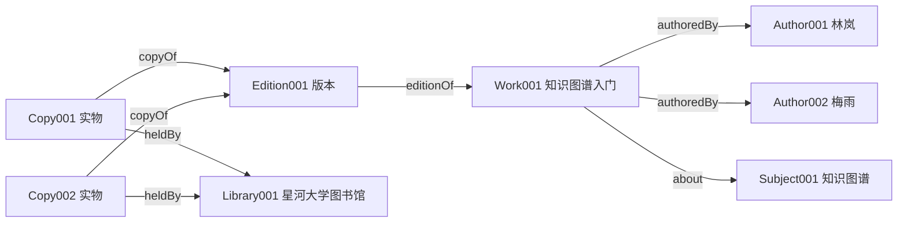

# L01. 知识图谱导论 / Введение в графы знаний

> 课程：知识图谱 / Графы знаний；讲者：М. Галкин、Д. Муромцев。
> 来源：[Lecture1.pdf · PDF第1–60页](../Lecture/Lecture1.pdf#page=1)；[研讨课 · PDF第1–45页](../Lecture/Копия_Семинар_“Семантические_веб_технологии”.pdf#page=1)。下文“研讨课”均指该文件。
> 先修：无需 RDF 背景；只需能理解表格、集合、箭头和向量坐标。
> 示例验证：图书馆 v0.1 的查询、单条教学规则和向量减法已运行；见 [复现说明](examples/README.md) 与 [实际输出](examples/verification-output.json)。外部网站截图按讲义解释，未复现在线演示。
> 状态：完整样稿，等待用户检查。PDF文字与本讲相关图像已核对；Obsidian 仅做静态检查。

## 本讲概览

一本书的标题可以存成字符串，作者、版本和馆藏也可以各存一张表。但如果要回答“哪些知识图谱主题的作品与《数据库实践》有共同作者，而且馆内有可借副本”，系统就必须知道这些记录指的是谁、关系是什么意思、沿哪些关系连接。知识图谱的出发点是让分散的数据成为可识别、可连接、可查询、可推理的知识表示。

本讲先从实体和关系建立图的直觉，再区分符号表示与向量表示，最后说明它们怎样支持搜索、数据集成和知识补全。学完应能画出一个小图，解释一条边，区分事实、规则推导和统计预测，并判断某个应用究竟解决了哪一层问题。

Lecture1 第4、59页的课程计划将嵌入放在第6项、图论放在第7项；实际文件是 **Lecture6 图论、Lecture7 嵌入**，本笔记集按实际文件组织。计划第9项 Question Answering & Query Embedding 没有独立 PDF；本讲只解释已经出现的问答例子。全课路线见 [[00 - 课程索引]]。

## 核心知识点

### 1. 从数据到知识 / Данные и знания

来源：[Lecture1 · 第3–7页](../Lecture/Lecture1.pdf#page=3)；[研讨课 · 第3–8页](../Lecture/Копия_Семинар_“Семантические_веб_технологии”.pdf#page=3)。

研讨课第7页给出三种互补说法。以下保留原文，合并原页因排版造成的词内断行：

> «Знания — это закономерности предметной области (принципы, связи, законы), полученные в результате практической деятельности и профессионального опыта, позволяющие специалистам ставить и решать задачи в этой области»

中文：知识是从实践和专业经验中获得的领域规律，包括原则、联系和法则，使专业人员能够提出并解决该领域的问题。

> «Знания — это хорошо структурированные данные или данные о данных, или метаданные»

中文：知识是经过良好组织的数据，也可以是关于数据的数据，即元数据。

> «Знания — формализованная информация, на которую ссылаются или используют в процессе логического вывода»

中文：知识是可在逻辑推理中引用或使用的形式化信息。

三种说法分别强调领域规律、数据组织、推理用途。本课程主要关心后两者怎样落实：`"林岚"` 只是文字；“Work001 的作者是 Author001，Author001 的中文名是林岚”把身份与关系表达出来；再加入规则，才可能导出原先没有显式写出的结论。**结构化能帮助机器处理，不能保证输入内容真实。**

研讨课第4页还提出五个设计问题：人怎样表示知识，知识的性质是什么，表示方案要通用还是领域专用，表达能力有多强，以及采用声明式还是过程式表示。对图书馆而言，声明式事实是“副本 C 属于版本 E”，过程式程序是“先读某张表，再循环查另一张表”。同一事实可由多种程序使用，因此把知识与某一次计算步骤分离，便于复用。

第5页的“大象识别”图说明感知结果仍需落到概念；第6页把知识表示的形成联系到 AI、难以形式化的任务、认知心理学、形式逻辑、人机交互和知识库。Lecture1 第5页的2018年“每分钟产生多少数据”图只提供信息增长的历史动机，不是本课程必须记忆或适用于今天的流量统计。

### 2. 实体、谓词与事实 / Сущность, предикат и факт

来源：[Lecture1 · 第6–12页](../Lecture/Lecture1.pdf#page=6)。

第6页将图描述为由独特实体（节点）与它们之间的关系（边）构成的网络。第8页的原文定义是：

> «Сущность (Entity) - узел графа, обозначающий абстрактные или материальные вещи (люди, места, концепции)»

中文：实体（Entity）是表示抽象事物或物质事物的图节点，例如人、地点和概念。

> «Предикат (Predicate) - ребро графа, обозначающее некоторую связь между сущностями, например “родился в”»

中文：谓词（Predicate）表示实体之间的某种关系，对应图中的边，例如“出生于”。严格的 RDF 中，谓词是给边指定关系的 IRI；它还可以把资源连接到字面量值。

**教学整理：** 一条事实可以写成三元组（триплет / triple）：

$$
(s,p,o),\qquad p(s,o).
$$

$s$ 是被描述对象（主语），$p$ 是关系（谓词），$o$ 是关系所指对象或值（宾语）。两种写法描述同一关系断言。例如：

```text
(Work001, authoredBy, Author001)
authoredBy(Work001, Author001)
```

这表示“作品 Work001 的作者是 Author001”。反过来写成 `authoredBy(Author001, Work001)` 会改变含义；画图时箭头方向不能随意调整。

> [!example] 教学改编：同名字符串为什么不够
> 两位作者都叫“林岚”，不能仅凭姓名把他们合并。应先为每个人分配稳定 ID，再把姓名作为标签。反过来，同一作者在不同数据源出现两个 ID，也需要实体对齐证据，不能仅凭 ID 不同就认定是两个人。

第7页强调关系的重要性：若只保留“人”“作品”“主题”三类节点而去掉边，便无法区分谁写了什么；图还使地图、决策树等网络结构可以在共同的数学语言下讨论。不过，知识图谱是其中一种语义丰富的图，普通道路图并不会因为有节点和边就自动成为完整的领域知识库。

### 3. 类、实例与本体 / Класс, экземпляр и онтология

来源：[Lecture1 · 第9–12页](../Lecture/Lecture1.pdf#page=9)；[研讨课 · 第36–40、44页](../Lecture/Копия_Семинар_“Семантические_веб_технологии”.pdf#page=36)。

Lecture1 第9–10页把“ITMO 大学”与“大学”连起来：前者是具体实例，后者是抽象类别；“成立日期”则把具体大学连到一个日期值。第11–12页进一步区分“一般大学有哪些性质”与“这一所大学有哪些事实”。

**类（класс / class）**描述一类对象；**实例（экземпляр / instance）**是属于该类的具体对象。图书馆案例中，`Work` 是类，`Work001` 是实例；`Author` 是类，`Author001` 是实例。“作者是人”的类层级与“林岚是作者”的实例分类也不同。

研讨课第37页对本体的表述为：

> «Формализация некоторой области знаний с помощью концептуальной схемы»

中文：通过概念模式对某个知识领域进行形式化。这说明**本体（онтология / ontology）**用于规定类、关系及有关它们的公理；事实数据则填充具体实例。图书馆的本体约定 `copyOf` 从副本指向版本，实例数据写明 Copy001 指向 Edition001。缺少这种约定，两个团队可能都使用“book”，却分别指作品和实物，合并后就会混淆作者与借阅状态。

> [!note] 补充解释：不要把“通常”自动变成严格公理
> 第11页说“大学通常有成立日期”，只是概念说明。自然语言中的“通常”可能有例外，也不等于每条目录数据都必须提供日期。要写成逻辑公理、还是输入数据的完整性要求，需要进一步选择；后续分别由 L02 的推理语义与 L04 的校验约束讨论。

研讨课第39–40页列出可复用的词汇或本体。当前先认识用途，详细公理与复用方法留给 L02：SKOS 组织受控词表、主题和概念关系；BFO、DOLCE 提供跨领域概念框架；FOAF 描述人及其关系；ORG 描述组织；Bibliographic Ontology 面向书目；CIDOC CRM 面向文化遗产记录。SKOS 被原页归在“通用”一组，不能因此把它与 BFO/DOLCE 当成同一类上层本体。

### 4. 图与关系数据库 / Графы и реляционные базы данных

来源：[Lecture1 · 第12页](../Lecture/Lecture1.pdf#page=12)；[研讨课 · 第38、44页](../Lecture/Копия_Семинар_“Семантические_веб_технологии”.pdf#page=38)；[Lecture3 · 第45–49页，后续材料](../Lecture/Lecture3.pdf#page=45)。

研讨课第44页把表格中的“ITMO：16000；圣彼得堡国立大学：N/A”画成图：有记录的人数连到数字值，未知的人数不需要凭空填数；类层级和属性的语义也能作为图中资源来表达。重点是**事实可稀疏、模式可被明确表达**，不是“SQL 不能保存缺失值”。

| 比较点 | 关系数据库直觉 | 知识图谱直觉 |
|---|---|---|
| 身份 | 主键标识记录，跨库需要协调 | IRI 标识资源，仍需协调同一性 |
| 关系 | 外键与连接表达关系 | 命名关系直接表达连接 |
| 缺失 | 可采用 NULL、缺行等约定 | 缺少某条三元组；其意义取决于语义与应用约定 |
| 模式与规则 | 表模式、约束、SQL及程序 | 类、属性、公理、查询及程序 |
| 存储 | 可保存图的三元组表 | 逻辑图可由关系存储或专用存储实现 |

> [!note] 对讲义表述的限定
> Lecture1 第12页用两条“Нет”突出半结构化与逻辑推理的优势。不能据此得出“关系数据库无法表示图或推理”的结论：Lecture3 第45–49页本身就展示了关系表存储 RDF。这里比较的是建模、交换和语义使用方式；具体性能要由数据、索引、查询与实现决定。

研讨课第38页另比较 LPG（Labeled Property Graph，带标签属性图）与 RDF：纽约到旧金山的一条连接带有距离4100公里、费用300美元。LPG 可把属性附在边上；该页的 RDF 画法把“连接”建成节点，再关联出发地、目的地、距离和费用。这是两个模型表达同一业务事实的例子；多元关系及语句元数据的细节将在 L04 展开。

### 5. 符号表示与向量表示 / Символьное и векторное представление

来源：[Lecture1 · 第13–17页](../Lecture/Lecture1.pdf#page=13)。

**符号表示（symbolic representation）**保留可读的实体和命名关系。例如第16页中：Leonard Nimoy 扮演 Spock；Spock 出现在 Star Trek；Star Trek 的类型为 Science Fiction。右侧用 Alec Guinness、Obi-Wan Kenobi 与 Star Wars 构成相似结构。演员、角色、作品、类型是不同对象，`played`、`characterIn`、`genre` 不能混用。

**向量表示（векторное представление / embedding）**为对象分配数值向量，让计算机用数值运算处理关系模式。第17页给出：

$$
\mathbf E\in\mathbb R^{N_e\times d},\qquad
\mathbf R\in\mathbb R^{N_r\times d}.
$$

| 符号 | 含义 |
|---|---|
| $N_e$ | 实体数量；$\mathbf E$ 每一行对应一个实体 |
| $N_r$ | 关系类型数量；$\mathbf R$ 每一行对应一种关系 |
| $d$ | 表示向量的维度，原页左图用二维方便画出位置 |
| $\mathbb R$ | 实数集合；矩阵中的元素是数值 |

例如把 Spock 写为 `[0.2, 0.8]`，得到的是供模型使用的坐标，而非它的自然语言定义。坐标轴未必分别对应“聪明程度”“角色年龄”等可命名属性。这里的矩阵形式是讲义所示的一类浅层表示，并非所有模型都要求关系也是同维实向量。

符号表示有利于精确查询和追踪规则，向量表示可从已有模式对缺失关系评分。两者可以结合。第15页还列出开放世界、封闭世界和随时间变化的图：它们是需要明确处理的问题，不是图左半边和右半边各自独占的性质。**开放世界**允许未记录事实仍有可能成立；**封闭世界**在指定完整范围内把未记录视为不成立。Library001 没有“借给许宁”的记录，只能说当前不知道；若业务要判断可借，必须另外定义状态完整性和更新时间。

第13页的交叉学科图也说明同一系统的不同职责：NLP 从文本识别实体与关系，数据管理负责存储和查询，语义技术负责词汇与逻辑，网络科学研究结构，机器学习从模式进行预测；AI 是更广的背景。

## 发展脉络与开放数据

来源：[Lecture1 · 第18–28页](../Lecture/Lecture1.pdf#page=18)；[研讨课 · 第9–19页](../Lecture/Копия_Семинар_“Семантические_веб_технологии”.pdf#page=9)。

| 讲义中的项目 | 主要机制与区别 | 学习时要记住什么 |
|---|---|---|
| DBpedia（第18页标2007） | 从 Wikipedia 信息框提取结构化描述 | 从百科文本组织中抽取可查询事实；研讨课12–13页展示 Lukoil 的属性与多语言标签查询 |
| YAGO（第19页标2008） | 结合 Wikipedia 与 WordNet | 数据来源与概念体系的结合；时间轴按讲义版本阅读，不视为已核实的首发年表 |
| NELL（第20页标2010） | Never Ending Language Learner，持续阅读网页、抽取候选事实 | 自动获取知识也会带来误差与验证需求 |
| Wikidata（第21页标2012） | 社区维护结构化知识，为 Wikipedia 等应用供数 | 与 DBpedia 的数据流方向不同；研讨课15页显示标签、描述、陈述和引用 |
| Google Knowledge Graph（第22页标2014） | 将实体与关系用于搜索解释、消歧和结果展示 | 发布年份应修正为2012；不能将公开图谱与商业搜索系统完全等同 |
| 多种图谱共存（第23页标2021） | 开放通用图、领域图、按处理过程生成的个人图 | 图谱可以有不同范围、访问方式与生命周期 |

> [!note] 已核实的历史勘误
> 讲义第22页把 Google Knowledge Graph 放在2014年位置；官方发布文章日期为 **2012-05-16**。研讨课第9页也引用了2012年的原文。此处按官方记录修正发布年份，不能从“Google 推广了术语”进一步推出它首次发明了全部知识图谱思想。依据：[Google 官方发布文](https://blog.google/products-and-platforms/products/search/introducing-knowledge-graph-things-not/)，访问日期2026-11-04。

第24–28页是 Linked Open Data（关联开放数据，связанные открытые данные / LOD）云图的2007、2009、2011、2014、2020版本。**圆圈代表数据集，连接代表数据集之间的链接，不是每个圆圈代表一个人或一本书。** 从少数节点发展成密集网络，说明多个发布者可以通过标识与跨数据集链接形成生态。颜色用于区分领域；图的布局和圆圈视觉大小不应直接解释成实体语义或最新数据量排名。

> [!note] 规模数字的使用边界
> 第18–21页分别声称 DBpedia 超60亿、YAGO超1.2亿、NELL超145亿事实，以及 Wikidata 超70亿事实/9000万实体。本轮已核对这些是原页表述，但未核实它们的统计日期、候选事实口径或首发年份。它们只保留为讲义背景，不用于数量比较、当前规模结论或算法依据。研讨课的产品截图和名单也按课程时点阅读。

研讨课第16–17页用 Metaphactory 展示从名称搜索进入实体页，再展开关系；同名公司、球队等候选需要消歧。这是数据之上的应用层，搜索框和可视化组件本身不是底层图谱。

## 应用场景与工业案例

### 6. 从搜索到跨源集成

来源：[Lecture1 · 第29–43页](../Lecture/Lecture1.pdf#page=29)；[研讨课 · 第18–35、41–43页](../Lecture/Копия_Семинар_“Семантические_веб_технологии”.pdf#page=18)。

| 场景 | 图里连接什么 | 解决的实际问题 |
|---|---|---|
| 搜索结果丰富化 | 实体→出生日期、职业、作品等 | 返回实体卡片与简单事实，而不仅返回含关键词的网页；原例为爱因斯坦生日 |
| 自然语言问答 | 问句中的实体、关系→查询模式 | AskNow 的奖项例展示从问题到结果集合；自然语言理解与查询执行是两个步骤 |
| 银行交易与反欺诈 | 账户、交易、客户与控制关系 | 通过多跳关系查共同关联与异常模式 |
| 法律/咨询 | 文档、条款、机构、监管要求 | 把要求与有关实体连接，帮助追踪影响与证据 |
| 供应链 | 供应商、零部件、生产与依赖 | 查供应中断会影响哪些产品 |
| 服务与聊天机器人 | 客户、意图、服务知识 | 为回答提供结构化上下文 |
| 医疗记录与生物信息 | 记录、术语、本体、文献 | 统一概念并连接不同来源；本讲不据此给出诊疗结论 |
| 工业4.0 | 设备、过程、观测及系统关系 | 为物理设备与软件系统提供共享语义，支持监测和协同 |

第31–35页是 KGC 2019 现场照片与递进列表，涉及 Goldman Sachs/Wells Fargo、pwc/Accenture/Capital One、eccenca、DiffBot/AirBnB、EHR。其教学意义是应用覆盖多个行业，照片上的增长数字不足以证明普遍因果效果。

第38–39页集成架构从下到上是异构来源（文本、媒体、半结构化数据、关系库、RDF）、语义数据湖、企业知识图谱及一致性层、GUI/REST/XML/JSON/SPARQL 接口、企业应用。物理集成把数据转换后存进统一图；虚拟集成保留源数据，在查询时转发并合并结果。图中的“一张图”首先可以是一套统一逻辑视图，并不要求所有来源搬进同一文件。

第41–43页分别展示 BioPortal、Bio2RDF、PubMed：它们承担的角色有本体仓库、跨数据集关联与文献来源之别。**图像核对：**第41页 BioPortal 截图约1448亿的条目标签是 “Direct Plus Expanded Annotations”，不能直接等同于同口径的独立事实数；第42页的“35个数据集、超110亿事实”和第43页的历史起点也没有在本轮作外部统计核实。理解用途即可，不把这些历史数字作为可靠规模结论。

第29页 Gartner 2020 曲线的纵轴是市场期待、横轴是发展过程；第30页表格是2009–2018公司市值变化，旁注若干公司建设了图谱。它们体现讲者当时的市场判断；既不能反映2026年位置，也不能证明“用图谱导致市值上涨”。

### 7. 研讨课工业案例的机制

来源：[研讨课 · 第21–35页](../Lecture/Копия_Семинар_“Семантические_веб_технологии”.pdf#page=21)。以下数字均是研讨课报告的历史案例描述，没有在本课程重新做性能实验。

**Statoil：面向领域人员的数据访问。** 第21–24页描述约900位地质/地球物理人员需要查井、地层和地震数据，却面对6个内部库、1个公共库、数千表/视图与数万列。困难不只是表多，还包括同一概念在不同系统命名不同；准备新 ETL 视图可能耗时数天到数周。第22页报告查找与提取占30%–70%时间，不能当成所有企业的通用比例。

第25页采用 **OBDA（Ontology-Based Data Access，基于本体的数据访问）**：领域人员用本体中的概念提问，系统利用映射把查询改写给底层数据源。图中本体、映射、查询库支持查询转换与规划，再对流数据、时态数据、静态数据执行，返回结果供分析。第26页列出106类、91属性、520公理的上层本体，75个上层映射、4000多个数据库本体映射，以及 R2RML 和联邦映射。关键是“本体解释问题、映射连接源字段、执行仍由源系统承担”，完整实现留给 L05。

第27页报告平均改写20毫秒、SQL执行36秒、总时间58秒；SPARQL长度均值462/中位456/最大1110字符，生成SQL为4283/2547/37788字符。**字符数反映用户可见复杂度，不等于运行复杂度。** 20毫秒加36秒并非58秒，原页没有分解其余开销，不能自行补成精确时间公式。讲义结论是查询时间与预建视图相近，同时减少等待新视图准备的过程，不是保证所有图查询更快。

**Siemens：集成枢纽。** 第28页把设备、部件、报告、工厂与位置连成图，用于建筑虚拟副本、风险、过程、涡轮维护和工厂监测。第29页架构底层并列关系库OBDA/ETL、图数据库SPARQL、REST服务，中间是联邦访问、本体库、查询目录和访问控制，顶部为搜索、可视化和编辑。可见知识图谱应用还需要权限、接口与维护工具；把所有实体画在一起只是起点。

**Pinterest：兴趣分类与协同维护。** 第30页连接用户、保存的 Pin、内容表达的兴趣以及“中世纪现代建筑→建筑”这类兴趣层级。第31–32页报告约11000类、12层、145000公理、38000次修订、2000条评论、1000次讨论，开发流程从Excel到内部工具，再到WebProtégé扩展；8名工程师经1小时培训、工作2个月是该案例叙述，不是本体项目工期估算公式。第33页报告搜索与广告改进、收入增量但无具体数字；不能凭空补百分比。公理总数与分项也不宜强行凑等式，原页分项并未完整列举。

**SciBite：语义增强检索。** 第34页把普通论文文档变为带实体注释的文档，识别 PSEN1、Presenilin-1 等不同写法并关联领域概念，使检索能跨同义表达匹配。原图说明“同一概念可有不同文字”，本讲不验证图中生物学断言。第35页还列出 Zalando 的产品语义搜索、GeoPhy 的房地产数据和估价、以及 Google/Apple/Amazon 等应用背景；没有给出足以复现的技术细节。

## 开放研究问题、推导与边界

### 8. 从问句到查询：识别、链接与关系匹配

来源：[Lecture1 · 第44–47页](../Lecture/Lecture1.pdf#page=44)。

教材问：“Юрий Гагарин 和 Сергей Королев 共同获得过哪些奖项？”第44页先给实体及关系网络，第45–47页依次标出问句、实体标识和关系标识。

1. **命名实体识别（NER）**：发现文本中提到了两个人，找到各自的文本片段。
2. **实体链接（Entity Linking）**：将提及对应到图中 `wd:Q7327`、`wd:Q170842`，解决同名与不同语言写法。
3. **关系链接（Relation Linking）**：把“获得的奖项”对应到 `wdt:P166`，而非随意选“职业”或“出生地”。
4. **查询组合**：要求同一个变量 `?award` 同时满足两个人的获奖关系，等价于求两个集合的交集。

```sparql
PREFIX wd: <http://www.wikidata.org/entity/>
PREFIX wdt: <http://www.wikidata.org/prop/direct/>
SELECT ?award WHERE {
  wd:Q7327 wdt:P166 ?award .
  wd:Q170842 wdt:P166 ?award .
}
```

这是第45页查询补齐前缀后的教学转录。两行共享 `?award` 才要求“共同”；使用两个不同变量会得到两组奖项的组合。**验证状态：**未调用实时 Wikidata；原图展示 Order of Lenin 的匹配关系，不声称它是今天在线结果的完整列表。本地同构问题“两个作品的共同作者”将在实践中运行。这里 RL 指 Relation Linking，不是强化学习。

### 9. 语言建模与图机器学习

来源：[Lecture1 · 第48–49页](../Lecture/Lecture1.pdf#page=48)。

第48页用“Robert Downey Jr. 在2008年 Marvel 电影中饰演 [MASK]”说明两类信息来源：文本语料提供语言与上下文模式；图中的演员、影片、角色和别名关系提供可追踪事实链。应先区分影片《Iron Man》与同名角色，才能沿“演员→角色 Tony Stark→别名 Iron Man”等关系解释候选答案。**这张图表达结合动机，没有给出一个已实现的检索增强或训练算法，也没有实验指标。**

第49页列出细胞相似网络、事件图、疾病路径、场景图、知识图谱与分子图。同为图数据，节点、边和任务可能不同：分子图的边可表示化学键，知识图谱的边是多种语义关系。因此不能把适用于无类型无向图的算法直接当成已保留全部知识图谱语义。

### 10. 知识补全：逻辑蕴含与统计预测

来源：[Lecture1 · 第50–53页](../Lecture/Lecture1.pdf#page=50)。

**知识图谱补全（Knowledge Graph Completion）**尝试补上缺失事实。第50页缺少 `Obi-Wan Kenobi characterIn Star Wars`，第51页以红边加入它。第52页给出规则：

$$
\operatorname{starredIn}(X,Y)\land\operatorname{played}(X,Z)
\rightarrow\operatorname{characterIn}(Z,Y).
$$

$X$ 是演员，$Y$ 是作品，$Z$ 是角色；$\land$ 表示两个前提都成立，$\rightarrow$ 表示在接受该规则时可以推出结论。代入 Alec Guinness、Star Wars、Obi-Wan Kenobi 后，结论就是红边。

> [!note] 规则边界
> 这是教材的简化规则。若演员在多部电影中演过不同角色，单凭“出演某片”和“演过某角色”可能错误交叉组合。要用于真实影视库，需把“在哪部作品中扮演哪个角色”绑定为同一演出记录，或限制规则适用范围。逻辑推导的可靠性依赖事实和规则本身。

第53页改用数值表示。Obi-Wan 为 $[0.05,0.25,0.37]$，Star Wars 为 $[0.18,0.4,0.9]$，两者之差为：

$$
[0.18,0.4,0.9]-[0.05,0.25,0.37]
=[0.13,0.15,0.53].
$$

它与原页关系向量 `characterIn = [0.1, 0.1, 0.6]` 接近，用于展示“实体之间的向量位移可反映关系”。这是从图中数字作出的解释，**不是课件给出了完整训练过程**。两向量不严格相等，也没有提供距离阈值或校准概率；不能据此宣称某事实已证明。数值减法已用程序核对，完整评分、训练与评估在 L07。

| 操作 | 依据 | 输出如何理解 |
|---|---|---|
| 查询显式事实 | 图中现有边与匹配条件 | 当前数据里的匹配结果 |
| 符号推导 | 事实和明确规则/公理 | 在指定语义下的逻辑结论 |
| 统计补全 | 学到的参数与评分函数 | 候选事实的评分或排序；需评价与核实 |

### 11. 语义相似性与事实核查

来源：[Lecture1 · 第54–57页](../Lecture/Lecture1.pdf#page=54)。

第54页 Goethe 与 Schiller 共享语言、职业和文学运动，又有直接影响关系。这些连接为“相近”提供不同证据，但相似性需先定义任务：共享职业、邻域相似与直接关联不是同一指标。第55页把 DBpedia 的 Ibuprofen 与另一药物条目 DB01050 并排：谓词名、类型、品牌、代码粒度和编号都不同，说明异构图之间比较需要对应属性与概念。**相似不等于同一性**；不能凭图形相似就添加 `owl:sameAs`，也不把原图的药物编码当作已核实的领域事实。

第56–57页要求找支持或反驳“加加林获得过许多国家奖项”的图中事实。可以先链接人物，收集获奖关系，再检查奖项类别、来源和量词“许多”的标准。原图展示多个奖项节点，但“找到多个”不自动证明所有奖项都属于同一国家类别；“没有找到”也不自动反驳。开放世界中的图通常不完整，核查还需限定时间、数据范围和来源可信度。

## 图表解读

本讲所有60页与研讨课1–45页都已结合文字及页面图像读取。最值得回看的图及阅读方式如下；简单结构用教学重绘表达，截图不替代上文解释。

| 来源页 | 对象、关系与变化 | 可以得出的结论与限制 |
|---|---|---|
| L1 9–12 | 实例ITMO、类University、日期；递进加入类型和事实说明 | 实例事实与类层概念分开，不把“通常”当严格量词 |
| L1 16–17、50–53 | 演员、角色、作品、类型→向量→缺失红边 | 结构可用符号或向量处理；向量图不是模型精度报告 |
| L1 24–28 | LOD数据集云由稀到密 | 跨数据集连接生态扩大，不按截图估算当前统计 |
| L1 29–30 | 期待曲线和市值表 | 历史市场背景，不是技术效果因果实验 |
| L1 38–39；研讨课25、29、43 | 来源→语义层→查询接口→应用 | 统一语义可以覆盖多个底层存储 |
| L1 44–47；研讨课12–17 | 实体网络、问句标色、查询与表格、实体应用界面 | 链接和查询各有职责；界面显示不是数据完整性证明 |
| L1 41；研讨课18–19 | 本体目录、类别/访问/注释统计 | 仓库、类、注释、事实不能用一个数量口径混算 |
| L1 54–55 | 共享邻居、异构谓词与不同标识 | 相似性需指定度量，跨源同一性需证据 |
| 研讨课38、44 | 边属性/关系节点；表格与稀疏事实图 | 同一业务问题可有不同模型；缺值不自动变成否定 |

## 实践与例题

### 12. 画出作品、版本与副本

**教学改编。** 数据身份以 [[_meta/统一案例设定]] v0.1 为准。



任务：“林岚写的作品”和“馆里可借的一本实物”是否同一实体？

解：作者连到 Work；副本经 Edition 连回 Work；两个副本共享内容与版本，却有不同条码和状态。`Copy001 availability "available"` 与 `Copy002 availability "borrowed"` 不冲突，因为主语不同。若把它们和作品合并，一个对象会混合作者、出版信息及多份实物的状态。Mermaid 为教学重绘，只画 v0.1 的一个子图，未画出的其他事实仍存在于数据文件。

### 13. 手算与运行：求共同作者

已知：$A(\text{Work001})=\{\text{Author001},\text{Author002}\}$，$A(\text{Work002})=\{\text{Author001},\text{Author003}\}$。这里 $A(w)$ 是作品 $w$ 的显式作者集合。

$$
A(\text{Work001})\cap A(\text{Work002})=\{\text{Author001}\}.
$$

按图逐条检查：Author001 同时满足两条 `authoredBy`；Author002 仅满足第一条；Author003 仅满足第二条。查中文标签后结果是 **林岚**。

对应完整查询为 [common-authors.rq](examples/common-authors.rq)，在 [library-v0.1.ttl](examples/library-v0.1.ttl) 上已由 RDFLib 7.6.0 实际运行；输出一行 `Author001 / 林岚`。查询含 `ORDER BY ?author`，按作者 IRI 排序；本例结果恰好只有一行。新增语法逐项解释见 [[_meta/样稿 - RDF知识点#简单查询与结果|RDF 样稿]]。

### 14. 手算与运行：用一条明确规则派生副本主题

采用本案例自己规定的规则（不是教材原例）：

$$
\operatorname{copyOf}(c,e)\land\operatorname{editionOf}(e,w)
\land\operatorname{about}(w,t)\rightarrow\operatorname{copyAbout}(c,t).
$$

$c$ 是副本，$e$ 是版本，$w$ 是作品，$t$ 是主题。输入三步为 Copy001→Edition001、Edition001→Work001、Work001→Subject001；输出 Copy001→Subject001。对 Copy002 同样成立，因此得到两条派生关系。这个 `copyAbout` 表示继承作品的主题，不代表副本被重新创作了一次。

最小实现见 [verify_examples.py](examples/verify_examples.py)：循环枚举三段关系，生成派生集合，并检查原始44条事实中没有这些派生边。**实际得到2条，未写回源数据，也未启用 RDFS/OWL 推理器。** 如果改变规则，结果必须重新检查；不能把“Python可以算出”写成“OWL已经蕴含”。

### 15. 如何观察公开图谱

来源：[Lecture1 · 第60页](../Lecture/Lecture1.pdf#page=60)；[研讨课 · 第12–17、247–250页](../Lecture/Копия_Семинар_“Семантические_веб_технологии”.pdf#page=247)。

教材最后给 Metaphacts/Wikidata 演示链接。可参照已有截图练习：先找实体 ID，再读标签、类型和关系，最后追到相关实体；区分人物与同名对象，区分资源页和查询结果表。这里没有运行网站，也没有为用户注册服务；课程截图已足够支持本讲的观察任务。

研讨课原任务的完整要求另有去向：第247页查俄美人口、城市/地区数量与面积，L01用于理解“先提出问题”，具体查询归 L03；第248、250页 Ontodia/VOWL 可视化归 L02；第249页完整本体与推理作业也归 L02，保留至少8类、6对象属性、10数据属性、关系特性及推理要求。当前小图是入门改编，不能替代该作业。

## 自测

1. 为什么“作品→作者”和“副本→版本”应该使用不同实体与关系？请举一个合并后出错的属性。
2. 图中没有“许宁借了 Copy002”，能否据此断定许宁没有借它？若要列出可借副本，还需要怎样约定？
3. 两个人共同获得的奖项查询为什么共用一个变量？把两个奖项变量分开会怎样？
4. 给定 Copy002→Edition001→Work001→Subject001，哪条派生边由本讲规则得到？它与向量模型的候选评分有何区别？
5. Statoil 案例中“SPARQL 比 SQL 字符少”和“总时间58秒”分别能说明什么，不能说明什么？

> [!question]- 第1题参考答案
> 作品描述创作内容，版本描述出版安排，副本描述某件实物。作者属于作品层，借阅状态属于副本层。两个副本可能一件可借、一件借出；合成一个对象就无法准确表达各自状态。

> [!question]- 第2题参考答案
> 不能。缺少记录可能是未知或遗漏。可借查询应明确使用哪一时点的完整状态记录、哪些状态值表示可借，以及缺失值如何处理；不能默认“未记录借出就可借”。v0.1只按显式 available 返回 Copy001。

> [!question]- 第3题参考答案
> 共享变量要求两个图模式绑定到同一个奖项，即集合交集。不同变量只要求分别找到各自奖项，可能产生两组奖项的组合，无法保证是共同奖项。

> [!question]- 第4题参考答案
> 得到 `Copy002 copyAbout Subject001`。它是在接受明确规则及三个前提时得到的演绎结果；向量评分根据模型参数估计候选是否符合已有模式，不构成同样的逻辑保证。

> [!question]- 第5题参考答案
> 字符更少说明该例中领域查询的书写负担较小，不能证明计算一定更快。58秒是案例报告的总时间，不是任意部署的保证；20毫秒改写与36秒执行不能直接加成58秒，课件未给完整开销分解。

## 知识关联与本讲要点

本讲没有需要证明的数学定理；集合交集、规则代入与向量减法用于把直觉变成可检查的步骤。继续学习时先读 [[_meta/样稿 - RDF知识点|RDF 样稿]]，把“箭头”落实为严格三元组和可运行数据。

| 已建立的能力 | 后续正式展开位置（尚待生成） |
|---|---|
| 稳定身份、类、实例、事实与公理 | L02《RDF RDFS OWL与本体工程》 |
| 用共享变量连接关系 | L03《SPARQL与图数据存储》 |
| 来源、限定条件与完整性 | L04《语句元数据与图谱验证》 |
| 本体与异构数据源映射 | L05《语义数据集成》 |
| 图结构、投影、相似性 | L06《图论与网络分析》 |
| 候选事实评分与训练 | L07《知识图谱嵌入》 |
| 聚合邻域信息及新实体 | L08《图神经网络》 |

Lecture1 第58页的会议名单用于继续查论文：The Web Conf/WWW、ISWC 侧重 Web 与语义技术；NeurIPS、ICLR、AAAI、ICML、IJCAI 覆盖机器学习与AI；ACL/NAACL、EMNLP 涉及语言处理；Enterprise Data World 与 Knowledge Graph Conference 提供行业交流背景。本讲不提供或预测这些会议当前日程。

## 术语表

下表俄文对应来自讲义术语；为连接概念而补出的完整名称是术语译写，不伪称原页定义。

| Русский | 中文 | English / 缩写 | 本文位置 |
|---|---|---|---|
| знания | 知识 | knowledge | §1 |
| граф знаний | 知识图谱 | knowledge graph / KG | 本讲概览、§2 |
| сущность | 实体 | entity | §2 |
| предикат | 谓词、关系 | predicate | §2 |
| триплет | 三元组 | triple | §2、RDF样稿 |
| класс / экземпляр | 类 / 实例 | class / instance | §3 |
| онтология | 本体 | ontology | §3 |
| символьное представление（译写） | 符号表示 | symbolic representation | §5 |
| векторное представление | 向量表示、嵌入 | embedding | §5 |
| предположение открытого мира（译写） | 开放世界假设 | OWA | §5 |
| связанные открытые данные（译写） | 关联开放数据 | Linked Open Data / LOD | 发展脉络 |
| интеграция данных | 数据集成 | data integration | §6–7 |
| связывание сущностей（译写） | 实体链接 | entity linking | §8 |
| символический вывод | 符号推理 | symbolic inference | §10 |
| статистический вывод | 统计推断 | statistical inference | §10 |
| семантическая близость | 语义相似性 | semantic similarity | §11 |
| проверка утверждений | 事实核查、断言检查 | fact checking | §11 |

返回 [[00 - 课程索引]]；全课页段登记见 [[_meta/讲义覆盖表]]。
