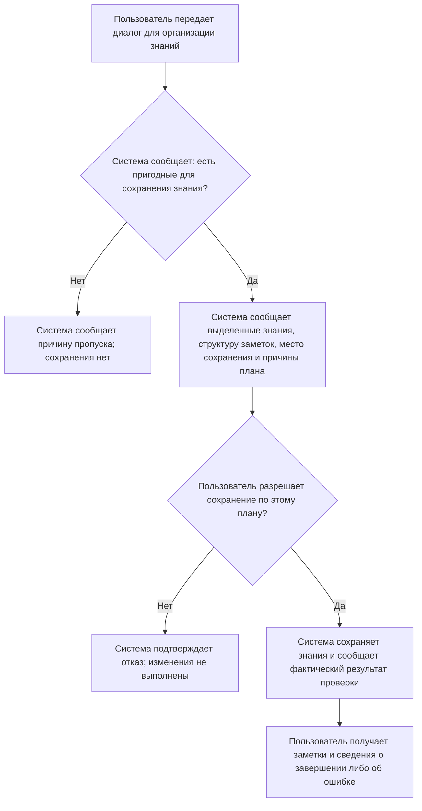

# Пользовательские сценарии

**AI Knowledge Agent | Из диалога с ИИ в личную базу знаний**

Практическое задание: целевая аудитория, User Story, границы MVP и обмен информацией между пользователем и системой.

## 1. Продукт и целевая аудитория

AI Knowledge Agent помогает превращать диалоги с ИИ в структурированные заметки в Obsidian. Пользователь получает материал, который можно повторять и использовать в дальнейшей работе: понятные темы, связанные понятия, вопросы и объяснения. Перед сохранением система сообщает план, а после выполнения - фактический результат.

### Группа A. Студенты и самостоятельные учащиеся

**Контекст.** Изучают программирование, ИИ и другие предметы с помощью длинных диалогов. Используют или готовы использовать Obsidian для личных заметок.

**Проблема.** Нужные объяснения остаются в истории переписки. Перечитывать весь разговор долго; при ручном конспектировании теряются вопросы и исправленные заблуждения.

**Цель и ожидаемый результат.** Получить компактный учебный материал с понятной структурой и сохранить, что именно было непонятно и как это объяснялось в диалоге.

### Группа B. Разработчики и технические специалисты

**Контекст.** Обсуждают с ИИ технологии, алгоритмы и способы решения рабочих задач. Накапливают личную техническую базу знаний.

**Проблема.** Полезные сведения распределены по разным разговорам. Ручное перенесение занимает время, а механическое сохранение каждого термина создает множество разрозненных заметок. При пополнении базы возникают повторы и противоречия.

**Цель и ожидаемый результат.** Получить технические заметки с обоснованной структурой и связями, пригодные для повторного использования, и контролировать изменения в своей базе.

### Основание сегментации

Это гипотезы о пользователях, выведенные из требований и сценариев проекта, а не результаты проведенных интервью. Группы различаются основной целью: понять и запомнить материал либо повторно применять технические знания. Один человек может относиться к обеим группам. Для проверки гипотез потребуется обсудить с представителями каждой группы реальные примеры сохранения диалогов.

Общая ценность продукта для обеих групп - сократить ручную обработку диалогов и получить контролируемый результат в личной базе знаний.

<!-- pagebreak -->

## 2. User Story и выбор MVP

Для каждой группы сформулированы три истории. Обозначения US-01 - US-06 относятся к этому заданию и не заменяют нумерацию в исходном документе требований.

### Группа A. Учебные цели

**US-01 | MVP | Сценарий S1**

Я как студент хочу получить структурированную заметку из учебного диалога с ИИ, чтобы повторять материал без перечитывания всей переписки.

**US-02 | MVP, упрощенный вариант | Сценарий S1**

Я как самостоятельный учащийся хочу сохранить свое исходное заблуждение вместе с объяснением из диалога, чтобы при повторении понимать, в чем состояла моя ошибка.

**US-03 | После MVP, Phase 3**

Я как учащийся с накопленной базой заметок хочу связывать новые знания с уже изученными понятиями, чтобы видеть их место в общей системе знаний.

### Группа B. Рабочие и технические цели

**US-04 | MVP | Сценарий S2**

Я как разработчик хочу организовать связанные понятия из технического диалога в заметки и разделы с понятными связями, чтобы повторно использовать материал без множества разрозненных записей.

**US-05 | После MVP, Phase 3**

Я как технический специалист хочу дополнять существующую заметку новыми сведениями из диалога, чтобы развивать накопленные знания и избегать повторного описания одного понятия.

**US-06 | MVP | Сценарии S1 и S2**

Я как разработчик, ведущий личную базу знаний, хочу узнать предполагаемые изменения и разрешить их до сохранения, чтобы контролировать содержание своей базы. Эта потребность также относится к группе A.

### Почему выбраны эти истории

US-01, US-02, US-04 и US-06 образуют завершенный путь: передать диалог, получить организованные знания, понять план, разрешить сохранение и узнать результат. US-02 в MVP охватывает только явно выраженные вопросы, заблуждения и объяснения при надежно определенных участниках диалога.

**Граница курса.** За основу взят MVP из Phase 2: создание новых заметок в `inbox/`, базовая проверка повторов, связи между новыми заметками, обнаружение конфликтов и обязательное разрешение пользователя на сохранение. Обновление старых заметок, развитая работа со связями старых и новых знаний, восстановление версий и автономное перепланирование относятся к последующим этапам. Текущая реализация проекта шире этой учебной границы.

<!-- pagebreak -->

## 3. Сценарий S1. Учебный диалог становится заметкой

**Истории:** US-01, US-02, US-06. **Пользователь:** учащийся из группы A.

**Ситуация.** После обсуждения RAG с ИИ пользователь хочет сохранить объяснение и свое исправленное заблуждение. В исходном разговоре он предполагал, что в запрос модели передается вся база данных, и получил объяснение этого заблуждения.

**Предусловия.** Личная база знаний и модель настроены; сохранение в `inbox/` разрешено. Участники исходного диалога определены достаточно надежно. Для этого примера подходящей заметки о RAG при базовой проверке не найдено.

Ниже приведена смысловая модель обмена сведениями и решениями. Система может сообщать несколько результатов подряд; отдельный ответ пользователя на каждый из них не требуется.

| Шаг | Участник | Передаваемая информация |
|---|---|---|
| 1 | Пользователь | «Передаю мой учебный диалог о RAG для сохранения полезных знаний в личной базе». Содержание разговора включает вопрос, исходное предположение пользователя и последующее объяснение ИИ. |
| 2 | Система | «В диалоге выделена тема RAG. Найдены определение, описание процесса и объяснение исходного заблуждения. Вопрос пользователя и ответ ИИ различимы; эти сведения можно сохранить вместе». |
| 3 | Система | «Предлагаю создать в inbox/ заметку RAG: определение, основные этапы, исходное заблуждение и объяснение из диалога. Эти части относятся к одной теме, поэтому отдельные заметки для каждого фрагмента не нужны. Сохранение еще не выполнено; требуется ваше разрешение». |
| 4 | Пользователь | «Разрешаю сохранить заметку по этому плану». |
| 5 | Система | «Создана заметка inbox/RAG.md. В ней сохранены выделенные сведения и связь с исходным диалогом. Файл повторно прочитан: сохранение и структура проверены. Существующие заметки не изменены». |

### Результат и критерии успешного завершения

- Пользователь получает одну учебную заметку, соответствующую заявленной теме.
- Исходное заблуждение обозначено как позиция пользователя, а объяснение - как содержание ответа ИИ.
- Сохранение происходит после разрешения пользователя.
- Отчет описывает реально созданную заметку и результат проверки, а не только намерение ее создать.

**Возможные отклонения:** повторный диалог, неясные роли, отсутствие пригодных знаний, отказ от плана или ошибка сохранения. Их продолжения описаны в разделе 5.

Пример показывает ожидаемый обмен информацией, а не результат отдельного пользовательского исследования или проведенного испытания. Проверка сохранения и структуры не доказывает научную достоверность исходного объяснения ИИ.

<!-- pagebreak -->

## 4. Сценарий S2. Связанные технические знания

**Истории:** US-04, US-06. **Пользователь:** разработчик из группы B.

**Ситуация.** В одном диалоге обсуждались Transformer, Attention, Self-Attention и Multi-Head Attention. Пользователь хочет получить материал для дальнейшей работы и избежать разрозненных заметок на каждый термин.

**Предусловия.** База и модель настроены. Диалог содержит достаточно подробное самостоятельное объяснение Attention. В этом примере базовая проверка не выявила препятствий для создания запланированных новых заметок.

| Шаг | Участник | Передаваемая информация |
|---|---|---|
| 1 | Пользователь | «Передаю технический диалог о Transformer и механизмах внимания для организации знаний в моей базе». |
| 2 | Система | «Найдена группа связанных понятий: Transformer, Attention, Self-Attention и Multi-Head Attention. Attention подробно объясняется как самостоятельное понятие; два его варианта можно описать внутри этой темы». |
| 3 | Система | «Предлагаю создать две заметки в inbox/: Transformer и Attention. В Attention войдут разделы Self-Attention и Multi-Head Attention; заметки будут связаны между собой. Причина такого деления: сохранить общее описание архитектуры отдельно от подробного материала о внимании и не дробить варианты механизма на отдельные записи». |
| 4 | Система | «План предполагает только создание новых заметок. Существующие материалы не изменяются. Сохранение еще не выполнено; требуется ваше разрешение». |
| 5 | Пользователь | «Разрешаю сохранить эти две заметки с предложенной структурой и связью». |
| 6 | Система | «Созданы inbox/Transformer.md и inbox/Attention.md. Разделы вариантов внимания включены в Attention. Файлы и ссылки повторно проверены; в отчете указаны созданные заметки и результаты проверки». |

### Результат и критерии успешного завершения

- Получены связанные технические заметки, а не четыре записи по числу терминов.
- Система объясняет, почему одни понятия стали заметками, а другие - разделами.
- План охватывает только новые заметки и выполняется после разрешения пользователя.
- Итоговый отчет позволяет сопоставить запланированный и фактический результат.

**Вариативность.** Две заметки - решение для указанного объема исходного материала. Для более короткого диалога может быть обоснована одна заметка с разделами. Важно сохранить смысловую структуру и объяснить решение, а не всегда создавать фиксированное число файлов.

Если в разговоре есть еще одна несвязанная тема, система сообщает о ней отдельно и не объединяет ее с этим материалом только потому, что сведения находились в одном диалоге.

<!-- pagebreak -->

## 5. Альтернативные ветви S1 и S2

Продолжения ниже относятся к соответствующему моменту основного сценария. В каждом случае пользователь получает понятный статус и знает, требуется ли дальнейшее решение.

### A1. Этот диалог уже передавался

**Система:** «Этот диалог уже есть в истории обработки. Можно завершить текущую попытку или повторить анализ; повторный анализ сам по себе не разрешает создание дубликатов».

**Пользователь:** «Повторный анализ не нужен».

**Итог:** текущая попытка завершается без новых заметок. Если пользователь все же запрашивает повторный анализ, после него снова требуется план и разрешение на сохранение.

### A2. Нет знаний, пригодных для сохранения

**Система:** «В разговоре найдены только ситуативные реплики либо сведения, которые нельзя уверенно выделить как самостоятельные знания. Новые заметки не созданы; причина пропуска указана».

**Пользователь:** «Передам другой диалог, содержащий нужное объяснение».

**Итог:** текущая обработка завершена без сохранения; другой диалог является новым входным материалом.

### A3. Неясно, кому принадлежит заблуждение

**Система:** «Участников диалога не удалось определить достаточно надежно. Личное заблуждение вам не приписано; это ограничение указано в результатах анализа».

**Пользователь:** «Не разрешаю сохранение этой попытки; подготовлю диалог с обозначенными участниками».

**Итог:** попытка прекращена. Уточненный материал можно передать для нового анализа.

### A4. Найдено противоречие или совпадение с имеющейся записью

**Система:** «Найдена существующая запись, которая может повторять или противоречить новому материалу. Сообщаю, какие сведения требуют проверки. Автоматическое объединение и изменение старой заметки не входят в этот MVP; спорное сохранение приостановлено».

**Пользователь:** «Не разрешаю выполнять этот план; сначала проверю исходные материалы».

**Итог:** план отклонен; существующая запись сохранена. Эта ветвь описывает реакцию на обнаруженную проблему и не обещает полного выявления всех смысловых повторов базовой проверкой MVP.

### A5. Пользователь не согласен с планом

**Пользователь:** «Не разрешаю сохранять предложенный результат».

**Система:** «План отклонен. Запланированные изменения не выполнены».

**Итог:** завершение без сохранения. Редактирование отдельных действий плана в этот учебный MVP не включено.

### A6. Сохранение или проверка результата завершились ошибкой

**Система:** «Задача не завершена успешно. Сообщаю, какие действия выполнены, что не удалось сохранить или проверить и какие материалы требуют сверки перед повторной попыткой».

**Пользователь:** «Проверю указанный результат перед новой попыткой».

**Итог:** успешное завершение не объявляется. Механизм автоматического восстановления расширенной версии не является условием этого сценария MVP.

<!-- pagebreak -->

## 6. Блок-схема обмена информацией

Общий путь для историй US-01, US-02, US-04 и US-06. На схеме показаны передаваемые сведения и решение пользователя. Подробные альтернативные ветви приведены в разделе 5.

**Что предоставляет пользователь:** исходный диалог и решение о разрешении сохранения.

**Что возвращает система:** выделенные знания, обоснованный план, статус выполнения и фактический результат. При проблеме система сообщает ее причину и то, какое решение или уточнение требуется.

**Граница ответственности:** пользователь определяет приемлемость результата для своей базы; система выполняет разрешенную задачу и проверяет технический результат сохранения.

<!-- pagebreak -->

## 7. Что такое Agent и в чем отличие от ИИ-чата

### Простое объяснение

ИИ-агент - система, которая использует модель для принятия решений по задаче, работает с внешними инструментами и учитывает результаты действий. Языковая модель помогает понять содержание и предложить решение; инструменты позволяют работать с реальными данными. Степень самостоятельности агента может быть ограничена правилами и решениями человека.

В нашем проекте пользователь задает цель: превратить диалог в полезные знания. Система выделяет содержание, учитывает состояние базы, предлагает план, после разрешения сохраняет заметки и проверяет результат. Ее результат - организованные материалы в личной базе и отчет об их сохранении.

### Сравнение с чатом без подключенных инструментов

| Аспект | Обычный текстовый ИИ-чат | AI Knowledge Agent |
|---|---|---|
| Результат | Ответ или подготовленный текст | Заметки в Obsidian и отчет о выполнении |
| Контекст базы | Сведения, которые пользователь передал в разговоре | Работа с доступной личной базой через инструменты |
| Решения | Формулирует ответ на запрос | Определяет, что сохранить, как организовать и когда пропустить материал |
| Выполнение | Перенос результата обычно выполняет пользователь | Разрешенный план выполняет приложение |
| Проверка | Из текста ответа нельзя установить факт сохранения | Приложение повторно читает файлы и проверяет структуру и ссылки |

Современные ИИ-чаты тоже могут иметь инструменты и агентные функции. Поэтому различие определяется организацией работы и доступными действиями, а не названием или особой «более умной» моделью.

### Точная граница самостоятельности нашего проекта

Основной путь MVP задан программой: анализ, план, разрешение, сохранение, проверка. Это агентная система на основе рабочего процесса (workflow). Модель выбирает содержание плана; порядок этапов и права записи контролирует программа. В строгой терминологии, различающей workflows и автономных agents, один только этот фиксированный путь еще не является полностью автономным агентом [1].

В расширенной реализации Phase 4 есть ограниченный цикл диагностики: модель может выбирать инструменты чтения и поиска заметок, учитывать ответы и рекомендовать перепланирование либо остановку. Допустимые инструменты, число попыток и операции записи ограничены программой. Этот механизм не включен в выбранный MVP курса [3, 4]. Проверка файлов подтверждает технический результат, а не истинность всех утверждений ИИ.

### Короткий ответ преподавателю

«В основе проекта используется языковая модель. Агентом является вся система вокруг нее: она получает цель, анализирует диалог и базу знаний, предлагает план, использует инструменты и проверяет результат. В обычном чате без инструментов пользователь получает текст и сам переносит его в заметки. У нас приложение выполняет согласованную работу с Obsidian. Самостоятельность ограничена: в MVP каждое сохранение требует разрешения пользователя; свободного управления файлами у модели нет».

### Основания и источники

1. [Anthropic. Building effective agents](https://www.anthropic.com/engineering/building-effective-agents), разделы What are agents? и Agents: различие заданных процессов и динамического выбора действий, инструменты и обратная связь. Дата обращения: 18.10.2026.
2. Документы проекта: `docs/requirements.md`, разделы 2, 6, 7; `docs/roadmap.md`, Phase 2-4. Основание пользовательских гипотез и границы учебного MVP.
3. Документы проекта: `docs/architecture.md`, D1, D2, D4; `docs/agent-workflow.md`, разделы 1, 5, 6. Распределение решений и полномочий.
4. Реализация: `backend/app/agent/pipeline.py`, `tool_loop.py`, `tool_runtime.py`, `policy.py`, `steps/verify.py`. Проверены основной процесс, ограниченная диагностика, разрешения и проверка файлов. Сценарии S1 и S2 являются проектными примерами, а не отчетом о тестировании.
