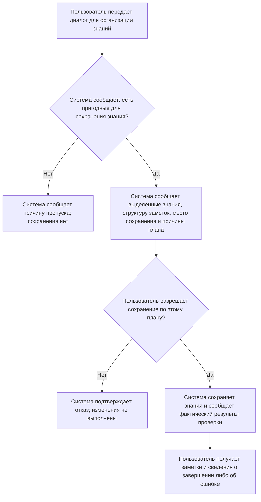

# Пользовательские сценарии

**AI Knowledge Agent | Из диалога с ИИ в личную базу знаний**

Практическая работа: целевая аудитория, пользовательские истории, границы MVP и сценарии обмена информацией.

## 1. Введение

Цель работы состоит в том, чтобы описать, как пользователь превращает диалог с ИИ в заметки для личной базы знаний. Для этого нужно выделить группы пользователей, составить не менее двух историй для каждой группы, выбрать истории для MVP и описать обмен информацией между пользователем и системой. Сценарии должны передавать содержание сообщений и решений без названий элементов интерфейса и способов управления ими.

## 2. Продукт и целевая аудитория

AI Knowledge Agent превращает диалоги с ИИ в структурированные заметки в Obsidian. В них сохраняются темы, связанные понятия, вопросы и объяснения, которые нужны для повторения и дальнейшей работы. Перед сохранением система сообщает план, после выполнения сообщает результат.

### Группа A. Студенты и самостоятельные учащиеся

**Контекст.** Изучают программирование, ИИ и другие предметы с помощью длинных диалогов. Используют или готовы использовать Obsidian для личных заметок.

**Проблема.** Нужные объяснения остаются в истории переписки. Перечитывать весь разговор долго; при ручном конспектировании теряются вопросы и исправленные заблуждения.

**Цель.** Получить краткий учебный материал с понятной структурой. Сохранить, что именно было непонятно и как это объяснялось в диалоге.

### Группа B. Разработчики и технические специалисты

**Контекст.** Обсуждают с ИИ технологии, алгоритмы и способы решения рабочих задач. Накапливают личную техническую базу знаний.

**Проблема.** Полезные сведения распределены по разным разговорам. Ручное перенесение занимает время, а механическое сохранение каждого термина создает множество разрозненных заметок. При пополнении базы возникают повторы и противоречия.

**Цель.** Получить технические заметки с понятной структурой и связями, использовать их в работе и контролировать изменения в своей базе.

### Основание сегментации

Группы выделены по основной цели: понять и запомнить материал либо применять технические знания в работе. Один человек может относиться к обеим группам. Описание аудитории основано на гипотезах, а не на результатах интервью. Для проверки гипотез нужно обсудить с представителями каждой группы реальные примеры сохранения диалогов.

Общая ценность продукта для обеих групп - сократить ручную обработку диалогов и получить контролируемый результат в личной базе знаний.

<!-- pagebreak -->

## 3. User Story и выбор MVP

Для каждой группы составлены три истории. Здесь используется отдельная нумерация от US-01 до US-06.

### Группа A. Учебные цели

**US-01 | MVP | Сценарий S1**

Я как студент хочу получить структурированную заметку из учебного диалога с ИИ, чтобы повторять материал без перечитывания всей переписки.

**US-02 | MVP, упрощенный вариант | Сценарий S1**

Я как самостоятельный учащийся хочу сохранить свое исходное заблуждение вместе с объяснением из диалога, чтобы при повторении понимать, в чем состояла моя ошибка.

**US-03 | После MVP, Phase 3**

Я как учащийся с накопленной базой заметок хочу связывать новые знания с уже изученными понятиями, чтобы видеть их место в общей системе знаний.

### Группа B. Рабочие и технические цели

**US-04 | MVP | Сценарий S2**

Я как разработчик хочу организовать связанные понятия из технического диалога в заметки и разделы с понятными связями, чтобы повторно использовать материал без множества разрозненных записей.

**US-05 | После MVP, Phase 3**

Я как технический специалист хочу дополнять существующую заметку новыми сведениями из диалога, чтобы развивать накопленные знания и избегать повторного описания одного понятия.

**US-06 | MVP | Сценарии S1 и S2**

Я как разработчик, ведущий личную базу знаний, хочу узнать предполагаемые изменения и разрешить их до сохранения, чтобы контролировать содержание своей базы. Эта потребность также относится к группе A.

### Почему выбраны эти истории

US-01, US-02, US-04 и US-06 охватывают весь путь: передать диалог, получить организованные знания, понять план, разрешить сохранение и узнать результат. US-02 в MVP охватывает только явно выраженные вопросы, заблуждения и объяснения при надежно определенных участниках диалога.

**Граница MVP.** Выбран объем второго этапа проекта: создание новых заметок в `inbox/`, базовая проверка повторов, связи между новыми заметками, обнаружение конфликтов и обязательное разрешение пользователя на сохранение. Обновление старых заметок, связи между старыми и новыми знаниями, восстановление версий и автономное перепланирование относятся к последующим этапам. Текущая версия проекта шире выбранного учебного MVP.

<!-- pagebreak -->

## 4. Сценарий S1. Учебный диалог становится заметкой

**Истории:** US-01, US-02, US-06. **Пользователь:** учащийся из группы A.

**Ситуация.** После обсуждения RAG с ИИ пользователь хочет сохранить объяснение и свое исправленное заблуждение. В исходном разговоре он предполагал, что в запрос модели передается вся база данных, и получил объяснение этого заблуждения.

**Предусловия.** Личная база знаний и модель настроены; сохранение в `inbox/` разрешено. Участники исходного диалога определены достаточно надежно. Для этого примера подходящей заметки о RAG при базовой проверке не найдено.

Реплики описывают обмен сведениями и решениями. Система может сообщать несколько результатов подряд; отдельный ответ пользователя на каждый из них не требуется.

| Шаг | Участник | Передаваемая информация |
|---|---|---|
| 1 | Пользователь | «Передаю мой учебный диалог о RAG для сохранения полезных знаний в личной базе». Содержание разговора включает вопрос, исходное предположение пользователя и последующее объяснение ИИ. |
| 2 | Система | «В диалоге выделена тема RAG. Найдены определение, описание процесса и объяснение исходного заблуждения. Вопрос пользователя и ответ ИИ различимы; эти сведения можно сохранить вместе». |
| 3 | Система | «Предлагаю создать в inbox/ заметку RAG: определение, основные этапы, исходное заблуждение и объяснение из диалога. Эти части относятся к одной теме, поэтому отдельные заметки для каждого фрагмента не нужны. Сохранение еще не выполнено; требуется ваше разрешение». |
| 4 | Пользователь | «Разрешаю сохранить заметку по этому плану». |
| 5 | Система | «Создана заметка inbox/RAG.md. В ней сохранены выделенные сведения и связь с исходным диалогом. Файл повторно прочитан: сохранение и структура проверены. Существующие заметки не изменены». |

### Результат и критерии успешного завершения

- Пользователь получает одну учебную заметку, соответствующую заявленной теме.
- Исходное заблуждение обозначено как позиция пользователя, а объяснение - как содержание ответа ИИ.
- Сохранение происходит после разрешения пользователя.
- Отчет содержит сведения о созданной заметке и результате проверки.

**Возможные отклонения:** повторный диалог, неясные роли, отсутствие пригодных знаний, отказ от плана или ошибка сохранения. Их продолжения описаны в разделе 6.

Сценарий описывает ожидаемый обмен информацией, а не результаты испытаний. Проверка сохранения и структуры не доказывает достоверность исходного объяснения ИИ.

<!-- pagebreak -->

## 5. Сценарий S2. Связанные технические знания

**Истории:** US-04, US-06. **Пользователь:** разработчик из группы B.

**Ситуация.** В одном диалоге обсуждались Transformer, Attention, Self-Attention и Multi-Head Attention. Пользователь хочет получить материал для дальнейшей работы и избежать разрозненных заметок на каждый термин.

**Предусловия.** База и модель настроены. Диалог содержит достаточно подробное самостоятельное объяснение Attention. В этом примере базовая проверка не выявила препятствий для создания запланированных новых заметок.

| Шаг | Участник | Передаваемая информация |
|---|---|---|
| 1 | Пользователь | «Передаю технический диалог о Transformer и механизмах внимания для организации знаний в моей базе». |
| 2 | Система | «Найдена группа связанных понятий: Transformer, Attention, Self-Attention и Multi-Head Attention. Attention подробно объясняется как самостоятельное понятие; два его варианта можно описать внутри этой темы». |
| 3 | Система | «Предлагаю создать две заметки в inbox/: Transformer и Attention. В Attention войдут разделы Self-Attention и Multi-Head Attention; заметки будут связаны между собой. Причина такого деления: сохранить общее описание архитектуры отдельно от подробного материала о внимании и не дробить варианты механизма на отдельные записи». |
| 4 | Система | «План предполагает только создание новых заметок. Существующие материалы не изменяются. Сохранение еще не выполнено; требуется ваше разрешение». |
| 5 | Пользователь | «Разрешаю сохранить эти две заметки с предложенной структурой и связью». |
| 6 | Система | «Созданы inbox/Transformer.md и inbox/Attention.md. Разделы вариантов внимания включены в Attention. Файлы и ссылки повторно проверены; в отчете указаны созданные заметки и результаты проверки». |

### Результат и критерии успешного завершения

- Получены связанные технические заметки, а не четыре записи по числу терминов.
- Система объясняет, почему одни понятия стали заметками, а другие - разделами.
- План охватывает только новые заметки и выполняется после разрешения пользователя.
- Итоговый отчет позволяет сопоставить запланированный и фактический результат.

**Другой объем материала.** В этом примере содержание разделено на две заметки. Для более короткого диалога может быть достаточно одной заметки с разделами. Число файлов зависит от содержания; система объясняет свое решение.

Если в разговоре есть еще одна несвязанная тема, система сообщает о ней отдельно и не объединяет ее с этим материалом только потому, что сведения находились в одном диалоге.

<!-- pagebreak -->

## 6. Альтернативные ветви S1 и S2

Эти ветви могут возникнуть в обоих сценариях. Система сообщает статус обработки и указывает, нужно ли решение пользователя.

### A1. Этот диалог уже передавался

**Система:** «Этот диалог уже есть в истории обработки. Можно завершить текущую попытку или повторить анализ; повторный анализ сам по себе не разрешает создание дубликатов».

**Пользователь:** «Повторный анализ не нужен».

**Итог:** текущая попытка завершается без новых заметок. Если пользователь все же запрашивает повторный анализ, после него снова требуется план и разрешение на сохранение.

### A2. Нет знаний, пригодных для сохранения

**Система:** «В разговоре найдены только ситуативные реплики либо сведения, которые нельзя уверенно выделить как самостоятельные знания. Новые заметки не созданы; причина пропуска указана».

**Пользователь:** «Передам другой диалог, содержащий нужное объяснение».

**Итог:** текущая обработка завершена без сохранения. Другой диалог обрабатывается как новый материал.

### A3. Неясно, кому принадлежит заблуждение

**Система:** «Участников диалога не удалось определить достаточно надежно. Личное заблуждение вам не приписано; это ограничение указано в результатах анализа».

**Пользователь:** «Не разрешаю сохранение этой попытки; подготовлю диалог с обозначенными участниками».

**Итог:** попытка прекращена. Уточненный материал можно передать для нового анализа.

### A4. Найдено противоречие или совпадение с имеющейся записью

**Система:** «Найдена существующая запись, которая может повторять или противоречить новому материалу. Сообщаю, какие сведения требуют проверки. Автоматическое объединение и изменение старой заметки не входят в этот MVP; спорное сохранение приостановлено».

**Пользователь:** «Не разрешаю выполнять этот план; сначала проверю исходные материалы».

**Итог:** план отклонен, существующая запись не изменена. Базовая проверка MVP не гарантирует обнаружение всех смысловых повторов. Эта ветвь описывает действия после обнаружения проблемы.

### A5. Пользователь не согласен с планом

**Пользователь:** «Не разрешаю сохранять предложенный результат».

**Система:** «План отклонен. Запланированные изменения не выполнены».

**Итог:** завершение без сохранения. Редактирование отдельных действий плана в этот учебный MVP не включено.

### A6. Сохранение или проверка результата завершились ошибкой

**Система:** «Задача не завершена успешно. Сообщаю, какие действия выполнены, что не удалось сохранить или проверить и какие материалы требуют сверки перед повторной попыткой».

**Пользователь:** «Проверю указанный результат перед новой попыткой».

**Итог:** система не сообщает об успешном завершении. Автоматическое восстановление относится к расширенной версии и не требуется для этого сценария MVP.

<!-- pagebreak -->

## 7. Блок-схема обмена информацией

Общий путь для историй US-01, US-02, US-04 и US-06. На схеме показаны передаваемые сведения и решение пользователя. Подробные альтернативные ветви приведены в разделе 6.

**Что предоставляет пользователь:** исходный диалог и решение о разрешении сохранения.

**Что возвращает система:** выделенные знания, обоснованный план, статус выполнения и фактический результат. При проблеме система сообщает ее причину и то, какое решение или уточнение требуется.

**Граница ответственности:** пользователь решает, подходит ли результат для его базы. Система выполняет разрешенную задачу и проверяет сохраненные файлы.

<!-- pagebreak -->

## 8. Агентная система и ее компоненты

ИИ-агент объединяет языковую модель, инструменты, управление контекстом и процесс выполнения задачи. Он получает цель, предлагает план, выполняет разрешенные действия через инструменты и проверяет результат. В AI Knowledge Agent цель состоит в том, чтобы превратить диалог в заметки для личной базы знаний.

### Основные компоненты

- **Языковая модель (LLM).** Понимает содержание диалога, выбирает знания для сохранения и предлагает структуру заметок.
- **Инструменты.** Читают и ищут заметки, сохраняют новые файлы, проверяют их структуру и ссылки.
- **Управление контекстом.** Передает модели нужные части исходного диалога, связанные заметки и состояние задачи. Длинные диалоги обрабатываются по частям.
- **Архитектура.** Связывает этапы анализа, планирования, подтверждения, выполнения и проверки. Программа контролирует права записи и обработку ошибок.

### Сравнение с LLM и обычной программой

| Аспект | Чат с LLM без инструментов | Программа на заданных правилах | AI Knowledge Agent |
|---|---|---|---|
| Обработка содержания | Формирует ответ по запросу | Применяет заранее заданные правила | Модель понимает диалог, оценивает знания и их связи |
| План | Может описать план текстом | Порядок действий определяется правилами | Модель предлагает структуру заметок и план сохранения по содержанию диалога |
| Выполнение | В основном возвращает текст | Выполняет предусмотренные операции | Инструменты выполняют разрешенный план |
| Результат | Ответ или совет | Результат предусмотренной функции | Заметки в Obsidian и отчет о проверке |

Обычная программа тоже может вызывать инструменты и хранить состояние. В нашем проекте модель принимает смысловые решения и предлагает план, а программа управляет его выполнением и проверкой. Чат с инструментами также может обладать агентными функциями.

В проекте используется заданный рабочий процесс с ограниченной самостоятельностью модели. В зависимости от содержания система предлагает одну заметку, несколько связанных заметок или пропуск материала. В MVP каждое сохранение требует разрешения пользователя. Проверка файлов подтверждает результат сохранения, но не истинность всех утверждений в исходном диалоге.

## 9. Заключение

Для двух групп пользователей составлены шесть историй; четыре выбраны для MVP. Два основных сценария и шесть альтернативных ветвей описывают подготовку учебных и технических заметок, решения пользователя и условия завершения задачи. Модель предлагает план, а программа контролирует разрешение на запись, сохранение и проверку файлов.
